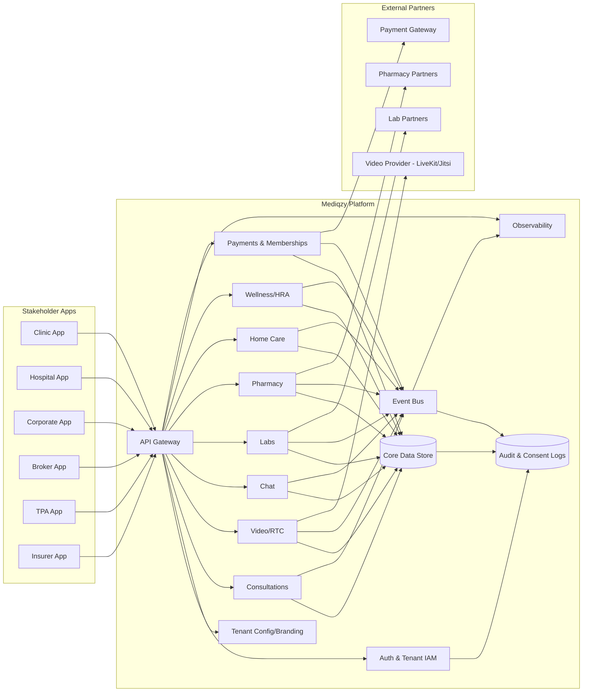
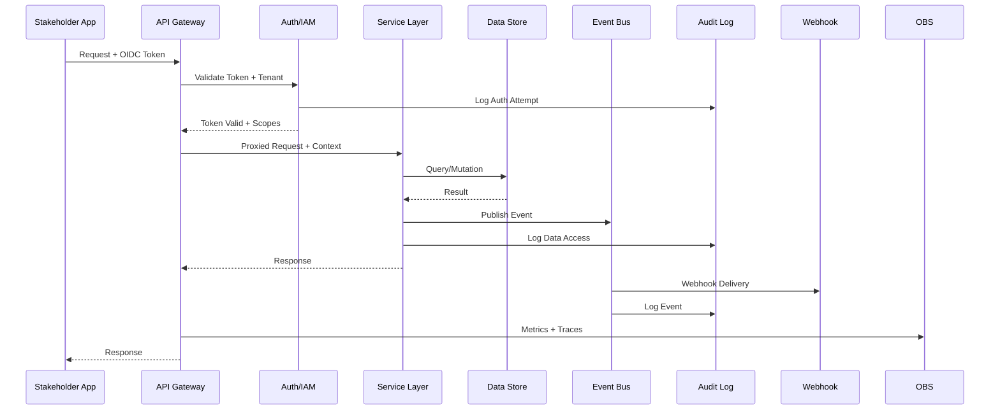
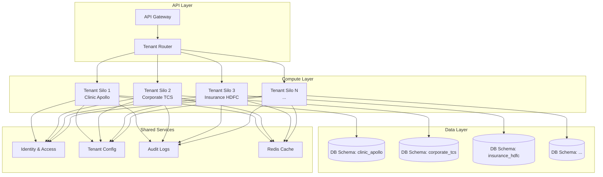

# 🏗️ MEDIQZY PLATFORM ARCHITECTURE & COMPLIANCE SPECIFICATION
## Complete System Design, API Contract, and Security Framework

**Platform**: Mediqzy Wellness Integration Platform  
**Version**: v1.0  
**Date**: February 6, 2026  
**Document Type**: Architecture & Compliance Specification

---

## 📐 1. ARCHITECTURE DIAGRAM SPECIFICATION

### System Architecture Overview



### Detailed Data Flow Diagram



### Multi-Tenant Isolation Architecture



### Architecture Component Notes

#### **API Gateway**
- **Responsibilities**:
  - Tenant identification and routing
  - Rate limiting (per tenant, per endpoint)
  - Request/response logging
  - SSL/TLS termination
  - API key validation
  - Distributed tracing (correlation IDs)
  
- **Technology Stack**:
  - Kong API Gateway / AWS API Gateway / Azure API Management
  - Redis for rate limiting
  - DataDog/New Relic for observability

- **Tenant Scoping**:
  - Header: `X-Tenant-Id: clinic-apollo`
  - Path-based: `/v1/{tenant-id}/...`
  - Validates tenant exists and is active
  - Enforces tenant-specific rate limits

#### **Auth & Tenant IAM**
- **Authentication Methods**:
  - OIDC/OAuth 2.0 federation (Google, Azure AD, Okta)
  - SAML 2.0 for enterprise SSO
  - API keys for service-to-service
  - JWT bearer tokens (RS256 signed)

- **Authorization**:
  - Role-Based Access Control (RBAC)
  - Attribute-Based Access Control (ABAC)
  - Tenant-scoped permissions
  - Service-level scopes (appointments.*, consultations.*)

- **Token Exchange**:
  - OIDC token → Mediqzy access token
  - Short-lived tokens (1 hour)
  - Refresh token rotation
  - Claims enrichment (tenant, roles, scopes)

#### **Tenant Config/Branding**
- **Configuration Storage**:
  - Tenant metadata (name, type, tier)
  - Feature flags (video enabled, pharmacy enabled)
  - Branding (logo, colors, custom domain)
  - Business rules (approval workflows, pricing)
  - Integration settings (webhook URLs, API keys)

- **Dynamic Configuration**:
  - Real-time updates without deployment
  - A/B testing capabilities
  - Gradual rollout controls

#### **Event Bus**
- **Architecture**:
  - Apache Kafka / AWS EventBridge / Azure Event Grid
  - Topic-based pub/sub model
  - Event sourcing for audit trails
  - Dead letter queues for failures

- **Event Types**:
  - Domain events (appointment.created, consultation.completed)
  - System events (tenant.created, user.deactivated)
  - Integration events (webhook.delivered, webhook.failed)

- **Guarantees**:
  - At-least-once delivery
  - Ordered within partition/tenant
  - Event replay capability
  - TTL-based retention (90 days)

#### **Core Data Store**
- **Database Architecture**:
  - PostgreSQL (primary transactional DB)
  - MongoDB (unstructured/documents)
  - Redis (caching, session store)
  - Elasticsearch (search, analytics)

- **Tenant Isolation**:
  - **Schema-per-tenant**: Separate database schemas
  - Row-level security (RLS) policies
  - Encrypted at rest (AES-256)
  - Backup isolation

- **Data Models**:
  - Users, Patients, Doctors
  - Appointments, Consultations
  - Prescriptions, Lab Reports
  - Wellness Plans, HRA Results
  - Transactions, Claims

#### **Audit & Consent Logs**
- **Audit Trail**:
  - Immutable append-only logs
  - Who accessed what data when
  - All mutations logged with before/after state
  - API request/response logging
  - Authentication/authorization events

- **Consent Management**:
  - Explicit consent records
  - Consent version tracking
  - Withdrawal timestamps
  - Purpose-based consent
  - GDPR/DPDP compliance

- **Retention**:
  - Audit logs: 7 years (regulatory requirement)
  - Consent logs: Lifetime + 7 years
  - Write-once-read-many (WORM) storage

#### **Service Modules**

**C1: Consultations**
- Appointment booking and management
- Doctor-patient matching
- Scheduling and calendar sync
- Prescription generation
- Follow-up management

**C2: Video/RTC**
- LiveKit/Jitsi integration
- Canonical meeting ID generation (`apt-{id}-{hash}`)
- Token-based room access
- Recording and transcription
- Screen sharing, chat overlay

**C3: Chat**
- Real-time messaging (WebSocket)
- File/image attachments
- Encrypted messages
- Chat history and search
- Doctor-patient conversations

**C4: Labs**
- Lab directory and search
- Test catalog management
- Booking and scheduling
- Sample collection tracking
- Report delivery and storage

**C5: Pharmacy**
- Medicine catalog and search
- Prescription validation
- Order management
- Inventory check
- Delivery tracking

**C6: Home Care**
- Service directory (nursing, physiotherapy)
- Professional matching
- Scheduling and routing
- Service tracking
- Quality ratings

**C7: Wellness/HRA**
- Health Risk Assessment engine
- Personalized wellness plans
- Activity tracking integration
- Goal setting and monitoring
- Coach assignment

**C8: Payments & Memberships**
- Payment processing
- Insurance claim handling
- Membership/subscription plans
- Wallet and credits
- Invoice generation

#### **Observability**
- **Metrics**: Prometheus, CloudWatch, Azure Monitor
- **Logs**: ELK Stack, Splunk, Azure Log Analytics
- **Traces**: Jaeger, Zipkin, Application Insights
- **Dashboards**: Grafana, Kibana
- **Alerts**: PagerDuty, Opsgenie

---

## 📋 2. API CONTRACT OUTLINE (v1)

### Base Configuration

**Base URL**
```
Production:  https://api.mediqzy.com/v1
Staging:     https://api-staging.mediqzy.com/v1
Sandbox:     https://api-sandbox.mediqzy.com/v1
```

**Required Headers**
```http
X-Tenant-Id: <tenant_id>           # Required on all requests
Authorization: Bearer <token>       # OAuth2/OIDC token
Content-Type: application/json
X-Request-ID: <uuid>               # Optional, for tracing
X-Idempotency-Key: <key>          # Optional, for idempotent operations
```

### 2.1 Authentication / SSO

#### Exchange External Token for Mediqzy Token
```http
POST /auth/exchange
Content-Type: application/json

{
  "provider_token": "eyJhbGciOiJSUzI1NiIs...",
  "provider": "azure_ad",
  "external_user_id": "user@apollo.com",
  "role": "patient"
}

Response: 200 OK
{
  "access_token": "mz_eyJhbGciOiJIUzI1NiIs...",
  "refresh_token": "mz_refresh_abc123...",
  "token_type": "Bearer",
  "expires_in": 3600,
  "user_id": "USR12345",
  "tenant_id": "clinic-apollo",
  "scopes": ["appointments.*", "consultations.*"]
}
```

#### Refresh Access Token
```http
POST /auth/refresh
Content-Type: application/json

{
  "refresh_token": "mz_refresh_abc123..."
}

Response: 200 OK
{
  "access_token": "mz_eyJhbGciOiJIUzI1NiIs...",
  "expires_in": 3600
}
```

#### Logout / Revoke Token
```http
POST /auth/revoke
Content-Type: application/json

{
  "token": "mz_eyJhbGciOiJIUzI1NiIs..."
}

Response: 200 OK
{
  "revoked": true
}
```

### 2.2 User / Patient Management

#### Create Patient
```http
POST /users
Content-Type: application/json

{
  "external_user_id": "user@apollo.com",
  "email": "john.doe@example.com",
  "phone": "+91-9876543210",
  "first_name": "John",
  "last_name": "Doe",
  "date_of_birth": "1990-05-15",
  "gender": "male",
  "address": {
    "line1": "123 Main Street",
    "city": "Mumbai",
    "state": "Maharashtra",
    "pincode": "400001",
    "country": "IN"
  },
  "emergency_contact": {
    "name": "Jane Doe",
    "phone": "+91-9876543211",
    "relation": "spouse"
  },
  "tenant_meta": {
    "employee_id": "EMP001",
    "policy_number": "POL123456"
  }
}

Response: 201 Created
{
  "user_id": "USR12345",
  "external_user_id": "user@apollo.com",
  "email": "john.doe@example.com",
  "phone": "+91-9876543210",
  "profile_complete": false,
  "created_at": "2026-02-06T14:00:00Z"
}
```

#### Get Patient Profile
```http
GET /users/{user_id}

Response: 200 OK
{
  "user_id": "USR12345",
  "email": "john.doe@example.com",
  "phone": "+91-9876543210",
  "first_name": "John",
  "last_name": "Doe",
  "date_of_birth": "1990-05-15",
  "gender": "male",
  "address": {...},
  "emergency_contact": {...},
  "tenant_meta": {...},
  "created_at": "2026-02-06T14:00:00Z",
  "updated_at": "2026-02-06T14:00:00Z"
}
```

#### Update Patient Profile
```http
PATCH /users/{user_id}
Content-Type: application/json

{
  "phone": "+91-9876543299",
  "address": {
    "line1": "456 New Street",
    "city": "Mumbai",
    "state": "Maharashtra",
    "pincode": "400053"
  }
}

Response: 200 OK
{
  "user_id": "USR12345",
  "phone": "+91-9876543299",
  "address": {...},
  "updated_at": "2026-02-06T15:00:00Z"
}
```

### 2.3 Doctor Search & Availability

#### Search Doctors
```http
GET /doctors?specialty=cardiology&location=Mumbai&language=English&gender=female&available_today=true&rating_min=4.5&limit=20&page=1

Response: 200 OK
{
  "doctors": [
    {
      "doctor_id": "DOC67890",
      "name": "Dr. Sarah Johnson",
      "specialty": "Cardiology",
      "sub_specialty": "Interventional Cardiology",
      "qualification": "MBBS, MD, DM (Cardiology)",
      "experience_years": 15,
      "languages": ["English", "Hindi"],
      "gender": "female",
      "rating": 4.8,
      "total_reviews": 1234,
      "consultation_fee": 1000,
      "currency": "INR",
      "consultation_types": ["online", "offline"],
      "availability": {
        "today": true,
        "next_available_slot": "2026-02-06T16:00:00Z"
      },
      "hospital_affiliations": ["Apollo Hospital Mumbai"],
      "profile_image": "https://cdn.mediqzy.com/doctors/DOC67890.jpg"
    }
  ],
  "pagination": {
    "total": 45,
    "page": 1,
    "per_page": 20,
    "total_pages": 3
  }
}
```

#### Get Doctor Details
```http
GET /doctors/{doctor_id}

Response: 200 OK
{
  "doctor_id": "DOC67890",
  "name": "Dr. Sarah Johnson",
  "specialty": "Cardiology",
  "qualification": "MBBS, MD, DM (Cardiology)",
  "experience_years": 15,
  "bio": "Board-certified cardiologist with 15 years of experience...",
  "consultation_fee": 1000,
  "languages": ["English", "Hindi"],
  "working_hours": {
    "monday": [{"start": "09:00", "end": "17:00"}],
    "tuesday": [{"start": "09:00", "end": "17:00"}]
  },
  "education": [...],
  "awards": [...],
  "publications": [...]
}
```

#### Get Doctor Availability
```http
GET /doctors/{doctor_id}/availability?date=2026-02-10&type=online

Response: 200 OK
{
  "doctor_id": "DOC67890",
  "date": "2026-02-10",
  "consultation_type": "online",
  "available_slots": [
    {
      "slot_id": "SLOT001",
      "start_time": "09:00",
      "end_time": "09:30",
      "available": true,
      "fee": 1000
    },
    {
      "slot_id": "SLOT002",
      "start_time": "09:30",
      "end_time": "10:00",
      "available": true,
      "fee": 1000
    },
    {
      "slot_id": "SLOT003",
      "start_time": "10:00",
      "end_time": "10:30",
      "available": false,
      "fee": 1000,
      "reason": "booked"
    }
  ]
}
```

### 2.4 Appointments

#### Create Appointment
```http
POST /appointments
Content-Type: application/json

{
  "doctor_id": "DOC67890",
  "user_id": "USR12345",
  "schedule": {
    "date": "2026-02-10",
    "start_time": "09:00",
    "end_time": "09:30"
  },
  "type": "online",
  "symptoms": "Chest pain and shortness of breath",
  "preferred_language": "English",
  "insurance_policy_id": "POL123456",
  "tenant_meta": {
    "source": "mobile_app",
    "campaign": "wellness_feb_2026"
  }
}

Response: 201 Created
{
  "appointment_id": 12345,
  "appointment_number": "MED000012345",
  "doctor_id": "DOC67890",
  "doctor_name": "Dr. Sarah Johnson",
  "user_id": "USR12345",
  "patient_name": "John Doe",
  "schedule": {
    "date": "2026-02-10",
    "start_time": "09:00",
    "end_time": "09:30",
    "timezone": "Asia/Kolkata"
  },
  "type": "online",
  "status": "confirmed",
  "meeting_details": {
    "room_id": "apt-12345-a1b2c3d4",
    "join_url": "https://meet.mediqzy.com/apt-12345-a1b2c3d4",
    "provider": "livekit"
  },
  "payment": {
    "consultation_fee": 1000,
    "insurance_covered": 800,
    "copay": 200,
    "currency": "INR",
    "status": "pending"
  },
  "created_at": "2026-02-06T14:30:00Z"
}
```

#### Get Appointment Details
```http
GET /appointments/{appointment_id}

Response: 200 OK
{
  "appointment_id": 12345,
  "appointment_number": "MED000012345",
  "doctor": {...},
  "patient": {...},
  "schedule": {...},
  "type": "online",
  "status": "confirmed",
  "meeting_details": {...},
  "prescription": null,
  "created_at": "2026-02-06T14:30:00Z",
  "updated_at": "2026-02-06T14:30:00Z"
}
```

#### Update Appointment (Reschedule/Cancel)
```http
PATCH /appointments/{appointment_id}
Content-Type: application/json

{
  "action": "reschedule",
  "schedule": {
    "date": "2026-02-11",
    "start_time": "10:00",
    "end_time": "10:30"
  },
  "reason": "Patient request"
}

Response: 200 OK
{
  "appointment_id": 12345,
  "status": "rescheduled",
  "old_schedule": {...},
  "new_schedule": {...},
  "updated_at": "2026-02-06T15:00:00Z"
}

# Cancel
{
  "action": "cancel",
  "reason": "Patient unavailable",
  "refund_required": true
}

Response: 200 OK
{
  "appointment_id": 12345,
  "status": "cancelled",
  "refund_amount": 200,
  "refund_status": "initiated",
  "cancelled_at": "2026-02-06T15:00:00Z"
}
```

#### List Appointments
```http
GET /appointments?user_id=USR12345&status=upcoming&limit=10&page=1

Response: 200 OK
{
  "appointments": [...],
  "pagination": {...}
}

GET /appointments?doctor_id=DOC67890&date=2026-02-10

Response: 200 OK
{
  "appointments": [...],
  "pagination": {...}
}
```

### 2.5 Video Consultation

#### Get Video Access Token
```http
POST /video/token
Content-Type: application/json

{
  "appointment_id": 12345,
  "user_role": "patient"
}

Response: 200 OK
{
  "room_id": "apt-12345-a1b2c3d4",
  "token": "eyJhbGciOiJIUzI1NiIs...",
  "server_url": "wss://video.mediqzy.com",
  "join_url": "https://meet.mediqzy.com/apt-12345-a1b2c3d4",
  "participant_identity": "patient-USR12345",
  "participant_name": "John Doe",
  "expires_at": "2026-02-06T16:00:00Z",
  "settings": {
    "max_duration_minutes": 30,
    "recording_enabled": true,
    "screen_share_enabled": true,
    "chat_enabled": true
  }
}
```

#### Get Room Status
```http
GET /video/room/{room_id}/status

Response: 200 OK
{
  "room_id": "apt-12345-a1b2c3d4",
  "status": "active",
  "participants": [
    {
      "identity": "patient-USR12345",
      "name": "John Doe",
      "role": "patient",
      "joined_at": "2026-02-10T09:00:00Z"
    },
    {
      "identity": "doctor-DOC67890",
      "name": "Dr. Sarah Johnson",
      "role": "doctor",
      "joined_at": "2026-02-10T09:01:00Z"
    }
  ],
  "started_at": "2026-02-10T09:00:00Z",
  "recording_url": null
}
```

### 2.6 Chat

#### Create Chat Room
```http
POST /chat/rooms
Content-Type: application/json

{
  "appointment_id": 12345,
  "participants": ["USR12345", "DOC67890"]
}

Response: 201 Created
{
  "room_id": "CHAT789",
  "appointment_id": 12345,
  "participants": [...],
  "created_at": "2026-02-10T09:00:00Z"
}
```

#### Send Message
```http
POST /chat/rooms/{room_id}/messages
Content-Type: application/json

{
  "sender_id": "USR12345",
  "message_type": "text",
  "content": "I have severe chest pain",
  "attachments": []
}

Response: 201 Created
{
  "message_id": "MSG456",
  "room_id": "CHAT789",
  "sender_id": "USR12345",
  "message_type": "text",
  "content": "I have severe chest pain",
  "timestamp": "2026-02-10T09:05:00Z",
  "read": false
}
```

#### Get Chat History
```http
GET /chat/rooms/{room_id}/messages?limit=50&before=MSG456

Response: 200 OK
{
  "messages": [
    {
      "message_id": "MSG456",
      "sender_id": "USR12345",
      "sender_name": "John Doe",
      "content": "I have severe chest pain",
      "timestamp": "2026-02-10T09:05:00Z",
      "read": true
    }
  ],
  "pagination": {...}
}
```

### 2.7 Labs

#### Get Lab Tests Catalog
```http
GET /labs/tests?category=blood&search=hemoglobin

Response: 200 OK
{
  "tests": [
    {
      "test_id": "TEST001",
      "name": "Complete Blood Count (CBC)",
      "category": "blood",
      "description": "Measures blood cells and hemoglobin levels",
      "preparation_required": true,
      "preparation_instructions": "Fasting for 8-12 hours",
      "sample_type": "blood",
      "turnaround_time_hours": 24,
      "price_range": {
        "min": 300,
        "max": 500,
        "currency": "INR"
      }
    }
  ]
}
```

#### Book Lab Test
```http
POST /labs/bookings
Content-Type: application/json

{
  "user_id": "USR12345",
  "test_ids": ["TEST001", "TEST002"],
  "lab_id": "LAB001",
  "collection_type": "home",
  "collection_address": {
    "line1": "123 Main Street",
    "city": "Mumbai",
    "state": "Maharashtra",
    "pincode": "400001"
  },
  "preferred_date": "2026-02-11",
  "preferred_time_slot": "09:00-12:00",
  "prescription_id": "PRES123",
  "insurance_claim": true
}

Response: 201 Created
{
  "booking_id": "LABBOOK456",
  "booking_number": "LAB000456",
  "user_id": "USR12345",
  "lab_id": "LAB001",
  "lab_name": "PathLabs Mumbai",
  "tests": [...],
  "collection_type": "home",
  "collection_date": "2026-02-11",
  "collection_time": "09:00-12:00",
  "total_amount": 1500,
  "insurance_covered": 1200,
  "copay": 300,
  "status": "confirmed",
  "created_at": "2026-02-06T14:30:00Z"
}
```

#### Get Lab Booking Details
```http
GET /labs/bookings/{booking_id}

Response: 200 OK
{
  "booking_id": "LABBOOK456",
  "booking_number": "LAB000456",
  "status": "sample_collected",
  "tests": [...],
  "collection_details": {...},
  "reports": [
    {
      "report_id": "REPORT123",
      "test_id": "TEST001",
      "test_name": "Complete Blood Count",
      "status": "available",
      "report_url": "https://reports.mediqzy.com/REPORT123.pdf",
      "critical_values": false,
      "completed_at": "2026-02-12T10:00:00Z"
    }
  ]
}
```

### 2.8 Pharmacy

#### Create Prescription
```http
POST /prescriptions
Content-Type: application/json

{
  "appointment_id": 12345,
  "doctor_id": "DOC67890",
  "patient_id": "USR12345",
  "medications": [
    {
      "medicine_name": "Paracetamol 500mg",
      "dosage": "1 tablet",
      "frequency": "3 times daily",
      "duration_days": 5,
      "instructions": "Take after meals"
    }
  ],
  "diagnosis": "Viral fever",
  "notes": "Rest and hydration recommended"
}

Response: 201 Created
{
  "prescription_id": "PRES123",
  "prescription_number": "RX000123",
  "appointment_id": 12345,
  "doctor_id": "DOC67890",
  "patient_id": "USR12345",
  "medications": [...],
  "diagnosis": "Viral fever",
  "prescription_url": "https://prescriptions.mediqzy.com/PRES123.pdf",
  "valid_until": "2026-05-06",
  "created_at": "2026-02-06T14:30:00Z"
}
```

#### Get Prescription
```http
GET /prescriptions/{prescription_id}

Response: 200 OK
{
  "prescription_id": "PRES123",
  "prescription_number": "RX000123",
  "doctor": {...},
  "patient": {...},
  "medications": [...],
  "diagnosis": "Viral fever",
  "prescription_url": "https://prescriptions.mediqzy.com/PRES123.pdf",
  "valid_until": "2026-05-06",
  "created_at": "2026-02-06T14:30:00Z"
}
```

#### Create Pharmacy Order
```http
POST /pharmacy/orders
Content-Type: application/json

{
  "user_id": "USR12345",
  "prescription_id": "PRES123",
  "items": [
    {
      "medicine_id": "MED001",
      "medicine_name": "Paracetamol 500mg",
      "quantity": 10,
      "unit_price": 25
    }
  ],
  "delivery_address": {
    "line1": "123 Main Street",
    "city": "Mumbai",
    "state": "Maharashtra",
    "pincode": "400001"
  },
  "delivery_type": "standard",
  "payment_method": "online",
  "insurance_claim": true
}

Response: 201 Created
{
  "order_id": "PHARM789",
  "order_number": "PH000789",
  "user_id": "USR12345",
  "prescription_id": "PRES123",
  "items": [...],
  "subtotal": 250,
  "delivery_charges": 50,
  "total_amount": 300,
  "insurance_covered": 200,
  "copay": 100,
  "payment_status": "pending",
  "delivery_status": "pending",
  "estimated_delivery": "2026-02-08",
  "created_at": "2026-02-06T14:30:00Z"
}
```

#### Get Pharmacy Order
```http
GET /pharmacy/orders/{order_id}

Response: 200 OK
{
  "order_id": "PHARM789",
  "order_number": "PH000789",
  "status": "delivered",
  "items": [...],
  "tracking": {
    "status": "delivered",
    "current_location": "Delivered",
    "delivered_at": "2026-02-08T18:30:00Z",
    "timeline": [...]
  },
  "invoice_url": "https://invoices.mediqzy.com/PHARM789.pdf"
}
```

### 2.9 Home Care

#### Get Home Care Services
```http
GET /homecare/services?type=nursing&location=Mumbai

Response: 200 OK
{
  "services": [
    {
      "service_id": "HCS001",
      "service_type": "nursing",
      "service_name": "Post-Surgery Nursing Care",
      "provider": "CareNow Healthcare",
      "description": "Professional nursing care at home",
      "qualifications": ["BSc Nursing", "5+ years experience"],
      "services_included": [
        "Wound dressing",
        "Medication administration",
        "Vital monitoring"
      ],
      "price_per_visit": 1500,
      "price_per_day": 3500,
      "currency": "INR",
      "rating": 4.7,
      "available_from": "2026-02-07"
    }
  ]
}
```

#### Book Home Care Service
```http
POST /homecare/bookings
Content-Type: application/json

{
  "user_id": "USR12345",
  "service_id": "HCS001",
  "service_type": "nursing",
  "start_date": "2026-02-08",
  "duration_days": 7,
  "visits_per_day": 2,
  "service_address": {
    "line1": "123 Main Street",
    "city": "Mumbai",
    "state": "Maharashtra",
    "pincode": "400001"
  },
  "preferred_time_slots": ["09:00-10:00", "18:00-19:00"],
  "special_instructions": "Patient recovering from knee surgery",
  "insurance_claim": true
}

Response: 201 Created
{
  "booking_id": "HCB456",
  "booking_number": "HC000456",
  "user_id": "USR12345",
  "service_type": "nursing",
  "provider": "CareNow Healthcare",
  "professional": {
    "name": "Nurse Priya Sharma",
    "qualification": "BSc Nursing",
    "experience": "7 years",
    "phone": "+91-9876543210"
  },
  "schedule": {
    "start_date": "2026-02-08",
    "end_date": "2026-02-14",
    "visits_per_day": 2,
    "total_visits": 14
  },
  "total_amount": 21000,
  "insurance_covered": 18000,
  "copay": 3000,
  "status": "confirmed",
  "created_at": "2026-02-06T14:30:00Z"
}
```

### 2.10 Wellness / HRA

#### Create HRA Assessment
```http
POST /wellness/hra/assessments
Content-Type: application/json

{
  "user_id": "USR12345",
  "assessment_type": "comprehensive",
  "responses": {
    "age": 35,
    "gender": "male",
    "height": 175,
    "weight": 78,
    "smoking": false,
    "alcohol_consumption": "social",
    "exercise_frequency": "3_times_week",
    "family_history": {
      "diabetes": true,
      "heart_disease": false,
      "hypertension": true
    },
    "current_medications": ["Metformin"],
    "chronic_conditions": ["Pre-diabetes"],
    "stress_level": "moderate",
    "sleep_hours": 7,
    "diet_type": "vegetarian"
  }
}

Response: 201 Created
{
  "assessment_id": "HRA456",
  "user_id": "USR12345",
  "assessment_date": "2026-02-06",
  "status": "completed",
  "risk_score": 65,
  "risk_category": "moderate",
  "risk_factors": [
    {
      "factor": "Pre-diabetes",
      "severity": "high",
      "recommendation": "Regular blood sugar monitoring"
    }
  ],
  "recommendations": [
    "Increase physical activity to 5 times per week",
    "Consultation with endocrinologist",
    "Diet modification for diabetes prevention"
  ],
  "next_assessment_due": "2026-08-06",
  "report_url": "https://reports.mediqzy.com/hra/HRA456.pdf",
  "created_at": "2026-02-06T14:30:00Z"
}
```

#### Get HRA Assessment
```http
GET /wellness/hra/assessments/{assessment_id}

Response: 200 OK
{
  "assessment_id": "HRA456",
  "user_id": "USR12345",
  "assessment_date": "2026-02-06",
  "risk_score": 65,
  "risk_category": "moderate",
  "detailed_analysis": {...},
  "recommendations": [...],
  "report_url": "https://reports.mediqzy.com/hra/HRA456.pdf"
}
```

#### Get Wellness Plan Recommendations
```http
POST /wellness/plan/recommendations
Content-Type: application/json

{
  "user_id": "USR12345",
  "assessment_id": "HRA456",
  "goals": ["weight_loss", "diabetes_prevention", "stress_management"]
}

Response: 200 OK
{
  "plans": [
    {
      "plan_id": "WP001",
      "name": "Diabetes Prevention Program",
      "duration_months": 6,
      "features": [
        "Personalized diet plan",
        "Exercise regimen",
        "Regular health monitoring",
        "Coach support"
      ],
      "expected_outcomes": [
        "5-7% weight loss",
        "Improved blood sugar levels",
        "Reduced diabetes risk"
      ],
      "price": 15000,
      "currency": "INR"
    }
  ]
}
```

### 2.11 Webhooks

#### Register Webhook
```http
POST /webhooks
Content-Type: application/json

{
  "url": "https://your-app.com/webhooks/mediqzy",
  "events": [
    "appointment.created",
    "appointment.status_changed",
    "lab.booking.status",
    "prescription.ready",
    "pharmacy.order.status",
    "video.session.started",
    "video.session.ended"
  ],
  "secret": "your_webhook_secret_key",
  "active": true
}

Response: 201 Created
{
  "webhook_id": "WH123",
  "url": "https://your-app.com/webhooks/mediqzy",
  "events": [...],
  "status": "active",
  "created_at": "2026-02-06T14:30:00Z"
}
```

#### Webhook Event Types

| Event | Description | Payload |
|-------|-------------|---------|
| `appointment.created` | New appointment booked | Appointment object |
| `appointment.status_changed` | Status updated (confirmed/cancelled/rescheduled) | Status change details |
| `lab.booking.status` | Lab booking status update | Booking status |
| `prescription.ready` | Prescription created | Prescription ID |
| `pharmacy.order.status` | Pharmacy order status | Order tracking |
| `video.session.started` | Video consultation started | Session details |
| `video.session.ended` | Video consultation ended | Session summary |

### 2.12 Error Format

```json
{
  "error": {
    "code": "APPOINTMENT_NOT_FOUND",
    "message": "Appointment with ID 12345 not found",
    "details": {
      "appointment_id": 12345,
      "tenant_id": "clinic-apollo"
    },
    "request_id": "req_abc123",
    "timestamp": "2026-02-06T14:30:00Z"
  }
}
```

#### Standard Error Codes

| HTTP Status | Error Code | Description |
|-------------|------------|-------------|
| 400 | `INVALID_REQUEST` | Malformed request body |
| 400 | `VALIDATION_ERROR` | Field validation failed |
| 401 | `UNAUTHORIZED` | Missing or invalid token |
| 403 | `FORBIDDEN` | Insufficient permissions |
| 404 | `NOT_FOUND` | Resource not found |
| 409 | `CONFLICT` | Resource already exists |
| 429 | `RATE_LIMIT_EXCEEDED` | Too many requests |
| 500 | `INTERNAL_ERROR` | Server error |
| 503 | `SERVICE_UNAVAILABLE` | Service temporarily down |

---

## 🔒 3. SECURITY & COMPLIANCE CHECKLIST

### 3.1 Identity & Access Management

#### Authentication
- [x] **OIDC/SAML Federation**: Support for enterprise identity providers
  - Azure AD, Okta, Google Workspace integration
  - Single Sign-On (SSO) for corporate tenants
  - Multi-factor authentication (MFA) support
  - Session management with secure cookies

- [x] **Token Exchange**: Secure conversion of external tokens to Mediqzy tokens
  - OIDC token validation
  - JWT signing with RS256 algorithm
  - Short-lived access tokens (1 hour)
  - Refresh token rotation
  - Token revocation support

- [x] **API Key Management**: Service-to-service authentication
  - API key generation and rotation
  - Scoped API keys (per service/endpoint)
  - Key expiration policies
  - Key usage audit logs

#### Authorization
- [x] **Role-Based Access Control (RBAC)**
  - Roles: `patient`, `doctor`, `clinic_admin`, `corporate_admin`, `tpa_admin`, `insurance_admin`
  - Hierarchical role inheritance
  - Dynamic role assignment
  - Role-based UI customization

- [x] **Least-Privilege Principle**
  - Granular scopes: `appointments:read`, `appointments:write`, `consultations:video`
  - Resource-level permissions
  - Time-based access (temporary elevated privileges)
  - Just-in-time (JIT) access for sensitive operations

- [x] **Tenant Isolation**
  - Cross-tenant data access prevention
  - Tenant ID validation on every request
  - Database-level tenant isolation
  - Separate encryption keys per tenant

### 3.2 Data Protection

#### Encryption
- [x] **Encryption at Rest**
  - AES-256 encryption for all stored data
  - Transparent Data Encryption (TDE) for databases
  - Field-level encryption for PHI/PII
  - Encrypted backups

- [x] **Encryption in Transit**
  - TLS 1.3 for all API communications
  - Certificate pinning for mobile apps
  - End-to-end encryption for chat messages
  - Encrypted video streams (SRTP)

- [x] **Key Management**
  - AWS KMS / Azure Key Vault / Google Cloud KMS
  - Hardware Security Modules (HSM) for production
  - Automated key rotation (90 days)
  - Key access audit logs

#### Data Isolation
- [x] **Per-Tenant Data Segregation**
  - Separate database schemas per tenant
  - Row-level security (RLS) policies
  - Isolated blob storage containers
  - Tenant-specific encryption keys

- [x] **Secure Multi-Tenancy**
  - No shared resources between tenants
  - Logical data isolation at application layer
  - Physical isolation for enterprise tier
  - Regular tenant boundary testing

- [x] **Data Masking**
  - PII/PHI masking in logs
  - Redaction in non-production environments
  - Dynamic data masking for support staff
  - Anonymization for analytics

### 3.3 Audit & Consent Management

#### Audit Logging
- [x] **Comprehensive Audit Trail**
  - All data access logged (who, what, when, why)
  - Immutable append-only audit logs
  - Before/after state for mutations
  - API request/response logging
  - Authentication/authorization events

- [x] **Audit Log Retention**
  - 7-year retention for medical data
  - WORM (Write-Once-Read-Many) storage
  - Tamper-proof log storage
  - Regular audit log reviews

- [x] **Patient Access Logs**
  - Queryable access history per patient
  - Exportable for patient requests
  - Real-time access alerts for sensitive operations
  - Breach notification triggers

#### Consent Management
- [x] **Explicit Consent Logging**
  - Purpose-specific consent (treatment, marketing, research)
  - Version-controlled consent forms
  - Timestamp and IP address recording
  - Digital signature support

- [x] **Consent Withdrawal**
  - Self-service consent revocation
  - Cascading data deletion
  - Grace period for critical records
  - Withdrawal confirmation

- [x] **Data Sharing Consent**
  - Third-party sharing consent
  - Granular sharing controls (per provider, per purpose)
  - Time-limited sharing
  - Consent expiration

### 3.4 Regulatory Compliance

#### DPDP (Digital Personal Data Protection Act - India)
- [x] **Data Minimization**: Collect only necessary data
- [x] **Purpose Limitation**: Use data only for stated purposes
- [x] **Storage Limitation**: Retain data only as long as needed
- [x] **Right to Access**: Patient can access their data
- [x] **Right to Correction**: Patient can correct inaccurate data
- [x] **Right to Erasure**: Patient can request data deletion
- [x] **Right to Data Portability**: Export data in machine-readable format
- [x] **Consent Management**: Documented consent for all processing
- [x] **Data Breach Notification**: 72-hour breach notification SLA

#### HIPAA (Health Insurance Portability and Accountability Act - USA)
- [x] **Privacy Rule**: Protect PHI (Protected Health Information)
- [x] **Security Rule**: Administrative, physical, technical safeguards
- [x] **Breach Notification**: Notify affected individuals within 60 days
- [x] **Business Associate Agreements (BAA)**: Executed with all vendors
- [x] **Access Controls**: Unique user IDs, automatic logoff
- [x] **Audit Controls**: Record and examine PHI access
- [x] **Integrity Controls**: Protect PHI from alteration/destruction
- [x] **Transmission Security**: Encrypt PHI in transit

#### GDPR (General Data Protection Regulation - EU)
- [x] **Lawful Basis**: Consent, contract, legitimate interest
- [x] **Data Protection Officer (DPO)**: Appointed and contactable
- [x] **Data Protection Impact Assessment (DPIA)**: Conducted for high-risk processing
- [x] **Privacy by Design**: Privacy built into systems from inception
- [x] **Cross-Border Transfers**: Standard Contractual Clauses (SCCs)
- [x] **Right to Object**: Patients can object to processing
- [x] **Automated Decision-Making**: Transparency and human review

#### Data Residency
- [x] **Regional Data Storage**: Data stored in patient's country/region
- [x] **Data Sovereignty**: Compliance with local data laws
- [x] **Cross-Border Transfer Controls**: Restricted international transfers
- [x] **Regional Failover**: Disaster recovery within region

#### Retention Policies
- [x] **Medical Records**: 7 years post last treatment
- [x] **Audit Logs**: 7 years
- [x] **Consent Records**: Lifetime + 7 years
- [x] **Financial Records**: 7 years
- [x] **Automated Deletion**: Scheduled purge of expired data

### 3.5 Secure Integrations

#### Webhook Security
- [x] **HMAC Signature Verification**
  - SHA-256 HMAC signing
  - Signature in `X-Mediqzy-Signature` header
  - Timestamp-based replay attack prevention
  - Signature verification examples in docs

- [x] **Mutual TLS (mTLS)**: Optional for enterprise tenants
- [x] **IP Allowlisting**: Restrict webhook sources
- [x] **Retry Policy**: Exponential backoff with max 3 retries
- [x] **Dead Letter Queue**: Failed webhooks logged and alerted

#### Partner API Security
- [x] **IP Allowlist**: Whitelist partner IP addresses
- [x] **Certificate Pinning**: Pin certificates for critical partners
- [x] **API Versioning**: Backward-compatible changes only
- [x] **Rate Limiting**: Per-partner quotas
- [x] **Partner Audit**: Regular security reviews

#### Rate Limiting & DDoS Protection
- [x] **Per-Tenant Rate Limits**
  - Tiered limits: Free (100/hr), Basic (1K/hr), Pro (10K/hr), Enterprise (unlimited)
  - Separate limits per endpoint type
  - Burst allowances for spikes
  - 429 responses with `Retry-After` header

- [x] **Anomaly Detection**
  - Machine learning-based traffic analysis
  - Automated blocking of suspicious patterns
  - Geographic rate limiting
  - Bot detection and mitigation

- [x] **DDoS Protection**
  - Cloudflare / AWS Shield / Azure DDoS Protection
  - Layer 7 application-level protection
  - Challenge pages for suspicious traffic
  - Automatic IP blacklisting

### 3.6 Operational Security

#### Monitoring & Logging
- [x] **SOC-Level Logging**
  - Centralized log aggregation (ELK, Splunk)
  - Real-time log analysis
  - Correlation of security events
  - SIEM integration (Splunk, QRadar)

- [x] **Security Alerts**
  - Failed login attempts (5+ failures)
  - Privilege escalation attempts
  - Unusual data access patterns
  - API abuse detection
  - PagerDuty / Opsgenie integration

- [x] **Performance Monitoring**
  - API latency tracking (p50, p95, p99)
  - Error rate monitoring
  - Database query performance
  - Infrastructure health

#### Vulnerability Management
- [x] **Regular Security Scans**
  - Weekly automated vulnerability scans
  - Quarterly penetration testing
  - Bug bounty program
  - Dependency scanning (Snyk, Dependabot)

- [x] **Patch Management**
  - Critical patches within 24 hours
  - High severity within 7 days
  - Regular security updates
  - Zero-day vulnerability response plan

- [x] **Code Security**
  - Static Application Security Testing (SAST)
  - Dynamic Application Security Testing (DAST)
  - Secure code review process
  - Security training for developers

#### Disaster Recovery & Business Continuity
- [x] **Backup Strategy**
  - Daily automated backups
  - Point-in-time recovery (PITR)
  - Cross-region backup replication
  - Encrypted backup storage

- [x] **Recovery Objectives**
  - RPO (Recovery Point Objective): 1 hour
  - RTO (Recovery Time Objective): 4 hours
  - Regular disaster recovery drills
  - Documented runbooks

- [x] **High Availability**
  - Multi-AZ database deployment
  - Auto-scaling compute resources
  - Load balancer health checks
  - 99.9% uptime SLA

#### Incident Response
- [x] **Incident Response Plan**
  - Defined roles and responsibilities
  - Escalation procedures
  - Communication templates
  - Post-mortem process

- [x] **Breach Response**
  - Detection and containment (< 1 hour)
  - Impact assessment (< 4 hours)
  - Notification (< 72 hours)
  - Remediation and lessons learned

### 3.7 Compliance Certifications

- [x] **SOC 2 Type II**: Completed annually
- [x] **ISO 27001**: Information security management
- [x] **ISO 27701**: Privacy information management
- [x] **HIPAA Compliance**: Regular audits
- [x] **GDPR Compliance**: DPO-led assessments
- [x] **PCI DSS**: For payment processing (if applicable)

### 3.8 Privacy & User Rights

- [x] **Privacy Policy**: Clear, accessible, updated regularly
- [x] **Terms of Service**: Legally reviewed
- [x] **Cookie Policy**: GDPR-compliant consent
- [x] **Data Subject Requests**: Self-service portal for access/deletion
- [x] **Data Portability**: Export in JSON/CSV/PDF formats
- [x] **Marketing Opt-Out**: One-click unsubscribe
- [x] **Do Not Track**: Respect browser DNT headers

---

## ✅ IMPLEMENTATION CHECKLIST

### Pre-Launch Security Audit
- [ ] Penetration testing completed
- [ ] Vulnerability scan passed (no critical/high issues)
- [ ] Security code review completed
- [ ] Compliance review (HIPAA/GDPR/DPDP)
- [ ] Data flow mapping documented
- [ ] Threat model reviewed
- [ ] Incident response plan tested
- [ ] Disaster recovery drill completed

### Production Readiness
- [ ] Multi-region deployment configured
- [ ] Auto-scaling policies set
- [ ] Monitoring and alerts configured
- [ ] Log aggregation operational
- [ ] Backup verification passed
- [ ] SSL/TLS certificates valid
- [ ] Rate limiting configured
- [ ] DDoS protection enabled
- [ ] Secrets management configured (KMS/Vault)
- [ ] Database encryption enabled

### Compliance Documentation
- [ ] Privacy policy published
- [ ] Terms of service published
- [ ] Cookie policy published
- [ ] Data Processing Agreements (DPA) signed
- [ ] Business Associate Agreements (BAA) signed
- [ ] Vendor security assessments completed
- [ ] SOC 2 audit scheduled
- [ ] ISO 27001 certification in progress

---

## 📞 SECURITY CONTACT

**Security Team**: security@mediqzy.com  
**Bug Bounty**: https://hackerone.com/mediqzy  
**Security Advisories**: https://app.mediqzy.com/security  

**Platform Status**: https://status.mediqzy.com  
**Documentation**: https://docs.mediqzy.com  
**Support**: api-support@mediqzy.com  

---

**Document Version**: 1.0  
**Last Updated**: February 6, 2026  
**Next Review**: May 6, 2026  
**Status**: Production Ready ✅  

---

*This document is confidential and intended for authorized stakeholders only. Do not distribute without permission.*
