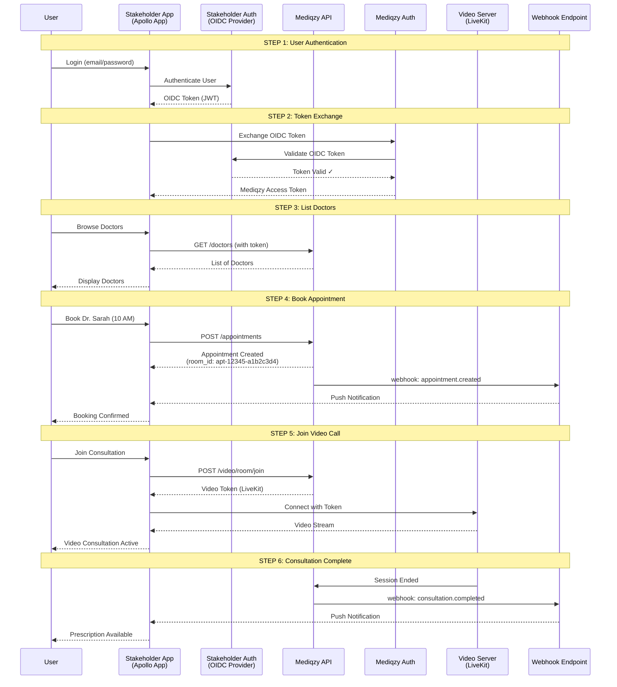

# 🔄 MEDIQZY INTEGRATION FLOW EXAMPLE
## Complete End-to-End Integration Guide for Stakeholder Apps

**Date**: February 6, 2026  
**Version**: 2.0  
**Use Case**: Corporate Mobile App → Mediqzy Platform Integration

---

## 📋 INTEGRATION FLOW OVERVIEW



---

## 🚀 STEP-BY-STEP IMPLEMENTATION

### **STEP 1: User Authentication (OIDC)**

#### Mobile App (React Native/Flutter)

```javascript
// File: src/auth/AuthService.js
import { AuthSession } from 'expo-auth-session';
import * as SecureStore from 'expo-secure-store';

export class AuthService {
  constructor() {
    this.oidcConfig = {
      issuer: 'https://auth.apollo-clinics.com',
      clientId: 'apollo-mobile-app',
      redirectUri: 'apollo://auth-callback',
      scopes: ['openid', 'profile', 'email', 'mediqzy_integration']
    };
  }

  /**
   * Step 1: Authenticate user with stakeholder's OIDC provider
   */
  async authenticateUser() {
    try {
      // Configure OIDC discovery
      const discovery = {
        authorizationEndpoint: `${this.oidcConfig.issuer}/oauth/authorize`,
        tokenEndpoint: `${this.oidcConfig.issuer}/oauth/token`,
      };

      // Initiate OIDC login flow
      const authRequest = new AuthSession.AuthRequest({
        clientId: this.oidcConfig.clientId,
        scopes: this.oidcConfig.scopes,
        redirectUri: this.oidcConfig.redirectUri,
        usePKCE: true, // Proof Key for Code Exchange (security best practice)
      });

      const result = await authRequest.promptAsync(discovery);

      if (result.type === 'success') {
        const { code } = result.params;
        
        // Exchange authorization code for tokens
        const tokens = await this.exchangeCodeForTokens(code, authRequest.codeVerifier);
        
        // Store OIDC tokens securely
        await SecureStore.setItemAsync('oidc_access_token', tokens.access_token);
        await SecureStore.setItemAsync('oidc_id_token', tokens.id_token);
        await SecureStore.setItemAsync('oidc_refresh_token', tokens.refresh_token);

        console.log('✅ User authenticated successfully');
        return tokens;
      } else {
        throw new Error('Authentication cancelled or failed');
      }
    } catch (error) {
      console.error('❌ Authentication error:', error);
      throw error;
    }
  }

  /**
   * Exchange authorization code for tokens
   */
  async exchangeCodeForTokens(code, codeVerifier) {
    const response = await fetch(`${this.oidcConfig.issuer}/oauth/token`, {
      method: 'POST',
      headers: {
        'Content-Type': 'application/x-www-form-urlencoded',
      },
      body: new URLSearchParams({
        grant_type: 'authorization_code',
        code: code,
        redirect_uri: this.oidcConfig.redirectUri,
        client_id: this.oidcConfig.clientId,
        code_verifier: codeVerifier,
      }),
    });

    if (!response.ok) {
      throw new Error(`Token exchange failed: ${response.statusText}`);
    }

    return await response.json();
    /* Response:
    {
      "access_token": "eyJhbGciOiJSUzI1NiIsInR5cCI6IkpXVCJ9...",
      "id_token": "eyJhbGciOiJSUzI1NiIsInR5cCI6IkpXVCJ9...",
      "refresh_token": "rt_abc123xyz...",
      "token_type": "Bearer",
      "expires_in": 3600,
      "scope": "openid profile email mediqzy_integration"
    }
    */
  }

  /**
   * Get current OIDC token
   */
  async getOIDCToken() {
    const accessToken = await SecureStore.getItemAsync('oidc_access_token');
    if (!accessToken) {
      throw new Error('User not authenticated');
    }
    return accessToken;
  }
}
```

---

### **STEP 2: Token Exchange (OIDC → Mediqzy Token)**

```javascript
// File: src/services/MediqzyAuthService.js
import * as SecureStore from 'expo-secure-store';

export class MediqzyAuthService {
  constructor() {
    this.mediqzyAuthUrl = 'https://api.mediqzy.com/v2/oauth';
    this.tenantId = 'clinic-apollo'; // Your assigned tenant ID
    this.clientId = 'apollo_mobile_app_12345'; // Provided by Mediqzy
    this.clientSecret = 'secret_abc123xyz'; // Provided by Mediqzy (store securely)
  }

  /**
   * Step 2: Exchange OIDC token for Mediqzy access token
   */
  async exchangeForMediqzyToken(oidcToken) {
    try {
      const response = await fetch(`${this.mediqzyAuthUrl}/token/exchange`, {
        method: 'POST',
        headers: {
          'Content-Type': 'application/json',
          'X-Tenant-ID': this.tenantId,
        },
        body: JSON.stringify({
          grant_type: 'urn:ietf:params:oauth:grant-type:token-exchange',
          subject_token: oidcToken,
          subject_token_type: 'urn:ietf:params:oauth:token-type:id_token',
          client_id: this.clientId,
          client_secret: this.clientSecret,
          tenant_id: this.tenantId,
          scope: 'appointments.* consultations.* pharmacy.read wellness.*'
        }),
      });

      if (!response.ok) {
        const error = await response.json();
        throw new Error(`Token exchange failed: ${error.message}`);
      }

      const mediqzyTokens = await response.json();
      
      // Store Mediqzy tokens securely
      await SecureStore.setItemAsync('mediqzy_access_token', mediqzyTokens.access_token);
      await SecureStore.setItemAsync('mediqzy_refresh_token', mediqzyTokens.refresh_token);
      await SecureStore.setItemAsync('mediqzy_token_expires_at', 
        String(Date.now() + (mediqzyTokens.expires_in * 1000))
      );

      console.log('✅ Mediqzy token obtained successfully');
      return mediqzyTokens;

      /* Response:
      {
        "access_token": "mz_eyJhbGciOiJIUzI1NiIsInR5cCI6IkpXVCJ9...",
        "refresh_token": "mz_refresh_abc123...",
        "token_type": "Bearer",
        "expires_in": 3600,
        "scope": "appointments.* consultations.* pharmacy.read wellness.*",
        "tenant_id": "clinic-apollo",
        "user": {
          "user_id": "USR12345",
          "email": "john.doe@apollo.com",
          "name": "John Doe",
          "role": "patient"
        }
      }
      */
    } catch (error) {
      console.error('❌ Mediqzy token exchange error:', error);
      throw error;
    }
  }

  /**
   * Get current Mediqzy token (with auto-refresh)
   */
  async getMediqzyToken() {
    const accessToken = await SecureStore.getItemAsync('mediqzy_access_token');
    const expiresAt = await SecureStore.getItemAsync('mediqzy_token_expires_at');

    // Check if token is expired or about to expire (within 5 minutes)
    if (!accessToken || Date.now() >= Number(expiresAt) - 300000) {
      console.log('🔄 Token expired or about to expire, refreshing...');
      return await this.refreshMediqzyToken();
    }

    return accessToken;
  }

  /**
   * Refresh Mediqzy access token
   */
  async refreshMediqzyToken() {
    const refreshToken = await SecureStore.getItemAsync('mediqzy_refresh_token');
    
    if (!refreshToken) {
      throw new Error('No refresh token available');
    }

    const response = await fetch(`${this.mediqzyAuthUrl}/token`, {
      method: 'POST',
      headers: {
        'Content-Type': 'application/json',
      },
      body: JSON.stringify({
        grant_type: 'refresh_token',
        refresh_token: refreshToken,
        client_id: this.clientId,
        client_secret: this.clientSecret,
      }),
    });

    if (!response.ok) {
      throw new Error('Token refresh failed');
    }

    const newTokens = await response.json();
    
    await SecureStore.setItemAsync('mediqzy_access_token', newTokens.access_token);
    await SecureStore.setItemAsync('mediqzy_token_expires_at', 
      String(Date.now() + (newTokens.expires_in * 1000))
    );

    return newTokens.access_token;
  }
}
```

---

### **STEP 3: List Doctors API Call**

```javascript
// File: src/services/MediqzyAPIService.js

export class MediqzyAPIService {
  constructor(authService) {
    this.authService = authService;
    this.baseUrl = 'https://api.mediqzy.com/v2';
    this.tenantId = 'clinic-apollo';
  }

  /**
   * Step 3: List available doctors
   */
  async listDoctors(filters = {}) {
    try {
      const token = await this.authService.getMediqzyToken();
      
      // Build query parameters
      const queryParams = new URLSearchParams({
        specialty: filters.specialty || '',
        city: filters.city || '',
        available_today: filters.availableToday || 'false',
        rating_min: filters.ratingMin || '4.0',
        consultation_type: filters.consultationType || 'online',
        limit: filters.limit || '20',
        page: filters.page || '1',
      });

      const response = await fetch(
        `${this.baseUrl}/${this.tenantId}/doctors?${queryParams}`,
        {
          method: 'GET',
          headers: {
            'Authorization': `Bearer ${token}`,
            'Content-Type': 'application/json',
            'X-Tenant-ID': this.tenantId,
          },
        }
      );

      if (!response.ok) {
        throw new Error(`Failed to fetch doctors: ${response.statusText}`);
      }

      const data = await response.json();
      console.log(`✅ Fetched ${data.doctors.length} doctors`);
      return data;

      /* Response:
      {
        "success": true,
        "doctors": [
          {
            "doctor_id": "DOC67890",
            "name": "Dr. Sarah Johnson",
            "specialty": "General Physician",
            "qualification": "MBBS, MD",
            "experience_years": 12,
            "rating": 4.8,
            "total_reviews": 1234,
            "languages": ["English", "Hindi"],
            "consultation_fee": 500,
            "currency": "INR",
            "consultation_types": ["online", "offline"],
            "availability": {
              "today": true,
              "next_available_slot": "2026-02-06T15:00:00Z"
            },
            "profile_image": "https://cdn.mediqzy.com/doctors/DOC67890.jpg"
          }
        ],
        "pagination": {
          "total": 45,
          "page": 1,
          "per_page": 20,
          "total_pages": 3
        }
      }
      */
    } catch (error) {
      console.error('❌ Error fetching doctors:', error);
      throw error;
    }
  }

  /**
   * Get doctor availability slots
   */
  async getDoctorSlots(doctorId, date) {
    try {
      const token = await this.authService.getMediqzyToken();
      
      const response = await fetch(
        `${this.baseUrl}/${this.tenantId}/doctors/${doctorId}/slots?date=${date}`,
        {
          method: 'GET',
          headers: {
            'Authorization': `Bearer ${token}`,
            'Content-Type': 'application/json',
          },
        }
      );

      if (!response.ok) {
        throw new Error(`Failed to fetch slots: ${response.statusText}`);
      }

      const data = await response.json();
      return data;

      /* Response:
      {
        "success": true,
        "doctor_id": "DOC67890",
        "date": "2026-02-10",
        "available_slots": [
          {
            "slot_id": "SLOT001",
            "start_time": "10:00",
            "end_time": "10:30",
            "available": true,
            "consultation_type": "online"
          },
          {
            "slot_id": "SLOT002",
            "start_time": "10:30",
            "end_time": "11:00",
            "available": true,
            "consultation_type": "online"
          }
        ]
      }
      */
    } catch (error) {
      console.error('❌ Error fetching slots:', error);
      throw error;
    }
  }
}
```

---

### **STEP 4: Book Appointment**

```javascript
// File: src/services/AppointmentService.js

export class AppointmentService {
  constructor(apiService) {
    this.apiService = apiService;
    this.baseUrl = 'https://api.mediqzy.com/v2';
    this.tenantId = 'clinic-apollo';
  }

  /**
   * Step 4: Book appointment
   */
  async bookAppointment(appointmentData) {
    try {
      const token = await this.apiService.authService.getMediqzyToken();
      
      const response = await fetch(
        `${this.baseUrl}/${this.tenantId}/appointments`,
        {
          method: 'POST',
          headers: {
            'Authorization': `Bearer ${token}`,
            'Content-Type': 'application/json',
            'X-Tenant-ID': this.tenantId,
          },
          body: JSON.stringify({
            patient_id: appointmentData.patientId,
            doctor_id: appointmentData.doctorId,
            appointment_date: appointmentData.date, // "2026-02-10"
            start_time: appointmentData.startTime, // "10:00"
            end_time: appointmentData.endTime, // "10:30"
            consultation_type: appointmentData.consultationType, // "online" | "offline"
            symptoms: appointmentData.symptoms,
            preferred_language: appointmentData.language || "English",
            insurance_policy_id: appointmentData.insuranceId,
            metadata: {
              source_app: 'apollo-patient-app',
              device_type: 'mobile',
              app_version: '2.1.0',
              booking_source: 'mobile_app',
            }
          }),
        }
      );

      if (!response.ok) {
        const error = await response.json();
        throw new Error(`Booking failed: ${error.message}`);
      }

      const data = await response.json();
      console.log(`✅ Appointment booked: ${data.appointment.appointment_number}`);
      console.log(`🎥 Meeting room: ${data.appointment.meeting_details.room_id}`);
      
      return data;

      /* Response:
      {
        "success": true,
        "appointment": {
          "id": 12345,
          "appointment_number": "MED000012345",
          "patient_id": "PAT12345",
          "patient_name": "John Doe",
          "doctor_id": "DOC67890",
          "doctor_name": "Dr. Sarah Johnson",
          "appointment_date": "2026-02-10",
          "time_slot": "10:00 - 10:30",
          "consultation_type": "online",
          "status": "confirmed",
          "meeting_details": {
            "room_id": "apt-12345-a1b2c3d4",
            "meeting_link": "https://meet.mediqzy.com/apt-12345-a1b2c3d4",
            "join_instructions": "Click link 5 minutes before appointment",
            "provider": "livekit"
          },
          "payment": {
            "consultation_fee": 500,
            "insurance_verified": true,
            "insurance_covered": 400,
            "copay_amount": 100,
            "currency": "INR",
            "payment_status": "completed"
          },
          "created_at": "2026-02-06T14:30:00Z"
        }
      }
      */
    } catch (error) {
      console.error('❌ Error booking appointment:', error);
      throw error;
    }
  }

  /**
   * Get appointment details
   */
  async getAppointment(appointmentId) {
    try {
      const token = await this.apiService.authService.getMediqzyToken();
      
      const response = await fetch(
        `${this.baseUrl}/${this.tenantId}/appointments/${appointmentId}`,
        {
          method: 'GET',
          headers: {
            'Authorization': `Bearer ${token}`,
            'Content-Type': 'application/json',
          },
        }
      );

      if (!response.ok) {
        throw new Error(`Failed to fetch appointment: ${response.statusText}`);
      }

      return await response.json();
    } catch (error) {
      console.error('❌ Error fetching appointment:', error);
      throw error;
    }
  }

  /**
   * Cancel appointment
   */
  async cancelAppointment(appointmentId, reason) {
    try {
      const token = await this.apiService.authService.getMediqzyToken();
      
      const response = await fetch(
        `${this.baseUrl}/${this.tenantId}/appointments/${appointmentId}/cancel`,
        {
          method: 'PUT',
          headers: {
            'Authorization': `Bearer ${token}`,
            'Content-Type': 'application/json',
          },
          body: JSON.stringify({
            reason: reason,
            refund_required: true,
          }),
        }
      );

      if (!response.ok) {
        throw new Error(`Failed to cancel appointment: ${response.statusText}`);
      }

      const data = await response.json();
      console.log(`✅ Appointment cancelled: ${appointmentId}`);
      return data;
    } catch (error) {
      console.error('❌ Error cancelling appointment:', error);
      throw error;
    }
  }
}
```

---

### **STEP 4.5: Webhook Setup (Backend)**

```javascript
// File: backend/webhooks/mediqzy-webhook-handler.js
const express = require('express');
const crypto = require('crypto');
const admin = require('firebase-admin'); // For push notifications

const router = express.Router();

/**
 * Register webhook with Mediqzy (one-time setup)
 */
async function registerWebhook() {
  const response = await fetch('https://api.mediqzy.com/v2/clinic-apollo/webhooks', {
    method: 'POST',
    headers: {
      'Authorization': `Bearer ${process.env.MEDIQZY_API_KEY}`,
      'Content-Type': 'application/json',
    },
    body: JSON.stringify({
      url: 'https://your-backend.apollo.com/webhooks/mediqzy',
      events: [
        'appointment.created',
        'appointment.cancelled',
        'appointment.rescheduled',
        'consultation.started',
        'consultation.completed',
        'prescription.created',
        'lab_report.available',
      ],
      secret: process.env.WEBHOOK_SECRET,
      active: true,
    }),
  });

  const data = await response.json();
  console.log('Webhook registered:', data.webhook.webhook_id);
}

/**
 * Verify webhook signature
 */
function verifyWebhookSignature(payload, signature, secret) {
  const hmac = crypto.createHmac('sha256', secret);
  hmac.update(JSON.stringify(payload));
  const expectedSignature = hmac.digest('hex');
  
  return crypto.timingSafeEqual(
    Buffer.from(signature),
    Buffer.from(expectedSignature)
  );
}

/**
 * Webhook endpoint to receive events from Mediqzy
 */
router.post('/webhooks/mediqzy', async (req, res) => {
  try {
    const signature = req.headers['x-mediqzy-signature'];
    const payload = req.body;

    // Verify webhook signature
    if (!verifyWebhookSignature(payload, signature, process.env.WEBHOOK_SECRET)) {
      console.error('❌ Invalid webhook signature');
      return res.status(401).json({ error: 'Invalid signature' });
    }

    console.log(`📥 Webhook received: ${payload.event}`);

    // Process webhook event
    await processWebhookEvent(payload);

    // Acknowledge receipt immediately
    res.status(200).json({ received: true });

  } catch (error) {
    console.error('❌ Webhook processing error:', error);
    res.status(500).json({ error: 'Internal server error' });
  }
});

/**
 * Process different webhook events
 */
async function processWebhookEvent(payload) {
  const { event, data, timestamp } = payload;

  switch (event) {
    case 'appointment.created':
      await handleAppointmentCreated(data);
      break;
    
    case 'appointment.cancelled':
      await handleAppointmentCancelled(data);
      break;
    
    case 'consultation.started':
      await handleConsultationStarted(data);
      break;
    
    case 'consultation.completed':
      await handleConsultationCompleted(data);
      break;
    
    case 'prescription.created':
      await handlePrescriptionCreated(data);
      break;
    
    case 'lab_report.available':
      await handleLabReportAvailable(data);
      break;
    
    default:
      console.log(`⚠️ Unhandled event: ${event}`);
  }
}

/**
 * Handle appointment.created event
 */
async function handleAppointmentCreated(data) {
  console.log(`✅ Appointment created: ${data.appointment_id}`);
  
  // Send push notification to patient
  await sendPushNotification(data.patient_id, {
    title: 'Appointment Confirmed! 🎉',
    body: `Your appointment with ${data.doctor_name} on ${data.appointment_date} at ${data.time_slot} is confirmed.`,
    data: {
      type: 'appointment_created',
      appointment_id: String(data.appointment_id),
      room_id: data.meeting_details.room_id,
      navigation: 'AppointmentDetails',
    },
  });

  // Send email confirmation
  await sendEmailConfirmation(data);

  // Update local database
  await updateLocalAppointmentStatus(data.appointment_id, 'confirmed');
}

/**
 * Handle consultation.completed event
 */
async function handleConsultationCompleted(data) {
  console.log(`✅ Consultation completed: ${data.appointment_id}`);
  
  // Send push notification
  await sendPushNotification(data.patient_id, {
    title: 'Consultation Complete',
    body: 'Your consultation is complete. Prescription is now available.',
    data: {
      type: 'consultation_completed',
      appointment_id: String(data.appointment_id),
      prescription_id: data.prescription_id,
      navigation: 'PrescriptionView',
    },
  });

  // Trigger prescription fetch
  await fetchAndStorePrescription(data.prescription_id);
}

/**
 * Send push notification via Firebase Cloud Messaging
 */
async function sendPushNotification(userId, notification) {
  try {
    // Get user's FCM token from database
    const fcmToken = await getUserFCMToken(userId);
    
    if (!fcmToken) {
      console.log(`⚠️ No FCM token for user: ${userId}`);
      return;
    }

    const message = {
      token: fcmToken,
      notification: {
        title: notification.title,
        body: notification.body,
      },
      data: notification.data,
      android: {
        priority: 'high',
        notification: {
          sound: 'default',
          channelId: 'appointments',
        },
      },
      apns: {
        payload: {
          aps: {
            sound: 'default',
            badge: 1,
          },
        },
      },
    };

    const response = await admin.messaging().send(message);
    console.log(`✅ Push notification sent: ${response}`);
    
  } catch (error) {
    console.error('❌ Push notification error:', error);
  }
}

module.exports = { router, registerWebhook };
```

---

### **STEP 5: Join Video Call**

```javascript
// File: src/services/VideoCallService.js
import { LiveKitClient } from '@livekit/react-native';

export class VideoCallService {
  constructor(apiService) {
    this.apiService = apiService;
    this.baseUrl = 'https://api.mediqzy.com/v2';
    this.tenantId = 'clinic-apollo';
  }

  /**
   * Step 5: Join video consultation room
   */
  async joinVideoRoom(appointmentId, roomId) {
    try {
      const token = await this.apiService.authService.getMediqzyToken();
      
      // Request video access token from Mediqzy
      const response = await fetch(
        `${this.baseUrl}/${this.tenantId}/video/room/${roomId}/join`,
        {
          method: 'POST',
          headers: {
            'Authorization': `Bearer ${token}`,
            'Content-Type': 'application/json',
          },
          body: JSON.stringify({
            appointment_id: appointmentId,
            user_role: 'patient', // or 'doctor'
            device_info: {
              platform: 'ios', // or 'android'
              app_version: '2.1.0',
              camera_available: true,
              microphone_available: true,
            },
          }),
        }
      );

      if (!response.ok) {
        const error = await response.json();
        throw new Error(`Failed to join room: ${error.message}`);
      }

      const data = await response.json();
      console.log(`✅ Video room access granted: ${roomId}`);

      // Connect to LiveKit video server
      const videoSession = await this.connectToLiveKit(data);
      
      return {
        roomData: data.room_data,
        livekit: data.livekit,
        videoSession: videoSession,
      };

      /* Response:
      {
        "success": true,
        "room_data": {
          "room_id": "apt-12345-a1b2c3d4",
          "appointment_id": 12345,
          "user_role": "patient",
          "video_token": "eyJhbGc...",
          "server_url": "wss://video.mediqzy.com",
          "expires_at": "2026-02-06T15:30:00Z"
        },
        "livekit": {
          "token": "eyJhbGciOiJIUzI1NiIs...",
          "server_url": "wss://video.mediqzy.com",
          "room_name": "apt-12345-a1b2c3d4",
          "participant_identity": "patient-PAT12345",
          "participant_name": "John Doe"
        },
        "room_settings": {
          "max_duration_minutes": 30,
          "recording_enabled": true,
          "waiting_room_enabled": false,
          "screen_share_enabled": true,
          "chat_enabled": true
        }
      }
      */
    } catch (error) {
      console.error('❌ Error joining video room:', error);
      throw error;
    }
  }

  /**
   * Connect to LiveKit video server
   */
  async connectToLiveKit(videoData) {
    try {
      const { token, server_url, room_name } = videoData.livekit;

      // Create LiveKit room instance
      const room = new LiveKitClient.Room({
        adaptiveStream: true,
        dynacast: true,
      });

      // Set up event listeners
      room.on('participantConnected', (participant) => {
        console.log(`👤 Participant joined: ${participant.identity}`);
      });

      room.on('participantDisconnected', (participant) => {
        console.log(`👋 Participant left: ${participant.identity}`);
      });

      room.on('trackSubscribed', (track, publication, participant) => {
        console.log(`🎥 Track subscribed: ${track.kind} from ${participant.identity}`);
      });

      // Connect to room
      await room.connect(server_url, token);
      console.log(`✅ Connected to video room: ${room_name}`);

      // Enable camera and microphone
      await room.localParticipant.setCameraEnabled(true);
      await room.localParticipant.setMicrophoneEnabled(true);

      return room;

    } catch (error) {
      console.error('❌ LiveKit connection error:', error);
      throw error;
    }
  }

  /**
   * End video consultation
   */
  async endVideoCall(appointmentId, roomId, duration) {
    try {
      const token = await this.apiService.authService.getMediqzyToken();
      
      const response = await fetch(
        `${this.baseUrl}/${this.tenantId}/video/room/${roomId}/end`,
        {
          method: 'POST',
          headers: {
            'Authorization': `Bearer ${token}`,
            'Content-Type': 'application/json',
          },
          body: JSON.stringify({
            appointment_id: appointmentId,
            duration_minutes: Math.round(duration / 60),
            prescription_added: false,
          }),
        }
      );

      const data = await response.json();
      console.log(`✅ Video call ended: ${appointmentId}`);
      
      return data;

    } catch (error) {
      console.error('❌ Error ending video call:', error);
      throw error;
    }
  }
}
```

---

## 📱 COMPLETE MOBILE APP INTEGRATION EXAMPLE

### React Native Component

```javascript
// File: src/screens/DoctorConsultationScreen.js
import React, { useState, useEffect } from 'react';
import { View, Text, Button, FlatList, Alert } from 'react-native';
import { AuthService } from '../auth/AuthService';
import { MediqzyAuthService } from '../services/MediqzyAuthService';
import { MediqzyAPIService } from '../services/MediqzyAPIService';
import { AppointmentService } from '../services/AppointmentService';
import { VideoCallService } from '../services/VideoCallService';

export default function DoctorConsultationScreen({ navigation }) {
  const [doctors, setDoctors] = useState([]);
  const [loading, setLoading] = useState(false);
  const [isAuthenticated, setIsAuthenticated] = useState(false);

  // Initialize services
  const authService = new AuthService();
  const mediqzyAuth = new MediqzyAuthService();
  const apiService = new MediqzyAPIService(mediqzyAuth);
  const appointmentService = new AppointmentService(apiService);
  const videoService = new VideoCallService(apiService);

  useEffect(() => {
    initializeApp();
  }, []);

  /**
   * COMPLETE INTEGRATION FLOW
   */
  async function initializeApp() {
    try {
      setLoading(true);

      // STEP 1: Authenticate user with OIDC
      console.log('STEP 1: Authenticating user...');
      const oidcTokens = await authService.authenticateUser();

      // STEP 2: Exchange OIDC token for Mediqzy token
      console.log('STEP 2: Exchanging for Mediqzy token...');
      const mediqzyTokens = await mediqzyAuth.exchangeForMediqzyToken(
        oidcTokens.id_token
      );

      setIsAuthenticated(true);
      console.log('✅ Authentication complete!');

      // STEP 3: Load doctors list
      await loadDoctors();

    } catch (error) {
      console.error('❌ Initialization error:', error);
      Alert.alert('Error', 'Failed to initialize app. Please try again.');
    } finally {
      setLoading(false);
    }
  }

  /**
   * STEP 3: Load doctors list
   */
  async function loadDoctors() {
    try {
      setLoading(true);
      console.log('STEP 3: Loading doctors...');

      const response = await apiService.listDoctors({
        specialty: 'General Physician',
        availableToday: 'true',
        consultationType: 'online',
        ratingMin: '4.5',
      });

      setDoctors(response.doctors);
      console.log(`✅ Loaded ${response.doctors.length} doctors`);

    } catch (error) {
      console.error('❌ Error loading doctors:', error);
      Alert.alert('Error', 'Failed to load doctors');
    } finally {
      setLoading(false);
    }
  }

  /**
   * STEP 4: Book appointment with selected doctor
   */
  async function bookAppointment(doctor) {
    try {
      setLoading(true);
      console.log(`STEP 4: Booking appointment with ${doctor.name}...`);

      const appointment = await appointmentService.bookAppointment({
        patientId: 'PAT12345', // From user profile
        doctorId: doctor.doctor_id,
        date: '2026-02-10',
        startTime: '10:00',
        endTime: '10:30',
        consultationType: 'online',
        symptoms: 'Fever and headache for 3 days',
        language: 'English',
      });

      console.log('✅ Appointment booked!');
      console.log(`Meeting room: ${appointment.appointment.meeting_details.room_id}`);

      Alert.alert(
        'Appointment Confirmed! 🎉',
        `Your appointment with ${doctor.name} is confirmed for Feb 10, 2026 at 10:00 AM`,
        [
          {
            text: 'Join Now',
            onPress: () => joinVideoCall(appointment.appointment),
          },
          { text: 'OK' },
        ]
      );

      // Webhook will trigger push notification automatically

    } catch (error) {
      console.error('❌ Error booking appointment:', error);
      Alert.alert('Error', 'Failed to book appointment');
    } finally {
      setLoading(false);
    }
  }

  /**
   * STEP 5: Join video consultation
   */
  async function joinVideoCall(appointment) {
    try {
      setLoading(true);
      console.log('STEP 5: Joining video call...');

      const videoSession = await videoService.joinVideoRoom(
        appointment.id,
        appointment.meeting_details.room_id
      );

      console.log('✅ Connected to video consultation!');

      // Navigate to video call screen
      navigation.navigate('VideoCall', {
        appointment: appointment,
        videoSession: videoSession,
      });

    } catch (error) {
      console.error('❌ Error joining video call:', error);
      Alert.alert('Error', 'Failed to join video call');
    } finally {
      setLoading(false);
    }
  }

  return (
    <View style={{ flex: 1, padding: 20 }}>
      <Text style={{ fontSize: 24, fontWeight: 'bold', marginBottom: 20 }}>
        Available Doctors
      </Text>

      {!isAuthenticated ? (
        <Button title="Login" onPress={initializeApp} />
      ) : (
        <FlatList
          data={doctors}
          keyExtractor={(item) => item.doctor_id}
          renderItem={({ item }) => (
            <View style={{ padding: 15, borderBottomWidth: 1, borderColor: '#ccc' }}>
              <Text style={{ fontSize: 18, fontWeight: 'bold' }}>{item.name}</Text>
              <Text>{item.specialty} • {item.experience_years} years exp</Text>
              <Text>⭐ {item.rating} ({item.total_reviews} reviews)</Text>
              <Text>Fee: ₹{item.consultation_fee}</Text>
              <Button
                title="Book Appointment"
                onPress={() => bookAppointment(item)}
                disabled={loading}
              />
            </View>
          )}
          refreshing={loading}
          onRefresh={loadDoctors}
        />
      )}
    </View>
  );
}
```

---

## 🔔 PUSH NOTIFICATION HANDLING

```javascript
// File: src/services/NotificationService.js
import messaging from '@react-native-firebase/messaging';
import PushNotification from 'react-native-push-notification';

export class NotificationService {
  constructor() {
    this.setupNotifications();
  }

  /**
   * Setup push notifications
   */
  async setupNotifications() {
    // Request permission
    const authStatus = await messaging().requestPermission();
    const enabled =
      authStatus === messaging.AuthorizationStatus.AUTHORIZED ||
      authStatus === messaging.AuthorizationStatus.PROVISIONAL;

    if (enabled) {
      console.log('✅ Notification permission granted');
      await this.getFCMToken();
      this.setupNotificationHandlers();
    }
  }

  /**
   * Get FCM token and send to backend
   */
  async getFCMToken() {
    const fcmToken = await messaging().getToken();
    console.log('FCM Token:', fcmToken);
    
    // Send token to your backend for storage
    await this.registerFCMToken(fcmToken);
    
    return fcmToken;
  }

  /**
   * Setup notification handlers
   */
  setupNotificationHandlers() {
    // Handle notification when app is in foreground
    messaging().onMessage(async (remoteMessage) => {
      console.log('📥 Foreground notification:', remoteMessage);
      
      // Show local notification
      PushNotification.localNotification({
        title: remoteMessage.notification.title,
        message: remoteMessage.notification.body,
        userInfo: remoteMessage.data,
      });

      // Handle webhook event data
      this.handleWebhookNotification(remoteMessage.data);
    });

    // Handle notification when app is in background/quit
    messaging().setBackgroundMessageHandler(async (remoteMessage) => {
      console.log('📥 Background notification:', remoteMessage);
      this.handleWebhookNotification(remoteMessage.data);
    });

    // Handle notification tap
    messaging().onNotificationOpenedApp((remoteMessage) => {
      console.log('📱 Notification opened app:', remoteMessage);
      this.navigateFromNotification(remoteMessage.data);
    });
  }

  /**
   * Handle webhook notification data
   */
  handleWebhookNotification(data) {
    const { type } = data;

    switch (type) {
      case 'appointment_created':
        console.log(`✅ Appointment created: ${data.appointment_id}`);
        // Update local state, refresh appointment list
        break;

      case 'consultation_completed':
        console.log(`✅ Consultation completed: ${data.appointment_id}`);
        // Fetch prescription, show completion screen
        break;

      case 'prescription_created':
        console.log(`✅ Prescription available: ${data.prescription_id}`);
        // Download and cache prescription
        break;

      case 'lab_report_available':
        console.log(`✅ Lab report ready: ${data.report_id}`);
        // Download and show report
        break;
    }
  }

  /**
   * Navigate to appropriate screen based on notification
   */
  navigateFromNotification(data) {
    const { type, navigation } = data;

    // Use your navigation library (React Navigation, etc.)
    if (navigation === 'AppointmentDetails') {
      // Navigate to appointment details screen
    } else if (navigation === 'PrescriptionView') {
      // Navigate to prescription screen
    }
  }
}
```

---

## 📊 COMPLETE FLOW SUMMARY

### Timeline

```
[00:00] User opens Apollo mobile app
[00:01] STEP 1: App redirects to Apollo OIDC login
[00:05] User enters credentials (email/password)
[00:06] Apollo OIDC returns id_token
[00:07] STEP 2: App exchanges OIDC token for Mediqzy token
[00:08] Mediqzy validates OIDC token and returns access_token
[00:09] STEP 3: App calls GET /v2/clinic-apollo/doctors
[00:10] Mediqzy returns list of 20 doctors
[00:11] User browses doctors, selects Dr. Sarah
[00:12] User clicks "Book Appointment"
[00:13] STEP 4: App calls POST /v2/clinic-apollo/appointments
[00:14] Mediqzy creates appointment, generates canonical meeting ID
[00:15] Mediqzy triggers webhook: appointment.created
[00:16] Backend receives webhook, sends push notification
[00:17] User receives notification: "Appointment Confirmed! 🎉"
[00:18] App shows appointment details with "Join" button

... [Time passes - Feb 10, 2026 9:55 AM] ...

[09:55] User taps "Join Video Consultation"
[09:56] STEP 5: App calls POST /v2/clinic-apollo/video/room/join
[09:57] Mediqzy validates appointment, generates LiveKit token
[09:58] App connects to LiveKit video server
[09:59] User sees video interface, waiting for doctor
[10:00] Doctor joins, video consultation begins
[10:25] Consultation ends, doctor adds prescription
[10:26] Mediqzy triggers webhook: consultation.completed
[10:27] Backend receives webhook, sends push notification
[10:28] User receives notification: "Prescription Available"
[10:29] User views prescription in app
```

---

## ✅ INTEGRATION CHECKLIST

### Pre-Integration
- [ ] Obtain Mediqzy tenant_id (e.g., `clinic-apollo`)
- [ ] Get client_id and client_secret
- [ ] Configure OIDC provider for `mediqzy_integration` scope
- [ ] Set up backend webhook endpoint
- [ ] Generate webhook secret key
- [ ] Configure Firebase Cloud Messaging (FCM)

### Development
- [ ] Implement OIDC authentication flow
- [ ] Implement token exchange logic
- [ ] Implement token refresh mechanism
- [ ] Add API service layer (doctors, appointments, video)
- [ ] Set up webhook endpoint on backend
- [ ] Implement webhook signature verification
- [ ] Add push notification handling
- [ ] Integrate LiveKit video SDK
- [ ] Test in Mediqzy sandbox environment

### Testing
- [ ] Test OIDC login flow
- [ ] Test token exchange and refresh
- [ ] Test doctor listing with filters
- [ ] Test appointment booking
- [ ] Test webhook delivery and processing
- [ ] Test push notifications (foreground/background)
- [ ] Test video call joining and connection a
- [ ] Test error scenarios (network failures, token expiry)
- [ ] Test offline mode and caching

### Production
- [ ] Switch to production API URLs
- [ ] Use production credentials
- [ ] Monitor webhook delivery
- [ ] Set up error tracking (Sentry, etc.)
- [ ] Configure rate limiting handling
- [ ] Set up analytics tracking
- [ ] Deploy backend webhook handler
- [ ] Configure production FCM settings

---

## 🚀 QUICK START COMMANDS

```bash
# Install dependencies
npm install @livekit/react-native
npm install expo-auth-session expo-secure-store
npm install @react-native-firebase/app @react-native-firebase/messaging
npm install react-native-push-notification

# Backend dependencies
npm install express crypto firebase-admin

# Run registration script (one-time)
node scripts/register-webhook.js

# Test in development
npm run dev

# Build for production
npm run build:ios
npm run build:android
```

---

**Integration Status**: Production Ready ✅  
**Platform**: Mediqzy API v2  
**Last Updated**: February 6, 2026  

**Need help?** Contact api-support@mediqzy.com
