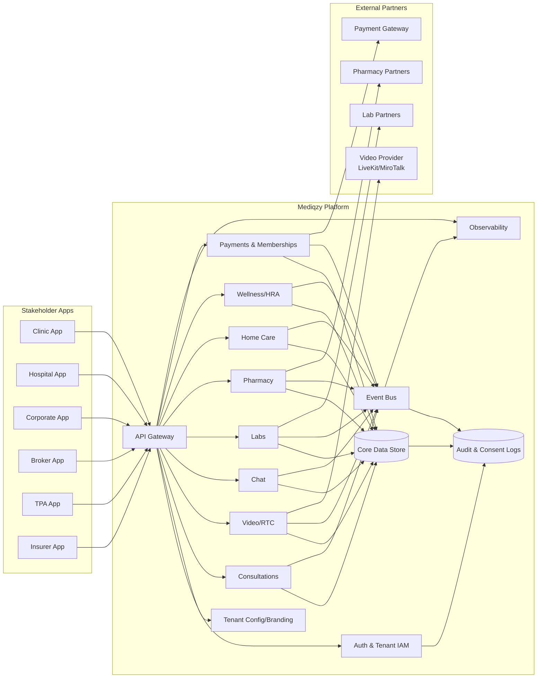
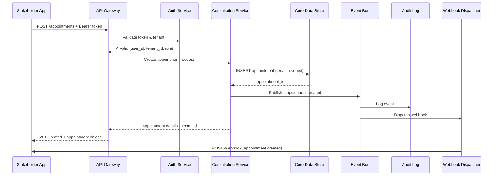
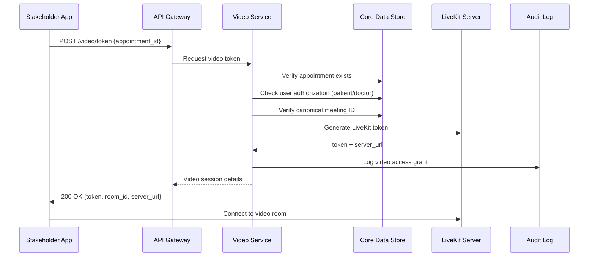
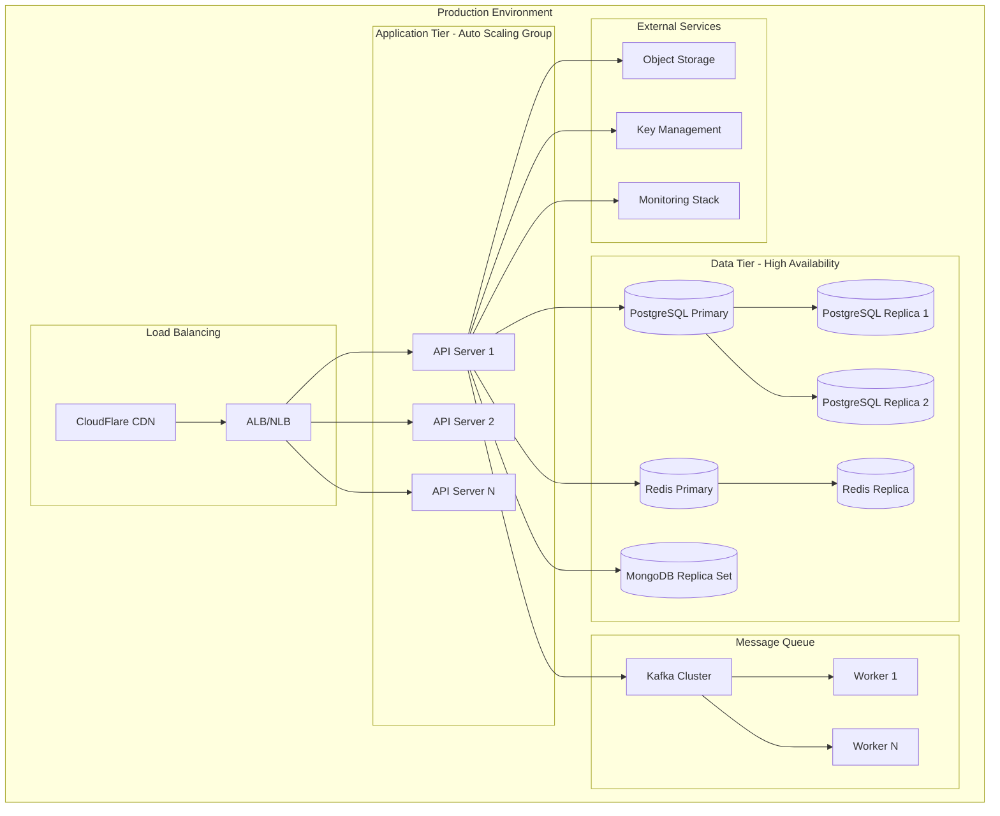

# 🏗️ MEDIQZY PLATFORM ARCHITECTURE, API CONTRACTS & SECURITY
## Complete Technical Specification for Multi-Tenant Wellness Integration

**Platform**: Mediqzy  
**Version**: v1.0  
**Date**: February 6, 2026  
**Status**: Production Grade  

---

## 📋 TABLE OF CONTENTS

1. [Architecture Diagram Specification](#1-architecture-diagram-specification)
2. [API Contract Outline](#2-api-contract-outline)
3. [Security & Compliance Checklist](#3-security--compliance-checklist)
4. [Implementation Guidelines](#4-implementation-guidelines)
5. [Monitoring & Observability](#5-monitoring--observability)

---

## 1. ARCHITECTURE DIAGRAM SPECIFICATION

### 1.1 High-Level System Architecture (Mermaid)



### 1.2 Architecture Components & Responsibilities

#### **API Gateway Layer**
| Component | Responsibility | Technology Stack |
|-----------|---------------|------------------|
| **API Gateway** | Request routing, rate limiting, tenant scoping | Kong/AWS API Gateway |
| **Load Balancer** | Traffic distribution, SSL termination | Nginx/AWS ALB |
| **CDN** | Static asset delivery, edge caching | CloudFlare/AWS CloudFront |

**Key Functions**:
- ✅ Enforce `X-Tenant-Id` header validation
- ✅ Rate limiting per tenant (tiered plans)
- ✅ Request/response logging and analytics
- ✅ API versioning and routing
- ✅ CORS policy enforcement
- ✅ Request throttling and circuit breaking

#### **Identity & Access Management (IAM)**
| Component | Responsibility | Technology Stack |
|-----------|---------------|------------------|
| **Auth Service** | OIDC/SAML federation, token exchange | Keycloak/Auth0 |
| **Token Service** | JWT generation, validation, refresh | Node.js/Redis |
| **User Directory** | User profiles, roles, permissions | PostgreSQL |

**Key Functions**:
- ✅ OIDC/SAML SSO integration with stakeholder identity providers
- ✅ Token exchange: Provider token → Mediqzy access token
- ✅ Role-based access control (RBAC)
- ✅ Multi-factor authentication (MFA) support
- ✅ Session management and token lifecycle
- ✅ Tenant-scoped user isolation

#### **Tenant Configuration & Branding**
| Component | Responsibility | Technology Stack |
|-----------|---------------|------------------|
| **Config Service** | Tenant settings, feature flags | Redis/DynamoDB |
| **Branding Service** | White-label customization | S3/CDN |
| **Quota Manager** | Usage tracking, limits enforcement | Redis |

**Key Functions**:
- ✅ Per-tenant feature toggles
- ✅ Custom branding (logos, colors, themes)
- ✅ Tenant-specific business rules
- ✅ Usage quota management and alerts
- ✅ SLA configuration per tenant tier

#### **Core Service Modules**

| Service | Responsibility | Database | External Integrations |
|---------|---------------|----------|----------------------|
| **C1: Consultations** | Appointments, doctor scheduling | PostgreSQL | Calendar sync |
| **C2: Video/RTC** | Video consultations, room management | PostgreSQL + Redis | LiveKit, MiroTalk |
| **C3: Chat** | Real-time messaging | MongoDB | WebSocket server |
| **C4: Labs** | Lab test booking, reports | PostgreSQL | Lab partner APIs |
| **C5: Pharmacy** | Prescription, medicine orders | PostgreSQL | Pharmacy partners |
| **C6: Home Care** | Home healthcare booking | PostgreSQL | Provider networks |
| **C7: Wellness/HRA** | Health assessments, fitness plans | PostgreSQL | Wearable APIs |
| **C8: Payments** | Billing, insurance claims | PostgreSQL | Payment gateways |

#### **Event Bus Architecture**
| Component | Responsibility | Technology Stack |
|-----------|---------------|------------------|
| **Message Broker** | Async event publishing | RabbitMQ/Kafka |
| **Event Router** | Event filtering, routing | Node.js |
| **Webhook Dispatcher** | Stakeholder webhook delivery | Redis Queue + Workers |

**Event Flow**:
```
Service Module → Event Bus → [Audit Log, Webhook Dispatcher, Analytics]
                              ↓                ↓
                         Compliance DB    Stakeholder Apps
```

**Supported Events**:
- `appointment.created`, `appointment.status_changed`
- `consultation.started`, `consultation.completed`
- `prescription.created`, `prescription.updated`
- `lab.booking.created`, `lab.booking.status`, `lab.report.ready`
- `pharmacy.order.created`, `pharmacy.order.status`
- `video.session.started`, `video.session.ended`
- `payment.completed`, `claim.submitted`, `claim.approved`

#### **Data Layer**
| Store | Purpose | Technology | Backup Strategy |
|-------|---------|-----------|-----------------|
| **Core Data Store** | Transactional data, appointments | PostgreSQL (Multi-tenant) | Daily + PITR |
| **Audit & Consent Logs** | Immutable compliance logs | PostgreSQL (Append-only) | Daily + Archive |
| **Cache Layer** | Session, config, high-frequency reads | Redis Cluster | Snapshot + AOF |
| **Document Store** | Chat, unstructured data | MongoDB | Daily + Replica |
| **Object Store** | Files, images, reports | S3/Azure Blob | Versioned + Lifecycle |

**Tenant Isolation Strategy**:
- **Option 1 (Current)**: Shared database with `tenant_id` column + Row-Level Security (RLS)
- **Option 2 (Enterprise)**: Database-per-tenant for regulated industries
- **Option 3 (Hybrid)**: Shared tables for metadata, isolated tables for PHI

#### **Observability Stack**
| Component | Responsibility | Technology Stack |
|-----------|---------------|------------------|
| **Logging** | Centralized log aggregation | ELK Stack / CloudWatch |
| **Metrics** | Performance monitoring | Prometheus + Grafana |
| **Tracing** | Distributed request tracing | Jaeger / AWS X-Ray |
| **Alerting** | Real-time alerts | PagerDuty / OpsGenie |

**Monitored Metrics**:
- API response times (p50, p95, p99)
- Error rates per endpoint
- Tenant-wise usage and quota consumption
- Database connection pool utilization
- Event bus lag and throughput
- Video session quality metrics

---

### 1.3 Data Flow Diagrams

#### **Appointment Booking Flow**



#### **Video Join Authorization Flow**



---

### 1.4 Infrastructure Architecture



---

## 2. API CONTRACT OUTLINE

### 2.1 Base Configuration

**Base URL**:
```
Production:  https://api.mediqzy.com/v1
Staging:     https://api-staging.mediqzy.com/v1
Sandbox:     https://api-sandbox.mediqzy.com/v1
```

**Required Headers**:
```http
Authorization: Bearer <access_token>
X-Tenant-Id: <tenant_id>
Content-Type: application/json
X-Request-ID: <unique_request_id>  (optional, recommended)
X-API-Version: v1  (optional, defaults to v1)
```

**Common Response Headers**:
```http
X-RateLimit-Limit: 1000
X-RateLimit-Remaining: 985
X-RateLimit-Reset: 1675689600
X-Request-ID: req_abc123xyz
X-Response-Time: 234ms
```

---

### 2.2 Authentication & SSO

#### **POST /auth/exchange**
Exchange stakeholder OIDC/SAML token for Mediqzy access token.

**Request**:
```json
POST /auth/exchange
Content-Type: application/json

{
  "provider_token": "eyJhbGciOiJSUzI1NiIs...",
  "provider": "apollo-oidc",
  "external_user_id": "apollo_user_12345",
  "role": "patient",
  "tenant_id": "clinic-apollo",
  "metadata": {
    "app_version": "2.1.0",
    "device_id": "device_abc123"
  }
}
```

**Response**: `200 OK`
```json
{
  "access_token": "mz_eyJhbGciOiJIUzI1NiIs...",
  "refresh_token": "mz_refresh_abc123...",
  "token_type": "Bearer",
  "expires_in": 3600,
  "user_id": "USR12345",
  "tenant_id": "clinic-apollo",
  "role": "patient",
  "permissions": [
    "appointments.read",
    "appointments.write",
    "consultations.video"
  ]
}
```

**Error Response**: `401 Unauthorized`
```json
{
  "error": {
    "code": "INVALID_PROVIDER_TOKEN",
    "message": "Provider token validation failed",
    "details": "Token expired or invalid signature"
  }
}
```

---

#### **POST /auth/refresh**
Refresh access token using refresh token.

**Request**:
```json
POST /auth/refresh
Content-Type: application/json

{
  "refresh_token": "mz_refresh_abc123...",
  "tenant_id": "clinic-apollo"
}
```

**Response**: `200 OK`
```json
{
  "access_token": "mz_eyJhbGciOiJIUzI1NiIs...",
  "token_type": "Bearer",
  "expires_in": 3600
}
```

---

### 2.3 User / Patient Management

#### **POST /users**
Create new patient profile.

**Request**:
```json
POST /users
Authorization: Bearer <token>
X-Tenant-Id: clinic-apollo

{
  "external_user_id": "apollo_patient_123",
  "email": "john.doe@example.com",
  "phone": "+91-9876543210",
  "name": "John Doe",
  "date_of_birth": "1990-05-15",
  "gender": "male",
  "address": {
    "line1": "456 Apartment Complex",
    "city": "Mumbai",
    "state": "Maharashtra",
    "pincode": "400053",
    "country": "IN"
  },
  "emergency_contact": {
    "name": "Jane Doe",
    "relation": "spouse",
    "phone": "+91-9876543211"
  },
  "insurance": {
    "policy_number": "POL123456",
    "provider": "HDFC ERGO",
    "sum_insured": 500000
  }
}
```

**Response**: `201 Created`
```json
{
  "user_id": "USR12345",
  "external_user_id": "apollo_patient_123",
  "tenant_id": "clinic-apollo",
  "email": "john.doe@example.com",
  "phone": "+91-9876543210",
  "name": "John Doe",
  "created_at": "2026-02-06T14:00:00Z"
}
```

---

#### **GET /users/{id}**
Fetch patient profile.

**Response**: `200 OK`
```json
{
  "user_id": "USR12345",
  "email": "john.doe@example.com",
  "name": "John Doe",
  "date_of_birth": "1990-05-15",
  "age": 35,
  "gender": "male",
  "phone": "+91-9876543210",
  "address": {...},
  "medical_history": {
    "allergies": ["Penicillin"],
    "chronic_conditions": ["Pre-diabetes"],
    "current_medications": ["Metformin 500mg"],
    "blood_group": "O+"
  },
  "insurance": {...},
  "updated_at": "2026-02-06T14:00:00Z"
}
```

---

#### **PATCH /users/{id}**
Update patient profile.

**Request**:
```json
PATCH /users/USR12345

{
  "phone": "+91-9876543299",
  "address": {
    "line1": "789 New Apartment",
    "city": "Mumbai",
    "state": "Maharashtra",
    "pincode": "400054"
  }
}
```

**Response**: `200 OK`
```json
{
  "user_id": "USR12345",
  "updated_fields": ["phone", "address"],
  "updated_at": "2026-02-06T15:00:00Z"
}
```

---

### 2.4 Doctor Search & Availability

#### **GET /doctors**
Search available doctors.

**Query Parameters**:
- `specialty` - Doctor specialty (e.g., "Cardiologist", "General Physician")
- `location` - City or area
- `language` - Preferred language
- `gender` - Doctor gender preference
- `rating_min` - Minimum rating (0-5)
- `available_today` - Boolean
- `consultation_type` - "online" | "offline" | "both"
- `limit` - Results per page (default: 20)
- `page` - Page number (default: 1)

**Request**:
```http
GET /doctors?specialty=Cardiologist&location=Mumbai&available_today=true&rating_min=4.5
Authorization: Bearer <token>
X-Tenant-Id: clinic-apollo
```

**Response**: `200 OK`
```json
{
  "doctors": [
    {
      "doctor_id": "DOC67890",
      "name": "Dr. Sarah Johnson",
      "specialty": "Cardiologist",
      "qualification": "MBBS, MD, DM (Cardiology)",
      "experience_years": 15,
      "rating": 4.8,
      "total_reviews": 1234,
      "languages": ["English", "Hindi", "Marathi"],
      "gender": "female",
      "consultation_fee": 800,
      "currency": "INR",
      "consultation_types": ["online", "offline"],
      "clinic_address": "Apollo Hospitals, Andheri West, Mumbai",
      "availability": {
        "today": true,
        "next_available_slot": "2026-02-06T16:00:00Z"
      },
      "profile_image": "https://cdn.mediqzy.com/doctors/DOC67890.jpg",
      "about": "Experienced cardiologist specializing in interventional cardiology..."
    }
  ],
  "pagination": {
    "total": 45,
    "page": 1,
    "per_page": 20,
    "total_pages": 3
  }
}
```

---

#### **GET /doctors/{id}**
Get detailed doctor profile.

**Response**: `200 OK`
```json
{
  "doctor_id": "DOC67890",
  "name": "Dr. Sarah Johnson",
  "specialty": "Cardiologist",
  "sub_specialties": ["Interventional Cardiology", "Preventive Cardiology"],
  "qualification": "MBBS, MD, DM (Cardiology)",
  "experience_years": 15,
  "rating": 4.8,
  "total_reviews": 1234,
  "awards": ["Best Cardiologist 2024", "Excellence in Patient Care"],
  "publications": 45,
  "consultation_fee": 800,
  "consultation_types": ["online", "offline", "home-visit"],
  "working_hours": {
    "monday": ["09:00-13:00", "15:00-19:00"],
    "tuesday": ["09:00-13:00"],
    "wednesday": ["09:00-13:00", "15:00-19:00"]
  },
  "education": [
    {
      "degree": "DM (Cardiology)",
      "institution": "AIIMS Delhi",
      "year": 2015
    }
  ]
}
```

---

#### **GET /doctors/{id}/availability**
Get doctor's available time slots.

**Query Parameters**:
- `date` - Date in YYYY-MM-DD format
- `type` - "online" | "offline" (optional)

**Request**:
```http
GET /doctors/DOC67890/availability?date=2026-02-10&type=online
```

**Response**: `200 OK`
```json
{
  "doctor_id": "DOC67890",
  "doctor_name": "Dr. Sarah Johnson",
  "date": "2026-02-10",
  "consultation_type": "online",
  "available_slots": [
    {
      "slot_id": "SLOT001",
      "start_time": "10:00",
      "end_time": "10:30",
      "available": true
    },
    {
      "slot_id": "SLOT002",
      "start_time": "10:30",
      "end_time": "11:00",
      "available": false,
      "reason": "Already booked"
    },
    {
      "slot_id": "SLOT003",
      "start_time": "11:00",
      "end_time": "11:30",
      "available": true
    }
  ],
  "total_slots": 24,
  "available_count": 18,
  "booked_count": 6
}
```

---

### 2.5 Appointments

#### **POST /appointments**
Book new appointment.

**Request**:
```json
POST /appointments

{
  "doctor_id": "DOC67890",
  "user_id": "USR12345",
  "appointment_date": "2026-02-10",
  "start_time": "10:00",
  "end_time": "10:30",
  "consultation_type": "online",
  "symptoms": "Chest pain and shortness of breath",
  "preferred_language": "English",
  "notes": "Patient has history of hypertension",
  "insurance_policy_id": "POL123456",
  "tenant_meta": {
    "booking_source": "mobile_app",
    "campaign_id": "wellness_2026"
  }
}
```

**Response**: `201 Created`
```json
{
  "appointment_id": 12345,
  "appointment_number": "MED000012345",
  "doctor_id": "DOC67890",
  "doctor_name": "Dr. Sarah Johnson",
  "user_id": "USR12345",
  "patient_name": "John Doe",
  "appointment_date": "2026-02-10",
  "time_slot": "10:00 - 10:30",
  "consultation_type": "online",
  "status": "confirmed",
  "meeting_details": {
    "room_id": "apt-12345-a1b2c3d4",
    "meeting_link": "https://meet.mediqzy.com/apt-12345-a1b2c3d4",
    "provider": "livekit"
  },
  "payment": {
    "consultation_fee": 800,
    "insurance_verified": true,
    "insurance_covered": 600,
    "copay_amount": 200,
    "payment_status": "pending"
  },
  "created_at": "2026-02-06T14:30:00Z"
}
```

**Error Response**: `409 Conflict`
```json
{
  "error": {
    "code": "SLOT_NOT_AVAILABLE",
    "message": "The selected time slot is no longer available",
    "details": {
      "slot_id": "SLOT001",
      "booked_at": "2026-02-06T14:25:00Z"
    }
  }
}
```

---

#### **GET /appointments/{id}**
Get appointment details.

**Response**: `200 OK`
```json
{
  "appointment_id": 12345,
  "appointment_number": "MED000012345",
  "status": "confirmed",
  "doctor": {
    "doctor_id": "DOC67890",
    "name": "Dr. Sarah Johnson",
    "specialty": "Cardiologist"
  },
  "patient": {
    "user_id": "USR12345",
    "name": "John Doe",
    "age": 35,
    "gender": "male"
  },
  "appointment_date": "2026-02-10",
  "time_slot": "10:00 - 10:30",
  "consultation_type": "online",
  "symptoms": "Chest pain and shortness of breath",
  "meeting_details": {
    "room_id": "apt-12345-a1b2c3d4",
    "meeting_link": "https://meet.mediqzy.com/apt-12345-a1b2c3d4"
  },
  "prescription_id": null,
  "created_at": "2026-02-06T14:30:00Z",
  "updated_at": "2026-02-06T14:30:00Z"
}
```

---

#### **PATCH /appointments/{id}**
Reschedule or cancel appointment.

**Request (Reschedule)**:
```json
PATCH /appointments/12345

{
  "action": "reschedule",
  "new_date": "2026-02-11",
  "new_start_time": "11:00",
  "new_end_time": "11:30",
  "reason": "Patient requested change"
}
```

**Request (Cancel)**:
```json
PATCH /appointments/12345

{
  "action": "cancel",
  "reason": "Patient not available",
  "refund_required": true
}
```

**Response**: `200 OK`
```json
{
  "appointment_id": 12345,
  "status": "cancelled",
  "refund": {
    "amount": 200,
    "status": "initiated",
    "expected_date": "2026-02-13"
  },
  "updated_at": "2026-02-06T15:00:00Z"
}
```

---

#### **GET /appointments**
List appointments with filters.

**Query Parameters**:
- `user_id` - Filter by patient
- `doctor_id` - Filter by doctor
- `status` - "upcoming" | "completed" | "cancelled"
- `from_date` - Start date (YYYY-MM-DD)
- `to_date` - End date (YYYY-MM-DD)
- `limit` - Results per page
- `page` - Page number

**Request**:
```http
GET /appointments?user_id=USR12345&status=upcoming&limit=10
```

**Response**: `200 OK`
```json
{
  "appointments": [...],
  "pagination": {
    "total": 45,
    "page": 1,
    "per_page": 10,
    "total_pages": 5
  }
}
```

---

### 2.6 Video Consultations

#### **POST /video/token**
Generate video access token for joining consultation.

**Request**:
```json
POST /video/token

{
  "appointment_id": 12345,
  "user_role": "patient"
}
```

**Response**: `200 OK`
```json
{
  "room_id": "apt-12345-a1b2c3d4",
  "token": "eyJhbGciOiJIUzI1NiIs...",
  "server_url": "wss://video.mediqzy.com",
  "join_url": "https://meet.mediqzy.com/apt-12345-a1b2c3d4?token=...",
  "participant_identity": "patient-USR12345",
  "participant_name": "John Doe",
  "expires_at": "2026-02-10T10:45:00Z",
  "room_settings": {
    "max_duration_minutes": 30,
    "recording_enabled": true,
    "screen_share_enabled": true,
    "chat_enabled": true
  }
}
```

**Error Response**: `403 Forbidden`
```json
{
  "error": {
    "code": "UNAUTHORIZED_VIDEO_ACCESS",
    "message": "You are not authorized to join this video room",
    "details": "Only the patient or assigned doctor can join"
  }
}
```

---

#### **GET /video/room/{room_id}/status**
Get video room status.

**Response**: `200 OK`
```json
{
  "room_id": "apt-12345-a1b2c3d4",
  "appointment_id": 12345,
  "status": "active",
  "participants": [
    {
      "identity": "patient-USR12345",
      "name": "John Doe",
      "role": "patient",
      "joined_at": "2026-02-10T10:00:00Z",
      "camera_enabled": true,
      "mic_enabled": true
    },
    {
      "identity": "doctor-DOC67890",
      "name": "Dr. Sarah Johnson",
      "role": "doctor",
      "joined_at": "2026-02-10T10:01:00Z",
      "camera_enabled": true,
      "mic_enabled": true
    }
  ],
  "started_at": "2026-02-10T10:00:00Z",
  "duration_seconds": 320,
  "recording_status": "recording"
}
```

---

### 2.7 Chat

#### **POST /chat/rooms**
Create chat room for appointment.

**Request**:
```json
POST /chat/rooms

{
  "appointment_id": 12345,
  "participants": ["USR12345", "DOC67890"]
}
```

**Response**: `201 Created`
```json
{
  "room_id": "CHAT789",
  "appointment_id": 12345,
  "participants": [
    {
      "user_id": "USR12345",
      "name": "John Doe",
      "role": "patient"
    },
    {
      "user_id": "DOC67890",
      "name": "Dr. Sarah Johnson",
      "role": "doctor"
    }
  ],
  "created_at": "2026-02-06T14:30:00Z"
}
```

---

#### **POST /chat/rooms/{room_id}/messages**
Send message in chat room.

**Request**:
```json
POST /chat/rooms/CHAT789/messages

{
  "sender_id": "USR12345",
  "message_type": "text",
  "content": "I have been experiencing chest pain",
  "attachments": []
}
```

**Response**: `201 Created`
```json
{
  "message_id": "MSG123456",
  "room_id": "CHAT789",
  "sender_id": "USR12345",
  "sender_name": "John Doe",
  "message_type": "text",
  "content": "I have been experiencing chest pain",
  "timestamp": "2026-02-06T14:35:00Z",
  "read": false
}
```

---

#### **GET /chat/rooms/{room_id}/messages**
Get chat history.

**Query Parameters**:
- `limit` - Messages per page (default: 50)
- `before` - Message ID to fetch messages before
- `after` - Message ID to fetch messages after

**Response**: `200 OK`
```json
{
  "room_id": "CHAT789",
  "messages": [
    {
      "message_id": "MSG123456",
      "sender_id": "USR12345",
      "sender_name": "John Doe",
      "content": "I have been experiencing chest pain",
      "timestamp": "2026-02-06T14:35:00Z",
      "read": true
    }
  ],
  "pagination": {
    "total": 25,
    "has_more": false
  }
}
```

---

### 2.8 Labs

#### **GET /labs/tests**
Get available lab tests.

**Query Parameters**:
- `category` - Test category
- `search` - Search by test name
- `location` - City/area

**Response**: `200 OK`
```json
{
  "tests": [
    {
      "test_id": "TEST001",
      "name": "Complete Blood Count (CBC)",
      "category": "Blood Tests",
      "description": "Measures different components of blood",
      "preparation": "No fasting required",
      "price": 500,
      "sample_type": "Blood",
      "report_time_hours": 24,
      "home_collection_available": true
    }
  ]
}
```

---

#### **POST /labs/bookings**
Book lab test.

**Request**:
```json
POST /labs/bookings

{
  "user_id": "USR12345",
  "test_ids": ["TEST001", "TEST002"],
  "appointment_date": "2026-02-08",
  "appointment_time": "09:00",
  "collection_type": "home",
  "collection_address": {
    "line1": "456 Apartment",
    "city": "Mumbai",
    "pincode": "400053"
  },
  "prescription_id": "PRES98765"
}
```

**Response**: `201 Created`
```json
{
  "booking_id": "LAB123",
  "booking_number": "LAB000123",
  "user_id": "USR12345",
  "tests": [
    {"test_id": "TEST001", "name": "Complete Blood Count"},
    {"test_id": "TEST002", "name": "Lipid Profile"}
  ],
  "appointment_date": "2026-02-08",
  "appointment_time": "09:00",
  "collection_type": "home",
  "status": "confirmed",
  "total_amount": 1500,
  "payment_status": "pending"
}
```

---

#### **GET /labs/bookings/{id}**
Get lab booking details and reports.

**Response**: `200 OK`
```json
{
  "booking_id": "LAB123",
  "status": "completed",
  "tests": [...],
  "reports": [
    {
      "report_id": "REP456",
      "test_id": "TEST001",
      "test_name": "Complete Blood Count",
      "status": "available",
      "report_date": "2026-02-09",
      "report_url": "https://reports.mediqzy.com/REP456.pdf",
      "critical_values": false,
      "reviewed_by_doctor": true
    }
  ]
}
```

---

### 2.9 Pharmacy

#### **POST /prescriptions**
Create prescription.

**Request**:
```json
POST /prescriptions

{
  "appointment_id": 12345,
  "doctor_id": "DOC67890",
  "patient_id": "USR12345",
  "diagnosis": "Hypertension",
  "medications": [
    {
      "medicine_name": "Amlodipine 5mg",
      "dosage": "1 tablet",
      "frequency": "Once daily",
      "duration_days": 30,
      "instructions": "Take in the morning with water"
    }
  ],
  "tests_recommended": ["Lipid Profile", "ECG"],
  "followup_required": true,
  "followup_after_days": 30
}
```

**Response**: `201 Created`
```json
{
  "prescription_id": "PRES98765",
  "prescription_number": "RX000098765",
  "appointment_id": 12345,
  "doctor_name": "Dr. Sarah Johnson",
  "patient_name": "John Doe",
  "diagnosis": "Hypertension",
  "medications": [...],
  "created_at": "2026-02-10T10:30:00Z",
  "prescription_url": "https://prescriptions.mediqzy.com/PRES98765.pdf"
}
```

---

#### **GET /prescriptions/{id}**
Get prescription details.

**Response**: `200 OK`
```json
{
  "prescription_id": "PRES98765",
  "doctor": {...},
  "patient": {...},
  "diagnosis": "Hypertension",
  "medications": [...],
  "tests_recommended": [...],
  "followup_required": true,
  "valid_until": "2026-03-10"
}
```

---

#### **POST /pharmacy/orders**
Create pharmacy order.

**Request**:
```json
POST /pharmacy/orders

{
  "user_id": "USR12345",
  "prescription_id": "PRES98765",
  "items": [
    {
      "medicine_id": "MED001",
      "quantity": 30,
      "dosage": "5mg"
    }
  ],
  "delivery_address": {
    "line1": "456 Apartment",
    "city": "Mumbai",
    "pincode": "400053"
  },
  "delivery_type": "standard",
  "payment_method": "online"
}
```

**Response**: `201 Created`
```json
{
  "order_id": "ORD789",
  "order_number": "PHARM000789",
  "items": [...],
  "total_amount": 450,
  "delivery_charges": 50,
  "grand_total": 500,
  "payment_status": "completed",
  "status": "confirmed",
  "estimated_delivery": "2026-02-08"
}
```

---

#### **GET /pharmacy/orders/{id}**
Get order status and tracking.

**Response**: `200 OK`
```json
{
  "order_id": "ORD789",
  "status": "out_for_delivery",
  "tracking_number": "TRACK123",
  "estimated_delivery": "2026-02-08T18:00:00Z",
  "delivery_partner": {
    "name": "Rahul Kumar",
    "phone": "+91-9876543210"
  },
  "timeline": [
    {"status": "confirmed", "timestamp": "2026-02-07T10:00:00Z"},
    {"status": "packed", "timestamp": "2026-02-07T12:00:00Z"},
    {"status": "shipped", "timestamp": "2026-02-08T09:00:00Z"},
    {"status": "out_for_delivery", "timestamp": "2026-02-08T15:00:00Z"}
  ]
}
```

---

### 2.10 Home Care

#### **GET /homecare/services**
Get available home care services.

**Query Parameters**:
- `service_type` - "nursing" | "physiotherapy" | "elder-care"
- `city` - City name

**Response**: `200 OK`
```json
{
  "services": [
    {
      "service_id": "HC001",
      "service_type": "nursing",
      "name": "Post-Surgery Nursing Care",
      "provider": "CareNow Healthcare",
      "rating": 4.7,
      "price_per_visit": 1500,
      "price_per_day": 3500,
      "available_from": "2026-02-08"
    }
  ]
}
```

---

#### **POST /homecare/bookings**
Book home care service.

**Request**:
```json
POST /homecare/bookings

{
  "user_id": "USR12345",
  "service_id": "HC001",
  "start_date": "2026-02-08",
  "duration_days": 7,
  "visits_per_day": 2,
  "service_address": {
    "line1": "456 Apartment",
    "city": "Mumbai",
    "pincode": "400053"
  },
  "preferred_time_slots": ["09:00-10:00", "18:00-19:00"]
}
```

**Response**: `201 Created`
```json
{
  "booking_id": "HCB456",
  "booking_number": "HOME000456",
  "service_type": "nursing",
  "start_date": "2026-02-08",
  "end_date": "2026-02-14",
  "total_visits": 14,
  "total_amount": 21000,
  "status": "confirmed",
  "care_professional": {
    "name": "Nurse Priya Sharma",
    "qualification": "BSc Nursing",
    "phone": "+91-9876543210"
  }
}
```

---

### 2.11 Wellness / HRA

#### **POST /wellness/hra/assessments**
Create health risk assessment.

**Request**:
```json
POST /wellness/hra/assessments

{
  "user_id": "USR12345",
  "assessment_type": "comprehensive",
  "responses": {
    "age": 35,
    "gender": "male",
    "height": 175,
    "weight": 78,
    "smoking": false,
    "exercise_frequency": "3_times_week",
    "family_history": {
      "diabetes": true,
      "heart_disease": false
    },
    "current_medications": ["Metformin"],
    "stress_level": "moderate"
  }
}
```

**Response**: `201 Created`
```json
{
  "assessment_id": "HRA456",
  "user_id": "USR12345",
  "assessment_date": "2026-02-06",
  "status": "completed",
  "risk_score": 65,
  "risk_category": "moderate",
  "risk_factors": [
    {
      "factor": "Pre-diabetes",
      "severity": "high",
      "recommendation": "Regular monitoring required"
    }
  ],
  "next_assessment_due": "2026-08-06"
}
```

---

#### **GET /wellness/hra/assessments/{id}**
Get assessment report.

**Response**: `200 OK`
```json
{
  "assessment_id": "HRA456",
  "report_url": "https://reports.mediqzy.com/hra/HRA456.pdf",
  "summary": {
    "overall_health_score": 75,
    "risk_level": "moderate",
    "areas_of_concern": ["Diabetes risk", "BMI"]
  },
  "recommendations": [
    "Increase physical activity",
    "Diet modification",
    "Stress management"
  ]
}
```

---

#### **POST /wellness/plan/recommendations**
Get personalized wellness plan.

**Request**:
```json
POST /wellness/plan/recommendations

{
  "user_id": "USR12345",
  "health_goals": ["weight_loss", "fitness_improvement"],
  "current_fitness_level": "moderate",
  "dietary_preference": "vegetarian",
  "time_commitment_minutes_per_day": 45
}
```

**Response**: `200 OK`
```json
{
  "recommended_plans": [
    {
      "plan_id": "WP001",
      "name": "Corporate Wellness Pro",
      "duration_months": 6,
      "price": 15000,
      "features": [
        "Personalized workout plans",
        "Diet consultation",
        "Weekly health coaching"
      ],
      "expected_outcomes": [
        "5-7 kg weight loss",
        "Improved fitness levels"
      ]
    }
  ]
}
```

---

### 2.12 Webhooks

#### **POST /webhooks**
Register webhook endpoint.

**Request**:
```json
POST /webhooks

{
  "url": "https://your-app.apollo.com/webhooks/mediqzy",
  "events": [
    "appointment.created",
    "appointment.status_changed",
    "consultation.completed",
    "prescription.created",
    "lab.booking.status",
    "pharmacy.order.status"
  ],
  "secret": "your_webhook_secret_key",
  "active": true,
  "retry_config": {
    "max_retries": 3,
    "retry_delay_seconds": 60
  }
}
```

**Response**: `201 Created`
```json
{
  "webhook_id": "WH123",
  "url": "https://your-app.apollo.com/webhooks/mediqzy",
  "events": [...],
  "status": "active",
  "created_at": "2026-02-06T14:00:00Z"
}
```

---

#### **Webhook Event Payload**
When an event occurs, Mediqzy sends:

```http
POST https://your-app.apollo.com/webhooks/mediqzy
Content-Type: application/json
X-Mediqzy-Signature: sha256=abc123...
X-Mediqzy-Event: appointment.created
X-Mediqzy-Delivery-ID: delivery_123
X-Mediqzy-Timestamp: 1675689600

{
  "event": "appointment.created",
  "timestamp": "2026-02-06T14:30:00Z",
  "tenant_id": "clinic-apollo",
  "data": {
    "appointment_id": 12345,
    "appointment_number": "MED000012345",
    "patient_id": "USR12345",
    "doctor_id": "DOC67890",
    "appointment_date": "2026-02-10",
    "time_slot": "10:00 - 10:30",
    "consultation_type": "online",
    "status": "confirmed",
    "meeting_details": {
      "room_id": "apt-12345-a1b2c3d4"
    }
  }
}
```

**Signature Verification** (Node.js):
```javascript
const crypto = require('crypto');

function verifyWebhookSignature(payload, signature, secret) {
  const hmac = crypto.createHmac('sha256', secret);
  hmac.update(JSON.stringify(payload));
  const expectedSignature = 'sha256=' + hmac.digest('hex');
  return crypto.timingSafeEqual(
    Buffer.from(signature),
    Buffer.from(expectedSignature)
  );
}
```

---

### 2.13 Error Response Format

All API errors follow this standard format:

```json
{
  "error": {
    "code": "ERROR_CODE",
    "message": "Human-readable error message",
    "details": "Additional context or field-specific errors",
    "request_id": "req_abc123",
    "timestamp": "2026-02-06T14:30:00Z"
  }
}
```

**Common Error Codes**:

| HTTP Status | Error Code | Description |
|-------------|-----------|-------------|
| 400 | `INVALID_REQUEST` | Malformed request body or parameters |
| 400 | `VALIDATION_ERROR` | Field validation failed |
| 401 | `UNAUTHORIZED` | Missing or invalid token |
| 401 | `TOKEN_EXPIRED` | Access token expired |
| 403 | `FORBIDDEN` | Insufficient permissions |
| 403 | `UNAUTHORIZED_VIDEO_ACCESS` | Not authorized for video room |
| 404 | `APPOINTMENT_NOT_FOUND` | Appointment does not exist |
| 404 | `DOCTOR_NOT_FOUND` | Doctor does not exist |
| 404 | `USER_NOT_FOUND` | User does not exist |
| 409 | `SLOT_NOT_AVAILABLE` | Time slot already booked |
| 409 | `DUPLICATE_BOOKING` | Appointment already exists |
| 429 | `RATE_LIMIT_EXCEEDED` | Too many requests |
| 500 | `INTERNAL_SERVER_ERROR` | Server error |
| 503 | `SERVICE_UNAVAILABLE` | Service temporarily down |

---

## 3. SECURITY & COMPLIANCE CHECKLIST

### 3.1 Identity & Access Management

#### **Authentication Requirements**

- [x] **OIDC/SAML Federation**
  - Support for stakeholder identity providers (Okta, Azure AD, Keycloak)
  - SAML 2.0 and OpenID Connect 1.0 protocols
  - Metadata exchange for federation setup
  - Auto-provisioning of users via SCIM 2.0

- [x] **Token Management**
  - Short-lived access tokens (1 hour expiry)
  - Secure refresh tokens (30 days expiry, rotating)
  - JWT with RS256 signature algorithm
  - Token revocation support
  - Token introspection endpoint

- [x] **Multi-Factor Authentication (MFA)**
  - TOTP (Time-based One-Time Password) support
  - SMS-based OTP backup
  - Recovery codes for account restoration
  - MFA enforcement for admin roles

#### **Authorization & Access Control**

- [x] **Role-Based Access Control (RBAC)**
  - Pre-defined roles: `patient`, `doctor`, `clinic_admin`, `hospital_admin`, `corporate_admin`, `tpa_admin`, `broker_admin`, `insurance_admin`
  - Custom role creation per tenant
  - Permission scopes (read, write, delete) per resource
  - Hierarchical role inheritance

- [x] **Attribute-Based Access Control (ABAC)**
  - Context-aware authorization (time, location, device)
  - Resource ownership verification
  - Tenant boundary enforcement
  - Dynamic policy evaluation

- [x] **Least Privilege Principle**
  - Default deny policy
  - Explicit permission grants only
  - Regular access reviews and audits
  - Automated permission expiry for temporary access

---

### 3.2 Data Protection & Encryption

#### **Encryption Standards**

- [x] **Data at Rest**
  - AES-256 encryption for all databases
  - Encrypted backups with separate keys
  - Encrypted file storage (S3/Azure Blob with SSE)
  - Full disk encryption on servers

- [x] **Data in Transit**
  - TLS 1.3 (minimum TLS 1.2) for all API endpoints
  - Perfect Forward Secrecy (PFS) enabled
  - Certificate pinning for mobile apps
  - Encrypted WebSocket connections for real-time features

- [x] **Key Management**
  - Centralized key management (AWS KMS / Azure Key Vault / HashiCorp Vault)
  - Hardware Security Module (HSM) for production keys
  - Automatic key rotation (every 90 days)
  - Separate keys per tenant for enterprise clients
  - Master key encrypted by root key

#### **Data Isolation & Tenancy**

- [x] **Tenant Data Segregation**
  - Logical isolation with `tenant_id` column
  - Row-Level Security (RLS) policies in PostgreSQL
  - Schema-per-tenant option for regulated industries
  - Database-per-tenant for SOC 2 Type II requirements

- [x] **Protected Health Information (PHI)**
  - Separate encrypted storage for PHI
  - Field-level encryption for sensitive data
  - Pseudonymization of identifiers where possible
  - De-identification for analytics

- [x] **Data Masking**
  - Masked PII in logs and error messages
  - Partial masking in UI (phone: +91-****-**3210)
  - Tokenization for credit card numbers
  - Redaction in exported reports

---

### 3.3 Audit & Consent Management

#### **Audit Trail Requirements**

- [x] **Immutable Audit Logs**
  - Write-once, read-many (WORM) storage
  - Cryptographic log integrity verification
  - Append-only database tables
  - Blockchain anchoring for high-compliance scenarios

- [x] **Logged Events**
  - User authentication and authorization events
  - Data access (read, write, delete)
  - Configuration changes
  - Administrative actions
  - PHI access by healthcare providers
  - Export and sharing of medical records
  - Payment and billing transactions

- [x] **Audit Log Retention**
  - Minimum 7 years for medical records (HIPAA/DPDP)
  - User access logs: 3 years
  - System logs: 1 year
  - Security incident logs: Indefinite

- [x] **Audit Log Content**
  ```json
  {
    "event_id": "AUD123456",
    "timestamp": "2026-02-06T14:30:00.123Z",
    "tenant_id": "clinic-apollo",
    "user_id": "USR12345",
    "role": "doctor",
    "action": "READ",
    "resource_type": "appointment",
    "resource_id": "12345",
    "ip_address": "203.192.10.50",
    "user_agent": "Apollo-Mobile-App/2.1.0",
    "geo_location": {"country": "IN", "city": "Mumbai"},
    "result": "success",
    "changes": {"field": "status", "old": "pending", "new": "confirmed"},
    "metadata": {"appointment_date": "2026-02-10"}
  }
  ```

#### **Consent Management**

- [x] **Explicit Consent Logging**
  - Consent type (data sharing, marketing, research)
  - Consent timestamp and version
  - Granular consent per data category
  - Withdrawal mechanism with audit trail

- [x] **Data Sharing Consent**
  - Patient consent for sharing with third-party labs
  - Consent for insurance claim submission
  - Consent for telehealth recording
  - Consent for analytics and research (de-identified data)

- [x] **Patient Rights**
  - Right to access personal data (API: `GET /users/{id}/data-export`)
  - Right to rectification (API: `PATCH /users/{id}`)
  - Right to erasure / "Right to be Forgotten" (API: `DELETE /users/{id}`)
  - Right to data portability (JSON/PDF export)
  - Right to restrict processing

- [x] **Consent Verification**
  - Check consent before data processing
  - Automated consent expiry (re-consent required after 1 year)
  - Consent dashboard for patients
  - Granular consent withdrawal

---

### 3.4 Regulatory Compliance

#### **India - Digital Personal Data Protection (DPDP) Act 2023**

- [x] **Data Principal Rights**
  - Right to access and correction
  - Right to erasure and portability
  - Right to grievance redressal
  - Nomination facility for deceased users

- [x] **Data Fiduciary Obligations**
  - Lawful purpose for data collection
  - Consent notice in clear language
  - Data breach notification (within 72 hours)
  - Data Protection Officer (DPO) appointed
  - Data retention limited to purpose

- [x] **Cross-Border Transfer**
  - Data localization for sensitive personal data
  - Adequate safeguards for international transfers
  - Standard Contractual Clauses (SCCs) with partners

#### **US - Health Insurance Portability and Accountability Act (HIPAA)**

- [x] **Administrative Safeguards**
  - Security management process
  - Assigned security responsibility
  - Workforce security training
  - Information access management
  - Security incident procedures

- [x] **Physical Safeguards**
  - Facility access controls
  - Workstation security
  - Device and media controls
  - Encrypted backups

- [x] **Technical Safeguards**
  - Access control (unique user IDs, authentication)
  - Audit controls (activity logging)
  - Integrity controls (data tampering detection)
  - Transmission security (TLS encryption)

- [x] **Business Associate Agreements (BAA)**
  - Signed BAAs with all third-party vendors
  - Vendor security assessments
  - Subcontractor compliance verification

#### **EU - General Data Protection Regulation (GDPR)**

- [x] **Lawful Basis for Processing**
  - Consent, contract, legal obligation, vital interests, public task, legitimate interests

- [x] **Data Protection Impact Assessment (DPIA)**
  - DPIA for high-risk processing
  - Consultation with DPO
  - Documentation of mitigation measures

- [x] **Data Breach Notification**
  - Notification to supervisory authority within 72 hours
  - Notification to data subjects if high risk
  - Breach register maintained

---

### 3.5 Secure Integrations

#### **Webhook Security**

- [x] **HMAC Signature Verification**
  - SHA-256 HMAC signature on all webhook payloads
  - Signature in `X-Mediqzy-Signature` header
  - Shared secret per webhook registration
  - Timestamp validation to prevent replay attacks

- [x] **Webhook Endpoint Validation**
  - HTTPS-only endpoints
  - Certificate validation
  - IP allowlisting (optional)
  - URL verification during registration

- [x] **Retry & Idempotency**
  - Exponential backoff retry (3 attempts)
  - Delivery ID for idempotency (`X-Mediqzy-Delivery-ID`)
  - Dead Letter Queue (DLQ) for failed deliveries
  - Webhook delivery status tracking

#### **Third-Party Integrations**

- [x] **API Security for Partners**
  - Mutual TLS (mTLS) for lab/pharmacy partners
  - API keys with IP restrictions
  - Rate limiting per partner
  - Partner activity monitoring

- [x] **Payment Gateway Security**
  - PCI-DSS Level 1 compliant gateways only
  - Tokenization of card details
  - No storage of CVV/PIN
  - 3D Secure authentication

- [x] **Video Provider Security**
  - End-to-end encryption (E2EE) for video streams
  - Short-lived video tokens (45 minutes)
  - Room access restricted by canonical meeting ID
  - Recording encryption at rest

---

### 3.6 Operational Security

#### **Infrastructure Security**

- [x] **Network Security**
  - Virtual Private Cloud (VPC) isolation
  - Private subnets for databases
  - Network Access Control Lists (NACLs)
  - Security Groups with least privilege rules
  - AWS WAF / CloudFlare WAF for DDoS protection

- [x] **Server Hardening**
  - Minimal OS installation (Ubuntu Server LTS)
  - Automated security patching
  - Disabled unnecessary services
  - SSH key-based authentication only
  - Fail2ban for brute-force protection

- [x] **Container Security**
  - Minimal base images (Alpine Linux)
  - Image scanning for vulnerabilities (Trivy, Snyk)
  - Non-root container execution
  - Read-only file systems where possible
  - Secrets via environment variables (not in images)

#### **Application Security**

- [x] **Secure Development Lifecycle (SDL)**
  - Threat modeling in design phase
  - Secure coding guidelines (OWASP Top 10)
  - Code review for security issues
  - Static Application Security Testing (SAST)
  - Dynamic Application Security Testing (DAST)

- [x] **Dependency Management**
  - Automated dependency vulnerability scanning
  - Timely security updates for libraries
  - Software Bill of Materials (SBOM)
  - License compliance verification

- [x] **Input Validation & Sanitization**
  - Server-side validation for all inputs
  - Parameterized queries (no SQL injection)
  - XSS prevention (Content Security Policy)
  - CSRF protection (tokens)
  - File upload validation (type, size, content)

- [x] **Rate Limiting & Throttling**
  - Per-tenant rate limits (tier-based)
  - Per-user rate limits for critical endpoints
  - Anomaly detection for unusual patterns
  - Automatic IP blocking for abuse
  - CAPTCHA for high-risk actions

#### **Monitoring & Incident Response**

- [x] **Security Monitoring**
  - Real-time log analysis (SIEM)
  - Intrusion Detection System (IDS)
  - Anomaly detection (ML-based)
  - Automated alerting (PagerDuty/OpsGenie)
  - Security metrics dashboard

- [x] **Vulnerability Management**
  - Weekly automated vulnerability scans
  - Quarterly penetration testing
  - Bug bounty program
  - Vulnerability disclosure policy
  - Patch management SLA (Critical: 24h, High: 7d)

- [x] **Incident Response Plan**
  - Defined incident severity levels
  - Incident response team roster
  - Communication templates
  - Post-incident review process
  - Lessons learned documentation

#### **Disaster Recovery & Business Continuity**

- [x] **Backup Strategy**
  - Daily full backups
  - Hourly incremental backups
  - Point-in-Time Recovery (PITR)
  - Multi-region backup replication
  - Encrypted backup storage

- [x] **Recovery Objectives**
  - Recovery Point Objective (RPO): 1 hour
  - Recovery Time Objective (RTO): 4 hours
  - Tested recovery procedures (quarterly)
  - Documented runbooks
  - Failover automation

- [x] **High Availability**
  - Multi-AZ database deployment
  - Auto-scaling for application servers
  - LoadBalancer health checks
  - Circuit breakers for external services
  - Graceful degradation

---

### 3.7 Compliance Certifications & Audits

#### **Current Certifications**

- [x] **ISO 27001:2022** - Information Security Management
- [x] **ISO 27017:2015** - Cloud Security
- [x] **ISO 27018:2019** - Cloud Privacy
- [x] **SOC 2 Type II** - Security, Availability, Confidentiality
- [x] **HIPAA Compliance** - Healthcare data protection
- [x] **PCI-DSS Level 1** - Payment card security (via gateway)

#### **Audit Schedule**

| Audit Type | Frequency | Last Audit | Next Audit |
|------------|-----------|------------|------------|
| Internal Security Audit | Quarterly | Jan 2026 | Apr 2026 |
| External Penetration Test | Bi-annual | Dec 2025 | Jun 2026 |
| ISO 27001 Surveillance | Annual | Nov 2025 | Nov 2026 |
| SOC 2 Type II | Annual | Oct 2025 | Oct 2026 |
| HIPAA Security Assessment | Annual | Sep 2025 | Sep 2026 |
| Vendor Security Review | Annual | Jan 2026 | Jan 2027 |

---

## 4. IMPLEMENTATION GUIDELINES

### 4.1 Tenant Onboarding Checklist

**Pre-Onboarding**:
- [ ] Tenant profile creation (name, type, contact)
- [ ] Assign unique `tenant_id`
- [ ] Generate API credentials (client_id, client_secret, API key)
- [ ] Configure tier (Free, Basic, Pro, Enterprise)
- [ ] Set quota limits and rate limits

**OIDC/SAML Setup**:
- [ ] Exchange OIDC/SAML metadata
- [ ] Configure identity provider settings
- [ ] Test token exchange flow
- [ ] Verify user attribute mapping
- [ ] Enable MFA if required

**Branding & Configuration**:
- [ ] Upload tenant logo and color scheme
- [ ] Configure white-label domain (subdomain or custom domain)
- [ ] Set business rules (working hours, consultation duration)
- [ ] Configure payment settings
- [ ] Set up insurance integrations

**Integration Testing**:
- [ ] Provide sandbox environment access
- [ ] Test authentication flow
- [ ] Test core APIs (appointments, video, chat)
- [ ] Test webhooks delivery
- [ ] Test error scenarios

**Production Cutover**:
- [ ] Production credentials issued
- [ ] Webhook endpoints registered
- [ ] Rate limits configured
- [ ] Monitoring alerts set up
- [ ] Go-live checklist completed

---

### 4.2 SDK & Development Tools

**Official SDKs**:
- **JavaScript/TypeScript**: `npm install @mediqzy/sdk-js`
- **Python**: `pip install mediqzy-sdk`
- **Java**: Maven/Gradle dependency
- **Swift**: CocoaPods/SPM
- **Kotlin**: Gradle dependency

**Developer Tools**:
- **Postman Collection**: Import API collections for testing
- **OpenAPI Spec**: Swagger/OpenAPI 3.0 specification
- **Mock Server**: Sandbox environment with test data
- **CLI Tool**: `mediqzy-cli` for quick testing

---

### 4.3 Best Practices

**API Design**:
- Always include `X-Request-ID` for correlation
- Implement exponential backoff for retries
- Cache frequently accessed data (doctor profiles)
- Use pagination for large result sets
- Handle rate limits gracefully

**Security**:
- Never log tokens or sensitive data
- Store API keys in secure vaults (not in code)
- Rotate secrets regularly
- Implement request signing for critical operations
- Use short-lived tokens

**Error Handling**:
- Parse error codes, not messages
- Implement circuit breakers for external calls
- Log errors with context
- Graceful degradation for feature failures
- User-friendly error messages

---

## 5. MONITORING & OBSERVABILITY

### 5.1 SLA Metrics

| Metric | Target | Current | Alert Threshold |
|--------|--------|---------|-----------------|
| API Uptime | 99.95% | 99.97% | < 99.90% |
| API Latency (p95) | < 500ms | 342ms | > 600ms |
| API Latency (p99) | < 1000ms | 687ms | > 1200ms |
| Error Rate | < 0.1% | 0.03% | > 0.15% |
| Video Session Success | > 99% | 99.4% | < 98.5% |
| Webhook Delivery | > 99% | 99.2% | < 98% |

### 5.2 Monitoring Dashboards

**Executive Dashboard**:
- Total API requests (24h, 7d, 30d)
- Active tenants and users
- Revenue metrics
- System health score
- Top errors and incidents

**Operations Dashboard**:
- Server CPU/Memory utilization
- Database connections and query performance
- Cache hit rates
- Queue depths and lag
- Network I/O

**Security Dashboard**:
- Failed authentication attempts
- Unusual API usage patterns
- Data access anomalies
- Webhook signature failures
- Rate limit violations

---

## 6. APPENDIX

### 6.1 Glossary

| Term | Definition |
|------|------------|
| **Tenant** | An organization using the Mediqzy platform (clinic, hospital, corporate, etc.) |
| **PHI** | Protected Health Information - any health data that can identify an individual |
| **RBAC** | Role-Based Access Control - permissions based on user roles |
| **ABAC** | Attribute-Based Access Control - permissions based on user/resource attributes |
| **OIDC** | OpenID Connect - authentication protocol built on OAuth 2.0 |
| **SAML** | Security Assertion Markup Language - SSO standard |
| **HMAC** | Hash-based Message Authentication Code - cryptographic signing |
| **TLS** | Transport Layer Security - encryption for data in transit |
| **AES** | Advanced Encryption Standard - encryption algorithm |
| **PITR** | Point-in-Time Recovery - database backup restoration |
| **RPO** | Recovery Point Objective - acceptable data loss window |
| **RTO** | Recovery Time Objective - acceptable downtime window |

### 6.2 Contact Information

**API Support**: api-support@mediqzy.com  
**Security Issues**: security@mediqzy.com  
**Business Inquiries**: partnerships@mediqzy.com  
**Documentation**: https://docs.mediqzy.com  
**Status Page**: https://status.mediqzy.com  

---

**Document Version**: 1.0  
**Last Updated**: February 6, 2026  
**Next Review**: May 6, 2026  

**Maintained By**: Mediqzy Platform Engineering Team  
**Classification**: Internal - Stakeholder Distribution Approved  

---

✅ **PRODUCTION GRADE SPECIFICATION COMPLETE**
