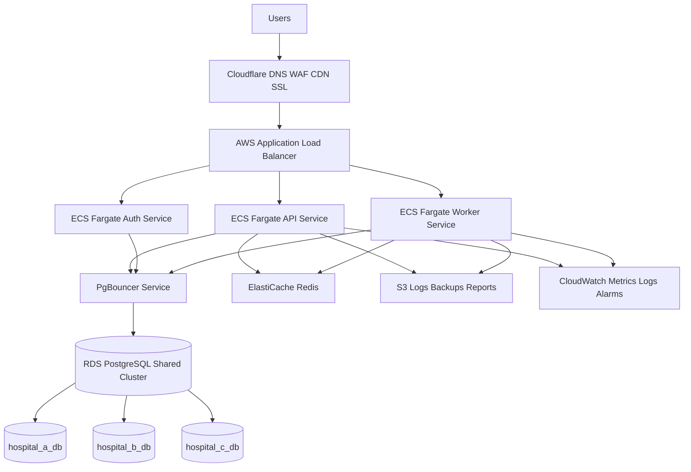

# Hospital SaaS Platform Master Architecture Spec v1.0

Status: Draft for execution
Date: 2026-05-29
Owner: CTO Office
Audience: Principal Engineer (Architecture), Tech Lead/Software Architect, Backend Engineering, DevOps Engineering

## 1. Purpose
This document is the single source of truth for implementing and operating a multi-tenant hospital SaaS platform.

It standardizes:
- Product deployment models (shared SaaS, dedicated runtime, hybrid customer-hosted compute)
- Control plane and data plane responsibilities
- Security, scaling, and reliability guardrails
- Day-0 and Day-30 execution steps
- Go-live gates and sign-off criteria

## 2. Scope
In scope:
- Multi-hospital tenancy with strict isolation
- DB-per-tenant strategy on shared PostgreSQL cluster
- AWS infrastructure baseline (Cloudflare + ALB + ECS + Redis + RDS + S3 + Secrets)
- Automated provisioning and lifecycle management through control plane APIs

Out of scope:
- Hospital clinical workflow product features
- BI semantic models and report design
- Device firmware and endpoint hardware integration specifics

## 3. Canonical Deployment Models
Do not mix these models in a single implementation path. Choose per customer tier.

### Tier A: Shared SaaS (default)
- Shared ECS cluster for all customers
- Shared RDS cluster, database-per-tenant
- Shared Redis cluster with tenant-prefixed keys
- Fastest onboarding, best cost profile

### Tier B: Dedicated Runtime
- Dedicated ECS services (or dedicated cluster) per customer
- Optional dedicated RDS instance
- Shared control plane
- Higher isolation, stronger custom SLA profile

### Tier C: Hybrid Customer-Hosted Compute
- Customer runs runtime in customer AWS account or VPC
- Control plane remains central
- Data plane can be central DB-per-tenant or customer-dedicated DB by contract
- Connectivity through AWS PrivateLink (preferred) or Site-to-Site VPN

## 4. Architecture Principles
1. Tenant isolation first: no cross-tenant data access at app, cache, or DB layers.
2. Immutable releases: deploy by versioned image tags or digests only.
3. Secrets never in plaintext env: use Secrets Manager/SSM only.
4. Stateless compute, stateful managed services.
5. Scale compute first, database last.
6. Security and compliance are release gates, not backlog items.

## 5. Reference Architecture (Tier A Shared SaaS)

## 6. Control Plane and Data Plane

### 6.1 Control Plane Responsibilities
- Customer onboarding and lifecycle
- Deployment provisioning orchestration
- Tenant domain mapping and resolve
- License and feature entitlements
- Monitoring policy and scaling policy management
- Release orchestration and rollback coordination

### 6.2 Data Plane Responsibilities
- API/auth/worker runtime
- Request processing and queue execution
- Tenant data access through routing middleware
- Runtime observability and incident signals

## 7. Tenant Isolation Model

### 7.1 Database Isolation
- One PostgreSQL database per hospital tenant
- One DB user per tenant database
- Per-tenant connection and privilege boundaries

### 7.2 Cache Isolation
- Redis key namespaced by tenant_id
- Separate rate-limiting buckets per tenant and per IP
- Queue names include tenant scope where business logic requires tenant isolation

### 7.3 Runtime Isolation Controls
- Tenant resolved from subdomain, JWT claim, and optional explicit header
- Middleware injects tenant context into request and DB access layer
- Hard deny for unresolved or mismatched tenant context

## 8. Control Plane Data Model (Minimum Required)
Core tables:
- customers
- deployments
- hospitals
- databases
- domains
- licenses

Mandatory operational extensions:
- environments (prod/uat/staging/dev)
- deployment_states (provisioning, healthy, degraded, rollback, retired)
- release_versions (image tag/digest, migration version)
- migration_states (pending, applied, failed, rolled_back)
- incident_states (severity, owner, SLA timers)
- audit_events (immutable action log)

## 9. AWS Baseline Requirements
- VPC with public, private-app, and private-db subnets
- ALB in public subnets
- ECS Fargate services in private-app subnets
- RDS PostgreSQL Multi-AZ in private-db subnets
- ElastiCache Redis in private-db subnets
- NAT gateways for private egress
- S3 for artifacts/log exports/backups
- Secrets Manager or SSM Parameter Store for credentials
- CloudWatch metrics, logs, alarms, dashboards
- Terraform for reproducible infrastructure

## 10. Security Baseline

### 10.1 Network
- No public DB endpoints
- Security group least-privilege rules only
- PrivateLink or VPN for hybrid customer-hosted tier

### 10.2 Edge and TLS
- Cloudflare SSL mode: Full (Strict)
- Origin TLS on ALB 443 with ACM certs
- HTTP 80 redirected to HTTPS 443

### 10.3 App Security
- JWT auth + RBAC + tenant scope enforcement
- Sensitive operations require audit trails
- Per-IP and per-account brute-force and abuse controls

### 10.4 Data Security
- Encryption at rest for RDS, Redis, and S3
- TLS in transit for service-to-service traffic where supported
- Secrets rotation policy and break-glass runbook

## 11. Compute and Scaling Strategy

### 11.1 ECS Services
- API service
- Auth service
- Worker service
- PgBouncer service

### 11.2 Scaling Policies
- CPU > 60% target tracking for scale out
- Memory > 70% target tracking for scale out
- Worker queue-depth scaling policy for background jobs
- Cooldown controls to prevent thrash

### 11.3 Scaling Order
1. Scale ECS tasks
2. Scale Redis memory/replication
3. Scale PgBouncer capacity
4. Scale RDS (vertical, then read replicas for read-heavy workloads)

## 12. Database Strategy
- Start with shared RDS cluster and DB-per-tenant
- Multi-AZ mandatory for production
- Automated backups and tested restore process
- Read replicas only when read load justifies complexity
- PgBouncer transaction pooling for connection pressure control

## 13. CI/CD and Release Controls
Pipeline:
- GitHub push
- Build Docker image
- Push to ECR
- Deploy ECS services
- Run migrations
- Run smoke checks
- Complete rollout gates

Release controls:
- Use immutable image tag/digest deployments only
- No runtime dependency on image latest in production
- Migration forward and rollback scripts rehearsed before go-live windows

## 14. Reliability and SLOs
Minimum production SLOs:
- API availability: >= 99.9%
- p95 API latency: <= 500 ms (normal load)
- Auth success rate: >= 99.5%
- Queue processing SLA: defined per queue class
- Backup restore success: 100% in scheduled drills

Mandatory alerts:
- ECS service unhealthy task count
- ALB 5xx and latency spikes
- Redis memory pressure and failover events
- RDS CPU, connections, replication lag, storage pressure
- Tenant-level error budget burn

## 15. Cost Guardrails
- Start with right-sized Fargate tasks and autoscaling bounds
- Monitor NAT and egress costs explicitly
- Use Savings Plans where sustained baseline exists
- Reassess DB sizing only after pool/cache tuning

## 16. Day-0 Execution Checklist (Build Foundation)
1. Finalize tier selection policy and customer mapping criteria.
2. Provision Terraform baseline VPC, ALB, ECS, Redis, RDS, S3, secrets, observability.
3. Enforce TLS end-to-end: Cloudflare Full (Strict), ALB 443, HTTP redirect.
4. Deploy control plane MVP with customer, deployment, hospital, domain, license APIs.
5. Implement tenant resolver middleware and tenant-aware DB routing.
6. Configure PgBouncer and DB user-per-tenant bootstrap.
7. Stand up CI/CD with immutable image tagging and smoke validation.
8. Enable core alarms and incident routing.

## 17. Day-30 Execution Checklist (Stabilize and Harden)
1. Remove any EC2 legacy runtime dependencies from production path.
2. Validate worker parity: secrets, health checks, autoscaling, image pinning.
3. Run failover drills for ECS, Redis, and RDS Multi-AZ.
4. Execute backup restore drill and document RTO/RPO evidence.
5. Complete security review: IAM least privilege, SG review, key rotation verification.
6. Add tenant-level observability dashboards and monthly SLO review cadence.
7. Freeze go-live gate criteria and publish operational runbook.

## 18. Go-Live Gates and Sign-Off Matrix

### 18.1 Hard Gates
- Security gate: TLS strict, no plaintext secrets, no public DB access.
- Reliability gate: health checks, autoscaling, alarms, incident routing active.
- Data gate: backup + restore drill passed within agreed RTO/RPO.
- Release gate: immutable artifact deployment and rollback rehearsal passed.
- Tenant gate: strict isolation tests passed for DB, cache, and auth scope.

### 18.2 Sign-Off Owners
- Principal Engineer: architecture compliance and isolation boundaries
- Tech Lead/Architect: code-level tenancy and reliability controls
- Backend Engineer: API behavior, migration safety, queue correctness
- DevOps Engineer: infra posture, deployment safety, observability, DR readiness
- CTO: final risk acceptance and production approval

## 19. Target API Surface (Control Plane)
- POST /customers
- POST /deployments
- POST /hospitals
- POST /deployments/{id}/provision
- GET /resolve?domain=

Recommended additions:
- POST /deployments/{id}/release
- POST /deployments/{id}/rollback
- GET /deployments/{id}/status
- GET /tenants/{id}/health

## 20. Open Decisions Log (Must Be Closed Before Scale)
1. Tier C data residency and legal/compliance policy by geography.
2. Single-region vs multi-region failover timeline.
3. Tenant analytics data strategy (shared warehouse vs tenant-isolated marts).
4. Control plane API auth model for platform operators and automation.
5. Cost attribution model per tenant for internal chargeback and gross margin visibility.

## 21. Final Recommendation
Proceed with Tier A as default and Tier B as enterprise upsell path.
Treat Tier C as a separately governed offering with explicit network, versioning, and support contracts.

This keeps delivery speed high while preserving a credible enterprise trajectory.

## 22. CTO Execution Program (Build a World-Class Platform)

### 22.1 Program Mission
Build a hospital-grade, globally credible, multi-tenant platform that is:
- Secure by default
- Resilient under failure
- Operationally observable
- Cost-disciplined
- Fast to onboard and scale

### 22.2 Program Outcomes (90-day)
1. Production edge security fully hardened (TLS strict, WAF controls, no plaintext paths).
2. Zero critical runtime dependency on legacy EC2 for Tier A Shared SaaS.
3. Immutable, reproducible releases with proven rollback and migration safety.
4. Tenant isolation validated at API, cache, and DB layers.
5. SLO dashboard and incident operating model active with weekly reliability review.

## 23. Role-Based Engineering Workstreams

### 23.1 Principal Engineer (Architecture)
Objectives:
- Finalize canonical Tier A and Tier B reference architecture and anti-pattern list.
- Define strict contracts between control plane and data plane.
- Approve data isolation and tenancy verification model.

Deliverables:
1. ADR set (Architecture Decision Records):
  - tenancy model
  - release immutability
  - scaling strategy
  - hybrid tier boundaries
2. Canonical dependency map: runtime service -> data/cache/external dependencies.
3. Failure domain model and blast-radius matrix.

Acceptance criteria:
- No unresolved architecture contradiction across tiers.
- All production services mapped to explicit ownership and fallback behavior.

### 23.2 Tech Lead / Software Architect (Code Review)
Objectives:
- Enforce architecture in code through reusable platform patterns.
- Remove hidden coupling and drift across services.

Deliverables:
1. Shared backend platform package for:
  - tenant resolver
  - authz guards
  - request context propagation
  - structured audit events
2. Code quality gates:
  - mandatory PR template with risk sections
  - migration safety checklist
  - mandatory rollback notes per release
3. Static checks for forbidden patterns:
  - direct tenant bypass
  - plaintext secret usage
  - mutable image dependency assumptions

Acceptance criteria:
- All tier-A services pass architecture lint checks.
- Security and tenancy tests included in CI for all critical paths.

### 23.3 Backend Engineer
Objectives:
- Build control plane APIs and tenant-aware runtime primitives.
- Ship robust health, readiness, and migration-safe behavior.

Deliverables:
1. Control plane API v1:
  - customers
  - deployments
  - hospitals
  - domain resolve
  - deployment status
2. Tenant-aware DB access layer:
  - request-scoped connection routing
  - DB user-per-tenant enforcement
  - hard fail on unresolved tenant
3. Runtime hardening:
  - health/readiness endpoints
  - queue depth metrics
  - idempotent onboarding/provision jobs

Acceptance criteria:
- Tenant context required for all write operations.
- Backward-compatible API contracts with versioned schema changes.

### 23.4 DevOps Engineer
Objectives:
- Deliver secure, reproducible, and observable production infrastructure.
- Reduce MTTR via automation and operational runbooks.

Deliverables:
1. Terraform modules:
  - network baseline
  - ECS services
  - RDS and Redis
  - ALB and DNS integration
  - IAM and secrets wiring
2. Release safety:
  - immutable tags/digests only
  - deployment gates (smoke + health + alarm quiet period)
  - rollback workflow tested monthly
3. SRE baseline:
  - CloudWatch dashboards + alarms
  - on-call alert routing
  - incident runbooks

Acceptance criteria:
- One-command environment bootstrap for Tier A.
- Measured deployment success rate >= 95% over rolling 30 days.

## 24. Phased Infrastructure Plan (Execution-Ready)

### Phase 0 (Week 1): Security and Stability Baseline
1. Enforce HTTPS 443 + Cloudflare Full (Strict) + HTTP redirect.
2. Remove plaintext secrets from runtime task definitions.
3. Standardize app and worker health checks.
4. Enable foundational alarms (ALB 5xx, ECS unhealthy, RDS/Redis critical).

Exit gate:
- No plaintext secret in task definitions.
- TLS strict posture verified in production.

### Phase 1 (Week 2-3): Dependency Decoupling and Service Parity
1. Move Redis to ElastiCache and validate failover behavior.
2. Bring worker service to parity (secrets, health checks, scaling hooks, pinned image).
3. Remove runtime reliance on legacy EC2 private endpoints for Tier A path.

Exit gate:
- Tier A runtime independent of legacy EC2 services.

### Phase 2 (Week 4-5): Scale and Reliability Controls
1. Enable ECS autoscaling policies for API/auth/worker.
2. Introduce queue-depth-driven scaling for workers.
3. Set PgBouncer baseline capacity and saturation alarms.
4. Conduct load tests and tune thresholds.

Exit gate:
- SLOs stable under peak synthetic load profile.

### Phase 3 (Week 6-7): Control Plane and Tenant Automation
1. Ship control plane API v1 and provisioning workflows.
2. Automate tenant DB creation and credential lifecycle.
3. Add deployment state machine and audit trails.

Exit gate:
- New tenant onboarding can be completed with zero manual infra steps.

### Phase 4 (Week 8-9): DR, Compliance Readiness, and Excellence Layer
1. Backup restore drill rehearsal with evidence and RTO/RPO measurement.
2. Chaos/failure drills (task crash, Redis failover, DB failover).
3. Finalize compliance evidence package (audit log integrity, access controls, key rotation).

Exit gate:
- Go-live sign-off matrix fully green.

## 25. Engineering Excellence Bars (World-Class Quality)

### 25.1 Reliability Bars
- Error budget policy enforced per service.
- Production incident postmortem within 48 hours for Sev-1/Sev-2.
- MTTR targets:
  - Sev-1 <= 30 min initial containment
  - Sev-2 <= 2 hours

### 25.2 Security Bars
- Secrets rotated on schedule and after key personnel changes.
- Zero direct DB public ingress.
- Mandatory threat-model review for every externally exposed feature.

### 25.3 Performance Bars
- p95 API latency <= 500 ms under normal load.
- p99 auth endpoints <= 700 ms.
- Tenant resolution overhead <= 20 ms p95.

### 25.4 Operability Bars
- Every critical service has:
  - runbook
  - owner
  - dashboards
  - alerts
  - rollback procedure

## 26. Implementation Blueprint (What to Build First in Code and Infra)

### 26.1 Terraform Module Order
1. `network-core` (VPC, subnets, routes, NAT, SG baselines)
2. `edge-alb` (ALB listeners, target groups, TLS)
3. `data-rds` (RDS Multi-AZ, backup config, parameter groups)
4. `cache-redis` (ElastiCache deployment and SG bindings)
5. `compute-ecs` (cluster, task defs, services, autoscaling)
6. `observability` (CloudWatch logs, alarms, dashboards)
7. `secrets-iam` (least privilege IAM, secret references)

### 26.2 Service Build Order
1. auth service (foundation)
2. API service with tenant routing middleware
3. worker service with queue metrics
4. PgBouncer service
5. control plane service

### 26.3 CI/CD Gate Order
1. build + unit tests
2. integration tests
3. migration dry-run
4. deploy canary or rolling batch
5. smoke checks
6. SLO/alert sanity checks
7. promotion complete

## 27. Program Governance Cadence
1. Daily: engineering stand-up with blocker review.
2. Twice weekly: architecture + reliability review.
3. Weekly: release board chaired by CTO.
4. Monthly: DR drill and security posture audit.

## 28. Immediate Next 10 Tasks
1. Freeze tier definitions and customer qualification policy.
2. Implement TLS strict edge posture in production.
3. Eliminate plaintext secrets from worker runtime.
4. Migrate Redis dependency to ElastiCache.
5. Enable worker health check and autoscaling baseline.
6. Enforce immutable image deployment policy.
7. Publish release and rollback runbooks.
8. Activate SLO dashboard and error budget alerts.
9. Implement control plane deployment state API.
10. Run first full backup-restore rehearsal and publish evidence.

## 29. Phase-Wise Execution Checklist (Tick on Completion)

Use this as the operational tracker. Mark each item completed only after evidence is attached in your delivery ticket.

### Phase 0: Security and Stability Baseline
- [ ] Enable ACM certificate and ALB 443 listener.
- [ ] Configure HTTP 80 -> HTTPS 443 redirect.
- [ ] Set Cloudflare SSL mode to Full (Strict).
- [ ] Verify no plaintext secrets in app and worker task definitions.
- [ ] Add and validate worker health check endpoint and ECS health check.
- [ ] Configure baseline alerts: ALB 5xx, ECS unhealthy tasks, RDS CPU/connections, Redis memory.
- [ ] Publish Phase 0 completion report with curl and AWS CLI evidence.

### Phase 1: Dependency Decoupling and Runtime Parity
- [ ] Provision ElastiCache Redis in private subnets.
- [ ] Update runtime secret references to new Redis endpoint/auth token.
- [ ] Remove EC2 Redis dependency from production runtime.
- [ ] Remove EC2 SIB dependency from production runtime path.
- [ ] Remove EC2 n8n dependency from production runtime path or route through managed endpoint.
- [ ] Align worker with app parity: secrets, health checks, immutable image tag.
- [ ] Validate zero critical Tier A runtime dependency on EC2 private IPs.

### Phase 2: Scaling and Reliability Controls
- [ ] Enable ECS autoscaling for API/auth/worker services.
- [ ] Add queue-depth based autoscaling for worker service.
- [ ] Define PgBouncer pool limits and saturation alert thresholds.
- [ ] Execute load test and record p95/p99 latency outcomes.
- [ ] Tune autoscaling cooldowns based on observed behavior.
- [ ] Verify SLO dashboard is live with error-budget burn alerts.

### Phase 3: Control Plane and Tenant Automation
- [ ] Release control plane API v1 (customers, deployments, hospitals, resolve).
- [ ] Implement deployment state machine and lifecycle audit events.
- [ ] Automate tenant DB creation with DB user-per-tenant.
- [ ] Implement domain mapping and tenant resolution contract.
- [ ] Add deployment release and rollback API endpoints.
- [ ] Demonstrate zero-manual-step onboarding for a new tenant.

### Phase 4: DR, Compliance, and Operational Excellence
- [ ] Run full backup restore drill and document measured RTO/RPO.
- [ ] Execute failover simulations for ECS, Redis, and RDS Multi-AZ.
- [ ] Complete IAM least-privilege review and sign-off.
- [ ] Verify key rotation and break-glass secret access process.
- [ ] Publish service runbooks with owner, alerts, rollback, and escalation path.
- [ ] Conduct final go-live readiness review with sign-off matrix.

### Release Checklist (Every Production Release)
- [ ] Image pinned by version tag or digest (no mutable latest dependency).
- [ ] Migration dry-run completed and reviewed.
- [ ] Rollback command tested in non-prod for this release train.
- [ ] Smoke test passed for auth, tenant resolution, and core APIs.
- [ ] Post-deploy health checks and alarms reviewed for 30-minute quiet window.

### Sign-Off Checklist (Per Phase)
- [ ] Principal Engineer sign-off
- [ ] Tech Lead / Software Architect sign-off
- [ ] Backend Engineer sign-off
- [ ] DevOps Engineer sign-off
- [ ] CTO final sign-off

## 30. World-Class Efficiency and Cost-Scale Blueprint

This section defines how to deliver high throughput, low infrastructure cost, and horizontal scalability without compromising healthcare-grade reliability.

### 30.1 Efficiency Design Goals
1. Maximize useful work per vCPU and per GB.
2. Scale out stateless services first, keep stateful tiers right-sized.
3. Minimize cross-AZ and internet egress where possible.
4. Keep p95 latency stable while reducing unit cost per request.

### 30.2 Core Efficiency Architecture Patterns

#### A. API and Auth Services (Stateless First)
- Keep API and auth fully stateless.
- Externalize all session/state to Redis or durable stores.
- Use shared middleware for request context, validation, auth, and audit to reduce duplicated compute.
- Apply aggressive connection reuse and HTTP keep-alive.

#### B. Worker and Queue Efficiency
- Use queue-depth autoscaling as the primary worker scaler.
- Separate queues by workload class (fast, medium, heavy) to avoid head-of-line blocking.
- Enforce idempotency keys for retry-safe jobs.
- Use batch processing where clinically safe to reduce overhead per event.

#### C. Database Efficiency (Scale Last)
- Use PgBouncer transaction pooling by default.
- Keep write paths narrow and indexed; offload reports to read replicas only when needed.
- Avoid N+1 query patterns and enforce query budget thresholds per endpoint.
- Use tenant-aware query templates and prepared statements.

#### D. Cache Efficiency
- Cache only high-hit, low-volatility data.
- Define TTL tiers by data class (auth/session, metadata, dashboard aggregates).
- Use tenant-prefixed keys and invalidation hooks for correctness.
- Protect Redis with memory headroom alarms and eviction policy review.

#### E. Storage and Artifact Efficiency
- Lifecycle S3 logs and artifacts with retention policies by compliance class.
- Compress archived logs and reports.
- Keep container images minimal and dependency-pruned.

### 30.3 Horizontal Scalability Controls
1. API/auth autoscaling via target tracking (CPU and memory), min 2 tasks in production.
2. Worker autoscaling via queue depth and max processing latency.
3. PgBouncer deployed as 2+ tasks for HA and pooled connection consistency.
4. Service-level concurrency limits to prevent noisy-neighbor tenant impact.
5. Circuit breakers and backpressure on downstream dependency saturation.

### 30.4 Cost Efficiency Guardrails
1. Enforce immutable image deploys to avoid uncontrolled runtime drift and repeated failed rollouts.
2. Right-size task CPU/memory quarterly using observed p95 utilization, not guesses.
3. Reduce NAT cost by minimizing unnecessary outbound chatter and consolidating egress patterns.
4. Use Cloudflare caching and rate limits to reduce origin request load.
5. Use Savings Plans only after baseline utilization stabilizes.
6. Keep DB scaling as last resort after cache, pool, and query optimization.

### 30.5 Performance and Cost KPIs (Mandatory)

#### Throughput and Latency
- p95 API latency <= 500 ms
- p99 API latency <= 900 ms
- Auth p95 <= 300 ms
- Queue processing SLA by class (define per queue)

#### Utilization Targets
- API task average CPU utilization target band: 45-65%
- Worker target utilization band: 50-70%
- Redis memory sustained < 75%
- PgBouncer pool saturation < 80% sustained

#### Cost Metrics
- Cost per 10K API requests
- Cost per active tenant per month
- Cost per completed background job
- Egress and NAT cost as percentage of total infra spend

### 30.6 Anti-Patterns (Do Not Allow)
1. Production dependency on mutable image latest.
2. Plaintext secrets in task definitions.
3. Tenant-unaware shared cache keys.
4. Direct DB access bypassing tenant resolution controls.
5. Unbounded retries without idempotency and dead-letter handling.
6. Premature RDS upsizing before app/cache/pool tuning.

### 30.7 Engineering Checklist: Efficiency and Scalability
- [ ] API and auth services confirmed stateless.
- [ ] Queue-depth autoscaling active for workers.
- [ ] PgBouncer 2+ task HA deployed and monitored.
- [ ] Query budget and slow-query alerting enabled.
- [ ] Redis TTL and eviction strategy documented.
- [ ] Cloudflare caching/rate-limiting tuned for origin protection.
- [ ] NAT/egress cost dashboard active.
- [ ] Cost-per-tenant and cost-per-request dashboards active.
- [ ] Monthly efficiency review ritual scheduled (architecture + DevOps + backend).

### 30.8 60-Day Efficiency Roadmap

#### Week 1-2
- Baseline metrics and cost dashboards.
- Enable autoscaling and queue-depth triggers.
- Remove known infra waste and drift.

#### Week 3-4
- Query tuning sprint and cache strategy rollout.
- Worker queue partitioning and retry hardening.
- PgBouncer pool tuning with load tests.

#### Week 5-6
- FinOps review: right-size ECS tasks and adjust scaling bands.
- Validate SLO adherence under peak test profile.
- Freeze optimized baseline and publish efficiency report.

### 30.9 Definition of World-Class (Operational)
This platform is considered world-class when all are true for 2 consecutive release cycles:
1. SLOs consistently met with no Sev-1 incidents caused by preventable capacity issues.
2. Horizontal scaling events are automatic and stable (no scaling thrash).
3. Unit economics trend down while throughput and tenant count increase.
4. Deployment success rate >= 95% with rehearsed rollback evidence.
5. Security and tenancy hard gates remain green in every release.