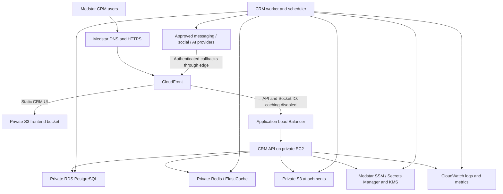
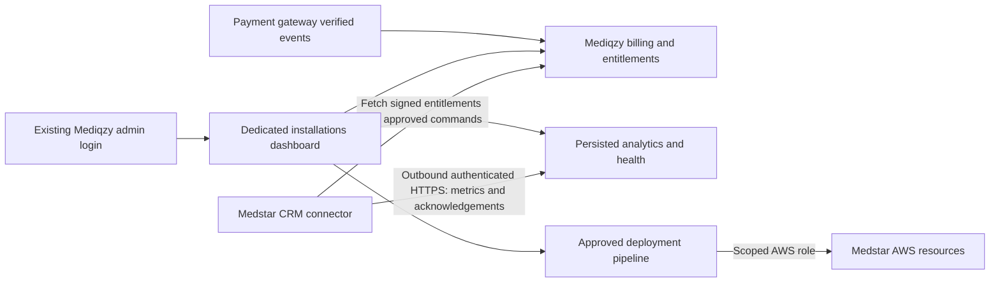

# Medstar CRM — dedicated AWS deployment plan

Date: 2026-10-18. Source reviewed: Mediqzy `main`, commit `f1d5ffbc`.

Status: architecture recommendation and implementation backlog, not deployment certification. This review inspected repository code and deployment scripts. It did not access Medstar's AWS account, DNS, production database, server capacity, or provider accounts. Existing historical audit documents are context, not evidence of current production state.

## 1. Decision

Deploy a dedicated Mediqzy CRM installation into **Medstar's AWS account**, on **Medstar's domain**, with its own database, queues, files, secrets, and operating permissions. Maintain one Mediqzy codebase and distribute versioned releases; use installation configuration for Medstar branding and enabled modules.

The recommended first hosting target is EC2, consistent with the application's current Node/PM2 deployment approach and Medstar's request for its AWS server. Package a dedicated CRM API and worker runtime first. Use managed PostgreSQL and Redis where permitted. Containers/ECS are an optional subsequent hosting choice, not a prerequisite or a reason to rewrite CRM.

This is feasible, but **CRM is not currently a self-contained deployable product**. Pointing a new domain at Mediqzy or uploading the frontend would not provide an independent installation. Copying the whole production server would carry unrelated workers, shared credentials, and configuration defaults into Medstar.

Use `crm.<medstar-domain>` below as a placeholder; the actual domain has not been supplied.

## 2. What the current architecture establishes

| Area | Repository evidence | Consequence for Medstar |
|---|---|---|
| Frontend | [`client/src/routes/index.tsx`](../../client/src/routes/index.tsx) contains CRM alongside other portals; [`client/src/config/brand.ts`](../../client/src/config/brand.ts) contains Mediqzy branding and support links. | Produce a CRM frontend entry/build with installation branding. Hiding menus alone is not server isolation. |
| API and startup | [`server/index.js`](../../server/index.js), [`server/app.js`](../../server/app.js), and [`initialization.controller.js`](../../server/controllers/initialization.controller.js) start the shared application, route families, infrastructure, and jobs. | Introduce an explicit CRM runtime, with only necessary shared services. Do not import the full app and assume unused routes/workers are inert. |
| CRM surface | `app.js` mounts legacy/v2 CRM, hospital CRM, communication hub, segments, automations, campaigns, AI, flow builder, social, and BrightBean-adoption routes. | Existing capabilities can be reused, subject to installation and functional acceptance tests. Route existence does not prove operational readiness. |
| Identity | [`crm.middleware.js`](../../server/middleware/crm.middleware.js) resolves users, owning tenant ID/UID, corporate scope, permissions, and session state using shared foundations. | CRM needs the identity/tenant/UID/session foundation, not just tables named `crm_*`. Preserve RBAC and tenant checks in the dedicated installation. |
| Default tenant | [`crm-v2-sync.service.js`](../../server/services/crm-v2-sync.service.js) defaults `CRM_V2_DEFAULT_TENANT_ID` to `7`. | Require validated installation tenancy or explicit authenticated scope. Medstar's database IDs must never be inferred from Mediqzy's. |
| Fresh installation | [`migrate-crm-all.mjs`](../../server/scripts/migrate-crm-all.mjs) runs selected hospital CRM/Chatwoot/social-content migrations. Other governance, session, credential, Agentic CRM, flow/social, and UID migrations exist separately. | This runner is not a verified blank-database installer. Build and rehearse a complete dependency-ordered migration manifest. |
| Login readiness | [`crm.route.js`](../../server/routes/crm.route.js) checks a schema list that includes RFQ/insurance tables before servicing requests. | Either retain those supporting tables without exposing their modules initially, or safely split readiness checks by enabled module. Otherwise login can return 503. |
| Domain resolution | [`domainResolver.middleware.js`](../../server/middleware/domainResolver.middleware.js) supports custom domains and tenant headers, but `app.js` mounts it after CRM routes. | Custom-domain support alone does not bind CRM authentication to Medstar. Add installation/host enforcement before the CRM routes. |
| Browser addressing | [`api.ts`](../../client/src/utils/api.ts) supports `VITE_API_URL` and client tenant headers; [`socket.ts`](../../client/src/utils/socket.ts) supports same-origin sockets. | Same-origin `/api` is viable. Ignore untrusted tenant overrides and verify all absolute URLs, login callbacks, and socket paths. |
| Asynchronous work | Campaign/segment workers are imported by `app.js`; automation and segment-refresh cron services are also initialized. | Separate API, worker, and scheduler lifecycles. Ensure no duplicate campaign dispatch or unrelated clinical jobs start. |
| Credentials | [`crm-channel-integrations.service.js`](../../server/services/crm-channel-integrations.service.js) encrypts integration credentials using `CRM_CREDENTIAL_ENCRYPTION_KEY`; some delivery paths use environment credentials. | Use new Medstar keys and provider identities. Trace actual delivery paths, not just the settings form. |
| Chatwoot | [`chatwoot-bridge.service.js`](../../server/services/chatwoot-bridge.service.js), [`chatwoot.service.js`](../../server/services/chatwoot.service.js), and `.env.example` include bridge configuration and Medstar-named placeholders. | There is integration scaffolding, not proof of an existing working Medstar deployment. Chatwoot is optional and needs a separate service/account if selected. |
| Release tooling | [`deploy-full-prod-s3.sh`](../../scripts/deploy/deploy-full-prod-s3.sh), [`deploy-frontend-s3.sh`](../../scripts/deploy/deploy-frontend-s3.sh) target Mediqzy paths/resources. The frontend script assigns Mediqzy's bucket/distribution directly. | Create an account-checked, installation-specific release pipeline. Do not run these scripts unchanged in a Medstar deployment. |
| Secret loading | [`ssm-env-loader.mjs`](../../server/scripts/ssm-env-loader.mjs) defaults to `/mediczy/prod`, supports `SSM_PARAM_PATH` and `SSM_REQUIRED`. | Supply Medstar's namespace explicitly and restrict IAM to it. Missing secrets must stop startup. |
| Container portability | [`Dockerfile.mediczy-app`](../../Dockerfile.mediczy-app) builds with Mediczy URLs and packages the full application; Chromium download is skipped. | Do not treat it as a ready CRM image. Parameterize URLs and supply a tested browser runtime if selected exports require Puppeteer. |

## 3. Proposed target architecture

All AWS resources shown belong to Medstar. External messaging, social, or AI processing remains external and must be disclosed; AWS hosting alone does not keep all processing inside the account.

### Hosting choices

| Choice | Appropriate use | Tradeoff |
|---|---|---|
| **Recommended production:** dedicated API EC2, separate worker EC2, RDS, managed Redis, S3/CloudFront, ALB | Normal independent hospital CRM deployment | Separate worker load and managed persistence; more infrastructure than a single server. |
| Existing single Medstar EC2 with reverse proxy, API and worker processes; managed DB/Redis preferred | Budget-constrained initial installation | Explicit single point of failure; backups do not provide availability. Validate capacity and existing workloads before accepting. |
| Two API instances across AZs, redundant worker capacity, RDS Multi-AZ, Redis failover | Required availability target justifies it | Requires proven distributed scheduler locking and Socket.IO scale-out handling. |
| ECS-based equivalent | Medstar already operates containers | Use the same release artifacts after a CRM image exists; additional operational setup. |

Select the AWS region with Medstar based on organizational data-location requirements and proximity. An Indian region such as Mumbai is a candidate, not an assumed account setting. Use private database subnets and security groups allowing only the application/migration roles. RDS supports VPC placement and Multi-AZ deployments ([AWS PostgreSQL documentation](https://docs.aws.amazon.com/AmazonRDS/latest/UserGuide/CHAP_PostgreSQL.html)).

For initial sizing discussion, budget approximately 4 vCPU/8–16 GiB for API and 2 vCPU/4–8 GiB for workers; size PostgreSQL, Redis, storage, and connection pools using measured users, imports, message volumes, and retention. These are starting estimates, not a load-tested capacity promise. Run builds on CI runners, not the production server. Do not provision GPUs for CRM by default.

## 4. Scope and integration boundaries

| Capability | Initial disposition | Dependencies to validate |
|---|---|---|
| CRM login, team roles, dashboard, leads, contacts, deals, pipeline, activities, reports/settings | Core scope | Identity foundation, permissions, audit, tenant binding, frontend/API parity. |
| Hospital CRM command centre, growth, specialties, diagnostics | Enable required modules | Identify actual hospital/clinical table/API dependencies; do not expose the full hospital portal as a shortcut. |
| Lists, segments, templates, campaigns, automations | Include when sending is configured | Redis jobs, schedule ownership, consent/suppression, sender identity, unsubscribe and tracking URLs. |
| Communication hub, email, WhatsApp, SMS, voice, social account settings | Include UI; activate each verified adapter independently | Medstar accounts, delivery adapters, signed callbacks, sender approvals and provider limits. Configuration storage is not proof that every adapter supports all actions. |
| Flow Builder and Social Growth/Content | Optional activation after acceptance | Migration coverage, worker execution, OAuth scopes, webhook handling, role checks. |
| Agentic CRM | Optional controlled activation | Approved model endpoint, tools, proposal/confirmation, expiry, RBAC, bulk dry-run, audit and tenant tests. No inherited Mediqzy AI fallback. |
| BrightBean-inspired inbox functions | Reuse existing Mediqzy implementation | Current social inbox/flow dependencies; do not assume the upstream BrightBean app must be separately installed. |
| Chatwoot workspace | Optional integration | Hospital-owned Chatwoot endpoint/account, tokens, inbox mapping and workers. Self-hosting Chatwoot adds its own application and persistence stack. |
| Insurance/RFQ, finance, lab, pharmacy, prescribing, clinical AI | Excluded unless separately agreed | Some supporting schema may remain initially; API access and background jobs stay disabled. |

If Medstar needs existing HIS/EMR data, define a separate, authenticated integration contract: identifiers, direction, refresh frequency, consent, error handling, and ownership of updates. Do not share database credentials or silently synchronize with Mediqzy production. CRM can launch without an HIS connector if its operating scope allows manual/imported leads.

## 5. Engineering work required before deployment

The names below describe proposed deliverables; they are not existing commands or switches.

| Work item | Implementation | Completion evidence |
|---|---|---|
| M1 — CRM runtime | Add a CRM application entrypoint using shared auth, DB, audit, error handling and only approved routes. Extract campaign/segment/inbox workers and scheduler startup. Remove import-time execution from the selected dependency graph. | Startup dependency trace; no unrelated clinical/payment/Kafka/device jobs; stopped optional systems do not break core CRM. |
| M2 — Installer | Create a versioned manifest covering identity/tenancy/UID functions, CRM core and every enabled extension; reconcile legacy readiness guards. Inventory runtime DDL and move required schema operations into migrations. Use migration ledger and single-run lock. | Empty PostgreSQL install succeeds; second run is a no-op; upgrade fixture passes; UID verifier passes for installed entities. |
| M3 — Installation boundary | Require Medstar tenant UID and resolve its local integer ID; remove implicit tenant `7` fallback in this runtime. Validate host and authenticated scope before routes. Make revocation-store availability and audit failure behavior explicit for sensitive operations. | Foreign/missing tenant rejected; forged `X-Tenant-ID`, `X-Tenant-Code`, host and cross-installation token tests pass; privileged operations fail closed when required controls are unavailable. |
| M4 — UI and branding | CRM entry/build, Medstar logo/name/support details, appropriate menu, login/reset screens, favicon/manifest, notification and email branding. Make optional Google login validation conditional. | Every enabled deep link loads; no unrelated portal navigation; keyboard/mobile checks; no unexplained Mediqzy API requests. |
| M5 — Storage | Separate private frontend and attachment buckets. Replace CRM attachment/import public-link assumptions with authorized downloads or short-lived signed URLs. Inventory local disk writes/exports. | Unauthorized downloads denied; files survive replacement of the API instance; appropriate lifecycle rules applied. |
| M6 — Communications | Trace each send path; replace shared credential/sender/recipient defaults. Configure provider-specific status, callbacks and error presentation. Gate outbound traffic until recipient tests pass. | Each enabled channel passes send/receive/status tests with designated test recipients; duplicate callback/job cannot cause duplicate send. |
| M7 — Deployment tooling | Parameterized IaC and release pipeline with AWS account-ID assertion, resource allowlist, explicit SSM path, artifact SHA/image digest, rollback release and separate migration job. | Pipeline refuses Mediqzy resources and absent configuration; reproducible deploy/rollback rehearsal. |
| M8 — Operations | Minimal infrastructure health endpoints, CRM readiness including schema/DB and essential queues, logs/alarms, backup policy, restore procedure, worker monitoring and support access. | Dependency failure produces meaningful health/status; alarms and restore drill demonstrated. |

Preserve the existing product while adding the dedicated runtime. Avoid a permanent `medstar` code branch. Configuration and licensed modules belong in deployment manifests; fixes return to the shared codebase.

## 6. Domain, frontend and network configuration

1. Confirm the hospital's exact hostname and DNS owner. Add the hostname and certificate to the Medstar distribution. CloudFront viewer certificates from ACM must be issued/imported in `us-east-1`; the regional load-balancer certificate belongs in its own region ([AWS TLS requirements](https://docs.aws.amazon.com/AmazonCloudFront/latest/DeveloperGuide/cnames-and-https-requirements.html)).
2. Serve CRM on `/crm`; redirect `/` to the chosen CRM entry. Build with `VITE_API_URL=/api` and use the same origin for sockets. Audit generated login/reset, tracking/unsubscribe, email, attachment and OAuth URLs.
3. Forward `/api/*`, `/socket.io/*`, and the inventoried callback paths to the API with caching disabled, required methods, cookies, authorization, query parameters and WebSocket upgrade headers. CloudFront supports WebSockets when the behavior forwards the required headers ([AWS WebSocket guidance](https://docs.aws.amazon.com/AmazonCloudFront/latest/DeveloperGuide/distribution-working-with.websockets.html)).
4. Rewrite only recognized frontend navigation requests to `index.html`. Do not globally translate API errors or missing JavaScript assets to HTML/200. Keep missing assets as 404. Upload hashed assets before HTML and retain previous-release chunks; serve HTML/service-worker metadata with revalidation to prevent the stale-chunk failures seen in earlier deployments.
5. Restrict the origin to the approved edge path, validate allowed hosts, and configure trusted proxies. Preserve or securely inject the verified viewer host if the origin uses a different DNS name. Never accept an arbitrary client-provided forwarded host or tenant header as authority.
6. Set exact allowed CORS origins, secure host-appropriate cookie settings, CSP and OAuth callback URLs. Test both Socket.IO polling and upgrade/reconnect; before multi-instance rollout, configure session affinity where polling requires it and a shared adapter for room events.
7. Use SSM Session Manager for administration where possible. Keep PostgreSQL/Redis inaccessible from the internet; validate TLS certificates rather than disabling certificate checks. Give API, worker, migration and CI separate least-privilege roles.

The repository's existing `/health/live` and `/health/ready` require an admin session. Do not blindly configure ALB checks against them or put admin tokens in health checks; provide a minimal internal deployment health surface.

## 7. Configuration and credentials

| Setting category | Medstar requirement |
|---|---|
| AWS | Explicit account ID, region, resource names, runtime IAM roles, backup ownership and budgets. |
| Secret source | Explicit `SSM_PARAM_PATH=/medstar/crm/prod` and `SSM_REQUIRED=true` if retaining the current loader; allow access only to that prefix and relevant KMS keys. |
| Database/Redis | Medstar endpoints and credentials, TLS and pool limits; no Mediqzy endpoint fallback. Validate PostgreSQL version/extensions before migration. |
| Authentication | Independent JWT/session secrets and hospital users/roles. Bootstrap a named admin securely; require credential setup and MFA according to the enabled authentication flow. |
| Credential encryption | New `CRM_CREDENTIAL_ENCRYPTION_KEY` in the format expected by the service. Re-enter credentials or perform controlled decrypt/re-encrypt; copying ciphertext under a new key will fail. |
| Public URLs | Medstar UI/API/callback origins, campaign links and socket origin. `CRM_BASE_URL`, related provider callbacks and brand support links must be audited. |
| AI | Explicit approved provider/model/key; hospital decision on external processing and retention. Disable unapproved provider fallbacks and unnecessary telemetry. |
| Feature activation | Independently configure Agentic CRM, flows, social, Chatwoot and outbound automation. Environment-template defaults are not evidence of a deployed flag state. |

For email: verify the hospital sending domain, SPF/DKIM/DMARC and bounce/unsubscribe handling. For WhatsApp/SMS/calls: provision Medstar sender numbers, account credentials, templates and callbacks required by the chosen provider. For social networks: hospital-owned pages/accounts, approved scopes, OAuth redirect URLs and webhook secrets. Confirm whether an existing live number/account can be moved before changing its routing.

Never populate the installation with Mediqzy's default outbound sales recipient, shared marketing list/user IDs, shared n8n webhook, shared Chatwoot endpoint, or provider tokens. Source configuration templates contain such defaults in places; absence of configuration must disable the function or fail clearly.

## 8. Data onboarding and migration

**Preferred:** a fresh installation seeded with Medstar's hospital/tenant, branches, named users, roles, source taxonomy and required CRM configuration. Import only approved Medstar lead/contact records.

If existing Medstar CRM data must move from Mediqzy:

1. Confirm authoritative Medstar tenant/organization UID and all linked branches/corporate dimensions. Profile ownership and ambiguous legacy records before export; do not infer ownership from numeric IDs or a name match.
2. Build a table/object manifest with tenant predicates and dependency closure: leads, contacts, deals, activities, campaign metadata, conversations, mappings, audit history and attachments needed for the agreed scope. Separate shared reference catalogs from tenant data. Explicitly exclude unrelated hospital/patient/employee records.
3. Preserve stable UIDs where valid, and generate deterministic mappings for local integer foreign keys. Include registry functions/rows and lookup dependencies; check uniqueness and UID twins. Quarantine ambiguous records instead of attaching them to Medstar by default.
4. Transfer an encrypted export to the hospital-controlled location. Reconcile per-table counts, relationships, attachment checksums, sampled screens and tenant-negative queries. Do not use a full Mediqzy production dump as the hospital baseline.
5. Do not transfer sessions, active refresh tokens, shared encryption keys, or queued sends. Reauthorize provider integrations; reconcile in-flight external messages and webhook cursors so import does not replay them.
6. Rehearse a final delta export. Freeze writes/sends only for Medstar's source scope during cutover; do not interrupt other Mediqzy tenants. Disable the old Medstar dispatch path before enabling the new path.
7. Keep the old Medstar scope read-only for the agreed rollback window, then apply the agreed retention policy. A rollback after new writes requires reconciliation, not simply changing DNS back.

## 9. Rollout sequence and ownership

Indicative effort assumes one backend engineer, one frontend engineer, DevOps support, and QA, with overlapping work. This is a planning estimate until dependency discovery and Medstar access are complete.

| Phase | Lead | Indicative duration | Exit condition |
|---|---|---|---|
| Discovery and scope | Architect + Medstar IT | 2–3 working days | Account/server inventory, hostname, feature list, users/load, data/HIS scope and availability targets agreed. |
| CRM packaging and installer | Backend + frontend | 7–12 working days | M1–M5 complete; blank install and regression suite pass; CRM UI uses only approved dependencies. |
| AWS and release pipeline | DevOps | 3–5 working days, overlaps packaging | Infrastructure, TLS, secrets, CI artifact deployment, backup and monitoring ready. |
| Channels and optional AI/Chatwoot | Backend + Medstar owners | 3–7 engineering days, overlaps | Enabled adapters pass tests; external provider approval time tracked separately. |
| Migration rehearsal and acceptance | QA + backend + Medstar | 3–5 working days | Data reconciliation, RBAC, browser, load, restore and rollback checks pass. |
| Cutover and observation | DevOps + QA | 1–2 working days plus monitoring | Named owner authorizes launch; production smoke tests and dispatch observation pass. |

Plan approximately **4–6 calendar weeks** for the recommended scope with parallel staffing, subject to findings. HIS integration, large historical imports, new adapters, provider approvals and contractual requirements can extend it. A domain-only change is faster but does not satisfy the independent-AWS requirement.

No standing staging environment was established by this review. Use an isolated rehearsal installation inside Medstar's account with synthetic/approved test data and outbound sending suppressed. If only one production server is available, use isolated ports/release directories and separate rehearsal database/queue namespaces; do not test schema installation or restored jobs against live users. Temporary resources can be removed after acceptance.

## 10. Acceptance and cutover gates

| Gate | Required evidence |
|---|---|
| Installation | Blank install and repeat migration pass; no unapproved system starts; DB/schema failure prevents readiness. |
| Authentication | Admin and restricted user login, refresh, logout/revocation, reset/lockout, role changes and disabled-user behavior. |
| Scope isolation | Foreign record IDs, corporate scope, forged tenant headers, unknown host and Mediqzy-signed tokens are denied. Include a second synthetic tenant in isolation tests even though production is dedicated. |
| Core functions | Create/edit/search/deduplicate/import leads and contacts; deals/stages, assignments, activities, settings and report/export behavior persist after restart. |
| Channels | Per enabled channel: save/update credentials without disclosure, send/receive to approved recipients, status callbacks, signature rejection, retry behavior, suppression/unsubscribe. Calls must be tested as calls, not inferred from SMS success. |
| Automations | Scheduled and segment jobs run once; disabled flows do not run; worker restart preserves pending work; retry and recipient limits work. |
| Agentic CRM | Real proposal → confirmation execution, expiry, RBAC denial, audit creation/failure policy, tenant separation and bulk dry-run. Keep disabled if these fail. |
| UI | Every enabled route/deep link and lazy chunk loads; no broken settings controls, console failures or unintended Mediqzy host calls; responsive, keyboard and accessibility checks. |
| Storage and operations | Authorized downloads only; restore from backup to isolated resources; failure/recovery alerts; process replacement; resource/load checks and rollback rehearsal. |

Deployment order: verify target account/resources → snapshot and backup → run compatible migrations once → deploy API/worker artifacts with outbound scheduling paused → smoke test → publish frontend assets and then HTML → validate DNS/callbacks → enable verified channels/jobs → observe queues, errors, latency and duplicate-send indicators.

Use immutable releases rather than pulling into a live working tree. A code rollback restores the previous artifact and UI manifest only when schema compatibility permits it. Do not automatically run destructive down migrations. Restore a database only through an explicit recovery plan that accounts for post-backup writes and already-sent messages.

Define RPO/RTO with Medstar. A proposed starting target is RPO ≤15 minutes and RTO ≤4 hours, to be demonstrated by restore drills, not promised from architecture alone. Configure PostgreSQL automated backups/PITR and snapshots, S3 versioning/lifecycle and protected secret recovery. AWS documents automated backup behavior separately from availability ([RDS backups](https://docs.aws.amazon.com/AmazonRDS/latest/UserGuide/USER_WorkingWithAutomatedBackups.html)).

## 11. Handover, costs and required Medstar inputs

Medstar should own AWS billing/root administration, DNS, provider accounts and data. Mediqzy engineering supplies signed/versioned releases, migration manifest, operating runbook, vulnerability/update process and scoped support access. Agree support response times, patch windows, emergency credential rotation, data export and exit procedures. If source code or images are distributed, review included dependency licences and delivery terms.

Prepare the AWS cost estimate after sizing and availability selection: API/worker compute, RDS storage/backups/Multi-AZ, Redis, ALB, NAT or private endpoints, S3, CDN transfer, logs/alarms and backup retention. Price messaging, voice, AI and optional Chatwoot operations separately. No monthly price is asserted here without the hospital workload and account configuration.

Inputs needed before execution:

- AWS account ID/region, delegated deployment role, existing EC2 details and network restrictions.
- Exact CRM domain/subdomain and a DNS administrator.
- Required CRM modules, number of branches/users/concurrent agents and expected campaign volumes.
- Fresh start versus approved existing Medstar data migration; HIS integration requirements if any.
- Hospital branding, support contacts and named CRM administrator.
- Hospital-owned email/WhatsApp/SMS/voice/social credentials and any Chatwoot endpoint, supplied through a secret store.
- Approved AI processing policy, retention, availability/recovery objectives and operating budget.

**Next engineering action:** implement M1–M3 and prove a fresh CRM installation in isolation. In parallel, obtain Medstar's infrastructure/domain inventory and prepare account-specific IaC. No production changes were made during this architecture review.

## 12. Central Mediqzy administration, payments and remote analytics

Added following the requirement to retain billing-linked control and analytics in the existing Mediqzy admin login. This is a proposed extension, not an already operational remote-management feature.

### Ownership and control

Keep a central **management service (control plane)** in Mediqzy and the operational CRM in Medstar's AWS account. Mediqzy remains authoritative for the software subscription, commercial entitlements, installation registration and centrally received usage. Medstar remains authoritative for its CRM records and hospital workflows.

| Admin capability | Implementation boundary |
|---|---|
| Plan, renewal, invoices, payment status | Central Mediqzy billing records tied to a stable customer/tenant UID and an installation ID. Do not equate invoice totals with collected revenue. |
| Purchased modules, seats and usage allowances | Centrally issued, signed, versioned entitlement document; Medstar validates it with a public key and enforces it locally. Signing key stays in Mediqzy. |
| Health, deployment version, queue failures and usage | Medstar sends authenticated heartbeat and metric batches to Mediqzy; the admin dashboard displays last sync and incomplete periods. |
| Leads, conversions, campaigns, channel performance | Agreed aggregate reporting schemas generated in Medstar; transmit no patient records, contact lists or message bodies by default. |
| Updates, support diagnostics, integration disablement | Explicit allowlisted operations with local authorization, audit trail, expiry, request identity and result acknowledgement. No arbitrary remote shell in the CRM admin API. |
| AWS infrastructure maintenance | Separate scoped IAM cross-account roles granted by Medstar, with temporary credentials. App admin status does not grant AWS permissions. |

Medstar's AWS owner can revoke delegated access or change software running in its account. This model provides agreed operational and commercial control, not irrevocable ownership of the hospital's infrastructure. Signed entitlements protect integrity but cannot prevent an account owner from modifying self-hosted software. Licensing and support agreements must reflect this boundary.

For programmatic third-party access, use a dedicated trust role and an installation-specific external ID; use a separate appropriate federated human access path for console work. AWS documents both the external-ID protection and the console role-switch limitation ([third-party access](https://docs.aws.amazon.com/en_en/IAM/latest/UserGuide/id_roles_common-scenarios_third-party.html), [cross-account roles](https://docs.aws.amazon.com/IAM/latest/UserGuide/tutorial_cross-account-with-roles.html)). Separate read-only monitoring, approved deployment and time-limited support privileges. CloudTrail captures Session Manager API activity; shell-session output logging needs explicit configuration, and SSH/port-forwarded session contents are not logged by Session Manager ([AWS session logging](https://docs.aws.amazon.com/systems-manager/latest/userguide/session-manager.html)).

### Proposed connection and admin interface

Proposed navigation: **Admin → Dedicated Installations → Medstar**, with Overview, Usage, Subscription & Payments, CRM Analytics, Integrations, Releases and Audit tabs. This navigation is not present merely because the tenant service exists.

Implement a per-installation machine identity, mutually authenticated TLS or short-lived scoped tokens, rotation/revocation, durable outbox and ingestion ledger. Bind credentials to the registered tenant/installation server-side. Deduplicate by installation and event/batch ID; include schema version, event time, reporting window and sequence. Define whether each metric is a cumulative counter, delta, snapshot or unique-user count before aggregating it. Retried batches must not inflate bills. Reconcile late events and do not sum daily distinct users into monthly active users.

Suggested cadence: heartbeat every minute, usage/CRM aggregates every 5–15 minutes and daily reconciliation. These are proposed settings. Show “last received” and “data through” timestamps. Offline status is unknown/stale, never zero usage or proof of nonpayment. CRM continues during a central-service outage using bounded cached entitlements and queues reports for later delivery; real-time support commands are unavailable while disconnected.

### Payment ownership

1. **Medstar's software subscription to Mediqzy:** retain the existing commercial/payment system as the central source of truth after validating its tenant mapping. Verify gateway webhook signatures, deduplicate events, reconcile refunds/chargebacks and update entitlements only from confirmed server-side state. A browser success redirect or Medstar-reported “paid” field is insufficient.
2. **Payments made by Medstar's patients/customers:** confirm the merchant/settlement arrangement. With Medstar-owned payments, retain transactional records locally and send permitted reconciled summaries; if Mediqzy already owns the authorized central payment workflow, retain that integration with explicit installation/tenant mapping. Do not change settlement accounts as part of infrastructure migration.
3. **AWS hosting charges:** remain payable through the owner of the AWS account unless a separate arrangement is agreed; CRM subscription billing does not automatically control AWS billing.

Define overdue behavior contractually: reminders, a documented grace period and restriction of new paid features or outbound campaigns where appropriate. Preserve essential record access/export and avoid abrupt interruption of active hospital workflows. Never stop EC2, delete data or revoke hospital data access automatically because a webhook is late or the management connection is unavailable. Any commercial restriction must be auditable, reversible and visibly distinguishable from technical failure.

### Existing code versus missing implementation

- [`tenant-registry.service.js`](../../server/services/tenant-registry.service.js) provides tenant settings/status and dashboard aggregation foundations. Its heartbeat map is process memory, not durable cross-account telemetry.
- [`tenant-heartbeat.service.js`](../../server/services/tenant-heartbeat.service.js) calls that local registry directly. Despite its control-plane description, this code does not send an outbound report to a remote Mediqzy service.
- [`tenant-billing.service.js`](../../server/services/tenant-billing.service.js) aggregates local usage and generates invoices. It does not establish a verified remote installation/payment/entitlement protocol. Its additive counters need an ingestion ledger; its sample tier prices must not be adopted as Medstar's contract. Review accounting periods, unique-user semantics, paid-invoice immutability and collection totals before reuse.

Add work items **M9: installation registry + durable connector/ingestion**, **M10: verified billing-to-entitlement integration**, and **M11: dedicated-installation admin UI + audited operations** before claiming centralized control. Test duplicate/reordered reports, spoofed installation identities, token revocation, central outages, delayed/refunded payments, stale analytics and denied support operations. Re-estimate the rollout after the intended payment meaning and required controls are agreed; the earlier 4–6 week estimate does not certify this additional scope.
