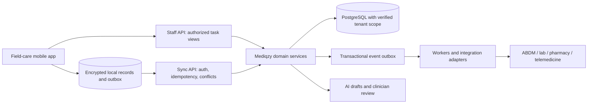

**CTO assessment: HWC Mobile App compared with Mediqzy**

**Review date: 8 October 2026 · Decision: retain Mediqzy’s core; build a focused field-care channel informed by HWC.**

HWC provides a substantially more developed native Android implementation for community and primary-care work than the Mediqzy `mobile/` directory reviewed here. Mediqzy has substantially broader implemented web and backend surfaces for hospital operations, commercial workflows, integrations, and AI assistance. These advantages address different problems. HWC is useful as a workflow and offline architecture reference; it is not a replacement for Mediqzy’s platform, nor a drop-in mobile frontend for its APIs.

My recommendation is to invest first in verified tenant and patient boundaries, complete one mobile care journey, and then add community-health program depth. Do not begin a wholesale platform rewrite or import HWC’s code into Mediqzy without resolving licensing, backend coupling, local credential storage, and sync reliability.

**Scope, evidence, and limits**

I cloned and inspected HWC’s public `main` at commit `5f6209eaed61a6f20eb10ffd981652b774931fdb`, dated 7 August 2026. Mediqzy was reviewed in `/home/ubuntu/Mediczy` at HEAD `f1681f921b852d0b8d6d7f15bd8ad33533411ba4`, dated 7 October 2026, including the existing working-tree changes. This is a source-level assessment of those snapshots, not certification of either deployed product.

The review covered manifests, application entrypoints, role screens, repositories, local storage, sync workers, authentication, API wiring, selected clinical and integration services, CI workflows, tests, and related architecture documentation. Repository-wide discovery was followed by targeted tracing of consequential paths; it was not a line-by-line audit of every file. Existing Mediqzy audit documents were used as leads, with the findings below checked against source.

I did not run either product against live patient data, authenticate to production, build an Android APK, perform a penetration test, evaluate model accuracy, or establish regulatory/ABDM certification. HWC’s backend repositories were not audited. No application behavior or configuration was changed. Only this report and its static-check evidence were added.

Mediqzy references a separate `msh_d_app` doctor application and other mobile integrations. Those external app repositories were not available in this review. Consequently, “mobile gap” below means the checked-in `mobile/` application, not a claim that every Mediqzy-branded mobile product is unfinished. [Doctor mobile integration reference](../../shared/doctor-mobile-api/README.md).

**1. Product positioning and practical fit**

| Dimension | HWC Mobile App | Mediqzy in this workspace | CTO interpretation |
|---|---|---|---|
| Primary operating context | Health and wellness centres, outreach, CHO and other healthcare staff | Hospitals, clinics, patients, doctors, labs, pharmacies, corporates and business administration | HWC has a focused field-care scope; Mediqzy has wider platform scope |
| Main client | Native Kotlin Android app | React/TypeScript web client; small Expo/React Native directory | Native mobile readiness and web-platform breadth must be evaluated separately |
| Main differentiator visible in source | Local clinical capture, sync, role handoffs, public-health program forms | Broad operational services, finance/CRM, imaging, integration and AI assistance | Learn field execution from HWC while preserving Mediqzy’s broader assets |
| Connectivity model | Room-backed data and many WorkManager push/pull tasks | Predominantly connected web/API workflows; no equivalent durable clinical sync path found in reviewed mobile source | Offline field operation is a substantial Mediqzy engineering gap |
| Backend relationship | Coupled to AMRIT/HWC/FLW services plus ABHA and eSanjeevani interfaces | Primarily Express/PostgreSQL with additional services and NestJS/control-plane projects | Pointing HWC at a Mediqzy URL will not make it compatible |
| Best-fit use case | Government/NGO primary care and outreach, subject to validation | Hospital/clinic operations and connected service coordination, subject to hardening | Product strategy should determine whether community-health depth is immediately necessary |

HWC’s repository explicitly targets collaboration among registration, nursing, medical, laboratory and pharmacy roles. The source contains role selection and navigation as well as distinct lab and dispensing forms. This is stronger evidence than a README feature list alone. [HWC overview](https://github.com/PSMRI/HWC-Mobile-App), [role navigation][H-role], [lab form][H-lab], [pharmacy form][H-pharmacy].

**2. Capability comparison**

“Implemented” in this table means source implementation was found. It does not mean every path was exercised, externally approved, or observed in production. “Not established” means this review did not substantiate the capability.

| Capability | HWC evidence | Mediqzy evidence | Assessment and action |
|---|---|---|---|
| Registration and identity | Local beneficiary records, registration, Aadhaar scan and ABHA screens | Patient/nurse registration, queue/kiosk services, ABDM registration routes | Both have foundations; Mediqzy needs offline provisional IDs, reconciliation and duplicate handling for field use |
| Nurse → doctor → lab → pharmacist journey | Role navigation, local visit data, investigation-selected lab forms, batch-based pharmacy forms | Separate nurse, clinical, lab and dispensing web/API surfaces | HWC gives a clearer native reference; validate Mediqzy’s entire encounter handoff as one journey |
| Vitals and clinical encounter | Vitals, visit details, case records and clinical forms | Nurse vitals, EHR, clinical notes, order and clinical-score services | Both have implementation; compare completion time and error rate in observed user tasks |
| Maternal, neonatal and child care | Pregnancy registration, ANC, PNC, delivery/neonatal outcomes, infant/child registration and immunization interfaces | Some specialty/EHR references; an equivalent integrated community program was not established | HWC has a clear source-level advantage for these programs |
| Community screening | CBAC/NCD, oral, ENT, ophthalmic, mental and elderly-health modules | General clinical/AI risk and specialty services; equivalent longitudinal field workflows not established | Adapt program workflows only where the target market requires them |
| Outreach and geographic worklists | Outreach activity and village/location assignment interfaces | Corporate screening/collection and coordination surfaces | Add camp/village assignments, due lists and follow-up tracking if targeting HWC-like operations |
| Disconnected capture | Room database, local forms and multiple push/pull workers | Mobile status advertises offline sync, but reviewed native client lacks the underlying implementation | Mediqzy should not present field offline sync as ready on this evidence |
| Device-to-device handoff | Nearby Connections implementation | Equivalent clinical handoff not established | Optional later capability; identity verification and audit design must precede adoption |
| Laboratory | Native visit-specific lab technician forms and sync | Lab portal, collection task services, RIS/PACS-related surfaces, rules and alerts | Mediqzy is broader; HWC offers the stronger native field reference |
| Pharmacy | Native prescription and batch-selection forms | Stock, purchases, POS/invoices, prescriptions and eMAR dispensing bridge | Mediqzy has broader business scope; clinical order/dispense identity still needs end-to-end verification |
| Telemedicine | eSanjeevani provider login, patient submission and web-reference interface | Agora/LiveKit dependencies and consultation services | Different integrations; neither source proves call quality or partner acceptance |
| Hospital/IPD operations | Comparable full inpatient suite not established in this mobile repo | Admissions/bed, nursing, billing, finance and hospital workflow services | Preserve Mediqzy’s core; absence in this repo is not absence from the AMRIT ecosystem |
| Patient self-service, corporate and CRM | Not the app’s evident focus | Patient booking, corporate benefits, CRM and communication modules | Mediqzy’s broader platform advantage |
| Interoperability | ABHA and AMRIT interfaces, an explicit FHIR Patient endpoint | Mounted FHIR, HL7 and ABDM-related routes | Endpoint names do not establish conformance; material Mediqzy ABDM gaps are detailed below |
| AI | On-device face-model assets and supporting code | Scribe, assistants, imaging and clinical/operational AI services; quality gates and governance records | Mediqzy has greater AI scope; effectiveness and safety must be demonstrated per use case |
| Languages | English, Kannada, Assamese and Hindi enum/resources | Translation services and language-related features | HWC has explicit native localization evidence; neither translation completeness nor clinical quality was tested |

HWC program evidence is in its [AMRIT API interface][H-api], [maternal/child UI tree][H-program] and [language enum][H-language]. Mediqzy’s broader scope is supported by [mounted routes][M-app], [nurse pages][M-nurse], [collection routing][M-collection], [pharmacy bridge][M-pharmacy], and [web dependencies][M-client]. No numerical feature-completeness percentages are assigned because there is no common acceptance-test baseline.

**3. Architecture and engineering maturity**

| Area | HWC | Mediqzy | Implication |
|---|---|---|---|
| Client structure | One Android app module, Kotlin, MVVM, Hilt, XML/ViewBinding plus Compose support | React 18/Vite/TypeScript web; Expo 54/React Native 0.81/React 19 mobile manifest | Mixed UI generations in HWC; different web/native lifecycles in Mediqzy |
| Android compatibility | `minSdk 24`, `targetSdk 35`, `compileSdk 35`, Java 17 | Native device compatibility not validated in this review | HWC README’s older SDK range is stale relative to build configuration |
| Persistence | Room 2.6.1; schema version 148; many explicit migrations | PostgreSQL with multiple data-access approaches; Redis and worker/event infrastructure | HWC has real offline persistence; Mediqzy needs consistent transaction, tenancy and schema ownership |
| Network integration | Retrofit/OkHttp, separate AMRIT/ABHA/eSanjeevani interfaces | Many Express routes, integration services and additional backend projects | More integration breadth increases Mediqzy’s consistency and operational burden |
| Delivery | Product flavors, signing setup, Fastlane, Firebase distribution and Play internal-track upload logic | Server/web CI, build/test jobs, security and debt checks | Both have useful delivery foundations, with different gaps |
| Tests discovered | Three Kotlin test files: two generated examples and one substantive token-manager test file | 150 matching test files in `server/__tests__`, 8 in `server/tests`, 9 in `client/src` | Mediqzy has broader test artifacts; counts do not establish coverage or passing status |
| Scale of inspected source tree | 604 Kotlin files, including 175 in `ui`, 48 in `repositories`, 54 in `work` | 391 JS files under routes, 510 under services, 1,036 TS/TSX files under web source; 5 TS/TSX/JS files under mobile | Scope indicators only; file volume is not a quality score |

HWC’s token holder uses `AtomicReference`, with a substantive concurrent-write test. Release builds disable OkHttp logging, disable debuggability and enable shrinking; Android backup is disabled. These are positive controls. They do not compensate for the local password and secret-storage concerns below. [Build][H-build], [token manager][H-token], [tests][H-tests], [network configuration code][H-di].

Mediqzy has reusable short-lived access-token issuance, revocable refresh-token storage and transaction-aware RLS helpers. These are stronger building blocks than its legacy mobile middleware suggests. The central concern is consistent enforcement along every protected path, rather than absence of all security architecture. [Token service][M-token], [RLS transaction helpers][M-rls].

**4. HWC findings that matter before reuse**

Priorities below are recommendations for a prospective Mediqzy adoption: P0 blocks the affected sensitive capability until resolved and verified; P1 should be resolved before a broader pilot. They are not claims of a demonstrated live breach.

| Finding | Source evidence and practical consequence | Required action |
|---|---|---|
| H1 — P0: reusable password retained locally | `UserCache` includes a password column; `UserRepo.authenticateUser()` matches supplied password against the cached value before making a network request. Plain Room storage is configured without an app database encryption integration. Thus the encrypted-preference migration does not remove the separate password copy. | Remove reusable password persistence; use a bounded offline authorization grant, device protection, revocation/revalidation policy and encrypted clinical storage |
| H2 — P0: encryption failure downgrades credential storage | `PreferenceDao` catches encrypted-preference initialization errors and uses ordinary preferences | Fail closed for secret storage, surface a recoverable sign-in/device error, and verify migration/cleanup |
| H3 — P0 for direct credential reuse: secrets compiled into the app | CMake injects `ABHA_CLIENT_SECRET` and an encryption-key variable into native build definitions | Keep privileged integration secrets server-side; native compilation does not create a trustworthy secret boundary |
| H4 — P1: destructive database fallback | Schema version 148 uses `exportSchema=false` and `fallbackToDestructiveMigration()` despite many manual migrations | Export schemas; test all supported upgrade paths; prevent silent deletion of unsynced clinical data |
| H5 — P1: successful work completion can hide partial sync failure | `PatientRepo.processUnsyncedData()` marks failed patients, but ultimately returns `true` for non-timeout per-patient failures; the worker maps that Boolean to success | Return per-record results and aggregate status; distinguish retryable/permanent failures; preserve stable operation IDs and reconcile acknowledgements |
| H6 — P1: nearby peers accepted without visible pairing verification in reviewed callbacks | Both reviewed Nearby connection callbacks immediately call `acceptConnection`; no authentication-digit comparison appears there | Require verified pairing plus authorized user/facility context, explicit transfer approval, replay protection and transfer audit |
| H7 — P1: transport policy permits cleartext | The manifest explicitly sets `usesCleartextTraffic=true`; a custom trust configuration also exists | Require HTTPS through explicit production policy and review custom certificate lifecycle; actual intercepted traffic was not tested |
| H8 — P1: delivery does not establish clinical regression protection | Only three test files were found; reviewed build lanes lack explicit test/lint gates. `android.yml` passes `variant`, while the reusable workflow requires `flavor`, `branch`, `version` and `version_code` | Repair the workflow interface and require migration, offline-replay, role and clinical-journey tests before distribution |

Evidence: [cached authentication][H-auth], [user model][H-user], [credential preferences][H-prefs], [native build inputs][H-cmake], [Room builder][H-db], [patient sync][H-sync], [Nearby callback][H-nearby], [manifest][H-manifest], [caller workflow][H-ci-caller], [reusable workflow][H-ci]. Android’s documentation confirms that destructive fallback deletes database contents when a migration path is missing; this is particularly consequential for unsubmitted field records. [Room migration guidance](https://developer.android.com/training/data-storage/room/migrating-db-versions).

HWC’s offline implementation is a genuine asset, but “has workers and local tables” is not equivalent to “cannot lose or duplicate clinical work.” Server-side idempotency, multi-device conflicts, interrupted acknowledgement, account switching, and all supported device upgrades remain to be proven.

**5. Mediqzy findings and expansion blockers**

| Finding | Verified source evidence | Consequence and recommended response |
|---|---|---|
| M1 — P1: checked-in native client is a scaffold | `mobile/index.ts` registers `App.tsx`; that file renders the Expo starter message. The API client and video screen are not wired into that root. | Complete one coherent role-based mobile journey before claiming this repository contains a ready native application. Evaluate external app repositories separately. |
| M2 — P1: offline readiness is advertised without the reviewed implementation | `/api/mobile` metadata returns `offlineSync: true`; no matching durable clinical queue and sync protocol was identified in this mobile client/router | Correct capability reporting; implement encrypted local records, outbox, delta sync, conflicts and attachment recovery |
| M3 — P0 for broad field rollout: tenant selection is not uniformly an authorization boundary | Mobile middleware prioritizes `X-Tenant-ID`, manufactures an active default tenant config, and attaches filter/schema hints. It does not validate membership itself. Stronger global/RLS helpers also exist. | Bind organization selection to the authenticated principal; enforce ownership in domain operations and use the same scoped transaction for protected queries. Verify effective DB roles/policies and two-tenant negative tests. Header handling alone is not proof of a live cross-tenant exploit. |
| M4 — P0 for identifiable employer health disclosure: consent enforcement missing in the inspected path | `/dashboard/employees-health` uses `authCorporate`; its controller selects and returns identified employees’ conditions, measurements and medications without a category-consent check in that path | Enforce authorized purpose/categories at data projection; default to minimum necessary aggregate views; test absent, refused and revoked permissions, including exports |
| M5 — P0 for production ABDM exchange: authentication and cryptographic completion not established | Consent and PHI callbacks run before `authUser` and pass only the body to handlers. Inspected handlers update by supplied IDs without sender verification. `requestPhi()` sends an empty public key and a `Math.random()`-derived nonce. | Gate this exchange until authenticated/replay-resistant callbacks, real key exchange/encrypted transfer, consent expiry/scope checks and partner conformance tests pass. Confirm whether upstream controls exist; none were established here. |
| M6 — P1: audit-chain claims exceed integrity provided | Hash input includes previous hash, action, actor and time, but omits tenant/resource/change payload. Predecessor selection uses `FOR UPDATE SKIP LOCKED`. | Hash the full canonical event, define concurrency-safe ordering, capture required events durably, and protect checkpoints independently |
| M7 — P1: schema work remains embedded in runtime code | Existing static audit reports 311 `CREATE TABLE` matches in 103 route/service files, with 302 distinct names and 28 route files involved | Move pilot-path DDL into versioned migrations; remove runtime DDL privileges after clean boot/request verification |
| M8 — P1: CI has broad assets but uneven mandatory gates | Server tests are compared with a known-failure baseline; web typecheck/lint and tenant statics have advisory paths. No corresponding native-mobile build/contract gate was identified in the main CI workflow. | Require security and contract tests for the chosen mobile journey; prevent baseline growth; add native build, offline and migration checks |
| M9 — P1: clinical AI breadth exceeds validation evidence | Governance source explicitly records pending external clinical validation, missing performance metrics and several imaging integrations as proofs of concept disabled by default | Preserve clinician review and default-off model gates; validate each model/workflow before broader clinical use; do not treat code comments as approval or certification |

Sources: [mobile root][M-mobile], [mobile metadata][M-mobile-api], [mobile tenant middleware][M-tenant], [corporate route][M-corporate-route], [health projection][M-corporate], [ABDM routes][M-abdm-route], [ABDM exchange][M-abdm], [audit chain][M-audit], [CI][M-ci], [AI governance][M-governance].

The tenant static check produced **64 candidate references** without a recognized scoping hint in their files. This checker can match comments and can miss protection applied through a helper; it is a triage list, not 64 confirmed vulnerabilities. Similarly, the DDL scan’s “per-request” heuristic is not runtime tracing. The defensible observation is substantial schema-management debt, not proof that all matched statements execute on every request.

**6. AI strategy**

Mediqzy should lead with time saved and traceable clinician-reviewed drafts. Its ambient-documentation implementation already routes documents to an approval inbox, and its synthesis path invokes quality checks. That is a useful foundation. Enforcement, patient scoping and approval authorization must be verified for each exposed route; a shared helper or “human review” label does not prove universal enforcement. [Ambient documentation][M-ambient], [quality gates][M-quality].

For the first field-care release, prioritize structured dictation drafts, missing-field checks, local-language assistance, visit summaries and follow-up suggestions. Keep medication, diagnosis, triage and signed-report decisions under the appropriate clinician’s control. Define evaluation datasets and acceptance thresholds with clinical owners before release; this review does not provide clinical treatment recommendations.

HWC’s FaceNet/MediaPipe assets concern face processing. They should not be interpreted as evidence of validated diagnostic AI. Copying biometric identification would add identity, consent, spoofing and false-match obligations without solving Mediqzy’s immediate mobile/offline gap. Use conventional patient identifiers and explicit confirmation for the first pilot.

**7. Build, adapt, or fork**

| Option | Benefits | Costs and dependencies | Recommendation |
|---|---|---|---|
| Rebuild Mediqzy around HWC | Reuses primary-care concepts | Loses platform fit; HWC mobile does not supply Mediqzy’s hospital/commercial backend; major migration burden | Reject |
| Fork HWC and repoint APIs | Existing Android forms and local data machinery | AMRIT-specific identities, payloads, master data and role semantics; security remediation; GPL obligations; separate Kotlin maintenance | Consider only for a committed Android public-health product with suitable licensing and backend strategy |
| Independently implement HWC-inspired field workflows on Mediqzy | Keeps canonical platform data and business services; can support Mediqzy-specific roles | Real investment in native UX and offline correctness; must avoid treating the scaffold as nearly finished | Preferred default |
| Integrate a separately operated AMRIT/HWC deployment | Useful where a customer already operates that ecosystem | Patient/encounter identity mapping, consent, contract, reconciliation and dual-system ownership | Evaluate for a concrete customer requirement, not as a default architecture |

HWC’s repository contains the GNU GPL version 3 license. A distributed derivative Android application requires a license-compliance plan, including applicable source-distribution obligations. Do not assume that rebranding makes it proprietary, or that an API connection automatically requires opening Mediqzy’s entire independent backend. The actual combination and distribution model need legal review before choosing a fork. This is a dependency of reuse, not a finding about Mediqzy’s current compliance. [Repository license][H-license].

Prefer learning requirements and independently implementing them over copying source where a proprietary Mediqzy distribution is intended. Do not copy patient datasets, branding, compiled credentials or bundled assets without assessing their separate permissions.

For implementation technology, the existing JavaScript/TypeScript stack makes React Native a reasonable default candidate for staff and patient channels. Select Kotlin for an Android-only field deployment if a measured prototype shows material advantages in background work, device integrations or low-end-device reliability. Validate the actual Expo package matrix and chosen native storage/background modules before committing; installed dependencies alone are not a working platform.

**8. Recommended architecture and first usable scope**

Keep Mediqzy’s existing domain services as the initial system of record. Add a staff/field API layer that composes authorized domain operations. Add a narrowly defined sync protocol; do not duplicate the hospital database or clinical business rules inside a new mobile backend.

This is a proposed target, not a statement that the current backend already implements every boundary. Local-first reads and durable queued writes are established design approaches; clinical conflict rules and authorization still need domain-specific treatment. [Android offline architecture guidance](https://developer.android.com/topic/architecture/data-layer/offline-first).

The first release should support one complete journey: **assigned worklist → patient registration/search → encounter and vitals → clinician note/orders → lab/dispensing handoff → follow-up → visible synchronization outcome**. Limit which roles and steps must work disconnected in the first pilot. Do not promise offline live video, fresh remote records, or ABHA OTP completion.

Required contracts include stable client-generated IDs; explicit mappings to server IDs; organization/user/device scope; idempotent mutation IDs with persisted replay outcomes; record versions and tombstones; validation rejection distinct from retryable failure; resumable attachments; account-switch cleanup; and visible pending/conflict/failed states. Medication and dispensing conflicts must not silently resolve through last-write-wins.

**9. Phased execution plan**

The following is a sequencing proposal, not a delivery guarantee. It assumes a dedicated mobile lead/engineer, a backend engineer, QA automation support, and regular clinical/product input, with security/DevOps support for release gates. External integrations and remediation can extend the schedule.

| Period | Deliverable | Exit evidence |
|---|---|---|
| Days 1–15 | Choose one customer/role journey; inspect external Mediqzy mobile repos if they are intended for reuse; publish truthful capability inventory; close pilot-path tenant/consent gaps; gate incomplete ABDM exchange | Written acceptance contract; passing two-tenant/two-patient authorization tests; scoped backlog and verified route ownership |
| Days 16–35 | Working native shell, login/session lifecycle, authorized worklists, patient search/registration and encounter capture; encrypted persistence and durable outbox | Usable device build; kill/restart survival; no cross-account local data leakage; token-expiry handling |
| Days 36–60 | End-to-end visit, chosen lab/pharmacy handoffs, idempotent replay, conflict UI, sync observability and upgrade tests | Offline/reconnect journey passes with controlled duplicates, rejected records and interrupted attachments; workflow witnessed by clinical staff |
| Days 61–90 | Bounded field pilot, performance and accessibility improvements, selected translations; add the highest-value maternal/NCD module only if the core is stable | Pilot review against agreed reliability and usability targets; rollback/recovery evidence; go/no-go decision based on results |

Do not schedule full HWC feature parity in this window. Maternal/child health, immunization, multi-device peer transfer and full external interoperability each require their own acceptance work.

Recommended pilot acceptance targets, to be agreed with the operating team rather than treated as current measurements:

- Zero lost records or duplicate clinical effects in the defined replay, crash, upgrade and network-interruption test matrix.
- All negative tenant/patient/role tests pass using the intended runtime database role.
- Every rejected or conflicted sync item remains visible and actionable; no silent “success” for incomplete work.
- A full shift of agreed core capture works without internet, followed by measured recovery within a defined network/batch-size budget.
- Clinical users complete the critical journey without assistance after training, with task time and error rate measured against the existing process.
- AI-assisted outputs remain attributable to model/prompt version, supporting patient context and the approving clinician where required.
- No embedded privileged integration secrets; no retained reusable passwords; security-sensitive callback/replay and migration tests are required release checks.

**10. What was verified and what remains unknown**

| Check | Result |
|---|---|
| HWC source snapshot and manifests | Cloned and inspected at the pinned commit; build SDK values differ from README |
| Mediqzy working-tree snapshot | Reviewed at the stated HEAD with pre-existing uncommitted changes included |
| Native entrypoint | Confirmed Expo starter UI is the registered Mediqzy `mobile/` root |
| Offline/authentication traces | Followed selected HWC local login, storage, registration sync and worker-return paths |
| Clinical/platform breadth | Inspected selected role forms, repositories, mounted routes and service implementations |
| Mediqzy DDL static audit | Ran existing filesystem-only script; 311 matches, 103 files, 302 distinct names, 28 route files |
| Mediqzy tenant static audit | Ran existing advisory script; 64 candidate references requiring human review |
| Test/CI review | Read test inventories and workflow definitions; did not run application unit/integration suites or Android builds |
| Production behavior | Not tested; deployment exposure, external controls, actual DB policies, performance, scale, recovery and uptime remain unknown |
| UX and clinical outcomes | Not observed on devices or with users; source structure supports workflow conclusions, not visual/usability superiority or clinical effectiveness |

Static outputs are preserved in [DDL evidence](hwc-comparison-evidence/ddl-static-audit.json) and [tenant-check evidence](hwc-comparison-evidence/tenant-static-audit.txt). Those files contain source-analysis findings, not patient records.

**CTO investment decision**

Prioritize Mediqzy’s dependable execution of a small number of complete care journeys. HWC is a useful benchmark for field workflow and program depth. Mediqzy’s commercial opportunity is to connect that field experience to its broader hospital, lab, pharmacy and patient platform—with verified data boundaries, reliable synchronization and clinician-controlled AI. Approve a bounded field-care pilot after the affected security/integration gates are met; defer wholesale forking and broad feature expansion.

[H-role]: https://github.com/PSMRI/HWC-Mobile-App/blob/5f6209eaed61a6f20eb10ffd981652b774931fdb/app/src/main/java/org/piramalswasthya/cho/ui/home/HomeFragment.kt#L180
[H-lab]: https://github.com/PSMRI/HWC-Mobile-App/blob/5f6209eaed61a6f20eb10ffd981652b774931fdb/app/src/main/java/org/piramalswasthya/cho/ui/commons/lab_technician/LabTechnicianFormViewModel.kt
[H-pharmacy]: https://github.com/PSMRI/HWC-Mobile-App/blob/5f6209eaed61a6f20eb10ffd981652b774931fdb/app/src/main/java/org/piramalswasthya/cho/ui/commons/pharmacist/PharmacistFormViewModel.kt
[H-api]: https://github.com/PSMRI/HWC-Mobile-App/blob/5f6209eaed61a6f20eb10ffd981652b774931fdb/app/src/main/java/org/piramalswasthya/cho/network/AmritApiService.kt
[H-program]: https://github.com/PSMRI/HWC-Mobile-App/tree/5f6209eaed61a6f20eb10ffd981652b774931fdb/app/src/main/java/org/piramalswasthya/cho/ui/home/rmncha
[H-language]: https://github.com/PSMRI/HWC-Mobile-App/blob/5f6209eaed61a6f20eb10ffd981652b774931fdb/app/src/main/java/org/piramalswasthya/cho/helpers/Languages.kt
[H-build]: https://github.com/PSMRI/HWC-Mobile-App/blob/5f6209eaed61a6f20eb10ffd981652b774931fdb/app/build.gradle
[H-token]: https://github.com/PSMRI/HWC-Mobile-App/blob/5f6209eaed61a6f20eb10ffd981652b774931fdb/app/src/main/java/org/piramalswasthya/cho/network/interceptors/AuthTokenManager.kt
[H-tests]: https://github.com/PSMRI/HWC-Mobile-App/blob/5f6209eaed61a6f20eb10ffd981652b774931fdb/app/src/test/java/org/piramalswasthya/cho/network/interceptors/AuthTokenManagerTest.kt
[H-di]: https://github.com/PSMRI/HWC-Mobile-App/blob/5f6209eaed61a6f20eb10ffd981652b774931fdb/app/src/main/java/org/piramalswasthya/cho/di/AppModule.kt
[H-auth]: https://github.com/PSMRI/HWC-Mobile-App/blob/5f6209eaed61a6f20eb10ffd981652b774931fdb/app/src/main/java/org/piramalswasthya/cho/repositories/UserRepo.kt#L126
[H-user]: https://github.com/PSMRI/HWC-Mobile-App/blob/5f6209eaed61a6f20eb10ffd981652b774931fdb/app/src/main/java/org/piramalswasthya/cho/model/User.kt#L51
[H-prefs]: https://github.com/PSMRI/HWC-Mobile-App/blob/5f6209eaed61a6f20eb10ffd981652b774931fdb/app/src/main/java/org/piramalswasthya/cho/database/shared_preferences/PreferenceDao.kt#L31
[H-cmake]: https://github.com/PSMRI/HWC-Mobile-App/blob/5f6209eaed61a6f20eb10ffd981652b774931fdb/app/src/main/cpp/CMakeLists.txt
[H-db]: https://github.com/PSMRI/HWC-Mobile-App/blob/5f6209eaed61a6f20eb10ffd981652b774931fdb/app/src/main/java/org/piramalswasthya/cho/database/room/InAppDb.kt#L1213
[H-sync]: https://github.com/PSMRI/HWC-Mobile-App/blob/5f6209eaed61a6f20eb10ffd981652b774931fdb/app/src/main/java/org/piramalswasthya/cho/repositories/PatientRepo.kt#L719
[H-nearby]: https://github.com/PSMRI/HWC-Mobile-App/blob/5f6209eaed61a6f20eb10ffd981652b774931fdb/app/src/main/java/org/piramalswasthya/cho/ui/home/OfflineDataSharingBottomSheet.kt#L193
[H-manifest]: https://github.com/PSMRI/HWC-Mobile-App/blob/5f6209eaed61a6f20eb10ffd981652b774931fdb/app/src/main/AndroidManifest.xml#L55
[H-ci-caller]: https://github.com/PSMRI/HWC-Mobile-App/blob/5f6209eaed61a6f20eb10ffd981652b774931fdb/.github/workflows/android.yml
[H-ci]: https://github.com/PSMRI/HWC-Mobile-App/blob/5f6209eaed61a6f20eb10ffd981652b774931fdb/.github/workflows/build-distribute.yml
[H-license]: https://github.com/PSMRI/HWC-Mobile-App/blob/5f6209eaed61a6f20eb10ffd981652b774931fdb/LICENSE
[M-app]: ../../server/app.js
[M-nurse]: ../../client/src/pages/nurse
[M-collection]: ../../server/routes/lab/collection.route.js
[M-pharmacy]: ../../server/routes/pharmacy-dispense.route.js
[M-client]: ../../client/package.json
[M-token]: ../../server/services/auth-token.service.js
[M-rls]: ../../server/middleware/rls-context.middleware.js
[M-mobile]: ../../mobile/App.tsx
[M-mobile-api]: ../../server/api/mobile/index.js
[M-tenant]: ../../server/middleware/multitenancy.middleware.js
[M-corporate-route]: ../../server/routes/corporate.route.js
[M-corporate]: ../../server/controller/corporate.controller.js
[M-abdm-route]: ../../server/routes/abdm.route.js
[M-abdm]: ../../server/services/abdm-client.service.js
[M-audit]: ../../server/services/audit-chain.service.js
[M-ci]: ../../.github/workflows/ci.yml
[M-governance]: ../../server/services/ai-model-governance.service.js
[M-ambient]: ../../server/services/hospital-os/ambient-documentation.service.js
[M-quality]: ../../server/services/ai-quality-gates.service.js
