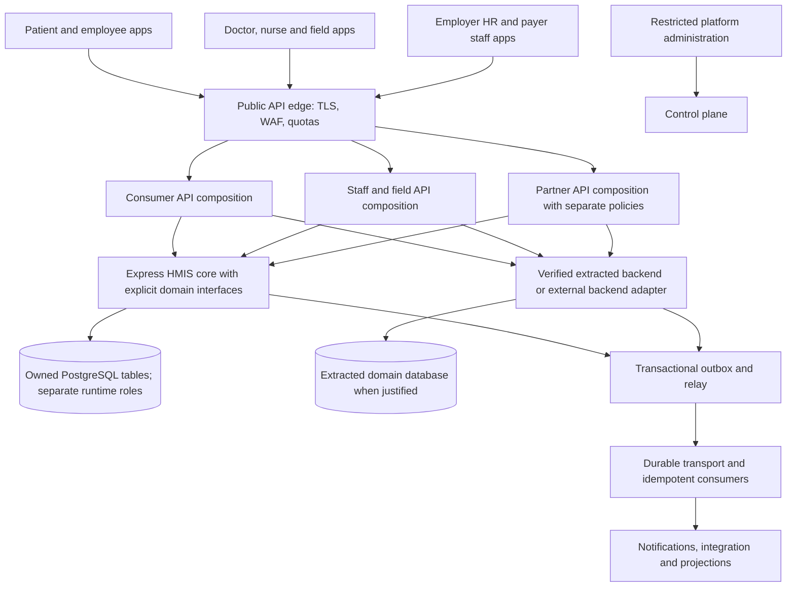

# Multi-app HMIS middleware feasibility micro-audit

Audit date: 7 October 2026 (Asia/Kolkata). Source revision: `ddf8e752e5fef63c56132f862d3bdf9e16184510`, plus the existing working-tree changes visible during review.

Input: attached conversation beginning “wat is the worldclass middleware arichitecture…”; cross-reference: [PostgreSQL/RDS implementation plan](POSTGRESQL_RDS_IMPLEMENTATION_PLAN_2026-09-01.md).

**Remediation companion:** [Findings and solution fix plan](MULTI_APP_BFF_SOLUTION_FIX_PLAN_2026-10-07.md) maps F01–F13 to file-level changes, acceptance tests, dependencies and rollout/rollback criteria. Fixes remain proposed until implementation evidence is recorded.

**Phlebotomy app companion:** [Phlebotomy app feasibility audit](PHLEBOTOMY_APP_FEASIBILITY_MICROAUDIT_2026-10-07.md) evaluates `/home/ubuntu/Mediczy/phlebotomy-app-development.zip` for the combined home and ward first release.

**CTO decision: feasible through staged evolution. Proceed with design and an isolated pilot; do not treat the current repository as a production-ready implementation of the attached architecture.**

The valuable part of the proposal is shared business domains behind channel-specific APIs. Mediczy has substantial reusable domain code and an existing mobile API facade. The main work is consistent identity and authorization, stable contracts, database ownership, and reliable delivery—not adding another proxy or rewriting everything in NestJS.

## 1. Scope, confidence, and boundaries

This is a repository-wide architecture inventory and risk-directed source audit, with focused local verification. It is not a line-by-line security review of every file or a production penetration test. The repository contains 9,954 tracked files, including vendored SDKs, virtual environments, documents, and operational artifacts. The reviewed working tree already had unrelated modifications and untracked work; those were preserved.

Inventory and searches covered the application/deployment surfaces below. Detailed review followed the critical paths identified in the findings. Counts are a working-tree snapshot of JS/TS source files, not a count of independent services or completed features.

| Surface | Source inventory | Review focus |
|---|---:|---|
| `server/routes` | 386 files | Active mounts, persona APIs, authorization, embedded SQL/DDL |
| `server/services` | 503 files | Domain coupling, events, consent, integrations, audit |
| `server/models` | 140 files | Shared persistence and identity representation |
| `server/__tests__` | 148 files | Available regression coverage; selected isolated execution |
| `client/src` | 1,023 JS/TS files | Portal/persona coverage and API/offline integration surfaces |
| `nestjs-app/src` | 83 JS/TS files | Module reachability, identity, object access, persistence, build |
| `control-plane/src` | 25 files | Administrative identity, tenant management, proxy behavior |
| `mobile/src` | 3 files, plus root app entry | Actual app readiness, network client, video |
| Other first-party areas | Inventoried/searched | `shared`, `sdk`, AI/scribe, MCP, edge, infra, ECS, Nginx, Ansible, CI, scripts |

No production requests, database queries, migrations, account changes, payer calls, or deployments were performed. Private environment values were not needed. Live AWS settings, deployed route configuration, effective database roles/policies, external mobile repositories, and payer certifications remain unverified. Historical RDS findings are not asserted to still describe today's infrastructure.

The attachment does not identify Backend A/B by repository or product. This report assumes the checked-in Express and NestJS applications are the candidates; it separately evaluates the control plane. If a second independent product is intended, its API, identity, tenant model, and data ownership require an additional audit before committing integration scope.

## 2. What actually exists

| Component | Evidence | Architectural interpretation |
|---|---|---|
| Express HMIS core | `server/app.js`; hundreds of routes/services | Broad business core with mixed modularity and direct database access |
| Mobile facade | `server/app.js:1875`; `server/api/mobile/index.js:1903,2038` | Mounted `/api/mobile` APIs, including dashboard composition; a practical starting point, currently coupled to shared SQL |
| NestJS migration app | `nestjs-app/package.json`; `src/app.module.ts`; Prisma schema | Explicitly a strangler replacement for Express, with overlapping users, appointments, clinical, lab and insurance domains; not an independently owned second business backend |
| NestJS control plane | `control-plane/src/app.module.ts`; tenant controllers | Administrative tenant/clinic management plus a generic API proxy; keep outside routine clinical mobile traffic |
| React web portals | `client/src/pages/{corporate,nurse,ambulance,insurance-desk,...}` | Broad persona UI footprint; web pages do not prove equivalent native apps exist |
| React Native shell | `mobile/App.tsx:4`; `mobile/index.ts`; `mobile/src/api/client.ts` | Starter entry screen, shared Axios/SecureStore client, one video screen; no checked-in suite of completed persona apps |
| External doctor-app integration | `shared/doctor-mobile-api/README.md` | Portable client explicitly intended for external `msh_d_app`; that app's implementation is outside this audit |
| Async/observability | Kafka, BullMQ, HyperGrid bus, telemetry and audit services | Useful foundations with important delivery and enforcement gaps |
| AI, scribe, imaging, edge and MCP | Separate first-party directories and deployment entries | Supporting services, not evidence of another complete Node/PostgreSQL HMIS backend |

Two Node processes do not establish two domain services. Likewise, two databases would not automatically establish ownership. The Prisma schema maps to existing concepts such as `users`, `appointments`, `insurance_claims`, and `patient_conditions`; some NestJS services directly import Express Kafka/queue/cache modules. Actual `DATABASE_URL` targets were not read or compared, so shared physical deployment is not claimed.

## 3. Proposal-to-code feasibility matrix

| Requested capability | Current evidence | Decision / work needed |
|---|---|---|
| One React Native app, one API origin, multiple backends | Central Axios origin and `/api/mobile` facade | Feasible. Add explicit upstream adapters and contracts; preserve existing URLs during migration |
| Patient, doctor, nurse, phlebo, ambulance apps | Domain APIs/web portals; native shell; external doctor client | Feasible as a product program; native applications are not all present here |
| Corporate and insurance apps | Corporate benefits/consent/MIS and insurer/TPA/claims code | Reuse domain services, but distinguish employee/member views from employer/payer staff access |
| Gateway and WAF | Nginx/deployment artifacts, application rate limits | Reconcile routing first; verify effective edge/WAF configuration separately |
| BFF/API composition | SQL-based mobile dashboards already exist | Refactor into channel composition over domain interfaces; avoid SQL in a separately deployed BFF |
| Central authentication | Short-lived canonical token service plus several legacy portal/mobile formats | Partial; consolidate principal/tenant identity and token lifecycle before shared trust |
| Tenant and patient-context authorization | RLS helpers, tenant utilities, selected role/ownership guards | Partial; critical missing checks and inconsistent context propagation block broad rollout |
| Independent data ownership | Shared concepts, cross-domain SQL, multiple ORM/pool implementations | Not established. Define ownership before physical extraction |
| Reliable cross-domain events | Kafka/BullMQ, database event records, specialized deduplication | Partial. Add transactional outbox, consumer deduplication, retry/replay and reconciliation |
| Offline field workflows | Mobile status advertises sync; no corresponding inspected sync path | New engineering required; server-side offline scribe is a different capability |
| Clinical audit integrity | Async audit middleware and hash-chain implementation | Partial; capture durability and integrity weaknesses require remediation |
| FHIR/HL7/payer integration | FHIR routes, MLLP gateway, TPA aggregator/adapters | Reusable implementation surface; conformance and partner acceptance remain unverified |
| Operational readiness | CI, metrics, tracing, RDS remediation plan | Partial; passing compilation is not deployment or isolation evidence |

## 4. Prioritized findings

Priority meaning: **P0** blocks the affected new production channel/service until fixed and verified; **P1** is required before platform expansion; **P2** is an improvement or evidence gap. A P0 source finding does not assert that the endpoint is currently reachable in production.

### F01 — P0: NestJS appointment and claim access lacks object-level checks

**Evidence:** `nestjs-app/src/appointments/appointments.controller.ts:67` passes only the path ID into `findById`; the status PATCH at line 73 passes only ID and DTO. `appointments.service.ts:14,72` and `repository/appointments.repository.ts:9,73` perform ID-based reads/updates without caller ownership or tenant filters. `auth/guards/roles.guard.ts:14` allows handlers with no role metadata. Global JWT validation authenticates a caller but does not authorize that appointment.

`insurance/insurance.controller.ts:86` limits status changes by role, but `insurance.service.ts:76` updates by claim ID without payer/TPA assignment or organization constraints. A staff role alone is not ownership of every claim.

**Impact:** if routed and database privileges permit, an authenticated caller could access or change another patient's appointment; authorized payer staff could modify claims outside their scope. Restrictive RLS might instead deny these operations, but no Prisma transaction context integration was found in the reviewed service.

**Required:** pass a verified actor context into every object operation, enforce tenant plus patient/care-team/payer assignment, constrain state transitions, and add two-tenant/two-patient negative tests against a non-owner runtime role. Recheck authorization inside the domain service even when a BFF already checks it.

### F02 — P0: Corporate health disclosure bypasses the existing consent registry

**Evidence:** `server/routes/corporate.route.js:237` mounts `/dashboard/employees-health` using `authCorporate`. `server/controller/corporate.controller.js:10` selects identifiable employees' chronic conditions, blood type, measurements and medications; lines 26–43 return health fields. The handler at line 451 calls this directly. The middleware verifies the corporate identity but does not check employee/category grants.

`server/services/corporate-account.service.js:158` implements `getGrantedCategories`; source search found its caller in the consent-inspection endpoint, not this health export path.

**Impact:** employer authentication and employee association currently suffice on this path; they do not enforce the proposal's consent/minimum-data boundary. This is a source-level privacy control gap, not a legal compliance determination.

**Required:** define purpose-specific employer views, enforce authorized categories at the query/projection boundary, propagate revocation to caches/exports, and suppress identifying small cohorts in aggregate reports. Test absent, denied and revoked grants, including exports and cached responses.

### F03 — P0: Tenant metadata is not uniformly a fail-closed authorization boundary

**Evidence:** `server/api/mobile/index.js:389` mounts `multitenancy.middleware.js`. That middleware prioritizes `X-Tenant-ID`, synthesizes an active tenant with `features: ['all']`, and attaches a filter/schema hint; it does not itself enforce database isolation or bind the requested tenant to the authenticated actor.

The stronger `server/middleware/rls-context.middleware.js` provides transaction helpers and lazily reads authenticated context. Merely mounting it does not put every subsequent SQL query into that transaction. `nestjs-app/src/prisma/prisma.service.ts` only manages connection lifecycle. Reviewed RLS code uses multiple context names (`app.current_org_id`, `app.current_tenant`). Migration `20261005000300-rls-guard-current-setting-cast.sql:15` explicitly preserves existing fail-open policy semantics while fixing a cast error. Migration 020 also contains NULL-organization and self-asserted admin allowances; final live policy composition is unknown.

**Required:** canonical organization identity; validated membership-based tenant selection; transaction-local context on the same connection as every protected query; distinct administrative credentials; missing-context denial. Verify actual roles and policies rather than inferring enforcement from migration filenames. PostgreSQL owners normally bypass RLS, and `BYPASSRLS` roles bypass it even when policies exist. [PostgreSQL row security documentation](https://www.postgresql.org/docs/current/ddl-rowsecurity.html).

### F04 — P1: Route ownership and service ports conflict

**Evidence:** `nginx/mediczy.conf` routes HTTP `/api/v2/` to port 8001 but its HTTPS block routes `/api/` to Express on 8888. Express itself mounts `/api/v2` at `server/app.js:1872`, including placeholder 501 routes in `server/api/v2/index.js`. NestJS controllers use the same prefix. `nestjs-app/src/main.ts` defaults to port 8001, while `ecosystem.config.js:108` assigns that port to SIB FastAPI.

**Impact:** applying these artifacts together on one host can send the same API family to different services by listener or encounter a port collision. This is a checked-in configuration conflict, not a statement about effective production Nginx/PM2/ECS configuration.

**Required:** explicit service/port registry, one route manifest, identical public routing semantics, distinct internal service addresses, and automated HTTP/HTTPS route-owner smoke tests. Choose migration routes endpoint by endpoint, not by the ambiguous label “v2.”

### F05 — P1: A gateway file exists, but it is not a ready BFF

**Evidence:** `server/api/gateway.js:13` imports five nonexistent paths under root `middleware/`; no import of this gateway was found in the searched server source. Its detailed health code reports database/Redis healthy with checks commented out. The mounted mobile router is the real facade today.

`control-plane/src/proxy/proxy.controller.ts:6` proxies to one hard-coded public origin, forwards selected headers, and serializes responses as JSON. It has no domain aggregation or two-upstream policy; it is unsuitable as a general streaming/upload/mobile composition layer without redesign.

**Required:** evolve the working mobile facade or create a small dedicated BFF using verified domain APIs. Preserve streaming, file and realtime semantics through explicit routes. Do not place the administrative control plane in the clinical request path.

### F06 — P1: Mobile and NestJS token contracts are incompatible on important paths

**Evidence:** `server/services/auth-token.service.js:41` issues 15-minute tokens with `sub`, issuer, audience and `token_type`. NestJS `auth/strategies/jwt.strategy.ts:27` requires those claims and looks up `sub` in the users model. In contrast, mobile social-login paths use `generateToken` / `generateRefreshToken` from `server/api/v2/auth.utils.js:51`; patient access defaults to 30 days, and the generator does not add issuer/audience/`token_type` or `sub` unless supplied. Several principal types also live in separate user/doctor/corporate tables.

**Impact:** moving a mobile route behind NestJS can reject existing tokens even with the same signing secret. Numeric IDs from different principal tables cannot safely be treated as the same subject namespace. The RN client deletes its token on 401; it does not implement refresh rotation.

**Required:** one documented principal namespace and issuer contract, actor/organization memberships, short-lived access, revocable rotating refresh families, audience checks and an explicit legacy transition. Prefer independently verifiable signing keys for separate services. Native OAuth flows should use a public-client flow; never embed a service credential in an app. Keep platform-admin privileges outside routine user tokens.

### F07 — P1: Runtime DDL and shared persistence obstruct least privilege and service extraction

**Evidence:** the reviewed read-only DDL scan found **311 `CREATE TABLE` matches in 103 route/service files, referencing 302 distinct names; 28 route files were involved**. These are regex/static candidates, not proof that all 311 execute on every request or that 302 live tables need creation. The scan does not cover every API helper, model initializer or `ALTER TABLE`.

Concrete additional examples: `server/api/v2/auth.utils.js:18` provisions refresh storage at runtime; `server/services/audit-chain.service.js:38` provisions hash columns at import; `server/services/hospital-os/hospital-events.service.js:9` calls a migration while ensuring event tables. `migrate-all.mjs` orchestrates several runners; its existence does not prove one comprehensive checksum ledger.

**Required:** migrate selected pilot dependencies first, deny DDL to runtime credentials, prove clean boot/restart/request behavior, then burn down remaining catalog debt. Maintain one writer per owned entity during extraction. Separate databases before this work would multiply migration and consistency problems.

### F08 — P1: Event publication is not atomic with business writes

**Evidence:** `server/config/kafka.js:182` returns through in-memory delivery when Kafka is disabled; publish failure also falls back locally and returns false. NestJS appointment/claim services write first, then publish, often swallowing failure. `server/services/hypergrid-event-bus.service.js` publishes to Redis, optionally Kafka, and also dispatches locally; its own Redis subscription can deliver the same event locally again. Persistent `hospital_os_events` and specialized claims queues exist, but the inspected generic producers do not implement a shared business-write/outbox transaction.

**Impact:** backend B can miss committed work after a crash or broker failure; duplicate delivery can cause repeated effects. Kafka producer idempotence does not close the PostgreSQL/message dual-write gap.

**Required:** transactionally write business state and an outbox row, relay with retries, deduplicate consumers by event ID, use aggregate versions for order, and provide dead-letter/replay/reconciliation tooling. Expect at-least-once transport and design idempotent effects. This addresses the dual-write failure described in [AWS transactional outbox guidance](https://docs.aws.amazon.com/prescriptive-guidance/latest/cloud-design-patterns/transactional-outbox.html).

### F09 — P1: Request idempotency and offline sync are incomplete platform contracts

**Evidence:** specialized deduplication exists in finance ledger, payment migrations, CRM and TPA lifecycle code. No common request-level idempotency mechanism was identified for all mobile order/booking/prescription commands. `server/api/mobile/index.js:411` advertises `offlineSync: true`; no sync endpoint or durable field-action queue was found in that router and the checked-in RN source. `client/src/services/offlineScribe.service.ts` invokes a server-side transcription service; it is not disconnected mobile synchronization.

**Required:** scoped operation IDs, body-hash checking, persisted replay responses and concurrency-safe uniqueness. Field apps need encrypted durable local actions, retry with original IDs, delta cursors/tombstones, conflict rules, account/tenant-switch cleanup, attachment resumption and visible pending/rejected states. Do not automatically retry a clinical/financial command with a new ID or apply last-write-wins to medication administration.

### F10 — P1: Audit presence does not yet establish completeness or immutability

**Evidence:** `server/middleware/audit.middleware.js:69` records asynchronously after response generation and catches failures; coverage uses path regexes. `server/services/audit-chain.service.js:53` hashes previous hash, action, actor and timestamp, excluding tenant/resource/changes/metadata. The insert selects the previous row with `FOR UPDATE SKIP LOCKED`, which can choose an older predecessor during concurrent inserts. This can fork a supposed linear chain. Both are code-level concerns; no live audit records were examined.

**Required:** durable capture for required events; explicit read/export/denial/break-glass coverage; canonical full-event hashing; serialized chain head or another well-defined integrity scheme; independently protected checkpoints/storage and access controls. Test concurrent writes, modified resource/changes payloads, deleted rows and failed audit storage. A hash chain alone is not immutable storage.

### F11 — P1: Feature files and compile success overstate service completeness

**Evidence:** NestJS `src/app.module.ts` does not import the existing corporate, ambulance, pharmacy, homecare, video or wearables modules. Their files are not reachable merely because they compile. `insurance.service.ts:96` returns simplified eligibility with a fixed `estimatedCoverage: '80%'` rather than a verified payer decision. The RN app's root entry still renders its starter message.

**Required:** maintain a mounted-route/capability registry, mark incomplete capabilities unavailable, and drive each app from tested endpoint contracts. Never present placeholder eligibility as an actual coverage decision. External doctor/native app repositories need separate acceptance evidence.

### F12 — P1: Pool/TLS and resilience policies need consolidation

**Evidence:** `server/db/pgPool.js:126`, `postgres.js`, `postgres-sequelize.js:34` and `control-plane/src/app.module.ts:29` permit TLS with `rejectUnauthorized: false`. Multiple pg/Sequelize/Prisma/TypeORM pools exist. The reviewed MediAssist adapter uses Axios without an explicit timeout and logs the error object. Circuit-breaker utilities and tracing exist, but they do not establish consistent policy on every adapter.

**Required:** verify database server certificates, budget aggregate connections across API/BFF/worker replicas and ORM pools, define request deadlines and concurrency limits, and redact adapter errors before logging. Evaluate RDS Proxy/PgBouncer with transaction-context tests. Do not assume a pool maximum is the total database connection budget.

### F13 — P2: CI does not currently demonstrate multi-backend/mobile readiness

**Evidence:** `.github/workflows/ci.yml` gates Express tests against a known-failure baseline and builds/tests the web client. Tenant statics, database checks, web typecheck and lint have advisory paths. There are no equivalent NestJS/mobile build-and-contract jobs in that workflow. Existing static checks intentionally tolerate baseline debt.

**Required:** required pilot-path cross-tenant, token-compatibility, API contract and mobile checks; route-owner tests; clean migration/bootstrap on disposable PostgreSQL; outage/replay and deployment rollback tests. Track known failures explicitly and prevent their baseline from growing unnoticed.

## 5. Recommended target for Mediczy

Use one public API origin with channel namespaces. Keep business rules in the HMIS domain layer; keep the BFF responsible for response composition, pagination, projection and channel-specific coordination. Choose a distinct deployable BFF when release cadence, load or trust boundaries warrant it. Separate BFFs add latency and operational cost; the number should follow actual interface needs. [Microsoft BFF pattern guidance](https://learn.microsoft.com/en-us/azure/architecture/patterns/backends-for-frontends).



The extracted backend node is a target, not a claim that the current NestJS app already meets that boundary. Each writing service keeps its outbox in its own business database transaction; the diagram groups the relay pattern for readability, not as a shared cross-database transaction. If Backend B is an external product, connect through its adapter and explicit identity mapping; do not assume shared numeric IDs, JWTs or tables.

Initial deployment can retain one composition process with consumer/staff/partner modules. They need separate route allowlists, policy tests and data projections even if they share a binary. Split deployments when a measurable need appears. Employer HR and payer/TPA staff should not inherit patient-level access merely because the proposal places “Corporate” and “Insurance” under a consumer BFF. Employees and insured members can use consumer journeys; organization operators are different actors.

### Ownership map before extraction

| Domain | Initial owner | Other channels consume |
|---|---|---|
| Identity and organization membership | One identity authority; adapt legacy principal stores | Verified actor and membership context, no shared password logic |
| Patient registry and consent | HMIS core | Minimum-data patient views and explicit grants |
| Scheduling and appointments | HMIS core | Booking commands, availability and committed events |
| Encounter, orders, prescriptions and nursing | HMIS core | Clinical commands, care-team views and signed state changes |
| Lab and specimen lifecycle | HMIS core | Assigned collection tasks and versioned sample transitions |
| Pharmacy and inventory | HMIS core | Dispense/reservation commands and stock projections |
| Billing, ledger and payment orchestration | HMIS core | Amounts/status references; one authoritative financial writer |
| Corporate enrollment, benefits and credit | Existing corporate services within core | Employee eligibility; separate employer reports |
| Claims and preauthorization | Existing insurance/TPA lifecycle within core | Member status versus assigned payer work queues |
| Ambulance and field dispatch | Existing dispatch/fleet services within core | Assigned work and authenticated location/status updates |
| Payer/HL7/FHIR adapters | Integration boundary, candidate for later extraction | Validated external messages; no unrestricted table access |
| Notifications and reporting projections | Workers, early extraction candidates | Durable events and purpose-limited read models |
| Tenant provisioning and platform administration | Restricted control plane | Explicit provisioning/entitlement interfaces |

This is a logical ownership map, not a proposal to create thirteen databases now. It aligns with the RDS plan's shared-schema default. A domain can initially own tables under grants/interfaces in the existing database. Physical database separation follows independent write ownership, reconciliation and cutover evidence. Use expand/migrate/contract and one authoritative writer; avoid uncoordinated dual writes.

### BFF and service contract requirements

1. Use a new unambiguous versioned mobile namespace, for example `/api/mobile/v1/{consumer,staff,partner}`; map old endpoints during compatibility rollout. Do not repurpose all `/api/v2` traffic at once.
2. Publish OpenAPI contracts and generated shared types/clients. Standardize IDs, timestamps, cursor pagination, error codes, request IDs and capability/version discovery.
3. Derive actor, active organization and scope from verified credentials and membership checks. Treat tenant headers as a requested context requiring validation. Authenticate internal service calls; strip untrusted identity headers at the edge.
4. BFFs call domain APIs or in-process domain interfaces during the monolith phase. A separately deployed BFF holds no general-purpose clinical database credential. Backend domain services enforce object access and workflow rules themselves.
5. Use bounded parallel reads with deadlines and cancellation. Return explicit unavailable/stale states for optional panels. Fail required clinical decisions explicitly; do not return invented empty/healthy/eligible results.
6. Scope every cache by tenant, actor/permission projection and relevant consent version. Keep sensitive responses private; define invalidation and freshness. An employer must never receive a patient cache entry.
7. Persist idempotency by tenant + actor + operation + client key, validate request hash, serialize concurrent retries, and replay the original outcome. Define key retention and compensation per domain.
8. Store business state plus event in one transaction. Include event ID, schema version, tenant, aggregate ID/version and correlation ID; minimize sensitive payloads. Track delivery lag, duplicates and reconciliation failures.
9. Route Socket.IO/streaming through authenticated tenant/subject rooms; handle revocation and reconnects. Keep media traffic on the appropriate video service and issue scoped tokens. Use short-lived, scoped file-upload/download grants for large documents.
10. Propagate trace context across edge/BFF/backend/workers while redacting patient data. Measure complete journeys, not only individual service health. Set latency/availability targets after measuring baseline traffic and field-network conditions.

## 6. Persona rollout

| Persona | Reusable foundation | Missing acceptance evidence |
|---|---|---|
| Patient / corporate employee | Mobile dashboard, profile, appointments, wellness, benefits | Native journeys, stable refresh/logout, patient-own-record negative tests |
| Doctor | Doctor APIs, clinical workspace, portable copilot client | External app audit, doctor identity mapping, patient relationship checks |
| Nurse | Nurse portal/API, eMAR, vitals and handover services | Native app, assignment/ward scope, medication transition and conflict tests |
| Phlebotomist | Lab order/sample status support | Assigned-task API, barcode/custody rules, offline conflict/replay and device tests |
| Ambulance | Dispatch/fleet APIs and web portal | Native location permissions/background behavior, task authorization and offline recovery |
| Corporate HR / occupational health | Corporate portal, MIS, consent registry, benefit programs | Category/purpose controls on every report/export; HR versus clinician separation |
| Insurance member | Policy and claim views | Actual payer eligibility, minimum member disclosure and document scope |
| Insurer / TPA staff | Claims lifecycle and adapter ecosystem | Assigned-payer authorization, state machine, reconciliation and partner UAT |
| Reception, pharmacy, lab, admin | Existing web workspaces | Native apps only when field/device requirements justify them; preserve web workflows |

Separate native applications can share API clients, design tokens, auth primitives and telemetry code while retaining distinct package identifiers, release controls and permission requests. Reusing web domain logic/contracts is valuable; React DOM screens are not automatically native screens. Prioritize one consumer and one staff journey before expanding the app fleet.

## 7. Relationship to the RDS implementation plan

The September plan remains a prerequisite program, not proof of completion. Do not combine a BFF introduction, database split, identity migration and RDS cutover into one release.

| Existing workstream | Middleware dependency / evidence needed |
|---|---|
| B — secrets and identity | Separate deployable service credentials; no mobile secrets; signing/key transition evidence |
| C/D — migration discipline and tenant authorization | Runtime DDL denial, canonical ownership, verified effective RLS, non-owner negative tests |
| E/F — RDS and recovery | Actual encrypted/private/Multi-AZ target evidence where required, restored backups and failover proof |
| G — observability and operations | Request-to-worker traces, per-channel dashboards, actionable delivery/isolation alerts |
| H/J — integrity and schema normalization | Canonical identifiers, constraints, conflict rules and stable schema contracts |
| I — pools/TLS | CA verification, replica-wide pool budget, proxy/session-context compatibility |

The attached claim that each backend needs its own PostgreSQL database should be read as an eventual ownership principle. An immediate physical split would conflict with the existing plan's explicit non-goal of splitting the entire catalog. Select a small domain for extraction only after these prerequisites are evidenced.

## 8. Delivery sequence and exit gates

These are planning ranges, not commitments: assume a technical lead, two backend engineers, two React Native engineers, QA, and shared DBA/SRE/security support; a limited first release; prompt access to any external backend and app repositories. Product scope, production remediation and payer approvals can dominate elapsed time. Estimate again after Phase 0.

| Phase | Indicative duration | Concrete output | Exit evidence |
|---|---|---|---|
| 0. Establish truth | 1–2 weeks | Named A/B owners, effective route/port manifest, principal and data ownership ADRs, app/repo inventory | Route map reconciled with actual deployments; selected journey and acceptance contract agreed |
| 1. Secure the pilot dependencies | 2–4 weeks, alongside RDS work | F01–F03 fixes, token adapter, no runtime DDL on pilot path, constrained runtime role | Cross-tenant/patient/payer/consent-denial tests pass on representative PostgreSQL policies; restart generates no DDL |
| 2. Thin composition pilot | 2–3 weeks | Consumer dashboard plus one staff worklist over explicit domain interfaces; upstream stub for unavailable external backend | Contract, outage, timeout, caching and route-owner tests; legacy clients remain compatible |
| 3. Durable commands and field proof | 3–5 weeks | One booking/lab task command with idempotency/outbox; one offline field flow | Disconnect/retry/crash/replay/concurrent-conflict tests; no duplicate business effect; reconciliation demonstrated |
| 4. Controlled first releases | 2–4 weeks | One consumer and one staff app pilot, dashboards and support/runbooks | Representative device/network UAT, security/clinical workflow acceptance, rollback rehearsal, old-client compatibility |
| 5. Expand by domain/channel | Per accepted scope | Corporate HR/payer and additional field apps; selective extraction | Purpose-specific authorization and partner UAT; owned writes and reconciled cutover |

A narrow staging BFF proof is approximately 2–3 weeks after scope/access is settled. A gated first production pair of journeys is roughly 10–18 weeks with overlap and the assumed team; it is not delivery of every persona app. The existing RDS plan estimates 8–12 weeks for its own work. A full app fleet and physical domain separation require separate estimates; source inspection alone cannot provide a defensible fixed budget or cloud bill.

Suggested first backlog, in dependency order:

| ID | Work item | Owner | Done when |
|---|---|---|---|
| ARC-01 | Reconcile routes, ports, deployed services and Backend A/B | Lead + SRE | One reviewed effective routing manifest; no ambiguous `/api/v2` owner |
| IAM-01 | Principal/tenant/token contract with legacy migration | Identity/backend | Patient, doctor, staff and partner tokens have tested allow/deny matrix |
| SEC-01 | Appointment/claim object authorization | Domain backend + QA | Foreign IDs, role confusion and invalid transitions denied |
| PRIV-01 | Corporate health projection and consent enforcement | Corporate backend + privacy owner | Absent/revoked grants denied for UI, exports and caches |
| DB-01 | Pilot runtime role/context and deploy-only schema | DBA + backend | No DDL rights required; non-owner tenant negative tests pass |
| API-01 | Shared contracts and consumer/staff facade | Backend + mobile | Generated clients; backward compatibility; explicit failure responses |
| EVT-01 | Outbox/relay/inbox and idempotent command | Backend + SRE | Crash between commit and publish recovers; duplicate replay is harmless |
| MOB-01 | Auth lifecycle and one complete native journey | Mobile + QA | Refresh, logout, reconnect and tenant/account switch tested |
| FIELD-01 | Durable offline task queue and conflicts | Mobile + domain owner | Replayed and stale clinical actions receive deterministic outcomes |
| OPS-01 | Audit integrity, telemetry and release gates | SRE + security + QA | Traceable journey, audit failure alarm, tested rollback and restore evidence |

## 9. Verification performed

| Check | Result | Interpretation |
|---|---|---|
| Repository/app inventory and critical-path source reads | Completed | Broad architecture coverage, not exhaustive behavioral proof |
| Read-only request-DDL static scan | 311 matches / 103 files / 302 distinct names / 28 route files | Heuristic debt inventory; does not measure live table count or execution frequency |
| Read-only tenant static scan | 61 references flagged | Review candidates only; scanner checks for hints anywhere in a file and can miss defects or flag safe code |
| Server-local Jest: tenant identity, hospital auth tenant, auth token service | **3 suites, 16 tests passed** | Selected identity regressions only; no cross-service or live RLS proof |
| NestJS TypeScript, `--noEmit --incremental false` | **Passed** | Source type compatibility with installed dependencies; no boot/migration/endpoint proof |
| Mobile TypeScript, `--noEmit --incremental false` | **Passed** | Checked TS source compiles; no native binary, store release, device or workflow proof |
| Standalone gateway relative import resolution | Five missing middleware paths | Gateway skeleton cannot be adopted as-is |

The first test attempt named a nonexistent `.mjs` configuration, then the root Jest installation failed before executing tests with `clearMocksOnScope is not a function`. Running the same selected suites with the server's own installation succeeded. No dependency changes were made. The production/database-dependent smoke suites and full application startup were not run.

Reproduction commands, from the repository root unless noted:

```bash
node server/scripts/qa/audit-request-ddl-and-rls.mjs --json
node server/scripts/ci/check-tenant-isolation-statics.mjs
```

From `server/`:

```bash
NODE_ENV=test JWT_SECRET=audit-local-only JWT_REFRESH_SECRET=audit-local-refresh-only \
  node --experimental-vm-modules ./node_modules/jest/bin/jest.js --runInBand \
  --runTestsByPath __tests__/tenant-identity.test.js \
  __tests__/hospital-auth-tenant.test.js __tests__/auth-token.service.test.js
```

From each of `nestjs-app/` and `mobile/`:

```bash
node node_modules/typescript/bin/tsc --noEmit --incremental false -p tsconfig.json
```

## 10. Decision record

**Proceed:** shared domain platform, a small channel composition layer, explicit contracts, and one consumer/staff pilot over the current core.

**Gate production expansion on:** object authorization, employer/payer data boundaries, canonical identity and tenant context, reliable commands/events, verifiable runtime database privileges, and actual mobile journeys.

**Defer:** automatic migration of all routes to NestJS, a database per app, a BFF process per persona, full-catalog database splitting, and new broker/mesh products without a demonstrated requirement.

The existing platform offers enough reuse to make the proposal practical. Treat security and data ownership as the foundation, then add channels incrementally with measured acceptance evidence.
