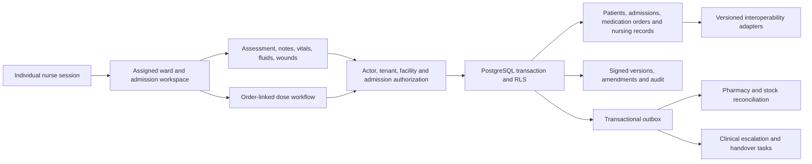

# Mediqzy vs GitHub HMIS projects: nursing gaps and implementation plan

**Reviewed:** 19 October 2026 (Asia/Kolkata)  
**Baseline:** Mediqzy `4fe17b9c545777e58c060caefe971f7f6c9c2b24` plus the working tree inspected on that date  
**Audience:** Product, engineering, nursing leadership, pharmacy, QA, hospital IT  
**Status:** Source-backed assessment and proposed delivery plan; application changes are not implemented by this document.

**Implementation update:** [Delivery, verification and rollout record](NURSING_IMPLEMENTATION_DELIVERY_2026-10-19.md). The findings below describe the reviewed baseline; use the delivery record for current implementation status.

## 1. Recommendation and scope

**Extend Mediqzy's existing React/Node.js/PostgreSQL nursing implementation.** The priority is to connect and harden its existing capabilities into one desktop/tablet workflow. Replacing it with another HMIS would introduce a second patient, admission, authentication, medication, and billing system.

The pasted conversation asks for paperless nurse documentation: notes, vitals, eMAR, intake/output, handover, assessments/care plans, wounds, and procedures. This review deeply inspects those workflows and compares the five identifiable projects mentioned there. Section 10 extends the plan to the wider hospital application; it is an integration roadmap, not a fresh audit of every Mediqzy department. The active Smart Force mobile API document covers field executives and is not evidence of bedside nursing completeness.

Main conclusions:

- Nurse login, notes, vitals, eMAR, assessments, nursing tasks, e-charting, wound tracking, and AI handover already have source implementations in Mediqzy. Several are partial or disconnected.
- The current nurse route configuration excludes key inpatient screens. Existing eMAR UI/API contracts disagree. Some service queries lack explicit tenant/admission checks, and legacy nurse authentication differs from shared authentication.
- Signed nursing documentation, authenticated second-person medication verification, robust dose concurrency, acknowledged handover, and full wound/procedure episodes need completion or integration.
- Existing tests contradict some prior completion claims: this review ran four isolated suites, with **40 tests passing and 6 failing**. Section 9 identifies the exact scope.
- Use external projects as selective references. No reviewed project is established here as a production-ready, drop-in nursing module for Mediqzy.

### Evidence rules

**Code** means a relevant implementation was inspected; **partial** means related code exists but the complete requested workflow is not established; **unverified** means the reviewed material does not establish the capability. **Demo** denotes browser-local simulation. These labels are not clinical validation or deployment certification. “Unverified” does not mean absent from the entire upstream repository.

External default branches, full commits, license observations, and inspected-file hashes are recorded in the [evidence manifest](NURSING_REPO_REVIEW_EVIDENCE_2026-10-19.json). Repositories were read through GitHub pages/API and pinned raw files. They were not installed, built, or exercised. Mediqzy was inspected locally; no production database, patient record, or deployed environment was accessed.

## 2. Repository assessment

| Project | Pinned commit / commit date | Stack and persistence | License observation | Recommended role |
|---|---|---|---|---|
| [Mauli HIS — Ashishamore/hospital-project][mauli] | `c4e4d984d05aeeca6ade018d204e550da7d0a5c8` / 2026-09-22 | React 19, Vite, Zustand; IndexedDB in each browser | No root license file or GitHub-recognized license found in the inspected tree | Study the nursing station and admission-chart interactions; implement original Mediqzy components |
| [Danphe — opensource-emr/hospital-management-emr][danphe] | `99638225ba0876261c2c16c3bd2f9b83f4abbc19` / 2024-09-02 | Angular, ASP.NET/C#, SQL Server | MIT; root LICENSE inspected | Study inpatient nursing, vitals, I/O, orders and transfers; avoid porting its backend |
| [OpenEMR — openemr/openemr][openemr] | `4b463cd3d2d840a4083c4c6bd47a5654a4574d2e` / 2026-10-19 | PHP; MySQL/MariaDB; server application | GNU GPL v3 license text; check notices for each reused component | Reference API authorization and clinical exchange; evaluate optional API integration separately |
| [qwan30/hospital-management-system][qwan] | `a46f5b4653c96575ee50ca35ea9c8bc8022afb33` / 2026-08-18 | Next.js, Java 17/Spring Boot, PostgreSQL | No GitHub-recognized license or root license file found | Reference capability checks, patient/appointment guards, and test architecture |
| [MedCare — tasmiul/hospital-management-system-django][medcare] | `35b67904d9cc8dd3dce3dae61856acad6cfbcb28` / 2026-06-24 | Django templates, Python; SQLite development default | MIT; root LICENSE inspected | Reference simple ward/task assignment patterns; implement in the existing stack |

The attachment did not provide a URL for “MedCare.” The tasmiul project identifies itself as MedCare and matches the described nursing stations/tasks/vitals, so it is included as a **probable identification**, not a confirmed original link. qwan30 is Java/PostgreSQL on the backend, not a Node.js nursing service. Danphe's reviewed branch has an older commit date; verify support and dependency health independently.

Reuse decision: no upstream code was copied. For Mauli and qwan30, this plan does not assume permission to copy code. For MIT projects, retain required notices if reuse is later selected. Assess OpenEMR component licenses and the intended integration/distribution before copying code; an API reference does not require importing its source. These are repository observations and project decisions, not a legal determination. [Danphe license][danphe-license], [OpenEMR license][openemr-license], [MedCare license][medcare-license].

## 3. Feature-by-feature comparison

External cells refer to the source samples listed below, not exhaustive verification. Mediqzy's gaps are expanded in sections 4–5.

| Required capability | Mauli | Danphe | OpenEMR | qwan30 | MedCare | Mediqzy inspected baseline |
|---|---|---|---|---|---|---|
| Individual nurse login and role | Demo role selection | User/nursing modules documented | Access controls/API scopes documented | Staff roles documented | Nurse-restricted views in code | Code; legacy and shared auth differ |
| Assigned ward/patient worklist | Demo ward view | Inpatient list/transfers in code | Dedicated ward assignment unverified | Appointment/triage worklist | Ward station and assigned-task code | Partial; legacy schedule is mocked |
| Nursing notes | Demo clinical chart | Clinical notes exist; nurse signing unverified | Encounter note form in code | EHR documentation described; nurse notes unverified | Task notes; dedicated signed chart unverified | Notes API/UI; no nursing sign/amend lifecycle in reviewed paths |
| Vital signs | Demo chart and ICU | Vitals component in code | Vitals form and Observation service | Vitals controller/intake page in code | VitalSigns model/forms | Multiple implementations; shared NEWS2 engine exists |
| Order-linked eMAR | Demo MAR with given/refused/held | Complete bedside eMAR unverified | Medication/FHIR resources; complete bedside eMAR unverified | Prescribing/dispensing is not established eMAR | Medication task is not established eMAR | Orders, slots, administration and validation code; important gaps |
| Intake/output | Demo admission chart | Input/output component in code | Nursing I/O workflow unverified | Unverified | Unverified | Flowsheet and daily summary code; aggregation issues |
| SBAR shift handover | Demo recorded SBAR | Incoming acknowledgment unverified | Unverified | Developer handover docs do not establish nurse handover | Unverified | AI-generated brief; persisted acknowledgment not established |
| Nursing assessment | Demo Morse/Braden forms | Full nursing assessment unverified | General clinical forms; nursing set unverified | Triage/vitals, not a full assessment | Task/vitals, not a full assessment | Structured admission/shift/risk records; incomplete UI/lifecycle |
| Nursing care plan with goals/evaluation | Full lifecycle unverified | Unverified | CarePlan service is not proof of nurse-facing workflow | Unverified | Unverified | Doctor-owned care plans plus nursing tasks; nurse workflow needs integration |
| Wound episodes and procedures | Dedicated wound lifecycle unverified | Unverified | Full wound module unverified | Unverified | Wound task type only | AI image analysis + wound tracking; longitudinal bedside workflow partial |
| Shared multi-user clinical storage | Demo/browser-local | Server-backed | Server-backed | Server-backed | Server-backed application | PostgreSQL code; isolation/concurrency need verification |
| Desktop/tablet readiness | Responsive demo; no usability validation | Web UI; tablet validation unverified | Web UI; bedside validation unverified | Web UI; bedside validation unverified | Web templates; bedside validation unverified | Web UI; route, session and bedside usability gaps |

Sources inspected: Mauli [nursing station][mauli-nursing], [admission chart][mauli-chart], [IndexedDB adapter][mauli-idb]; Danphe [nursing controller][danphe-nursing], [vitals component][danphe-vitals], [I/O component][danphe-io]; OpenEMR [API guide][openemr-api], [note form][openemr-notes], [Observation service][openemr-observation], [CarePlan service][openemr-careplan]; qwan30 [vitals authorization/controller][qwan-vitals] and [intake page][qwan-intake]; MedCare [nursing models][medcare-models] and [views][medcare-views].

Do not treat a FHIR datatype class, a medication list, a generic task, or a README feature count as an implemented eMAR. Upstream claims about test totals or production status were not reproduced here.

## 4. Mediqzy findings with local evidence

### 4.1 Existing building blocks to preserve

| Building block | Evidence | Interpretation |
|---|---|---|
| Nurse sign-in and patient documentation | [nurse routes](../../server/routes/nurse.route.js), [nurse dashboard](../../client/src/pages/nurse/NurseDashboard.tsx), [notes UI](../../client/src/pages/nurse/NurseNotes.tsx) | Existing nurse experience; modernize its clinical identity and admission context |
| Inpatient assessments/task board | [nursing service](../../server/services/nursing-ipd.service.js), [routes](../../server/routes/nursing-ipd.route.js), [task UI](../../client/src/pages/hmis/NursingTaskBoard.tsx) | Assessment records and task creation/completion are implemented |
| Bedside chart and I/O | [e-chart service](../../server/services/nursing-echart.service.js), [e-chart UI](../../client/src/pages/hmis/EChartingPage.tsx) | Structured vitals, observation text, risk fields and fluid totals exist |
| Medication workflow | [eMAR service](../../server/services/emar.service.js), [routes](../../server/routes/emar.route.js), [UI](../../client/src/pages/hmis/EMARPage.tsx) | Orders, scheduled administrations, allergy checks, co-sign fields and blocked-attempt records exist |
| Deterioration scoring | [vitals/EWS](../../server/services/vitals-ews.service.js), [shared NEWS2](../../server/services/news2.service.js) | Reuse the shared scorer; ensure every bedside entry reaches it |
| Wound tracking | [wound endpoints](../../server/routes/roadmap-intelligence.route.js), [schema](../../server/migrations/20260926000006-roadmap-intelligence.migration.js), NurseNotes UI above | Tenant-scoped wound records and AI-assisted capture exist; do not create a competing wound store |
| Handover and care plans | [AI handover](../../server/services/hospital-os/nurse-handover.service.js), [handover UI](../../client/src/features/hospital-os/pages/NurseHandoverPage.tsx), [care-plan routes](../../server/routes/care-plan.route.js) | Useful starting points; generated brief and doctor-owned plan are not a completed nursing handoff |

### 4.2 Confirmed integration and control gaps

**Routing and session context.** [portalClinicalRoutes.tsx](../../client/src/routes/portalClinicalRoutes.tsx) includes `emar`, `admissionEchart`, `echart`, and `admissionNursingTasks` in `HOSPITAL_ONLY`; its filter excludes them for the nurse portal. `/nurse/medications` instead opens a free-text medication form. E-chart bed selection navigates explicitly to `/hospital/...`. Hospital nurse-station tasks link to hardcoded admission `1`. [api.ts](../../client/src/utils/api.ts) preferentially selects a stored hospital token for clinical endpoints, even before respecting an explicit Authorization header; test simultaneous portal sessions to prevent incorrect authorship. Current `/hmis/*` routes redirect; do not repeat the June plan's instruction to use them as the primary UI.

**Legacy nurse authentication.** `authNurse` in nurse.route.js verifies the JWT and role, then builds `req.nurse` without tenant scope or an account-status/revocation recheck. The shared [auth middleware](../../server/middleware/auth.middleware.js) does recheck nurse state, revocation, and tenant binding. Login issues a nurse token without explicit tenant claims; shared auth can resolve tenant from the nurse entity, but roadmap-intelligence's separate JWT handler requires a nurse tenant claim. Consequently the existing wound UI and login contract need an end-to-end test. Do not conclude that every nurse request is already unscoped: the two auth paths behave differently.

**Admission and tenant authorization.** E-chart read functions filter by `admission_id` without an organization argument. Assessment retrieval does the same. eMAR validation locates the order/admission without a caller-tenant predicate, while the route does not pass tenant context to `recordAdministration`. The reviewed routers use `authUser` but lack action-specific role/assignment gates for these operations. [RLS middleware](../../server/middleware/rls-context.middleware.js) supplies transaction helpers; attaching the helpers alone does not execute queries inside an RLS transaction. The services reviewed do not consistently use them. These are source-level control gaps requiring negative integration tests; live exploitability and deployed policies were not tested.

**eMAR contract mismatch.** The due service returns `schedule_id`, `order_id`, `admission_id`, `patient_id`, `drug_name`, `scheduled_time`, and `is_overdue`. The UI reads camelCase IDs/names/times plus `status`, `ward`, and `patientName`, with no response mapping in the reviewed Axios success interceptor. It sends `window=4h`, while the route accepts `windowMinutes`. The administer action omits the schedule ID/time and actual dose. UI keys and optimistic updates use order ID, which cannot distinguish multiple doses of the same order.

**Dose safety and concurrency.** `validateAdministration` compares identity/route/time only when optional values are supplied; it does not compare `doseGiven` to the prescribed dose. A supplied `cosignBy` is checked for presence, not an authenticated, distinct clinician. Barcode proof is a caller-supplied Boolean. `recordAdministration` selects a nearby scheduled row and updates it without a pending-state condition, lock, version, or idempotency contract; a retry or concurrent writer can replace administration fields. Scheduled rows start with `outcome='given'` even before administration time is set. The due query lacks an active-order filter; the admission-specific alias passes a filter the service does not consume. The history endpoint returns active-order aggregates, not the full administration event history.

**Pharmacy integration.** The [bridge service](../../server/services/emar-pharmacy-bridge.service.js) inserts queue records without replay handling or an outcome check. The route invokes it after administration, derives drug/dose from caller fields, and suppresses all enqueue errors. Refusal/hold outcomes can therefore follow the same queue path. Administration and dispensing must be separate, linked events; a post-administration queue alone does not establish stock issue, verification, return, or consumption reconciliation.

**Documentation integrity and fluids.** The reviewed nurse notes/assessments/flowsheet APIs lack a draft→sign→amend lifecycle and optimistic version contract. Assessment author can come from the request body rather than the authenticated principal. I/O writes the entry and increments a daily summary separately; totals use database `CURRENT_DATE` rather than observation time/facility day, and a retry can double-count. E-chart vital entry writes a separate flowsheet and does not itself call `saveVitals`, so shared scoring/alerts are not established for that entry path.

**Handover and wounds.** The AI handover service caps its query at 25 patients and processes only 12; a query exception becomes an empty list. It returns generated content without a persisted sender/receiver acknowledgment lifecycle in that service. The wound UI automatically posts AI-derived staging/area after image analysis without a separate reviewed/confirmed state, does not send an image reference in that request, and is patient-linked rather than a complete admission/wound episode. Structured dressings, measurements, interventions and reassessments remain to be connected.

**Schema governance drift.** Migrations exist for eMAR safety and nursing e-charting, but the reviewed services still execute startup `CREATE TABLE`/`ALTER TABLE`. The existing nursing-schema test fails. Prior [department planning](DEPARTMENT_MODULE_IMPLEMENTATION_PLAN_2026-10-14.md) says these services are migration-owned; this source/test finding takes precedence for the inspected baseline. No migration was run during this assessment.

## 5. Prioritized implementation backlog

P0 blocks a real nursing/eMAR pilot. P1 is required for complete paperless nursing rollout. P2 is staged product differentiation. Owners below are proposed accountable roles; assign named people during planning. Estimates are team engineering-days, including focused verification, with approximately ±50% uncertainty; they overlap and are not calendar commitments.

| ID | Priority / estimate | Change and primary files | Owner / dependencies | Acceptance evidence |
|---|---|---|---|---|
| NUR-01 | P0 / 5–8d | One nurse principal/tenant/session adapter; align legacy `authNurse`, shared auth and wound JWT handler | Backend/security / none | Revoked/disabled nurse and missing tenant denied; two open portals preserve the intended actor |
| NUR-02 | P0 / 8–12d | Tenant/facility/admission/assignment checks and transaction-scoped RLS in nursing/e-chart/eMAR services | Backend/security / 01 | Nurse from tenant A cannot read/write tenant B IDs; expired ward assignment denied; unauthorized prescribing denied |
| NUR-03 | P0 / 5–8d | Expose permitted inpatient screens through nurse routes; replace hardcoded/hospital links; persist real ward/shift assignment | Frontend + backend / 01,02 | Nurse-only login can open assigned admission, chart and due doses on desktop/tablet without hospital credentials |
| NUR-04 | P0 / 4–6d | Shared typed eMAR/task DTOs; normalize fields, `windowMinutes`, admission/ward filters; dose-row keys | Frontend + backend / 02 | Real route/service payload renders correct patient, dose/time and window; no unrelated admission tasks |
| NUR-05 | P0 / 8–12d | Dose-slot state machine, unique constraints, idempotency, locking/version checks, complete history; emar service/migrations | Backend / 02,04 | Two nurses and a network retry produce one terminal dose event; held/stopped orders excluded; prior administrations retained |
| NUR-06 | P0 / 8–12d | Server-derived patient/order context, required administered dose/unit/route/time, verified second clinician, barcode mismatch and governed override | Backend + pharmacy lead / 01,02,05 | Wrong patient/drug/dose/route, fabricated/self co-sign and stale order blocked; approved exceptions retain reason and approver |
| NUR-07 | P0 / 5–8d | Reliable pharmacy events/outbox, actual-outcome filter, reconciliation and error visibility | Backend + pharmacy / 05,06 | Refused/held dose never triggers consumption; replay harmless; failed delivery visible/retryable; bridge tests pass |
| NUR-08 | P0 / 3–5d | Remove service startup DDL after validating migration parity; add readiness checks; extend clinical RLS coverage inventory | Backend/platform / 02 | Empty/upgrade scratch databases migrate; runtime DB role cannot alter schema; nursing-schema test passes |
| NUR-09 | P1 / 8–12d | Admission-linked nursing drafts, sign/re-auth, append-only amendments, author/version/history; existing notes/e-chart models | Backend + frontend / 01,02,08 | Signed content cannot be overwritten; stale edit conflicts; correction preserves original author/content and reason |
| NUR-10 | P1 / 5–8d | One canonical vitals write/scoring path, units, range checks, observation/entry timestamps, acknowledgment/escalation | Backend + nursing lead / 02,09 | All bedside entry paths show the same score/completeness; critical test event reaches assigned clinician and is acknowledged |
| NUR-11 | P1 / 4–6d | Atomic/idempotent I/O entries, facility-day/shift totals, correction/rebuild reconciliation | Backend + frontend / 02,09 | Backdated entry crosses midnight correctly; retry counted once; totals rebuild from original observations |
| NUR-12 | P1 / 8–12d | Nursing assessment templates, patient problems/goals/interventions/evaluation linked to existing care plans/tasks | Clinical product + full stack / 03,09,10 | Admission assessment generates attributable tasks; nurse records goal progress and reassessment without editing doctor orders |
| NUR-13 | P1 / 6–10d | Persist ward/per-patient SBAR, pending items, sign/send/accept/amend; deterministic fallback and complete census | Full stack + nursing lead / 05,09–12 | 30-patient ward has 30 tracked handovers; incoming nurse accepts ownership; model/database failure cannot imply “nothing pending” |
| NUR-14 | P1 / 6–10d | Extend wound tracking into admission-linked episodes, images, measurements, dressing/procedure/device records and reassessment | Full stack + wound-care champion / 02,09,12 | Serial wound measurements/images and intervention history persist; AI findings require clinician confirmation |
| NUR-15 | P1 / 6–10d | Tablet accessibility, save/unsaved/conflict states, session lock, interrupted-work recovery and read-only downtime pack | Frontend + UX/QA / 03–14 | Portrait/landscape and scanner/keyboard pass; no silent draft loss; expired session locks PHI; recovery reconciles outstanding doses |
| NUR-16 | P1 / 8–12d | Real PostgreSQL + browser acceptance suite, migration/restore drills, pilot metrics and SOPs | QA/SRE + nursing/pharmacy / 01–15 | Section 9 matrix passes; recovery drill and supervised ward pilot signed off |
| NUR-17 | P2 / 8–15d | Nursing FHIR contracts and validated partner exchange, extending existing FHIR gateway | Interoperability / 05,09,12,14 | Supported resources/scopes advertised honestly; consent/scope and cross-tenant tests pass; export round trip validated |
| NUR-18 | P2 / 8–15d | Human-reviewed AI drafts, workload/quality analytics and governed device observations | AI/platform + clinical safety / 10,13,16 | AI cannot sign/administer; provenance and missing-data states visible; evaluations pass before enabling per facility |

Each acceptance item must be linked to a test report or signed clinical scenario before closing the gap. Do not close an item because a route, migration, or screenshot exists.

## 6. Target implementation architecture

Keep existing patient/admission/order identifiers and PostgreSQL as the authoritative record. Preserve the current Express services; introduce shared domain validation and transaction helpers before considering another service framework.



### Data changes: extend before adding tables

| Existing record | Proposed extension or reuse |
|---|---|
| Nurse/staff identity and assignment | Reconcile nurse ID vs canonical staff/user ID; persist tenant/facility/ward/shift and effective assignment dates; do not assume equal numeric IDs across tables |
| `ip_admissions` and patient identity | Validate patient belongs to admission and admission belongs to facility/tenant; preserve stable identifiers during transfers |
| `nursing_assessments`, `nursing_tasks` | Server-authored attribution, admission scope, versions, template version, goal/intervention/evaluation references |
| Existing patient notes and `nursing_flowsheet_entries` | Add governed admission association, draft/sign/amend metadata and immutable revisions; avoid another independent generic notes store |
| `medication_orders`, `medication_administrations` | Preserve orders; separate scheduled slots from actual immutable administration events where necessary; tenant-scoped slot uniqueness, order revision, idempotency key/hash, observed time, distinct authenticated verification |
| `nursing_io_summary` | Treat as rebuildable projection, with facility timezone/clinical day and consistent tenant scope; derive from event time and signed corrections |
| `wound_tracking_records` | Add admission/wound episode, body site, image object reference, measurement method and human-reviewed status; link reassessment/intervention history |
| Existing care plans, consent, audit and event infrastructure | Reuse with nursing permissions and references; add handover acknowledgment and revision records only where an equivalent model does not exist |

Use expand/backfill/validate/contract migrations. Resolve duplicates before adding unique constraints. Explicitly classify legacy free-text medications as historical documentation; do not convert them into authorized orders or infer that a scheduled dose was administered. Preserve original times/authors and reconciliation exceptions. Pilot rollout can disable new writes while retaining read/export access and existing records; rollback must not delete clinical history.

### API contracts and invariants

Existing monolith routes include `/api/nurse/*`, `/api/v1/nursing/*`, `/api/v1/echart/*` and `/api/v1/emar/*` in [app.js](../../server/app.js). The [HMIS domain router](../../server/routes/domains/hmis.domain.js) uses `/v1/nursing-ipd` and `/v1/nursing-echart` instead. Trace the intended deployment entrypoint and contract-test aliases before selecting canonical routes. API comments alone do not prove a route is mounted.

The following are **proposed contract changes**, not available API promises:

| Contract | Required behavior |
|---|---|
| `GET /api/v1/nursing/patients?shiftId=...` | Return authorized active admission/ward/bed worklist, with stable patient IDs and minimum necessary data |
| Existing eMAR due endpoint | One camelCase DTO per `scheduleId`; include order/admission/patient IDs, dose/unit/route, due time, status and order version; typed bounded window/admission filters |
| Existing eMAR administer endpoint | Address exact slot; require idempotency key, order/slot version, actual time, dose/unit, route and outcome-specific reasons; derive actor/tenant/order details server-side |
| `POST .../nursing/notes/:id/sign` and `.../amendments` | Re-authenticated signing, expected revision and append-only correction; enforce state transitions transactionally |
| `POST .../nursing/handovers`, `.../:id/send`, `.../:id/accept` | Persist complete census, source versions, outgoing/incoming identities, pending items and acceptance times |
| Existing wound endpoints plus episode/intervention routes | Validate admission and wound ownership; retain images and human-approved measurements; avoid a second wound model |

Use machine-readable failure codes: 401 invalid session; 403 capability/assignment denied; 404 inaccessible or missing record; 409 stale revision/terminal-slot conflict; 422 invalid payload or changed-payload idempotency replay; 503 required dependency unavailable. Same-key/same-payload replay returns the original committed result. Store UTC instants and explicit facility timezone; render clinical day/shift in the facility timezone. Successful sign/administer responses require a committed database result.

Initial state model proposal: draft → signed → amended for documentation; pending → given/refused/held/not-given for dose slots, with separate overdue and late-timing indicators. Distinguish holding a dose from changing the prescriber's order. Govern PRN indications/reassessment and infusion rate/start/change/stop events with nursing/pharmacy before enabling those workflows. Clinical policy determines allowable windows and emergency exceptions; this document does not prescribe them.

### Interoperability and AI

For nursing exchange, propose mappings to Patient/Encounter, Observation, CarePlan/Task, Procedure and DocumentReference as supported by the chosen partner profiles. Keep prescription, dispensing and actual administration distinct. FHIR R4 [MedicationAdministration](https://hl7.org/fhir/R4/medicationadministration.html) represents the actual administration event and can link the authorizing request and encounter. Do not infer an exposed OpenEMR MedicationAdministration endpoint from generated resource classes. Discover supported interactions through capability metadata and test them.

Use [Provenance](https://hl7.org/fhir/R4/provenance.html) for record lineage and [AuditEvent](https://hl7.org/fhir/R4/auditevent.html) for security/audit events where supported. These proposed adapters do not establish FHIR conformance, ABDM approval, or accreditation.

AI may draft SBAR, summarize trends or suggest wound observations after the deterministic workflow works. Display source observations, coverage, missing data, generation time and review state. Never let a model sign a note, authenticate a witness, change a medication order, or record an administration. A model outage must leave ordinary documentation and handover usable.

## 7. Delivery sequence and staffing

Planning assumption: two backend engineers, two frontend engineers, one QA automation engineer, shared SRE/security and designer, plus a nursing informatics lead and pharmacist with weekly review time. Clinical acceptance and operational training are real dependencies. Re-estimate after the first two weeks; the effort ranges above exceed a small cosmetic enhancement.

| Relative window | Deliverable | Exit gate |
|---|---|---|
| Weeks 1–2 | NUR-01/02/08 foundation; baseline failing tests triaged; ward/device workflow observation; approved data/contracts | Tenant/actor decisions documented; migration parity established; negative authorization tests green |
| Weeks 3–6 | NUR-03–07: nurse navigation, contract repair, dose concurrency/safety and pharmacy integration | All P0 complete; simulated order→dispense→administer/refuse→history scenarios pass with real service/DB paths |
| Weeks 7–10 | NUR-09–12: signed charting, unified vitals, reliable I/O and care planning | Complete nurse shift chart can be reconstructed with amendments and attribution |
| Weeks 11–14 | NUR-13–15: acknowledged handover, wounds/procedures, tablet and downtime workflow | Full census accounted for; interrupted work recovered; usability review signed |
| Weeks 15–16+ | NUR-16: supervised single-ward pilot, drills, audit and measured improvements | Nursing director, pharmacy, clinical safety, QA and operations accept evidence; expand only after gate |
| Following 3–6 months | NUR-17/18 and cross-department tracks in section 10 | Integration contracts, clinical evaluation and measured operational benefits per release |

This is a conditional delivery forecast, not a promise that every “world-class” capability can be completed in 16 weeks. Authorization, signing and medication safety are on the critical path; staffing reductions extend the schedule.

### First ten working days

1. Reproduce and triage the six known failing tests; establish a disposable PostgreSQL fixture and nurse-only browser session.
2. Agree canonical staff identity, facility/ward assignments and permitted nurse actions with hospital operations.
3. Add negative tenant/admission/actor tests; trace shared vs legacy authentication and fix their contract first.
4. Reconcile nursing/eMAR migrations with runtime SQL; remove bootstrap DDL only after clean/upgrade schema validation.
5. Specify typed due/task responses, exact dose-slot identity and replay/conflict behavior; implement one vertical slice with no hospital-token fallback.

## 8. Proposed product quality targets

These are pilot acceptance targets to approve with hospital leadership, not current measurements or universal clinical standards. Capture baseline measures during discovery and publish the result by ward/shift.

| Dimension | Target and measurement |
|---|---|
| Access and authorship | Zero successful unauthorized tenant/admission actions in the agreed matrix; all signed/administered records identify the verified actor |
| Medication integrity | Zero duplicated terminal administrations in retry/concurrency tests; all high-alert scenarios enforce facility-approved verification; refusal/hold reasons retained |
| Documentation | At least 95% of required pilot nursing documentation completed digitally within agreed shift windows; signed records retain complete correction history |
| Handover | 100% of active admissions included or explicitly accounted for; 100% of transfers of responsibility have acknowledgment or tracked escalation |
| Bedside usability | At least 90% unaided completion of core tasks in observed nurse usability sessions; ≥44px primary touch targets; keyboard/scanner and portrait/landscape checks |
| Performance | p95 ward/chart/due-list API reads <1 second and committed writes <2 seconds at twice the measured pilot peak; publish dataset, concurrency and network conditions |
| Reliability | Initial 99.9% monthly clinical-service availability objective; proposed recovery RPO ≤5 minutes/RTO ≤30 minutes, demonstrated by restore drill before being promised |
| AI trust | Every generated draft marked/reviewable with source coverage; no autonomous signed writes; failures never replace missing clinical data with reassurance |

Medication incident rates and time saved should be measured against baseline, with denominators and review of near misses. Software test success alone cannot establish improved clinical outcomes.

## 9. Verification completed and release acceptance matrix

Executed locally on 19 October 2026, using existing tests without changing application code:

```bash
cd server
npm test -- --runTestsByPath \
  __tests__/nursing-schema.test.js \
  __tests__/emar-pharmacy-bridge.service.test.js \
  __tests__/roadmap-intelligence-route.test.js --silent
npm test -- --runTestsByPath __tests__/news2.test.js --silent
```

| Suite | Observed result | Meaning and limit |
|---|---|---|
| `roadmap-intelligence-route.test.js` | 20 passed | Signed-token/role/tenant/ownership/RLS-call tests with mocked DB; includes wound writes. Not a live PostgreSQL policy test |
| `news2.test.js` | 20 passed | Shared scorer vectors/completeness/bands pass; does not prove every nursing write reaches the scorer |
| `nursing-schema.test.js` | 1 failed | Runtime DDL remains in nursing service source despite migration-ownership expectation |
| `emar-pharmacy-bridge.service.test.js` | 5 failed | Missing request-hash export, changed-payload replay/outcome handling, atomic retry semantics and typed not-found behavior do not meet the test contract |

**Total: 4 suites; 2 passed, 2 failed; 40 tests passed, 6 failed.** The first command exits 1; the second exits 0. The failing tests are baseline findings, not regressions introduced by this documentation. Existing eMAR/nursing route suites mock the core services and cannot establish real medication-safety or patient-filter behavior; they were inspected but not run in this review. No browser E2E, upstream build, clean-database migration, production test, load test, or clinical UAT was performed.

Required additional release evidence:

| Scenario group | Tests to implement/run | Release gate |
|---|---|---|
| Identity and scope | Nurse-only login; wrong role; tenant A/B; wrong admission; ended assignment; revoked/disabled staff; multiple portal tabs | NUR-01–04 |
| eMAR integrity | Actual service/DB: dose/unit/route/patient mismatch; stopped/held order; exact slot; distinct witness; fabricated barcode; two nurses; retry after timeout; PRN/infusion policies | NUR-05/06 |
| Pharmacy reconciliation | Given vs refused/held; duplicates; queue outage/replay; dispense/return/consumption separation and stock trace | NUR-07 |
| Charting/fluids | Signed amendment history; forged author; stale draft; units; incomplete score; recorded-vs-entered time; midnight/backdated fluid; projection rebuild | NUR-09–12 |
| Shift/wound workflow | >25 admissions; transfer midshift; missing data/provider outage; incoming acknowledgment; new wound/reassessment/dressing/photo review | NUR-13/14 |
| Operations | 768×1024 and 1024×768 tablets; desktop; scanner; lock/session expiry; network loss; no silent success; migration/restore; peak load | NUR-08/15/16 |

Start pilot with one ward and trained clinical champions, using synthetic rehearsal first. Stop expansion for unexplained dose discrepancies, loss of attribution, incorrect scope, unreconciled downtime records, or incomplete handover census. Retain read access and a documented hospital-approved downtime/reconciliation process when disabling new writes.

## 10. Wider Mediqzy improvement program

Use this nursing slice as a template for the wider application: **connected workflow + data integrity + security + operational evidence + measured usability**. Follow the [department delivery baseline](DEPARTMENT_MODULE_IMPLEMENTATION_PLAN_2026-10-14.md) and [hospital master backlog](../hospital/MEDIQZY_HOSPITAL_OS_MASTER_GAP_IMPLEMENTATION.md); reconcile their statuses against current code before reusing dates, scores or “complete” labels.

| Track / proposed owner | Mediqzy anchor inspected or existing planning reference | Implementation direction and proof |
|---|---|---|
| Patient journey / clinical product | ADT, clinical workspace, discharge modules in app/domain routing | One patient/admission/order context across registration→ward→discharge; replayable end-to-end scenario and discharge reconciliation |
| Medication, pharmacy and revenue / pharmacy + finance | eMAR/pharmacy bridge source | Distinct prescribing, verification, dispensing, administration, consumption/return and billing events; reconcile without duplicate charges or stock movements |
| Diagnostics and critical results / lab/radiology leads | Department plan and vitals/alerts code | Validate order→specimen/study→result→read-back/acknowledgment→clinical action, with escalation ownership; current completeness requires a department audit |
| Shared staff experience / UX + IAM | Nurse/hospital route split and Axios token preference | Role/capability-driven shell and explicit actor context across departments; task-based usability and session-isolation tests |
| Standards and partner exchange / integration lead | Existing FHIR/HL7 routes; OpenEMR reference | Versioned schemas, partner capability discovery, consent/scope validation, identifiers/terminology mapping and contract tests; verify actual ABDM/NHCX adapters independently |
| Security, records and operations / security + SRE | Shared auth/RLS helpers and schema failures | Apply one access policy; signed history; bounded uploads; encrypted images; restore/load drills; readiness dashboards based on evidence rather than feature counts |
| Workflow quality and AI / clinical safety + analytics | Shared scorer, wound AI and SBAR source | Complete source coverage, human approval, evaluation sets, deterioration acknowledgment, nursing workload and omission dashboards; measure alert burden |
| Field force, CRM and patient experience / respective product owners | Active Smart Force API and existing department plan | Preserve separate role scopes while connecting permitted referrals/follow-ups to the patient journey; audit offline/replay, notification delivery and consent before extending patterns to clinical writes |

Stage broader department audits and implementation over the following 6–12 months, reusing shared identity, contracts, event delivery, signing and observability. Optional voice drafts, devices, advanced analytics and additional specialty templates follow demonstrated workflow reliability. Independent accreditation, statutory compliance and clinical effectiveness assessments need their own evidence; neither this comparison nor an upstream README establishes them.

## 11. Source register

All GitHub source links below are pinned to the inspected commit. The manifest contains additional inspected paths and hashes for reproducibility. Full source snapshots were not vendored into Mediqzy.

[mauli]: https://github.com/Ashishamore/hospital-project/tree/c4e4d984d05aeeca6ade018d204e550da7d0a5c8
[mauli-nursing]: https://github.com/Ashishamore/hospital-project/blob/c4e4d984d05aeeca6ade018d204e550da7d0a5c8/src/pages/Nursing.jsx
[mauli-chart]: https://github.com/Ashishamore/hospital-project/blob/c4e4d984d05aeeca6ade018d204e550da7d0a5c8/src/pages/AdmissionChart.jsx
[mauli-idb]: https://github.com/Ashishamore/hospital-project/blob/c4e4d984d05aeeca6ade018d204e550da7d0a5c8/src/store/idb.js
[danphe]: https://github.com/opensource-emr/hospital-management-emr/tree/99638225ba0876261c2c16c3bd2f9b83f4abbc19
[danphe-license]: https://github.com/opensource-emr/hospital-management-emr/blob/99638225ba0876261c2c16c3bd2f9b83f4abbc19/LICENSE
[danphe-nursing]: https://github.com/opensource-emr/hospital-management-emr/blob/99638225ba0876261c2c16c3bd2f9b83f4abbc19/Code/Websites/DanpheEMR/Controllers/Nursing/NursingController.cs
[danphe-vitals]: https://github.com/opensource-emr/hospital-management-emr/blob/99638225ba0876261c2c16c3bd2f9b83f4abbc19/Code/Websites/DanpheEMR/wwwroot/DanpheApp/src/app/clinical/vitals/vitals-add.component.ts
[danphe-io]: https://github.com/opensource-emr/hospital-management-emr/blob/99638225ba0876261c2c16c3bd2f9b83f4abbc19/Code/Websites/DanpheEMR/wwwroot/DanpheApp/src/app/clinical/others/input-output-add.component.ts
[openemr]: https://github.com/openemr/openemr/tree/4b463cd3d2d840a4083c4c6bd47a5654a4574d2e
[openemr-license]: https://github.com/openemr/openemr/blob/4b463cd3d2d840a4083c4c6bd47a5654a4574d2e/LICENSE
[openemr-api]: https://github.com/openemr/openemr/blob/4b463cd3d2d840a4083c4c6bd47a5654a4574d2e/API_README.md
[openemr-notes]: https://github.com/openemr/openemr/blob/4b463cd3d2d840a4083c4c6bd47a5654a4574d2e/interface/forms/note/new.php
[openemr-observation]: https://github.com/openemr/openemr/blob/4b463cd3d2d840a4083c4c6bd47a5654a4574d2e/src/Services/FHIR/FhirObservationService.php
[openemr-careplan]: https://github.com/openemr/openemr/blob/4b463cd3d2d840a4083c4c6bd47a5654a4574d2e/src/Services/FHIR/FhirCarePlanService.php
[qwan]: https://github.com/qwan30/hospital-management-system/tree/a46f5b4653c96575ee50ca35ea9c8bc8022afb33
[qwan-vitals]: https://github.com/qwan30/hospital-management-system/blob/a46f5b4653c96575ee50ca35ea9c8bc8022afb33/backend/controller/src/main/java/com/hospital/api/vitalsigns/VitalSignsController.java
[qwan-intake]: https://github.com/qwan30/hospital-management-system/blob/a46f5b4653c96575ee50ca35ea9c8bc8022afb33/frontend/src/app/staff/(app)/nurse-intake/page.tsx
[medcare]: https://github.com/tasmiul/hospital-management-system-django/tree/35b67904d9cc8dd3dce3dae61856acad6cfbcb28
[medcare-license]: https://github.com/tasmiul/hospital-management-system-django/blob/35b67904d9cc8dd3dce3dae61856acad6cfbcb28/LICENSE
[medcare-models]: https://github.com/tasmiul/hospital-management-system-django/blob/35b67904d9cc8dd3dce3dae61856acad6cfbcb28/nursing/models.py
[medcare-views]: https://github.com/tasmiul/hospital-management-system-django/blob/35b67904d9cc8dd3dce3dae61856acad6cfbcb28/nursing/views.py
