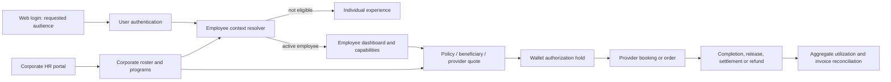

# Corporate Employee Experience — Detailed Implementation Plan

**Status:** proposed implementation plan; no application changes are represented by this document.
**Updated:** 4 November 2026
**Owner:** Web, Platform, Corporate Benefits, Provider Integration and QA
**Companions:** [CTO audit](../ai/INDIVIDUAL_CORPORATE_EMPLOYEE_CTO_AUDIT_2026-11-04.md), [competitor gap analysis](../ai/CORPORATE_EMPLOYEE_COMPETITOR_GAP_ANALYSIS_2026-11-04.md)

## Why this document replaces the 2024 design

The previous design allowed an authenticated user to set `corporateId`, `employeeId`, and
`membershipType` through profile update. That cannot be an eligibility mechanism: users must never
be able to grant themselves employer-funded healthcare access. It also treated a `users` table link
as the primary source of employment, while the current system has both `corporate_employees` and
`user_associations` with partially overlapping rules.

This plan makes the roster link authoritative, preserves the user as a patient account, and adds a
verified employer context for the Corporate Employee experience. A login selector changes the
experience requested; it never changes the user's role, employer, benefit limit, or permissions.

The intended experience is a benefits hub, wallet, cashless service discovery and checkout,
eligible dependant coverage, care/claims tracking, and private employee support. The reference
analysis draws from Visit Health, ekincare and MediBuddy; those are feature references only.
Mediczy must not claim network size, service level or outcome results until it has contract and
operational evidence of its own.

## Product decisions

| Decision | Implementation consequence |
|---|---|
| Individual and Corporate Employee are patient experiences, not account roles. | Both use `POST /api/users/login` and a user token. Corporate HR/Admin remains on `/corporate/login` with `corporateToken`. |
| Employment eligibility is server-owned. | `corporate_employees` plus a matching active `user_associations` employee link supplies employer access. Browser state and mutable `users.corporateId` never authorize access. |
| Multiple employers are an explicit choice, never a hidden “latest row” selection. | First release prompts for context when there is more than one active employer. Every employer-bound request validates `X-Corporate-Context`. |
| Companies configure benefits; the server decides whether a person can use a benefit now. | A shared evaluator checks employment, dates, beneficiary, program state, category limit, provider and constraints at quote and commit. |
| Patient information is confidential by default. | HR receives only policy-allowed aggregate or consent-governed information. Funding a benefit does not grant access to a patient record. |
| Sponsor access ends on offboarding or expiry. | Context, caches, wallets, holds and requests are revalidated/revoked; personal records and retail purchases remain available to the user. |

## Scope

### First release

1. Individual / Corporate Employee selector on the web login page.
2. Verified employee-context API, central eligibility resolver, employee dashboard and
   capability-driven navigation.
3. Employer-sponsored benefit visibility, wallet balances and transaction history.
4. One complete sponsored service: annual health checkup from beneficiary selection through booking,
   report delivery and wallet use.
5. Security fixes: close profile self-linking and corporate association escalation.
6. HR onboarding/offboarding synchronization, audit logs, metrics and release controls.

### Follow-on release

Cashless consultation, diagnostic, pharmacy, claims/reimbursement, dependant additions, provider
search, events, challenges, employee assistance and the expanded service catalogue. Each reuses the
same employee context, policy/quote and checkout boundaries.

### Health-checkup boundary: two distinct workflows

| Workflow | Subject and timing | Funding and entitlement | What the employee can do | Employer outcome |
|---|---|---|---|---|
| **Annual health checkup (AHC)** | Verified active employee, and only a verified covered dependant where the sponsored plan permits it | A corporate-sponsored plan entitlement. It is configured as an `annual` package, assigned to an eligible active employee and redeemed through the employee context, not through retail payment. | See only their assigned annual package, eligible venue/slot and their own booking/report. | Aggregated uptake and policy-approved operational status; individual clinical content only through an explicit, appropriate consent/role policy. |
| **Pre-employment medical examination (PEME)** | Candidate/new joiner before employment activation; may not yet have a Mediczy user or employee association | A separate employer-paid recruitment/occupational-health service. It is **not** a membership-plan benefit, employee wallet category or employee self-service health-checkup entitlement. | Receive a one-time secure invite, give required notice/consent, complete a scheduled occupational examination and access their own result/notice according to policy. | A narrowly scoped occupational disposition—such as fit, fit with restrictions, temporarily unfit, pending or unable to assess—plus authorized workflow status. The employer must not receive the full clinical record by default. |

`pre_employment` packages must therefore be removed from `GET /api/health-checkups/packages`,
`/health-checkups/:packageId`, employee benefits/wallet navigation and the employee checkout path.
Annual packages must be positively selected by `type='annual'`; do not merely exclude a known
pre-employment label. PEME uses its own candidate/case, scheduling, provider and payment path.

### Out of scope

- Replacing corporate HR/admin authentication.
- Allowing other portal roles through the patient login.
- Replacing clinical records, ordinary patient appointments or the retail membership engine.
- Treating a corporate `member` association created by individual signup as employee eligibility.
- Promising insurance or cashless service without a live policy and provider confirmation.

## Target architecture



### Trust boundaries

- The browser keeps requested experience and selected context for navigation only. The server
  validates the active user and context on every employee endpoint.
- Context must be opaque, signed or a validated UUID. A browser-supplied numeric `corporateId` is
  never authorization.
- Only the policy evaluator calculates eligibility and contribution. Frontend price summaries are
  informational.
- The wallet owns reservation and settlement. Provider booking never writes available balance.
- HR, provider, employee and support permissions are separate. Selecting Corporate Employee never
  turns a user token into an HR/admin token.

## Data model and migration plan

### Canonical employment record

Retain `corporate_employees` as the canonical employment/roster record. It already captures the
corporate, employee ID, active status and linked `userId`. Enforce these invariants:

| Invariant | Enforcement |
|---|---|
| One linked user has one active row per corporate. | Partial unique index `(corporate_id, "userId")` where `"userId" IS NOT NULL AND "isActive" = true`. |
| An employee identifier is not active twice at a corporate. | Partial normalized unique index `(corporate_id, UPPER("employeeId"))` where `"isActive" = true`; clean conflicting data first. |
| Roster employee and user association agree. | Create/activate them atomically during roster claim. A reconciler reports mismatches and never invents a link. |
| Employment has a lifecycle. | Add `effective_from`, `effective_to`, `employment_status`, `offboarded_at`, `offboard_reason`, `linked_at`, `linked_by`; retain `isActive` during migration. |
| The employer is active. | The resolver joins `corporates` and requires active status and an effective employment period. |

After release, `users.corporateId`, `users.employeeId`, `users.membershipType`, and
`users.isCorporate` can be read for temporary compatibility only. They cannot authorize a benefit,
and the public profile API cannot write them.

### Context and capabilities

Use a short-lived server-side context or signed context claim with revocation/version checking. Do
not issue a long-lived JWT entitlement that cannot be invalidated at offboarding. A persisted model,
if required for web/mobile selection, is:

```sql
employee_access_contexts (
  id uuid primary key,
  user_id bigint not null,
  corporate_id bigint not null,
  corporate_employee_id bigint not null,
  issued_at timestamptz not null,
  expires_at timestamptz not null,
  revoked_at timestamptz null,
  revoked_reason text null,
  selected_by_user boolean not null default false,
  unique (id, user_id)
)
```

Capabilities are derived from current programs and policy state, never a manually maintained broad
`canBookEverything` grant. Example capabilities: `benefits.read`, `wallet.read`, `checkup.quote`,
`checkup.book`, `network.read`, `claim.create`, `calendar.read`, `calendar.rsvp`,
`challenge.read`, `challenge.join`, `support.create`.

### Wallet and checkout records

Reuse `corporate_benefit_programs`, `employee_benefit_wallets`, and
`corporate_benefit_authorizations`; the existing service already has reserved, utilized and
remaining balance handling. Extend it instead of creating a second wallet:

- Add or consistently populate `beneficiary_type`, `beneficiary_id`, `service_reference`,
  `quote_id`, `idempotency_key`, `expires_at`, settlement/refund reason and provider reference.
- Enforce a unique `(user_id, idempotency_key)` for employee checkout requests.
- Use integer paise or a fixed precision decimal consistently for new monetary values.
- Record employer sponsorship, employee co-pay and retail payment separately so provider order,
  payment gateway and corporate invoice reconcile.

### Migration sequence

1. Produce read-only reports for duplicate employee IDs, users linked to multiple active roster
   rows, dangling associations and inactive corporates with active links.
2. Add nullable lifecycle fields and indexes only after data cleaning; run dry-run and rollback
   verification.
3. Backfill an association only from a verified active roster row with an existing `userId` and
   matching corporate. Do not automatically link by email alone.
4. Deploy the centralized resolver in shadow mode, compare it to every legacy resolver and emit
   mismatch metrics.
5. Make the resolver authoritative for employee network, wallet, calendar, gamification, checkup
   booking and claims routes.
6. Remove public writes to legacy fields. Keep read compatibility until consumers migrate; delete
   legacy columns only in a separately approved retention migration.

## Server design

### Employee access context service

Create `server/services/employee-access-context.service.js`. It has no HTTP concerns and exposes:

```ts
type EmployeeAccessContext = {
  userId: number;
  corporateId: number;
  corporateEmployeeId: number;
  employeeId: string;
  corporateName: string;
  effectiveFrom: string | null;
  effectiveTo: string | null;
  contextId: string;
  capabilities: string[];
  benefitSources: Array<{ id: string; category: string; fundingType: string }>;
};

resolveActiveContexts(userId): Promise<EmployeeAccessContext[]>;
selectContext(userId, corporateId): Promise<EmployeeAccessContext>;
requireEmployeeContext(req): Promise<EmployeeAccessContext>;
revokeContextsForEmployee(corporateEmployeeId, reason): Promise<void>;
```

`resolveActiveContexts` verifies the active patient user, roster `userId`, active/effective roster,
active corporate, matching `user_associations` record (`role='employee'`, `status='active'`), then
derives capabilities from active benefit programs/wallets. It returns stable reasons rather than a
generic failure: `NO_EMPLOYMENT_LINK`, `OFFBOARDED`, `EMPLOYER_INACTIVE`,
`EMPLOYMENT_NOT_EFFECTIVE`, `ASSOCIATION_MISMATCH`, `NO_ACTIVE_BENEFITS`,
`MULTIPLE_EMPLOYERS`.

### Middleware

Implement `requireEmployeeContext(requiredCapabilities?: string[])` after `authUser` and
`patientAccountOnly`.

It validates `X-Corporate-Context` or an equivalent server selection, attaches the verified context
at `req.employeeContext`, and returns:

- `401` for no valid user session;
- `403` plus a stable code for a missing/expired/offboarded context or capability;
- `409` plus safe employer summaries when a user needs to select an employer.

Replace local `authEmployee` variants after migration. The current variant means merely
“authenticated patient user”, which is insufficient for employer-funded operations.

### Authorized association management

Replace broad `POST /api/user-associations/corporate` behavior with corporate-scoped roster commands:

| Command | Actor | Required checks |
|---|---|---|
| Create roster employee | corporate HR/admin | actor’s corporate scope, permission, company status, normalized employee-ID uniqueness, audit record |
| Invite/claim roster employee | recipient or HR | signed/OTP claim for one unlinked roster row; email/employee-ID validation; one-time expiry |
| Update employment | scoped HR/admin | allowlisted fields, effective dates and audit diff; never generic reassignment |
| Offboard employee | scoped HR/admin | effective date, context revocation, sponsor-access end, clinical-data preservation, audit event |
| Repair association | platform admin with reason | roster/user/corporate evidence and explicit audit; no automatic email matching |

The generic association API must require a platform-admin permission or exclude employment types. It
cannot accept a client-chosen `role='employee'`, `userId`, or `corporateId` without actor scope.

### Policy evaluation and quotes

Create `server/services/corporate-benefit-policy.service.js`, used by all quote and commit paths.
Inputs are verified context, category, beneficiary, provider/service, requested time and any
prescription/reference. It returns:

```ts
evaluateBenefit(input): Promise<{
  eligible: boolean;
  reasonCode?: string;
  programId?: string;
  walletId?: string;
  currency: 'INR';
  listPrice: number;
  employerPays: number;
  employeePays: number;
  availableBalance: number;
  constraints: string[];
  quoteExpiresAt?: string;
}>;
```

Evaluation order:

1. context and program dates;
2. beneficiary relationship, enrollment and coverage dates;
3. included category/service, frequency and prescription/referral requirement;
4. provider network, serviceability, slot and provider price;
5. overall/category/dependant/transaction sublimits and existing holds/usage;
6. funding rule: employer funded, cashless, co-pay or reimbursement;
7. safe explanatory reason when the service cannot proceed.

Persist quote facts and expiry. Commit recalculates against live state and never trusts browser
amounts or browser eligibility.

### Checkout orchestration

Create a small orchestration service, not another wallet:

1. `POST /api/employee/benefit-quotes` evaluates and persists a short-lived quote.
2. `POST /api/employee/checkouts` accepts `quoteId` and `Idempotency-Key`.
3. It re-evaluates, starts a transaction, locks wallet rows, creates an authorization hold and
   checkout record in `pending_provider`.
4. It obtains employee co-pay through the existing payment service where relevant. A payment callback
   can settle only a matching checkout and amount.
5. It invokes the provider/booking adapter with a stable external idempotency reference.
6. Provider confirmation becomes `confirmed`; provider failure releases the hold and records a
   recoverable `failed` checkout.
7. Completion settles; cancellation/no-show/refund releases or refunds exactly once.

Write checkout, hold and provider/payment outbox event in one transaction. Workers may retry
delivery but must not create another booking or debit.

### API contract

All employee APIs require a patient bearer token and verified context where indicated.

| Endpoint | Purpose | Required capability |
|---|---|---|
| `GET /api/employee/context` | available/selected employers, eligibility, branding and capabilities | user session |
| `PUT /api/employee/context` | select one verified employer | user session |
| `GET /api/employee/dashboard` | employee landing data, filtered by capability | `benefits.read` |
| `GET /api/employee/benefits` | plans, limits, exclusions and usage | `benefits.read` |
| `GET /api/employee/wallet` | balance and paginated ledger/authorizations | `wallet.read` |
| `POST /api/employee/benefit-quotes` | authoritative price and eligibility | category quote capability |
| `POST /api/employee/checkouts` | reserve funds and start order/booking | category booking capability |
| `GET /api/employee/checkouts/:id` | booking/payment/fulfillment status | checkout owner |
| `POST /api/employee/checkouts/:id/cancel` | cancellation under policy/provider rules | checkout owner |
| `GET /api/employee/network/providers` | context/category/location-scoped search | `network.read` |
| `GET /api/employee/checkups` | assigned eligible checkups | `checkup.quote` |
| `POST /api/employee/checkups/:id/quote` | checkup quote and serviceability | `checkup.quote` |
| `POST /api/employee/checkups/:id/book` | temporary facade over checkout | `checkup.book` |
| `GET /api/employee/activity` | appointments, orders, claims and authorizations | verified context |
| `POST /api/employee/support/cases` | employee-owned case tied to a transaction | `support.create` |

Responses carry `context`, `data`, `requestId`, and a stable `code` for actionable errors. Employer
lists never expose another employee’s wallet, treatment, report or private identity fields.

### Existing route migration

| Existing area | Migration action |
|---|---|
| `server/routes/employee-network.route.js` | Replace divergent association/plan lookup with shared resolver. Keep temporary aliases but include context source/version during migration. |
| `server/services/corporate-benefit-wallet.service.js` | Route `resolveEmployeeCorporate` through the new resolver. Retain its locking/reserve/settle/cancel work behind policy evaluation and checkout orchestration. |
| `server/routes/corporate.route.js` employee wallet/calendar/gamification | Use `requireEmployeeContext`; retain HR operations under `authCorporate`; hide drafts and cancelled programs from employee feeds. |
| `server/services/corporate-health-checkup-booking.service.js` | Use as first provider adapter; require context and quote; connect final booking/order to checkout and authorization. |
| `server/routes/user.route.js` profile update | Remove employment identity writes; return a read-only employer summary derived from context. |
| `server/routes/userAssociation.route.js` | Scope, restrict or retire generic corporate employment mutation. |
| `server/controller/user.controller.js` login | Return user identity only. Resolve employer context after login rather than embedding durable benefit entitlement. |

## Web implementation

### Login and session

In `client/src/auth/Login.tsx`, add an accessible audience selector above password/OTP selection:

| Audience | Copy | Success behavior |
|---|---|---|
| Individual | “Use your personal health account.” | Preserve existing individual routing and membership behavior. |
| Corporate Employee | “Use benefits provided by your employer.” | Authenticate as user; fetch `/employee/context`; choose context or show eligibility result; navigate to `/employee`. |
| HR / Corporate Admin | secondary link, not a selector tab | Open existing `/corporate/login`. |

Password, OTP, reset and social login preserve `returnTo` and requested audience. An individual who
selects Corporate Employee receives `NO_EMPLOYMENT_LINK`, an Individual return action and employer
support guidance. They are never sent to retail plan selection as a way to obtain corporate rights.

Keep `userType='user'` for both patient experiences. Add separate experience/context state:

```ts
type Experience = 'individual' | 'corporate_employee';
type EmployeeContextState = {
  status: 'unknown' | 'none' | 'selecting' | 'active' | 'expired' | 'error';
  context?: EmployeeAccessContext;
};
```

`corporateToken`, `corporateData`, and `userType='corporate'` remain HR/admin-only. Clear employee
queries on logout, context change, token refresh and `401/403` context revocation. Capabilities are
refetched on focus/refresh; local storage is not their source of truth.

### Employee routes and navigation

Create an employee shell under `/employee`, built on patient `MainLayout`. Do not use
`CorporateLayout`, which intentionally redirects patient sessions to HR login.

| Route | Page |
|---|---|
| `/employee` | employer home: coverage, balance, active services, next booking and support |
| `/employee/benefits` | catalogue, eligibility, limits and balance |
| `/employee/wallet` | available, holds, usage and receipts |
| `/employee/checkups` | assigned packages and booking flow |
| `/employee/network` | providers filtered by category/location/network |
| `/employee/activity` | appointments, orders, claims and authorization status |
| `/employee/family` | enrolled beneficiaries and coverage status |
| `/employee/wellness` | published events and challenges only |
| `/employee/support` | employer-benefit cases |

Employee Benefits navigation appears only with active context and is server-capability-driven. Hidden
menus are not authorization: route loaders and APIs enforce the same capability. Move employee
behavior blended into `CorporateBenefits.tsx` into employee-owned screens. Keep HR program
configuration, settlement and roster operations in corporate screens. Add a real route for the
currently lazy-imported `EmployeeGamification` page.

### Employee home hierarchy

1. Employer identity, validity and change-employer action.
2. “Available today” cards only for services bookable now.
3. Wallet available/pending/used/expiring breakdown.
4. Next action: checkup, appointment, document, claim or pending payment.
5. Covered vs non-covered family members; a family record does not imply coverage.
6. Activity and one employee support entry point.

Every transaction labels payer source: **Employer benefit**, **You pay**, **Personal membership**,
or **Insurance/reimbursement**. A personal retail benefit must not look employer-sponsored.

## First complete service: annual health checkup

Use health checkup as the first live category because packages, employee association checks, labs
and booking tests already exist. This applies only to `annual` corporate-sponsored packages. A
pre-employment examination is intentionally excluded from this service: it is assessed under the
separate candidate/occupational workflow in
[the PEME audit](../ai/PRE_EMPLOYMENT_HEALTHCHECKUP_CTO_AUDIT_2026-11-04.md).

```mermaid
sequenceDiagram
  participant E as Employee
  participant W as Web app
  participant P as Policy/Context
  participant L as Wallet/Checkout
  participant B as Booking adapter
  participant Lab as Network lab

  E->>W: Select beneficiary and package
  W->>P: Quote(package, beneficiary, location)
  P-->>W: Eligibility, covered amount, contribution, expiry
  E->>W: Confirm once
  W->>L: Checkout(quote, idempotency key)
  L->>L: Lock wallet; create hold + outbox event
  L->>B: Create booking with stable reference
  B->>Lab: Reserve slot/home collection
  Lab-->>B: Confirm or reject
  B-->>L: Update checkout and authorization
  L-->>W: Confirmation, receipt, preparation instructions
  Lab-->>L: Completion/report event
  L->>L: Settle/release wallet and notify employee
```

Release rules:

- Package and beneficiary must belong to the selected verified employer context.
- Package type is exactly `annual`; `pre_employment`, `periodic`, `return_to_work`, `other` and
  malformed/legacy type values are not eligible for employee-plan booking.
- Network lab, home address, date/slot and fasting instructions are confirmed before hold/payment.
- Double-click, retry and delayed provider reply create one booking and one hold.
- Provider rejection/payment failure releases a hold exactly once.
- Cancellation and partial refund follow provider/policy rules and visibly update ledger.
- Results belong to the patient/beneficiary. HR gets consented aggregate reporting only.

## Security, privacy and audit

Mandatory controls:

- Validate ownership/context for every GET, POST, export and download. URL IDs never grant access.
- Query employee data by verified `user_id` and `corporate_id`, never employee ID alone.
- Set RLS/tenant context consistently before corporate provider and booking operations.
- Rate-limit login, OTP, context selection, quote and checkout separately.
- Store idempotency keys, request IDs and actor/session metadata for money and employment changes.
- Do not log PHI, raw payment details, OTPs, sessions or tokens.
- Restrict/encrypt employee identifiers and health documents under the existing data policy. Define
  access-log and support-case retention.
- Require HR step-up authentication for benefit program changes, settlement overrides and exports.

Audit events: `employee_context_selected`, `employee_context_denied`,
`employment_link_created`, `employment_link_repaired`, `employee_offboarded`,
`benefit_quote_created`, `benefit_authorization_held`, `checkout_confirmed`,
`checkout_failed`, `hold_released`, `authorization_settled`, `refund_processed`,
`provider_access_denied`, `report_accessed`.

Events contain actor/target entity UIDs, request ID, code, transition and redacted monetary deltas;
they never contain clinical content.

## Testing plan

### Unit

- Resolver: active, inactive, expired, missing association, inactive employer, mismatch, duplicate
  employee ID, multiple employers and a personal `member` association.
- Policy evaluator: self/dependant, dates, excluded category/service/provider, prescription rule,
  frequency/sublimit, co-pay and insufficient balance.
- Wallet: atomic hold, duplicate idempotency key, concurrent authorization, settlement, cancellation,
  partial settlement and refund.
- Capability mapping: an expiring benefit disappears reliably and does not leave stale privilege.

### API and integration

- Individual selecting corporate audience obtains no context and cannot book an employee service.
- An active employee uses an HR-created/verified roster link and cannot select another employer.
- HR cannot act as an employee with `corporateToken`; employee cannot read roster or settle with a
  user token.
- Offboarding revokes a context after refresh, quote creation and before commit.
- Direct URL/API calls enforce the same controls as hidden UI.
- Checkup happy path, duplicate submit, provider failure, cancellation, report ownership and ledger
  reconciliation.

### Browser and security

Use seeded non-production fixtures for password, OTP and social login; single/multiple/no context;
expiry/offboarding; keyboard and screen-reader flows; mobile/desktop; individual plan regression;
employee dashboard; checkup booking; logout and multi-tab revocation.

Attempt profile edits to employer fields, generic association creation as patient/foreign HR, replayed
callbacks, swapped beneficiary/context/checkout IDs, expired quote, parallel authorizations, and
cross-user/cross-employer reads of report, wallet, claim and booking data.

## Observability and reconciliation

| Metric | Purpose |
|---|---|
| context resolution outcome by code | Detect roster/onboarding defects |
| active employees with at least one capability | Detect benefit-program configuration defects |
| quote → checkout → provider confirmation | Find booking/payment friction |
| hold age and expired-hold count | Find stuck wallet money |
| provider confirmation/error latency | Detect integration failures |
| authorization vs provider completion vs invoice variance | Finance reconciliation |
| offboarding revocation latency | Verify security control |
| support response/resolution time | Measure service reliability |

The daily reconciler identifies holds with no outcome, completed services without settlement,
settlements without completion, and active wallets after offboarding. It creates operations tasks;
it does not silently mutate money or employment records.

## Rollout and rollback

Feature flags, scoped by corporate UID and environment:

- `employee_context_resolver_shadow`
- `employee_context_enforced`
- `employee_web_experience`
- `employee_checkup_checkout`
- `employee_checkout_provider_outbox`
- `employee_multi_context_selection`

Release stages:

1. Data/readiness: migration dry run, roster reconciliation, program/network map and support owner.
2. Shadow resolver: compare legacy/new outcomes and investigate every mismatch class.
3. Security enforcement: block self-linking and unsafe association calls; enable audit alerts.
4. Internal pilot: one employer, read-only benefits dashboard, no wallet commits.
5. Checkup pilot: limited packages/providers, checkout and daily financial reconciliation.
6. General availability: corporate cohorts only after completion, support and reconciliation gates;
   expand categories one at a time.

Rollback disables the UI/checkout flag but preserves contexts, ledger and status visibility. A provider
adapter failure stops new checkouts and leaves support able to resolve existing ones. Never delete or
alter settled ledger entries to roll back a release; use compensating release/refund entries. Never
restore legacy profile-to-employer authorization as a rollback mechanism.

## Work packages and definition of done

| Package | Changes | Exit criteria |
|---|---|---|
| CE-0: data and authorization | migrations, cleanup report, association restriction, profile-write removal, audit events | no self-linking; readiness checks pass |
| CE-1: context foundation | resolver, middleware, context API, shadow comparison, cache invalidation | migrated endpoints give one employer outcome |
| CE-2: web experience | selector, post-login context, employee shell/routes/navigation | individual regression holds; employee reaches dashboard; HR remains separate |
| CE-3: read-only benefits | dashboard, benefits, network, wallet/activity APIs and UI | source programs/wallet reconcile; errors are not rendered as empty data |
| CE-4: checkup checkout | quote, hold, outbox, adapter, payment split, cancellation | e2e tests and operational reconciliation pass |
| CE-5: expansion | claims, consult/lab/pharmacy, dependants, events/challenges, support | each category uses shared policy/checkout and passes ownership tests |
| CE-6: operations | lifecycle UI/API, MIS/invoices, monitoring, support runbooks | offboarding, invoice variance and incident drills pass |

Packages are independently deployable behind flags. Estimates are deliberately omitted until provider
adapter, payment contract, roster quality and engineering capacity are confirmed.

The Corporate Employee experience is done only when an individual cannot acquire employer rights;
an active employee can select verified employer context, see only available benefits and complete
the first sponsored service; offboarding reliably blocks new corporate transactions; money/provider
booking/invoice reconcile; HR cannot access unauthorized health information; direct APIs and UI
enforce identical rules; and regression, concurrency, authorization and accessibility checks run in
CI with staffed pilot support.

## Compatibility notes

Existing employee routes may remain temporary aliases while clients migrate, but must call the new
context resolver before an employee feature flag is enabled. Track every alias with owner, deadline
and telemetry. The existing SmartHealth mobile integration describes a separate corporate-login
contract; before changing it, migrate it to these verified context semantics rather than preserving
a parallel trust model.
