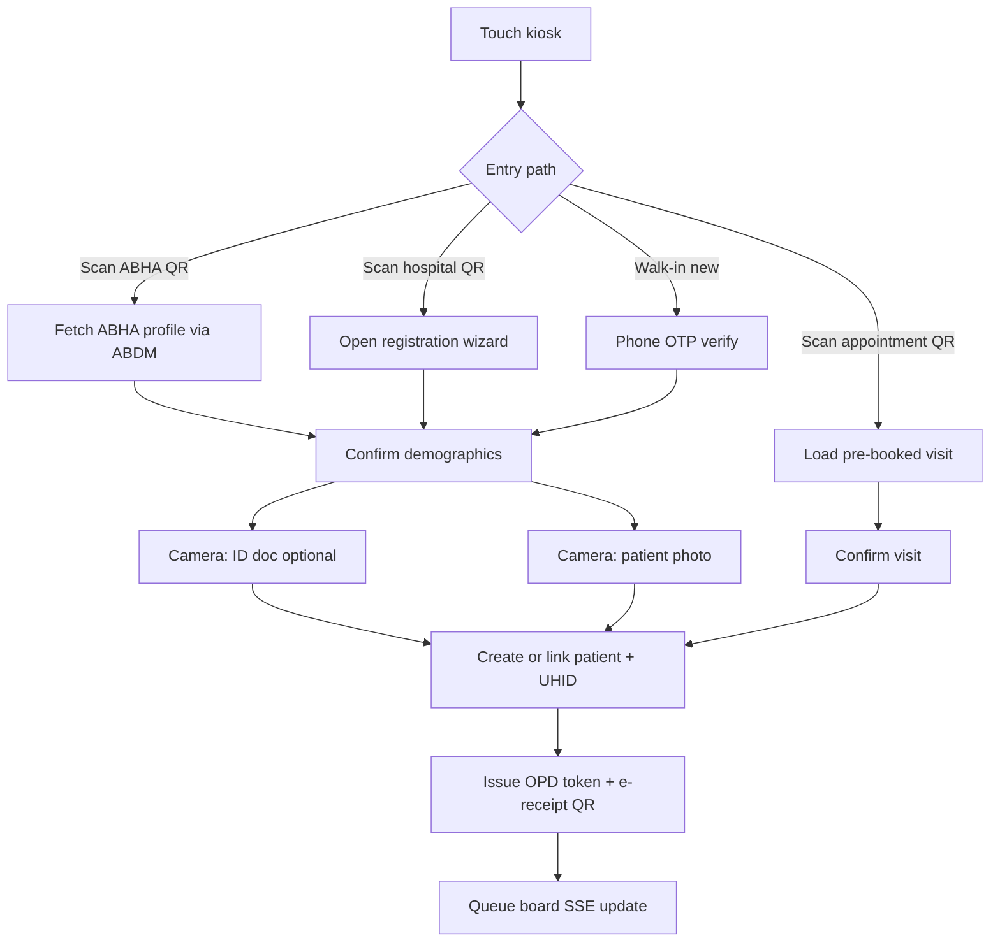

# Greenfield Hospital — Gaps Implementation Complete Document

| Field | Value |
|-------|-------|
| **Document ID** | MED-HOSP-GAP-001 |
| **Version** | 1.1 |
| **Date** | 2026-06-17 |
| **Owner** | AI CTO |
| **Audience** | PM, BA, Engineering, QA, Security, Delivery |
| **Status** | ACTIVE — implementation backlog |
| **Related audits** | `HOSPITAL_ROLLOUT_READINESS_ASSESSMENT.md`, `TENANT_SETUP_AUDIT.md`, `SAMD_READINESS_SCORECARD.md` |

---

## 1. Purpose

This document is the **single implementation backlog** for making Mediqzy production-ready for a **greenfield hospital deployment** (new tenant, new facility, real PHI).

It consolidates findings from:

- Hospital HMIS / portal codebase review (June 2026)
- Multi-tenant security audit (`docs/deployment/TENANT_SETUP_AUDIT.md`)
- Mobile / frontend / QA landscape review
- SaMD & DPDP compliance scorecards

Each gap has: **ID, priority, owner role, current state, target state, files, implementation steps, acceptance criteria, dependencies.**

---

## 2. Executive summary

### 2.1 Overall readiness (greenfield hospital)

| Dimension | Score | Go-live without fix? |
|-----------|-------|----------------------|
| OPD + doctor + patient flows | 75% | Yes (with deploy) |
| Insurance / TPA desk | 85% | Yes |
| Pharmacy + lab portals | 80% | Yes |
| Full IPD (admit → discharge) | 45% | **No** |
| Hospital portal sidebar (beds, OPD/IPD, billing) | 30% | **No** |
| Multi-tenant PHI isolation | 50% | **No** |
| Native mobile apps | 35% | Build separately |
| Hospital E2E QA | 40% | **No** |
| Paperless kiosk (QR + camera self-registration) | 15% | **No** |

**Weighted overall:** ~58/100

### 2.2 Verdict

| Deployment type | Ready? |
|-----------------|--------|
| Phased greenfield: OPD + insurance + pharmacy + lab | **Yes** (Phase 1) |
| Paperless lobby: QR check-in + walk-in self-registration | **After KIOSK-001–005** (Phase 1b) |
| IPD pilot (10–30 beds) using HMIS routes | **After Phase 0 + Phase 2** |
| Full hospital ERP replacement on day one | **No** |
| Multi-hospital SaaS with shared-row tenancy | **No** |

### 2.3 Implementation phases (summary)

| Phase | Focus | Exit criteria |
|-------|-------|---------------|
| **0 — Foundation** | Migrations, tenant isolation, encryption | Pen-test pass; migrations green on clean DB |
| **1 — Day-1 go-live** | OPD, insurance, pharmacy, lab | Staff trained; no placeholder routes in use |
| **2 — IPD pilot** | HMIS UI + ADT/eMAR/discharge | Admit→discharge E2E passes in CI |
| **3 — Productization** | Unified portal, IP billing, mobile | Sidebar = real APIs; no `localStorage` clinical data |
| **4 — Scale & compliance** | ECS, NABH evidence, SaMD filing | Per-tenant accreditation pack exportable |

---

## 3. Architecture context (why gaps exist)

Mediqzy runs **two parallel hospital stacks**:

```
┌─────────────────────────────────────────────────────────────────┐
│  HOSPITAL PORTAL STACK (partial / risky for IPD)                │
│  UI: /hospital/*                                                │
│  API: /api/hospital/practice/*                                  │
│  Persistence: file store + localStorage + legacy beds.ward       │
│  Sidebar: beds, OPD/IPD, pharmacy, billing → PLACEHOLDERS        │
└─────────────────────────────────────────────────────────────────┘

┌─────────────────────────────────────────────────────────────────┐
│  HMIS STACK (clinical backend + UI — use for IPD pilot)         │
│  UI: /hmis/*, /ward/*, /icu/*, /ot/*                            │
│  API: /api/v1/adt, beds, emar, nursing, ot, discharge, vitals  │
│  Persistence: PostgreSQL (wards, ip_admissions, adt_events…)    │
│  Tests: adt-beds, emar, nursing-ipd, ot-scheduling, icu, etc.   │
└─────────────────────────────────────────────────────────────────┘
```

**Rule until GAP-ARCH-001 is closed:** Staff must **not** use `/hospital/beds`, `/hospital/opd-ipd`, `/hospital/billing` for real operations. Use `/hmis/*` and `/ward/*`.

### 3.1 Paperless kiosk / self-registration (current vs target)

Zone **1a** in `MEDIQZY_DISPLAY_KIOSK_PLAN.md` calls for appointment lookup by phone/ABHA, token issuance, and wayfinding. The **built** experience is narrower: phone-only check-in for **existing** appointments — no QR scan, no camera capture, no walk-in new-patient registration.

```
┌──────────────────────────────────────────────────────────────────────────┐
│  CURRENT (partial — demo-capable, not production paperless)              │
│  UI:  /kiosk/checkin → SelfCheckinKiosk.tsx (phone keypad only)           │
│  API: POST /api/display/checkin/appointments | issue-token               │
│  QR:  @zxing/browser in HospitalMRD.tsx (staff MRD scan — not kiosk)     │
│  Cam: getUserMedia in MRD / triage / video — not registration kiosk      │
│  ABHA: POST /api/abdm/abha/register/* (authUser required — not kiosk)    │
└──────────────────────────────────────────────────────────────────────────┘
                                    ↓
┌──────────────────────────────────────────────────────────────────────────┐
│  TARGET — paperless QR + camera self-registration (GAP-KIOSK-001–007)    │
│  Entry: ABHA QR | appointment QR | hospital deep-link QR | walk-in       │
│  Capture: live patient photo (+ optional ID doc image) with DPDP consent   │
│  Output: UHID/MRN + OPD queue token + e-receipt QR (no paper form)       │
│  Privacy: public queue boards show token/initials only                     │
└──────────────────────────────────────────────────────────────────────────┘
```

**Target flow (lobby kiosk):**



**Reuse (do not rebuild):** `DisplayShell.tsx`, `SelfCheckinKiosk.tsx` idle/timeout UX, `HospitalMRD.tsx` ZXing pattern, patient profile upload + MinIO + ClamAV, `hospital-display.route.js` token issuance + SSE, `abdm.route.js` OTP primitives.

---

## 4. Master gap register

| ID | Priority | Gap title | Owner | Phase | Status |
|----|----------|-----------|-------|-------|--------|
| GAP-MIG-001 | P0 | Unified migration orchestrator | DevOps | 0 | Open |
| GAP-MIG-002 | P0 | HMIS migration chain applied & verified | DevOps | 0 | Open |
| GAP-MIG-003 | P0 | `er_visits` table migration | Backend | 0 | Open |
| GAP-MIG-004 | P0 | RLS + tenant security SQL applied | Security | 0 | Open |
| GAP-MIG-005 | P0 | PHI encryption migration + backfill | Security | 0 | Open |
| GAP-TEN-001 | P0 | Tenant scope on all hospital/HMIS routes | Security + Backend | 0 | Open |
| GAP-TEN-002 | P0 | RLS session vars unified & enforced | Security + Backend | 0 | Open |
| GAP-TEN-003 | P0 | Greenfield tenant provisioning playbook | Delivery + DevOps | 0 | Open |
| GAP-TEN-004 | P0 | Dedicated DB/schema per hospital (no shared-row) | DevOps | 0 | Open |
| GAP-ARCH-001 | P0 | Unify hospital portal ↔ HMIS navigation | Frontend + PM | 2 | Open |
| GAP-ARCH-002 | P0 | Remove file-store practice persistence | Backend | 0 | Open |
| GAP-ARCH-003 | P0 | Unify bed models (legacy vs HMIS `ward_id`) | Backend | 0 | Open |
| GAP-ARCH-004 | P0 | Eliminate `hospitalStorage` for clinical data | Frontend | 2 | Open |
| GAP-IPD-001 | P1 | Ward master data CRUD API | Backend | 2 | Open |
| GAP-IPD-002 | P1 | OT room setup admin API | Backend | 2 | Open |
| GAP-IPD-003 | P1 | 10-bed hospital seed script | DevOps | 0 | Open |
| GAP-IPD-004 | P1 | eMAR → pharmacy dispense loop | Backend | 3 | Open |
| GAP-IPD-005 | P1 | ER workflow schema + migration | Backend | 2 | Open |
| GAP-BIL-001 | P1 | IP charge master | Backend + BA | 3 | Open |
| GAP-BIL-002 | P1 | Bed-day automated charging | Backend | 3 | Open |
| GAP-BIL-003 | P1 | Discharge billing clearance automation | Backend | 3 | Open |
| GAP-BIL-004 | P1 | Hospital billing UI (replace placeholder) | Frontend | 3 | Open |
| GAP-MOB-001 | P1 | Patient native app (Expo scaffold → MVP) | Mobile | 1 | Open |
| GAP-MOB-002 | P1 | Consolidate mobile API paths | Backend + Mobile | 1 | Open |
| GAP-MOB-003 | P2 | Unified hospital staff mobile app | Mobile | 3 | Open |
| GAP-API-001 | P1 | Hospital HMIS OpenAPI contract | Backend + BA | 2 | Open |
| GAP-API-002 | P2 | Public swagger for hospital integrators | Backend | 4 | Open |
| GAP-QA-001 | P0 | Hospital admit→discharge Playwright E2E | QA | 2 | Open |
| GAP-QA-002 | P0 | Tenant isolation pen-test | Security + QA | 0 | Open |
| GAP-QA-003 | P1 | Hospital portal smoke script in CI | QA + DevOps | 2 | Open |
| GAP-QA-004 | P1 | Default `npm test` runs full Jest suite | QA | 1 | Open |
| GAP-OPS-001 | P1 | PostgreSQL backup/restore runbook | DevOps | 0 | Open |
| GAP-OPS-002 | P1 | Sentry/PagerDuty alerting | DevOps | 1 | Open |
| GAP-OPS-003 | P2 | ECS task definition for main Express app | DevOps | 4 | Open |
| GAP-CMP-001 | P0 | DPDP DPO + LLM provider DPAs | Security | 0 | Open |
| GAP-CMP-002 | P1 | PHI sanitization before LLM calls | AI + Security | 1 | Open |
| GAP-CMP-003 | P1 | NABH evidence population per tenant | BA + Delivery | 3 | Open |
| GAP-CMP-004 | P2 | SaMD clinical validation (triage, risk) | AI + Medical Director | 4 | Open |
| GAP-CMP-005 | P2 | CDSCO SaMD external filing | Regulatory | 4 | Open |
| GAP-UX-001 | P1 | Single staff SSO across portals | Frontend + Backend | 3 | Open |
| GAP-UX-002 | P2 | Bedside nurse mobile UX | UX + Mobile | 3 | Open |
| GAP-DEPT-001 | P2 | Dept modules (blood bank, CSSD…) on patient timeline | Backend + Frontend | 4 | Open |
| GAP-KIOSK-001 | P0 | QR-based kiosk entry (ABHA / appointment / walk-in deep link) | Frontend + Backend | 1 | Open |
| GAP-KIOSK-002 | P0 | Camera ID + patient photo capture at kiosk | Frontend + Backend | 1 | Open |
| GAP-KIOSK-003 | P0 | Walk-in new patient registration API (User + UHID + token) | Backend | 1 | Open |
| GAP-KIOSK-004 | P0 | Kiosk ABHA flow without staff JWT (device token + OTP limits) | Backend + Security | 1 | Open |
| GAP-KIOSK-005 | P0 | Harden check-in APIs (remove demo fallbacks, real schema) | Backend | 1 | Open |
| GAP-KIOSK-006 | P1 | DPDP consent for kiosk photo/ID storage + retention | Security + BA | 1 | Open |
| GAP-KIOSK-007 | P2 | Optional video liveness / ID verification at kiosk | AI + Frontend | 4 | Open |

---

## 5. P0 gaps — detailed implementation

### GAP-MIG-001 — Unified migration orchestrator

| | |
|---|---|
| **Owner** | DevOps Engineer |
| **Current** | Fragmented runners: `run-hmis-migrations.js`, per-file `node migration.js`, manual SQL |
| **Target** | Single `scripts/migrate-all.sh` (or `server/run-all-migrations.js`) with ordered steps + exit codes |
| **Files** | `server/run-hmis-migrations.js`, `server/migrations/*`, `server/db/migrations/*`, new `server/scripts/migrate-all.mjs` |

**Implementation steps**

1. Define ordered migration manifest:

   ```text
   1. Base PostgreSQL / Sequelize sync (if applicable)
   2. server/migrations/saas-platform-tables.migration.js
   3. server/migrations/add-multitenancy-admin-hierarchy.js
   4. server/migrations/hospital-portal-tables.sql (or -simple variant)
   5. server/migrations/pharmacy-module-tables.sql
   6. node server/run-hmis-migrations.js up
   7. server/migrations/samd-interpretability-governance.migration.js
   8. server/db/migrations/020-row-level-security-phi.sql
   9. server/db/migrations/027-phi-encryption.sql
   10. server/migrations/add-tenant-security.sql
   11. GAP-MIG-003 er_visits migration
   ```

2. Add `migrate-all status` — prints applied vs pending per manifest entry.
3. Wire into deploy runbook (`docs/deployment/PRODUCTION_DEPLOYMENT_RUNBOOK.md`).
4. Fail deploy if any step fails (non-zero exit).

**Acceptance criteria**

- [ ] Fresh PostgreSQL → `npm run migrate:all` → all HMIS tables exist
- [ ] Re-run is idempotent (no errors on second run)
- [ ] Documented in deploy checklist

**Dependencies** | None  
**Blocks** | GAP-MIG-002, GAP-TEN-002, all IPD work

---

### GAP-MIG-002 — HMIS migration chain verified

| | |
|---|---|
| **Owner** | DevOps + Backend |
| **Current** | 8 migrations defined in `server/run-hmis-migrations.js`; may not be applied on prod |
| **Target** | `node server/run-hmis-migrations.js status` shows all 8 applied on every environment |

**Tables created (minimum)**

| Migration file | Tables / changes |
|----------------|----------------|
| `20260525000001-create-wards-table.js` | `wards` |
| `20260525000002-update-beds-table.js` | `beds.ward_id`, `current_admission_id`, … |
| `20260525000003-create-ip-admissions.js` | `ip_admissions` |
| `20260525000004-create-adt-events.js` | `adt_events` |
| `20260525000005-create-ot-tables.js` | `ot_rooms`, `ot_bookings`, `ot_checklists` |
| `20260525000006-create-emar-tables.js` | `medication_orders`, `medication_administrations` |
| `20260525000007-create-vitals-and-alerts.js` | `vital_records`, `early_warning_alerts` |
| `20260526000001-create-hmis-phase3-5-tables.js` | 30+ tables (ICU, nursing, discharge, billing estimates, …) |

**Acceptance criteria**

- [ ] `status` = 8/8 on staging and production
- [ ] `server/__tests__/adt-beds.test.js` passes against migrated DB

---

### GAP-MIG-003 — `er_visits` migration

| | |
|---|---|
| **Owner** | Backend Engineer |
| **Current** | `server/routes/er-workflow.route.js` references `er_visits`; not in migration manifest |
| **Target** | Formal migration + model; no runtime `CREATE TABLE` hacks |

**Implementation steps**

1. Add `server/migrations/20260617000001-create-er-visits.js` with columns matching route expectations.
2. Register in `run-hmis-migrations.js` or manifest position after `adt_events`.
3. Add `server/__tests__/er-workflow.test.js` (minimal admit + triage).

**Acceptance criteria**

- [ ] ER route works on clean DB without fallback DDL
- [ ] Test in CI

---

### GAP-MIG-004 — RLS + tenant security SQL

| | |
|---|---|
| **Owner** | Security & Compliance Engineer |
| **Current** | `server/db/migrations/020-row-level-security-phi.sql`, `server/migrations/add-tenant-security.sql` — design exists, adoption partial |
| **Target** | Policies active on PHI tables; verified with cross-tenant negative tests |

**Implementation steps**

1. Pick **one** session variable convention (recommend `app.current_org_id` INTEGER).
2. Update all SQL files to use the same variable name.
3. Apply migrations on staging.
4. Implement GAP-TEN-002 so every PHI query sets the variable.

**Acceptance criteria**

- [ ] User A (org 1) cannot `SELECT` org 2 appointments when RLS enabled
- [ ] Documented in `docs/security/TENANT_SECURITY_QUICK_REF.md`

---

### GAP-MIG-005 — PHI encryption at rest

| | |
|---|---|
| **Owner** | Security Engineer |
| **Current** | `server/db/migrations/027-phi-encryption.sql`, `server/utils/encryption.js`; opt-in |
| **Target** | `ENCRYPTION_KEY` set in prod; backfill complete for designated PHI columns |

**Implementation steps**

1. Generate 64-char hex `ENCRYPTION_KEY`; store in SSM/Secrets Manager.
2. Run `027-phi-encryption.sql`.
3. Run `server/scripts/qa/backfill-phi-encryption.mjs`.
4. Verify decrypt round-trip in staging.

**Acceptance criteria**

- [ ] New PHI rows encrypted at insert
- [ ] Backfill job completes with audit log
- [ ] App reads decrypted values transparently

---

### GAP-TEN-001 — Tenant scope on hospital/HMIS routes

| | |
|---|---|
| **Owner** | Security + Backend (Principal Engineer review) |
| **Current** | `attachTenantScope` in ~3 route files; `TENANT_SETUP_AUDIT.md` = HIGH RISK |
| **Target** | All `/api/v1/*`, `/api/hospital/*`, `/api/nurse/*`, `/api/hospital/staff/*` enforce `organization_id` / `tenant_id` filter |

**Route audit matrix (implement `scopeFilter` on each)**

| Route prefix | File(s) | Tenant field |
|--------------|---------|--------------|
| `/api/v1/adt` | `server/routes/adt.route.js` | `organization_id` |
| `/api/v1/beds` | `server/routes/beds-management.route.js` | `organization_id` |
| `/api/v1/emar` | `server/routes/emar.route.js` | `organization_id` |
| `/api/v1/nursing` | `server/routes/nursing-ipd.route.js` | `organization_id` |
| `/api/v1/ot` | `server/routes/ot-scheduling.route.js` | `organization_id` |
| `/api/v1/icu` | `server/routes/icu.route.js` | `organization_id` |
| `/api/v1/discharge` | `server/routes/discharge-workflow.route.js` | `organization_id` |
| `/api/hospital/practice` | `server/routes/hospital/practice.route.js` | `tenant_id` |
| `/api/hospital-insurance` | `server/routes/hospital-insurance.route.js` | `organization_id` |
| `/api/nurse` | `server/routes/nurse.route.js` | `organization_id` |
| `/api/fhir` | `server/routes/fhir.route.js` | tenant-scoped bulk export |

**Implementation pattern**

```javascript
import { attachTenantScope, scopeFilter } from '../middleware/tenantScope.middleware.js';

router.use(authUser, attachTenantScope);

router.get('/patients', async (req, res) => {
  const where = { ...scopeFilter(req), status: 'active' };
  // ...
});
```

**Acceptance criteria**

- [ ] GAP-QA-002 pen-test: 0 cross-tenant reads on audited routes
- [ ] `tenantScope` never fails open (remove open fallback or alert on error)

**Dependencies** | GAP-MIG-004  
**Blocks** | Any multi-hospital production PHI

---

### GAP-TEN-002 — RLS session enforcement

| | |
|---|---|
| **Owner** | Backend + Security |
| **Current** | `rls-context.middleware.js` exposes helpers; only prescription + appointment controller use `setSequelizeRlsContext` |
| **Target** | All PHI writes use `req.withRlsTransaction()` or equivalent |

**Implementation steps**

1. Extend `appointment.controller.js` pattern to HMIS services.
2. Middleware: on authenticated request, if `req.user.organization_id`, call `SET LOCAL app.current_org_id = $id` at transaction start.
3. Add regression test `server/scripts/qa/verify-rls-coverage.mjs` — fail CI if new PHI routes lack RLS wrapper.

**Acceptance criteria**

- [ ] `verify-rls-coverage.mjs` passes
- [ ] DB-level deny confirmed with integration test

---

### GAP-TEN-003 — Greenfield provisioning playbook

| | |
|---|---|
| **Owner** | Delivery Manager + DevOps |
| **Current** | Manual scripts (`add-new-tenant.cjs`, `create-hospital-account.js`); no ward/bed seed |
| **Target** | Documented + scripted: tenant → admin → capabilities → wards/beds/OT → smoke verify |

**Deliverable script:** `server/scripts/greenfield/provision-hospital.mjs`

```bash
node server/scripts/greenfield/provision-hospital.mjs \
  --name "Acme Hospital" \
  --subdomain acme \
  --beds 10 \
  --wards 2 \
  --ot-rooms 1 \
  --admin-email admin@acme.com
```

**Steps inside script**

1. `tenant.service.onboardTenant()` or `super-admin-tenant` API
2. Create hospital auth account (`hospital-auth.route.js`)
3. Run GAP-IPD-003 seed (wards, beds, OT rooms) for `organization_id`
4. Set capabilities: `bed_management`, `opd_ipd`, `emar`, `insurance`, …
5. Call health check: `GET /api/hospital/capabilities`, `GET /api/v1/beds/census`

**Acceptance criteria**

- [ ] New hospital usable in &lt; 30 minutes (automated)
- [ ] Runbook in `docs/hospital/GREENFIELD_PROVISIONING_RUNBOOK.md` (linked from this doc)

---

### GAP-TEN-004 — Dedicated DB or schema per hospital

| | |
|---|---|
| **Owner** | DevOps + Principal Engineer |
| **Current** | Default shared PostgreSQL + inconsistent `organization_id` |
| **Target** | Greenfield hospitals use `shared_schema` (minimum) or `dedicated_db` via `tenant-provisioner.service.js` |

**Acceptance criteria**

- [ ] Provisioning uses `dbStrategy: 'SCHEMA'` or `'DEDICATED'`
- [ ] `shared_row` not used for hospital PHI until GAP-TEN-001 + GAP-TEN-002 closed

---

### GAP-ARCH-002 — Remove file-store practice persistence

| | |
|---|---|
| **Owner** | Backend Engineer |
| **Current** | `server/routes/hospital/practice.route.js` → `HOSPITAL_PRACTICE_STORE` default `/tmp/mediczy/hospital-practice/state.json` |
| **Target** | All practice entities in PostgreSQL with `organization_id` |

**Entities to migrate**

| Entity | Target table / pattern |
|--------|------------------------|
| Appointments | `appointments` (existing) |
| Patients | `users` / hospital patient registry table |
| Staff roster | `user_associations` or hospital staff table |
| Resources / rooms | `wards`, `beds`, config JSONB on tenant |
| Prescriptions / lab orders | existing clinical tables |

**Implementation steps**

1. Create `hospital_practice_*` tables or map to existing models.
2. One-time migration: import `state.json` if present.
3. Replace file read/write with Sequelize/pg queries scoped by tenant.
4. Remove `STORE_DIR` env var after cutover.

**Acceptance criteria**

- [ ] PM2 restart does not lose hospital practice data
- [ ] Horizontal scaling (2+ API instances) shows consistent data
- [ ] `HOSPITAL_PRACTICE_STORE` deprecated

**Reference** | `docs/hospital/HOSPITAL_PORTAL_DATA_PERSISTENCE_FIX.md` (frontend fixes done; backend file store remains)

---

### GAP-ARCH-003 — Unify bed models

| | |
|---|---|
| **Owner** | Backend Engineer |
| **Current** | Legacy `beds.ward` (string) vs HMIS `wards` + `beds.ward_id` |
| **Target** | Single canonical model; hospital portal reads HMIS bed APIs |

**Implementation steps**

1. Data migration: map `beds.ward` strings → `ward_id` FK where possible.
2. Deprecate string `ward` column (keep read-only alias during transition).
3. Point `hospital/practice` bed endpoints to `bed-allocation.service.js`.
4. Update `client/src/pages/hospital/*` bed views to call `/api/v1/beds/*`.

**Acceptance criteria**

- [ ] One bed record per physical bed per org
- [ ] `adt-beds.test.js` + manual bed map UI agree on occupancy

---

### GAP-ARCH-004 — Eliminate `hospitalStorage` for clinical data

| | |
|---|---|
| **Owner** | Frontend Engineer |
| **Current** | `client/src/utils/hospitalStorage.ts` used by `HospitalModulePages.tsx` and others |
| **Target** | All clinical/admin data via API; `localStorage` only for UI prefs |

**Files to refactor**

| File | Action |
|------|--------|
| `client/src/pages/hospital/HospitalModulePages.tsx` | Replace `ManagedSection` with real API pages or redirect to `/hmis/*` |
| `client/src/pages/hospital/HospitalPracticeManagement.tsx` | Remove `hospitalStorage` fallbacks |
| `client/src/utils/hospitalStorage.ts` | Deprecate; keep only `ui_prefs` keys |

**Acceptance criteria**

- [ ] Refresh browser → clinical data unchanged (from server)
- [ ] Grep `saveHospitalStore` in `client/src/pages/hospital/` = 0 for clinical keys

---

### GAP-ARCH-001 — Unify hospital portal ↔ HMIS navigation

| | |
|---|---|
| **Owner** | Frontend + PM |
| **Current** | `HospitalSidebar.tsx` links to placeholders |
| **Target** | Sidebar items route to real modules |

**Redirect map**

| Sidebar label | Current href | Target href |
|---------------|--------------|-------------|
| Bed Management | `/hospital/beds` | `/hmis/beds/map` |
| OPD/IPD | `/hospital/opd-ipd` | `/ward` or `/hmis/inpatient` |
| Pharmacy | `/hospital/pharmacy` | `/pharmacy/dashboard` (if licensed) or in-hospital pharmacy module |
| Billing | `/hospital/billing` | `/hospital-insurance/*` or `/accounts` (post GAP-BIL-004) |
| EMR / Records | `/hospital/ehr` | Keep + ensure API-backed |

**Acceptance criteria**

- [ ] No sidebar link lands on `HospitalModulePages` placeholder
- [ ] PM sign-off on IA document

---

### GAP-QA-001 — Admit → discharge Playwright E2E

| | |
|---|---|
| **Owner** | QA Engineer |
| **Current** | Playwright covers admin/doctor login only (`tests/e2e/`) |
| **Target** | `tests/e2e/hospital-admit-discharge.spec.ts` |

**Scenario**

1. Hospital admin login
2. Navigate `/ward` → admit patient (or API seed + UI verify)
3. Record vitals `/hmis/*`
4. Administer eMAR dose (mock or test patient)
5. Discharge readiness checklist → discharge
6. Assert ADT event log + bed available

**Acceptance criteria**

- [ ] Runs in CI against staging
- [ ] Blocks merge on failure (Phase 2+)

---

### GAP-QA-002 — Tenant isolation pen-test

| | |
|---|---|
| **Owner** | Security + QA |
| **Current** | Audit documented; not closed |
| **Target** | Written report + all Critical/High remediated |

**Test cases**

1. Hospital A token → Hospital B patient ID → expect 403/404
2. Hospital A token → Hospital B bed allocation → expect deny
3. FHIR bulk export scoped to tenant
4. RLS enabled: direct SQL without session var → deny

**Acceptance criteria**

- [ ] Report stored in `docs/security/pen-test-YYYY-MM.md`
- [ ] 0 open Critical findings

---

### GAP-CMP-001 — DPDP organizational closure

| | |
|---|---|
| **Owner** | Security & Compliance |
| **Current** | `dpdp-privacy.service.js` — DPO "to be appointed"; LLM cross-border noted |
| **Target** | DPO named; DPAs with Groq/OpenAI/Anthropic; privacy policy updated |

**Acceptance criteria**

- [ ] DPO contact in app + `docs/compliance/DPDP_REGISTER.md`
- [ ] Signed DPAs on file
- [ ] LLM calls documented in data inventory

---

### GAP-KIOSK-001 — QR-based kiosk entry

| | |
|---|---|
| **Owner** | Frontend + Backend |
| **Phase** | 1 (Phase 1b — paperless lobby) |
| **Current** | `/kiosk/checkin` accepts phone only; QR scanning exists in `HospitalMRD.tsx` (staff); no patient-facing QR |
| **Target** | Kiosk home offers: **Scan QR** or **Enter phone** or **Walk-in registration** |

**QR entry paths**

| QR type | Payload | Action |
|---------|---------|--------|
| ABHA QR | NDHM health ID | Resolve profile via ABDM (see GAP-KIOSK-004) |
| Appointment QR | `appointmentId` + HMAC or signed JWT | Skip phone lookup; go to confirm step |
| Hospital registration QR | `hospitalId`, `dept`, `visitType` | Start walk-in wizard (GAP-KIOSK-003) |

**Files**

| Layer | Path |
|-------|------|
| UI | `client/src/pages/display/SelfCheckinKiosk.tsx` (extend) or new `SelfRegistrationKiosk.tsx` |
| QR lib | Reuse `@zxing/browser` from `client/src/pages/hospital/HospitalMRD.tsx` |
| Routes | `client/src/routes/index.tsx` — add `/kiosk/register` if separate from check-in |
| API | `server/routes/hospital-display.route.js` — `POST /api/display/kiosk/parse-qr` |
| Plan | `docs/hospital/MEDIQZY_DISPLAY_KIOSK_PLAN.md` Zone 1a |

**Implementation steps**

1. Add kiosk step machine: `idle → choose-entry → scan-qr | enter-phone | walk-in → …`
2. Port ZXing `decodeFromVideoDevice` pattern from MRD into kiosk component (HTTPS + one-time camera permission).
3. Implement `parse-qr` endpoint: classify payload type; validate signature/tenant; return next-step hint.
4. Wire appointment QR to existing `checkin/issue-token` path after confirm.
5. Register kiosk device via `display_devices` + optional `x-device-token` header.

**Acceptance criteria**

- [ ] ABHA, appointment, and hospital deep-link QRs each route to the correct wizard step
- [ ] Invalid/expired QR shows user-friendly error; idle timeout resets session
- [ ] QR scan works on Chrome kiosk mode over HTTPS
- [ ] No staff login required on public kiosk routes

**Dependencies** | GAP-KIOSK-004 (ABHA QR), GAP-KIOSK-005 (appointment schema), GAP-TEN-001 (tenant scope on kiosk APIs)

---

### GAP-KIOSK-002 — Camera ID + patient photo capture at kiosk

| | |
|---|---|
| **Owner** | Frontend + Backend |
| **Phase** | 1 |
| **Current** | Profile photo upload fixed for patient/doctor web; no kiosk capture flow |
| **Target** | Kiosk captures **live patient photo** (required for new registration); **ID document photo** (optional Phase 1b, required before go-live if hospital policy mandates) |

**Files**

| Layer | Path |
|-------|------|
| UI | Kiosk wizard step `capture-photo` / `capture-id` |
| Upload | Reuse `server/routes/user.route.js` presign or direct upload; ClamAV via `registrationHelpers.js` |
| Storage | MinIO bucket `patient-media` (or tenant-scoped prefix) |
| Link | Patient record `profilePicture` + new `id_document_key` column or `patient_documents` table |

**Implementation steps**

1. Add `<video>` preview + capture frame to blob (canvas) in kiosk UI.
2. POST multipart to kiosk-scoped upload endpoint (device token auth, rate limited).
3. Store object key on patient; never expose raw bucket URL without signed URL.
4. Show consent screen before capture (GAP-KIOSK-006).
5. Compress image client-side (max 2 MB) before upload.

**Acceptance criteria**

- [ ] Patient photo attached to newly registered or linked patient record
- [ ] Upload rejected if ClamAV flags file
- [ ] Camera permission denial shows fallback: "Visit registration counter"
- [ ] Captured images not retained in browser memory after session reset

**Dependencies** | GAP-KIOSK-003, GAP-KIOSK-006, GAP-TEN-001

---

### GAP-KIOSK-003 — Walk-in new patient registration API

| | |
|---|---|
| **Owner** | Backend |
| **Phase** | 1 |
| **Current** | Kiosk errors with "visit registration counter" when no appointment; doctor can create patient on behalf (`doctor.route.js`); no public kiosk registration |
| **Target** | Unauthenticated (device-token) endpoint creates or links patient, assigns hospital UHID/MRN, issues OPD queue token |

**Endpoint spec (proposed)**

```
POST /api/display/kiosk/register
Headers: x-device-token (required), x-tenant-id or derived from device
Body: {
  phone, otpVerified: true,
  firstName, lastName, dateOfBirth, gender,
  abhaId?: string,
  departmentId?: string,
  visitType: 'walk-in' | 'follow-up',
  photoKey?: string,
  idDocumentKey?: string,
  consentVersion: string
}
Response: { patientId, uhid, token_number, eReceiptQrPayload }
```

**Implementation steps**

1. Phone OTP verify (reuse SMS/WhatsApp OTP service with kiosk rate limits).
2. If `abhaId` present, merge demographics from ABDM response; de-duplicate by ABHA or phone.
3. Create `User` (role patient) + hospital-scoped MRN/UHID (sequence per `organization_id`).
4. Optionally create same-day walk-in `appointment` or `opd_visit` row for queue routing.
5. Call token issuance (extend `checkin_tokens` or integrate HMIS queue module).
6. Emit HL7 `A04` / internal `patient.registered` event if Kafka consumer enabled.
7. Return e-receipt QR encoding `{ uhid, token, date }` for patient phone scan.

**Acceptance criteria**

- [ ] Walk-in patient receives queue token without front-desk staff action
- [ ] Duplicate phone + same day returns existing visit link option (no duplicate UHID)
- [ ] All writes scoped to kiosk device's `organization_id`
- [ ] Audit log: device ID, timestamp, consent version, no password set on kiosk-created accounts

**Dependencies** | GAP-TEN-001, GAP-KIOSK-005, GAP-KIOSK-006

---

### GAP-KIOSK-004 — Kiosk ABHA flow (no staff JWT)

| | |
|---|---|
| **Owner** | Backend + Security |
| **Phase** | 1 |
| **Current** | `POST /api/abdm/abha/register/init` and `/verify` behind `authUser` |
| **Target** | Kiosk-safe ABHA: scan QR → fetch/link profile OR mobile OTP create/link; rate limited; device token auth |

**Files**

| Path | Change |
|------|--------|
| `server/routes/abdm.route.js` | Add `/api/abdm/kiosk/abha/*` routes with `deviceAuth` + IP/device rate limits |
| `server/routes/hospital-display.route.js` | Reuse `deviceAuth` middleware pattern |
| Env | `ABDM_CLIENT_ID`, `ABDM_CLIENT_SECRET`, HIP credentials per tenant |

**Implementation steps**

1. Extract ABHA OTP logic from existing routes into shared service.
2. New router mounted at `/api/abdm/kiosk` with `deviceAuth` + `abhaOtpRateLimit`.
3. Support ABHA QR parse (healthId / PHR address) → ABDM profile fetch.
4. Map ABHA demographics to kiosk registration payload (GAP-KIOSK-003).
5. Security review: no PHI in QR logs; kiosk cannot export bulk ABHA data.

**Acceptance criteria**

- [ ] Valid ABHA QR pre-fills registration form; user confirms before submit
- [ ] OTP brute-force blocked (existing rate limiter + device throttle)
- [ ] ABHA link stored on patient record; audit trail in `abdm_audit` or equivalent
- [ ] Works only when ABDM credentials configured for tenant (graceful degrade otherwise)

**Dependencies** | GAP-CMP-001 (DPDP), GAP-TEN-001, ABDM sandbox/prod credentials

---

### GAP-KIOSK-005 — Harden check-in APIs (remove demo fallbacks)

| | |
|---|---|
| **Owner** | Backend |
| **Phase** | 1 |
| **Current** | `POST /api/display/checkin/appointments` returns demo appointment when DB empty; `issue-token` returns demo token on DB error; SQL joins `doctors`/`patients` tables may not match Sequelize schema |
| **Target** | Production-only responses; correct appointment/patient joins; appointment status updated on check-in |

**Files**

| Path |
|------|
| `server/routes/hospital-display.route.js` |
| `server/models/appointment*.js` (verify canonical schema) |
| `server/utils/appointmentSlotTime.js` (slot canonicalization) |

**Implementation steps**

1. Remove demo fallback blocks (lines returning `DEMO-001` / `A-001`).
2. Rewrite appointment lookup using Sequelize models or verified SQL against `appointments` + `users` + `doctors`.
3. Filter by `organization_id` from device token config.
4. On successful check-in: set appointment status `checked_in`; record `checked_in_at`.
5. Integrate `checkin_tokens` with HMIS OPD queue if separate queue table exists.
6. Add smoke test: `server/scripts/qa/kiosk-checkin.smoke.mjs`.

**Acceptance criteria**

- [ ] No demo data returned when `NODE_ENV=production`
- [ ] Phone lookup returns only today's confirmed appointments for tenant
- [ ] Token sequence unique per day per counter prefix
- [ ] SSE `new-token` event received on OPD queue display

**Dependencies** | GAP-TEN-001

---

## 6. P1 gaps — detailed implementation

### GAP-IPD-001 — Ward master data CRUD API

**Endpoint spec**

```
POST   /api/v1/wards
GET    /api/v1/wards
GET    /api/v1/wards/:id
PUT    /api/v1/wards/:id
DELETE /api/v1/wards/:id  (soft delete)
```

**Fields:** `organization_id`, `name`, `code`, `floor`, `capacity`, `ward_type` (general/icu/ot_recovery), `is_active`

**Files:** new `server/routes/wards.route.js`, `server/services/ward.service.js`  
**UI:** Admin tab in `/hospital/settings` or `/hmis/admin/wards`  
**Acceptance:** Provision script uses API instead of raw SQL

---

### GAP-IPD-002 — OT room setup admin API

Mirror GAP-IPD-001 for `ot_rooms` table (`20260525000005-create-ot-tables.js`).

---

### GAP-IPD-003 — 10-bed hospital seed script

**File:** `server/scripts/greenfield/seed-10bed-hospital.sql` (or `.mjs`)

**Creates per `organization_id`:**

- 2 wards (General 8 beds, Private 2 beds)
- 10 beds with codes `G-01`…`G-08`, `P-01`…`P-02`
- 1 OT room
- Default capabilities JSON

**Acceptance:** Bed map shows 10 beds, all available, after seed

---

### GAP-IPD-004 — eMAR → pharmacy dispense loop

**Flow:** `medication_orders` (eMAR) → pharmacy queue → `pharmacy` dispense → update order status

**Files:** bridge service `server/services/emar-pharmacy-bridge.service.js`, webhook or poll from `server/routes/pharmacy/*`

**Acceptance:** Nurse order appears in pharmacy portal; dispense marks eMAR order `dispensed`

---

### GAP-IPD-005 — ER workflow schema

See GAP-MIG-003; add UI link from `/er` queue to ADT admit.

---

### GAP-BIL-001 through GAP-BIL-004 — IP billing

| ID | Deliverable |
|----|-------------|
| GAP-BIL-001 | `charge_master` table + CRUD (procedure, bed/day, nursing, OT package) |
| GAP-BIL-002 | Nightly cron: bed-days × rate → `ip_charges` |
| GAP-BIL-003 | Discharge service checks `billing_cleared` before `A03` discharge |
| GAP-BIL-004 | Replace `HospitalModulePages` billing with real UI wired to estimates + insurance |

**Reference services:** `server/services/billing-estimate.service.js`, `hospital-insurance.route.js`

---

### GAP-MOB-001 — Patient native app MVP

**Current:** `mobile/App.tsx` placeholder  
**Target:** Auth, dashboard, appointments, profile (photo upload), video consult

**Stack:** Expo React Native (existing `mobile/` folder)  
**API:** `/api/mobile/*` per `docs/patient/PATIENT_MOBILE_APP_API_GUIDE.md`

**Milestones**

1. Navigation + auth + token storage
2. Appointments list/book
3. Profile + `profile-picture` upload (presign or direct)
4. LiveKit video screen (sample exists: `LiveKitVideoCallScreen.js`)

---

### GAP-MOB-002 — Consolidate mobile API paths

**Decision record needed:**

| App | Canonical base |
|-----|----------------|
| Patient | `/api/mobile` |
| Doctor | `/api` (per doctor integration guide) OR `/api/mobile` extension |

Document in `docs/mobile/API_GATEWAY_DECISION.md`; deprecate duplicate aliases in `server/app.js` legacy forwards.

---

### GAP-API-001 — Hospital HMIS OpenAPI

Generate OpenAPI 3.1 for:

- `/api/v1/adt`, `/beds`, `/emar`, `/nursing`, `/ot`, `/discharge`, `/vitals`
- `/api/hospital-insurance`

**Tooling:** extend `server/docs/swagger.config.js`; CI gate: new hospital routes require `@swagger` block.

---

### GAP-QA-003 — Hospital portal smoke

**File:** `server/scripts/qa/hospital-portal-smoke.mjs`

**Checks:** login, capabilities 200, beds census 200, insurance dashboard 200, no 404 on sidebar hrefs

---

### GAP-QA-004 — Full Jest in CI

Change default `server/package.json` `test` script from single file to `test:all` or hospital-focused subset.

---

### GAP-OPS-001 — PostgreSQL backup runbook

Replace `server/docs/DATABASE_BACKUP.md` MariaDB content with:

- `pg_dump` schedule
- PITR / RDS snapshot strategy
- Restore drill quarterly

---

### GAP-OPS-002 — Alerting

Close `server/app.js` TODO: integrate Sentry + PagerDuty/Slack for 5xx rate, DB connection failures, cron failures.

---

### GAP-CMP-002 — PHI sanitization before LLM

Audit all `llm-provider.js` call sites; enforce `phi-masker.js` on prompts; block raw PHI to US providers without DPA.

---

### GAP-CMP-003 — NABH evidence per tenant

Use `server/routes/nabh-jci.route.js` to upload checkpoint evidence per hospital `organization_id`; export PDF pack for survey.

---

### GAP-UX-001 — Single staff SSO

**Target:** One `staffToken` with role claims; route to nurse/ICU/OT sub-apps without re-login.

**Files:** `unified-hospital-staff.routes.js`, `client/src/auth/*`, portal layouts

---

### GAP-KIOSK-006 — DPDP consent for kiosk photo/ID storage

| | |
|---|---|
| **Owner** | Security + BA |
| **Phase** | 1 |
| **Current** | `dpdp-privacy.service.js` exists; no kiosk-specific consent capture |
| **Target** | Touch consent screen before camera; versioned consent text; retention policy enforced |

**Deliverables**

1. Consent copy (EN + HI): purpose (identity verification, MRD), retention period, right to erasure.
2. `consentVersion` + `consentedAt` stored on registration audit row.
3. ID document images: encrypt at rest (GAP-MIG-005); auto-purge after N days if policy allows.
4. Privacy notice URL on kiosk idle screen.

**Acceptance criteria**

- [ ] Registration blocked if consent not accepted
- [ ] Consent version bump forces re-display on next visit
- [ ] DPO register documents kiosk as processing activity

**Dependencies** | GAP-CMP-001, GAP-KIOSK-002, GAP-MIG-005

---

## 7. P2 gaps — backlog

| ID | Summary | Notes |
|----|---------|-------|
| GAP-MOB-003 | Unified staff mobile app | `/api/hospital/staff/*` consumer |
| GAP-OPS-003 | ECS for main Express app | `Dockerfile.mediczy-app` exists; task def needed |
| GAP-API-002 | Public swagger for integrators | Admin-gated today |
| GAP-CMP-004 | SaMD clinical validation | Triage + risk scoring external study |
| GAP-CMP-005 | CDSCO filing | Before commercial SaMD claims |
| GAP-UX-002 | Bedside nurse mobile | Barcode meds, glove-friendly vitals |
| GAP-DEPT-001 | Dept modules on timeline | blood bank, CSSD, dietary, mortuary |
| GAP-KIOSK-007 | Video liveness / ID verification at kiosk | Optional third-party or on-device; not required for Phase 1b |

---

## 8. Phase implementation plan

### Phase 0 — Foundation (block all PHI at scale)

| Week | Work items | Gap IDs |
|------|------------|---------|
| 1 | Migration orchestrator + HMIS chain on staging/prod | MIG-001, MIG-002 |
| 1 | `er_visits` migration | MIG-003 |
| 2 | RLS SQL + unify session vars | MIG-004, TEN-002 |
| 2 | PHI encryption + backfill | MIG-005 |
| 2 | Tenant scope on P0 routes | TEN-001 |
| 3 | Remove file-store practice persistence | ARCH-002 |
| 3 | Unify bed model migration | ARCH-003 |
| 3 | Provisioning script + 10-bed seed | TEN-003, IPD-003 |
| 3 | Dedicated schema per hospital | TEN-004 |
| 4 | Pen-test + remediate | QA-002 |
| 4 | DPDP DPO + DPAs | CMP-001 |
| 4 | PG backup runbook | OPS-001 |

**Phase 0 exit gate:** Pen-test 0 Critical; migrations green; provision script demo on clean DB.

---

### Phase 1 — Day-1 go-live (OPD + insurance + diagnostics)

| Work items | Gap IDs |
|------------|---------|
| Deploy backend + frontend to hospital subdomain | — |
| Train staff: use insurance portal, OPD, doctor workflow | — |
| Pharmacy + lab portals (if in-house) | — |
| Patient app MVP OR patient web | MOB-001 |
| Mobile API decision record | MOB-002 |
| Sentry alerting | OPS-002 |
| PHI LLM sanitization | CMP-002 |
| Full Jest in CI | QA-004 |

**Modules in scope:** `/hospital/dashboard`, `/hospital-insurance/*`, `/pharmacy/*`, `/lab/*`, doctor + patient flows

**Modules explicitly out of scope:** `/hospital/beds`, `/hospital/opd-ipd` placeholders

---

### Phase 1b — Paperless lobby (QR + camera self-registration)

| Work items | Gap IDs |
|------------|---------|
| Harden check-in APIs (no demo data) | KIOSK-005 |
| QR entry on kiosk (ABHA + appointment + deep link) | KIOSK-001 |
| Walk-in registration API + UHID + token | KIOSK-003 |
| Kiosk ABHA (device token, OTP limits) | KIOSK-004 |
| Camera patient photo (+ optional ID) | KIOSK-002 |
| DPDP consent screen | KIOSK-006 |
| Kiosk smoke test in CI | QA-003 (extend) |
| Chrome kiosk HTTPS deploy + device token provisioning | TEN-003 |

**Routes in scope:** `/kiosk/checkin`, `/kiosk/register` (new), `/display/queue`

**Phase 1b exit gate:** Walk-in patient completes registration + receives token without staff; ABHA QR check-in works on staging; no demo fallbacks in prod.

---

### Phase 2 — IPD pilot (10–30 beds)

| Work items | Gap IDs |
|------------|---------|
| Sidebar → HMIS redirects | ARCH-001 |
| Ward + OT admin APIs | IPD-001, IPD-002 |
| ER schema + UI link | IPD-005, MIG-003 |
| Admit→discharge Playwright E2E | QA-001 |
| Hospital portal smoke CI | QA-003 |
| Staff training on `/hmis/*`, `/ward/*` | — |
| OpenAPI for HMIS | API-001 |

**Phase 2 exit gate:** E2E green; bed map reflects real admissions; eMAR dose logged.

---

### Phase 3 — Productization

| Work items | Gap IDs |
|------------|---------|
| Remove `hospitalStorage` clinical usage | ARCH-004 |
| IP billing engine | BIL-001–004 |
| eMAR → pharmacy loop | IPD-004 |
| Staff SSO | UX-001 |
| NABH evidence uploads | CMP-003 |
| Staff mobile app (optional) | MOB-003 |

---

### Phase 4 — Scale & compliance

| Work items | Gap IDs |
|------------|---------|
| ECS migration | OPS-003 |
| SaMD clinical validation | CMP-004 |
| CDSCO filing | CMP-005 |
| Dept module integration | DEPT-001 |
| Public API docs | API-002 |

---

## 9. Migration runbook (quick reference)

```bash
# On target server (after backup)
cd /home/ubuntu/Mediczy/server

# 1. HMIS chain
node run-hmis-migrations.js up
node run-hmis-migrations.js status   # expect 8/8

# 2. SaMD governance (if AI enabled)
node migrations/samd-interpretability-governance.migration.js

# 3. SQL (via psql)
psql $DATABASE_URL -f db/migrations/020-row-level-security-phi.sql
psql $DATABASE_URL -f db/migrations/027-phi-encryption.sql
psql $DATABASE_URL -f migrations/add-tenant-security.sql
psql $DATABASE_URL -f migrations/hospital-portal-tables.sql

# 4. PHI backfill (after ENCRYPTION_KEY set)
node scripts/qa/backfill-phi-encryption.mjs

# 5. Greenfield provision
node scripts/greenfield/provision-hospital.mjs --name "..." --beds 10

# 6. Verify
npm run test:all
node scripts/qa/hospital-portal-smoke.mjs   # after GAP-QA-003
```

---

## 10. QA acceptance gates

| Gate | When | Criteria |
|------|------|----------|
| **G0** | Before any prod PHI | MIG-001–005, TEN-004, QA-002, CMP-001 |
| **G1** | Phase 1 go-live | Insurance E2E manual script; OPD booking works; no placeholder routes used |
| **G1b** | Paperless lobby (Phase 1b) | KIOSK-005 smoke green; walk-in registration E2E; ABHA QR on staging; consent logged |
| **G2** | IPD pilot start | QA-001 pass; ARCH-001 redirects live; ward seed exists |
| **G3** | IPD production | ARCH-004 complete; BIL-003 discharge billing; IPD-004 optional |
| **G4** | Multi-site SaaS | TEN-001 100% route coverage; OPS-003 if on ECS |

---

## 11. Role RACI (implementation)

| Role | Responsible for |
|------|-----------------|
| **PM** | Phase scope, sidebar IA, go-live comms, sign-off G1/G2 |
| **BA** | Workflow specs, charge master rules, NABH checkpoint mapping |
| **Principal Engineer** | ARCH-003, TEN-004, API gateway decisions |
| **Tech Lead** | Code review all P0; tenant middleware patterns |
| **Backend** | MIG-003, ARCH-002, IPD APIs, BIL, EMAR-pharmacy bridge, KIOSK-003–005 |
| **Frontend** | ARCH-001, ARCH-004, BIL-004, KIOSK-001–002 |
| **Mobile** | MOB-001–003 |
| **AI Engineer** | CMP-002, CMP-004 (with Medical Director); KIOSK-007 (liveness) |
| **DevOps** | MIG-001–002, TEN-003, OPS-*, deploy runbooks, kiosk device provisioning |
| **UX** | UX-001, UX-002, bedside flows, kiosk wizard UX |
| **UI** | Hospital admin screens for ward/OT setup |
| **QA** | QA-001–004, test data fixtures |
| **Security** | TEN-001–002, MIG-004–005, QA-002, CMP-001, KIOSK-004, KIOSK-006 |
| **Delivery** | Phase gates, customer onboarding, training materials |

---

## 12. What is already done (do not re-implement)

| Area | Evidence |
|------|----------|
| Hospital insurance cockpit | `hospital-insurance.route.js`, 25+ UI pages |
| HMIS backend services | `adt`, `emar`, `nursing-ipd`, `ot-scheduling`, `icu`, `discharge` services + Jest tests |
| HMIS clinical UI | `/hmis/beds/map`, `/hmis/emar`, `/ward`, `/hmis/discharge` |
| Pharmacy module | `server/routes/pharmacy/*` (16 routers) |
| Lab module | `lab.route.enhanced.js` |
| Multi-role staff auth API | `unified-hospital-staff.routes.js` |
| Frontend hospital save fixes | `HOSPITAL_PORTAL_DATA_PERSISTENCE_FIX.md` (API wiring for many forms) |
| Doctor API + mobile web | `DOCTOR_APP_API_INTEGRATION_GUIDE.md`, `DoctorMobileHome.tsx` |
| Patient mobile API gateway | `server/api/mobile/index.js` |
| SaMD software governance | 22/27 scorecard items |
| Display/kiosk layer (plan + partial check-in) | `docs/hospital/MEDIQZY_DISPLAY_KIOSK_PLAN.md`, `/kiosk/checkin`, `SelfCheckinKiosk.tsx` |
| Kiosk QR scan pattern (staff only — reuse for kiosk) | `HospitalMRD.tsx` (`@zxing/browser`) |
| Profile photo upload pipeline (reuse for kiosk capture) | `user.route.js`, MinIO + ClamAV |

**Not done — do not assume available:**

| Area | Gap IDs |
|------|---------|
| Paperless QR + camera self-registration | KIOSK-001–007 |
| Walk-in patient at kiosk | KIOSK-003 |
| ABHA at kiosk without staff login | KIOSK-004 |
| Production-hardened check-in APIs | KIOSK-005 |

---

## 13. Sign-off checklist (greenfield hospital go-live)

### Phase 0 — Required before PHI

- [ ] GAP-MIG-001 — Migration orchestrator deployed
- [ ] GAP-MIG-002 — HMIS 8/8 migrations applied
- [ ] GAP-TEN-001 — Tenant scope on audited routes
- [ ] GAP-TEN-002 — RLS enforcement verified
- [ ] GAP-TEN-004 — Dedicated schema/DB for hospital
- [ ] GAP-ARCH-002 — No file-store practice data
- [ ] GAP-QA-002 — Pen-test 0 Critical
- [ ] GAP-CMP-001 — DPDP DPO + DPAs
- [ ] GAP-OPS-001 — Backup restore drill completed

### Phase 1 — OPD + insurance go-live

- [ ] Staff trained; runbook distributed
- [ ] Sidebar audit: no placeholder routes in use
- [ ] GAP-OPS-002 — Alerting live
- [ ] Rollback plan documented

### Phase 1b — Paperless lobby (optional Day-1; recommended for greenfield)

- [ ] GAP-KIOSK-005 — Check-in APIs hardened; demo fallbacks removed in prod
- [ ] GAP-KIOSK-001 — QR entry live (appointment QR minimum)
- [ ] GAP-KIOSK-003 — Walk-in registration issues UHID + queue token
- [ ] GAP-KIOSK-002 — Patient photo capture on new registration
- [ ] GAP-KIOSK-006 — Consent screen + audit trail
- [ ] GAP-KIOSK-004 — ABHA QR (if ABDM credentials provisioned)
- [ ] Kiosk devices registered in `display_devices`; HTTPS Chrome kiosk tested

### Phase 2 — IPD pilot

- [ ] GAP-ARCH-001 — Sidebar redirects to HMIS
- [ ] GAP-IPD-003 — Beds seeded and visible on map
- [ ] GAP-QA-001 — Admit→discharge E2E green
- [ ] Medical director sign-off on eMAR workflow

### Phase 3 — Full IPD + billing

- [ ] GAP-ARCH-004 — No clinical localStorage
- [ ] GAP-BIL-001–003 — IP billing operational
- [ ] GAP-IPD-004 — Pharmacy loop (if in-house pharmacy)

---

## 14. Related documents

| Document | Path |
|----------|------|
| Rollout readiness (Jan 2026) | `docs/hospital/HOSPITAL_ROLLOUT_READINESS_ASSESSMENT.md` |
| Tenant security audit | `docs/deployment/TENANT_SETUP_AUDIT.md` |
| Portal persistence fix | `docs/hospital/HOSPITAL_PORTAL_DATA_PERSISTENCE_FIX.md` |
| Backend API requirements | `docs/hospital/HOSPITAL_PORTAL_BACKEND_API_REQUIREMENTS.md` |
| Dashboard endpoint audit | `docs/hospital/HOSPITAL_DASHBOARD_ENDPOINT_AUDIT.md` |
| HMIS implementation plan | `HMIS_PATIENT_JOURNEY_IMPLEMENTATION_PLAN.md` (repo root) |
| SaMD scorecard | `docs/ai/SAMD_READINESS_SCORECARD.md` |
| Dhyan 10-bed reference | `docs/hospital/DHYAN_HOSPITAL_COMPLETE_SETUP.md` |
| Patient mobile API | `docs/patient/PATIENT_MOBILE_APP_API_GUIDE.md` |
| Doctor mobile API | `docs/doctor/DOCTOR_APP_API_INTEGRATION_GUIDE.md` |
| Production deploy | `docs/deployment/PRODUCTION_DEPLOYMENT_RUNBOOK.md` |
| Display & kiosk plan (Zone 1a) | `docs/hospital/MEDIQZY_DISPLAY_KIOSK_PLAN.md` |

---

## 15. Document maintenance

| Trigger | Action |
|---------|--------|
| Gap closed | Update §4 Status column + sign-off §13 |
| New hospital module shipped | Add row to §4 if new gap discovered |
| Pen-test / audit | Append findings; bump version |
| Phase complete | PM updates §8 status; Delivery archives evidence |

**Next review date:** 2026-07-01  
**Version history:**

| Version | Date | Changes |
|---------|------|---------|
| 1.0 | 2026-06-17 | Initial greenfield gaps document |
| 1.1 | 2026-06-17 | Added paperless QR + camera self-registration (GAP-KIOSK-001–007), §3.1 architecture, Phase 1b plan |

---

*This document supersedes informal gap lists from the June 2026 CTO audit. For implementation PRs, reference gap IDs in commit messages (e.g. `fix(hospital): GAP-ARCH-002 migrate practice store to PostgreSQL`).*
