# MediQzy — Complete Hospital Module Workflows (Admission → Discharge)

**Version:** 1.0  
**Date:** 2026-06-17  
**Audience:** Hospital operations, clinical directors, IT, implementation teams  
**Scope:** End-to-end flows across **all** MediQzy hospital modules — OPD, ER, admission, ward, ICU, OT, lab, radiology, pharmacy, insurance, billing, MRD, blood bank, dietary, CSSD, procurement, finance, displays, and command centre.

**Companion docs:** [MEDIQZY_HOSPITAL_OS_WORKFLOW_CHARTS.md](./MEDIQZY_HOSPITAL_OS_WORKFLOW_CHARTS.md) (kiosk/display focus) · [GREENFIELD_HOSPITAL_GAPS_IMPLEMENTATION.md](./GREENFIELD_HOSPITAL_GAPS_IMPLEMENTATION.md) (gap IDs) · [MEDIQZY_GREENFIELD_PAPERLESS_AI_FLOWS.md](./MEDIQZY_GREENFIELD_PAPERLESS_AI_FLOWS.md) (paperless + AI copilots)

**Legend:** 🟢 Live API + wired UI · 🟡 Partial · 🔴 Scaffold / demo data

**Critical rule:** For **inpatient clinical truth**, use `/hmis/*`, `/ward/*`, `/api/v1/*`. Do **not** use `/hospital/beds`, `/hospital/billing`, `/hospital/opd-ipd` for production IPD — those pages use localStorage placeholders.

---

## 1. Hospital module map (all departments)

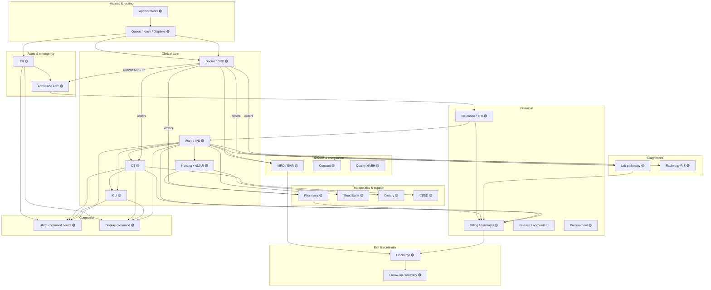

---

## 2. Master timeline — one patient, all modules

| Phase | Modules involved | Primary routes | Key APIs |
|-------|------------------|----------------|----------|
| **0. Arrival** | Queue, Kiosk, Displays | `/kiosk/checkin`, `/display/queue` | `/api/v1/queue`, `/api/display/kiosk/*` |
| **1. Registration** | Hospital practice, ABDM, MRD | `/hospital/practice-management` | `/api/hospital/practice/patients`, `/api/abdm/kiosk` |
| **2. OPD consult** | Doctor, Scribe, Orders | `/doctor/*`, `/hospital/prescription-creator` | `/api/doctor/clinical-workflow`, `/api/hospital/practice/*` |
| **3. ER (if acute)** | ER, AI triage, Displays | `/hospital/er/queue`, `/kiosk/er-triage` | `/api/v1/er/*`, `/api/display/kiosk/er-triage` |
| **4. Insurance pre-auth** | Insurance portal, HMIS preauth | `/hospital/:slug/insurance/pre-auth` | `/api/hospital/insurance/*`, `/api/v1/insurance/preauth` |
| **5. Admission** | ADT, Beds | `/hospital/adt/admit`, `/hmis/beds/map` | `/api/v1/adt/admit`, `/api/v1/beds/allocate` |
| **6. Inpatient care** | Ward, Nursing, eMAR, Vitals | `/hospital/ward`, `/hmis/emar` | `/api/v1/nursing/*`, `/api/v1/emar/*`, `/api/v1/vitals/*` |
| **7. ICU (if critical)** | ICU portal, vitals bridge | `/icu/*`, `/display/icu-board` | `/api/v1/icu/*`, MQTT→SSE |
| **8. OT (if surgical)** | OT command, CSSD | `/hmis/ot/command-center`, `/ot/*` | `/api/v1/ot/*`, `/api/cssd/*` |
| **9. Diagnostics** | Lab, RIS | `/lab/*`, `/hospital/lab-order` | `/api/lab/ris/*`, `/api/hospital/practice/lab-orders` |
| **10. Pharmacy** | Pharmacy, eMAR dispense | `/pharmacy/*`, `/hmis/emar` | `/api/pharmacy/*`, `/api/v1/emar/administer` |
| **11. Blood / diet** | Blood bank, Dietary | `/blood-bank/*`, `/dietary/*` | `/api/blood-bank/*`, `/api/dietary/*` |
| **12. Billing** | HMIS estimates, insurance | `/billing/*` | `/api/v1/billing/estimate`, `/api/billing/*` |
| **13. MRD** | Records, discharge summary | `/hospital/mrd`, `/hospital/discharge-summary` | `/api/hospital/practice/mrd/*`, `/api/v1/discharge/*` |
| **14. Discharge** | Readiness, ADT A03 | `/hmis/discharge-board` | `/api/v1/adt/discharge`, readiness APIs |
| **15. Claims & follow-up** | Insurance, recovery | `/hospital/insurance-claims` | `/api/hospital/insurance/claims`, `/api/v1/follow-up/*` |

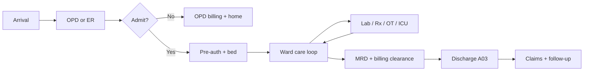

---

## 3. Module workflows (detailed)

### 3.1 Queue · Kiosk · Displays 🟢

| UI | API |
|----|-----|
| `/kiosk/checkin`, `/kiosk/er-triage`, `/hospital/queue-console` | `/api/v1/queue/*`, `/api/display/*` |
| `/display/queue`, `/display/er-triage`, `/display/ward`, `/display/icu-board`, `/display/ot-status`, `/display/bedside`, `/display/command` | SSE `/api/display/events` |

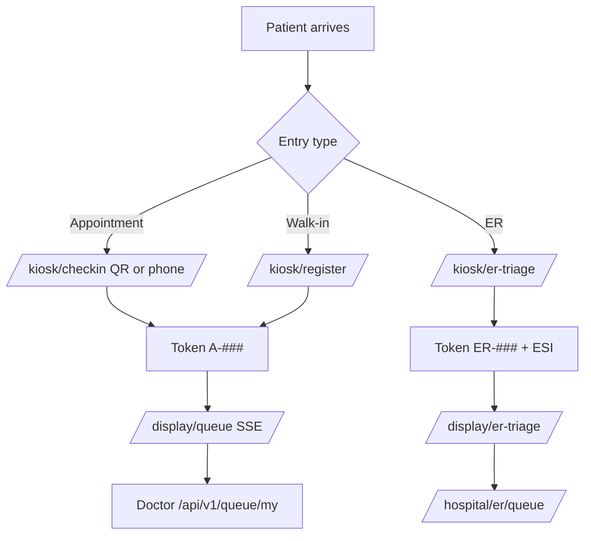

**Hands off to:** Doctor OPD, ER staff, billing (OPD counter).

---

### 3.2 Doctor · OPD · Clinical orders 🟢

| UI | API |
|----|-----|
| `/doctor/*`, `/smart-opd`, `/hospital/practice-management` | `/api/doctors/*`, `/api/doctor/clinical-workflow/*` |
| `/hospital/prescription-creator`, `/hospital/lab-order`, `/hospital/imaging-order`, `/hospital/procedure-adder` | `/api/hospital/practice/prescriptions`, `lab-orders`, `imaging-orders`, `procedures/schedule` |

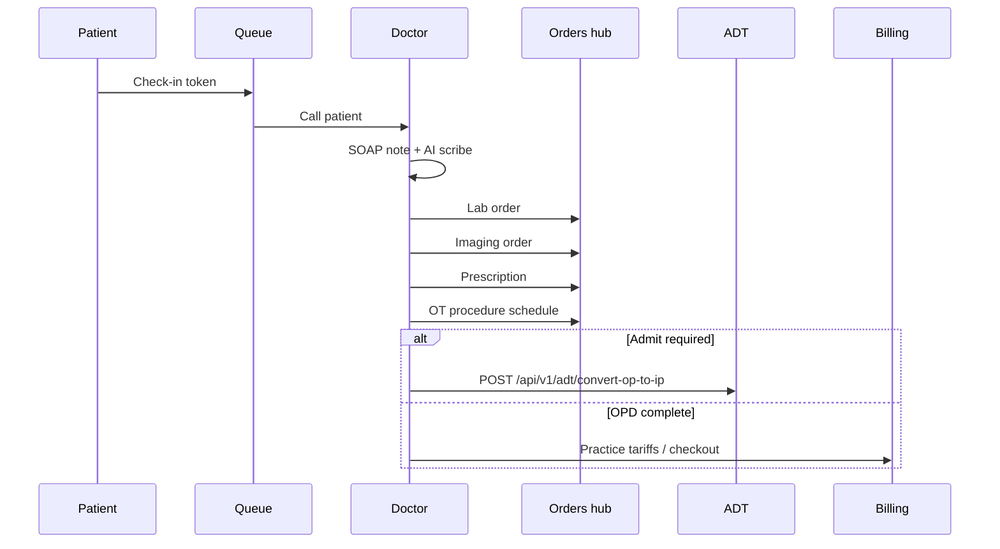

**Hands off to:** Lab, RIS, Pharmacy, OT, ADT, Insurance.

---

### 3.3 ER — Emergency 🟡

| UI | API |
|----|-----|
| `/hospital/er/queue`, `/kiosk/er-triage`, `/display/er-triage` | `/api/v1/er/register`, `/queue`, `/triage/:id`, `/emergency-ot`, `/convert-to-ip` |

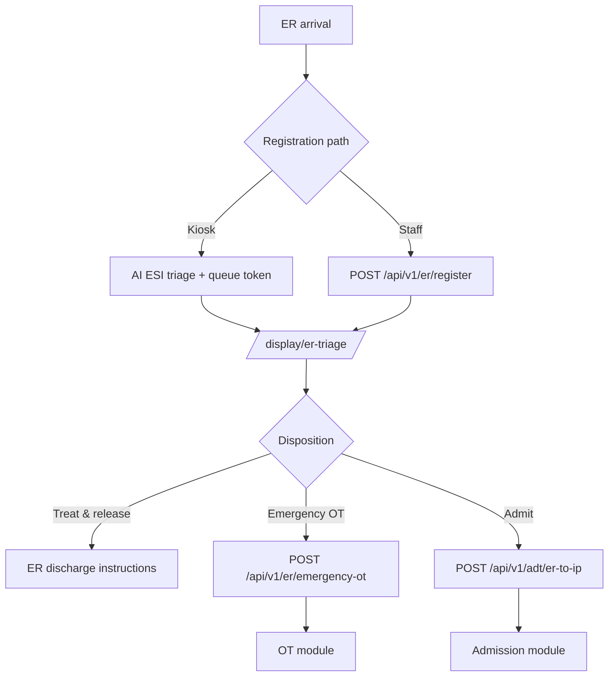

**Hands off to:** ADT, OT, ICU, Billing, MRD (MLC docs).

---

### 3.4 Admission · ADT · Beds 🟢

| UI | API |
|----|-----|
| `/hospital/adt/admit`, `/hospital/adt/er-to-ip`, `/hmis/beds/map`, `/hospital/ward` | `/api/v1/adt/admit`, `/transfer`, `/discharge`, `/convert-op-to-ip`, `/er-to-ip` |
| | `/api/v1/beds/allocate`, `/reserve`, `/map`, `/census` |

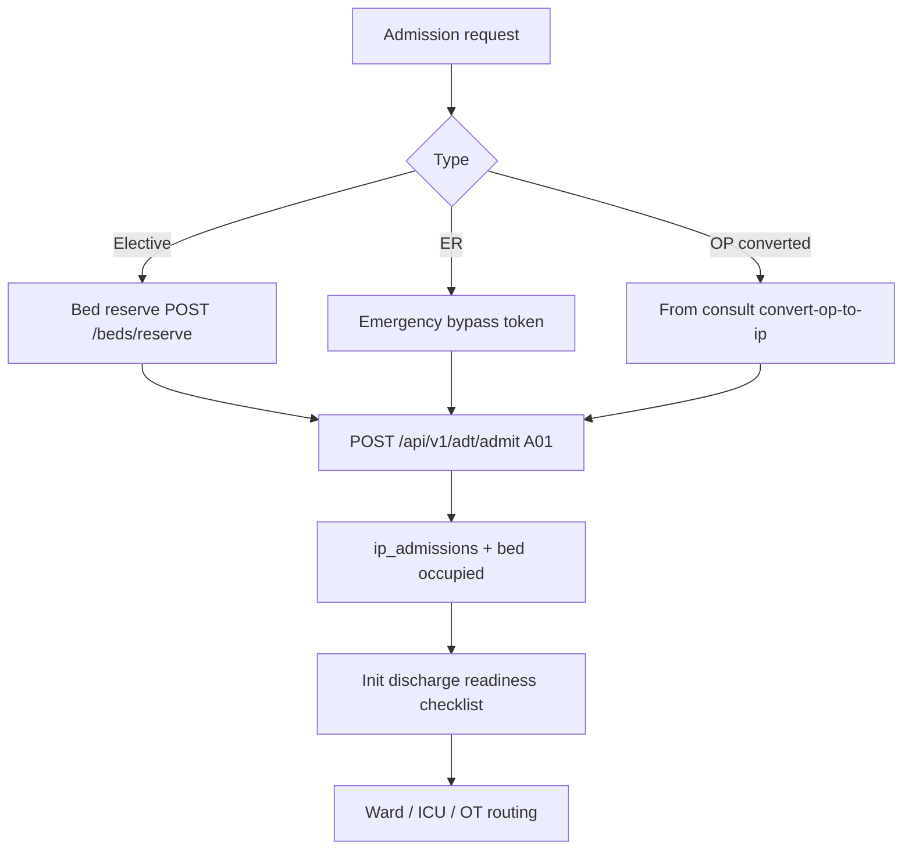

**Hands off to:** Insurance pre-auth, Ward, ICU, OT, Dietary auto-order, MRD file opening.

---

### 3.5 Insurance · TPA · Pre-auth 🟢

| UI | API |
|----|-----|
| `/hospital/:slug/insurance/*` (25+ screens) | `/api/hospital/insurance/*` |
| `/hospital/insurance-claims`, `/insurance-desk/*`, `/tpa/*` | `/api/v1/insurance/preauth`, `/api/tpa/*`, `/api/edi/*` |

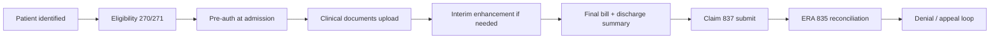

**Discharge gate:** Readiness dimension `tpa` + `billing` must clear before `POST /api/v1/adt/discharge` (unless override role).

**Hands off to:** Billing, MRD, Finance.

---

### 3.6 Ward · Nursing · eMAR · Vitals 🟢

| UI | API |
|----|-----|
| `/hospital/ward`, `/hmis/emar`, `/hmis/admission/:id/nursing-tasks`, `/hmis/admission/:id/echart` | `/api/v1/nursing/*`, `/api/v1/emar/*`, `/api/v1/vitals/*`, `/api/v1/echart/*` |
| `/nurse/*`, `/display/ward`, `/display/bedside` | `/api/display/bedside/nurse-call`, `/api/display/ward` |

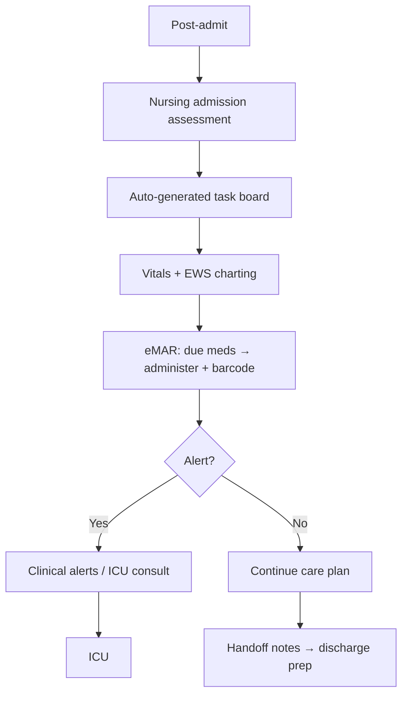

**Hands off to:** Pharmacy (eMAR), Lab (nursing collects), ICU transfer, Discharge readiness.

---

### 3.7 ICU 🟡

| UI | API |
|----|-----|
| `/icu/*`, `/hmis/patient/:id/workspace`, `/display/icu-board` | `/api/v1/icu/admit`, `/census`, `/:id/ventilator`, `/drips`, `/scores` |
| | `/api/display/icu-board` + MQTT `vitals_update` SSE |

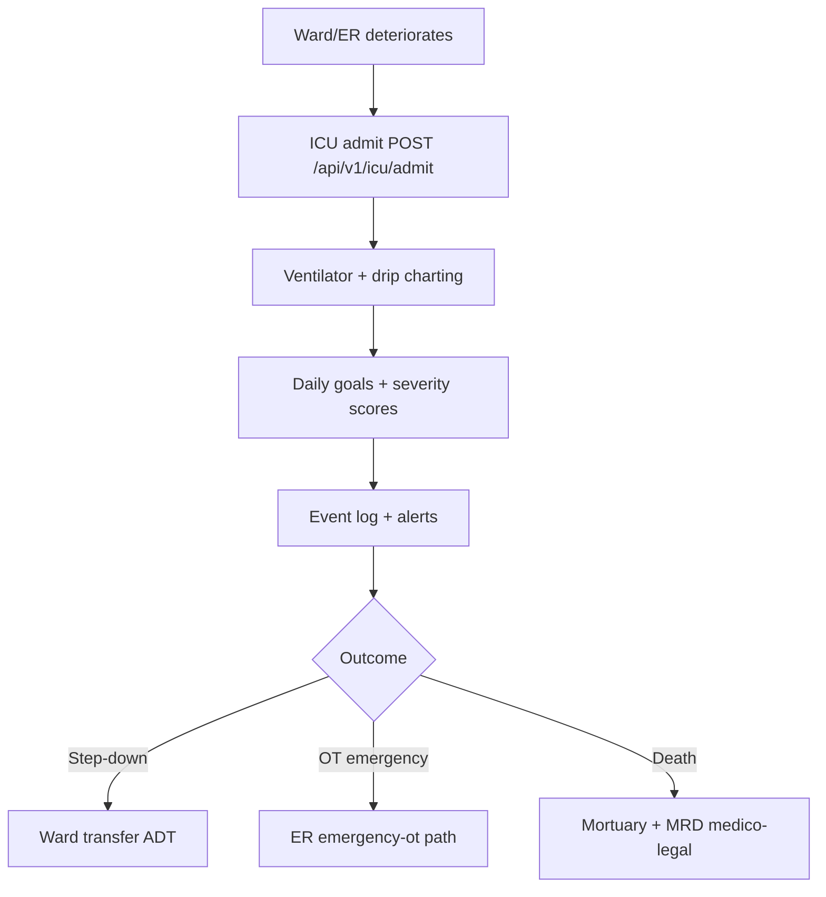

---

### 3.8 OT — Operation Theatre 🟡

| UI | API |
|----|-----|
| `/hmis/ot/command-center`, `/hmis/ot/:id/anesthesia`, `/ot/*`, `/display/ot-status` | `/api/v1/ot/book`, `/cases/today`, `/:id/checklist`, `/consumables`, `/implants`, `/operative-note` |
| | `/api/v1/anesthesia/assessment`, `/api/v1/er/emergency-ot` |

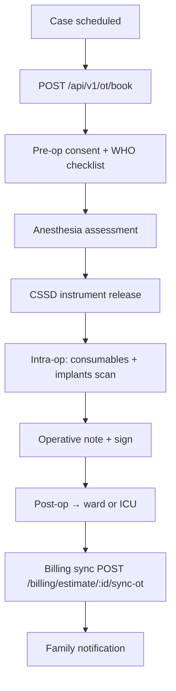

**Hands off to:** CSSD, ICU, Ward, Billing, MRD operative record.

---

### 3.9 Lab — Pathology 🟡

| UI | API |
|----|-----|
| `/lab/*`, `/hospital/lab-order`, `/hospital/lab-reports` | `/api/labs/*`, `/api/lab-tests/*`, `/api/hospital/practice/lab-orders` |
| | `/api/v1/lab-rules/*` (critical value rules) |

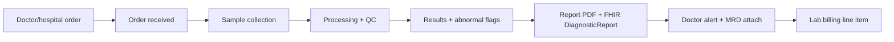

**OPD path:** `/hospital/lab-order` → practice API 🟢  
**Lab portal sub-pages:** many 🟡 scaffold

---

### 3.10 Radiology · RIS · PACS 🟢

| UI | API |
|----|-----|
| `/lab/ris`, `/lab/imaging`, `/hospital/imaging-order`, `/doctor/imaging` | `/api/lab/ris/*`, `/api/hypergrid/dicom/*`, `/api/hospital/practice/imaging-orders` |

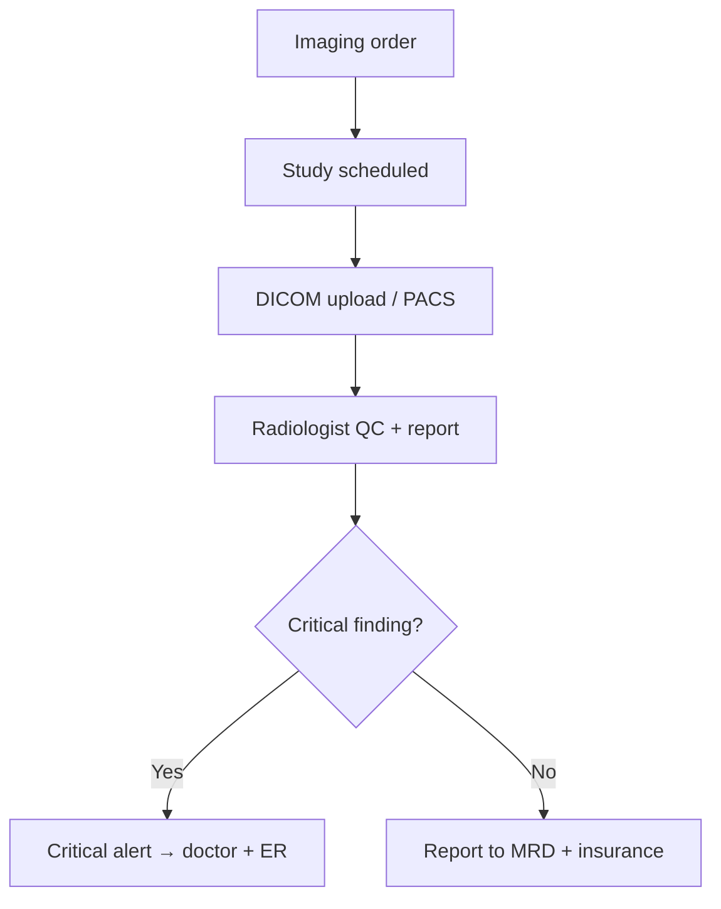

---

### 3.11 Pharmacy 🟡

| UI | API |
|----|-----|
| `/pharmacy/*`, `/hospital/pharmacy` | `/api/pharmacy/*` (inventory, POS, prescriptions, batches) |
| `/hmis/emar` (IPD admin) | `/api/v1/emar/administer`, `/api/hospital/practice/pharmacy/*` |

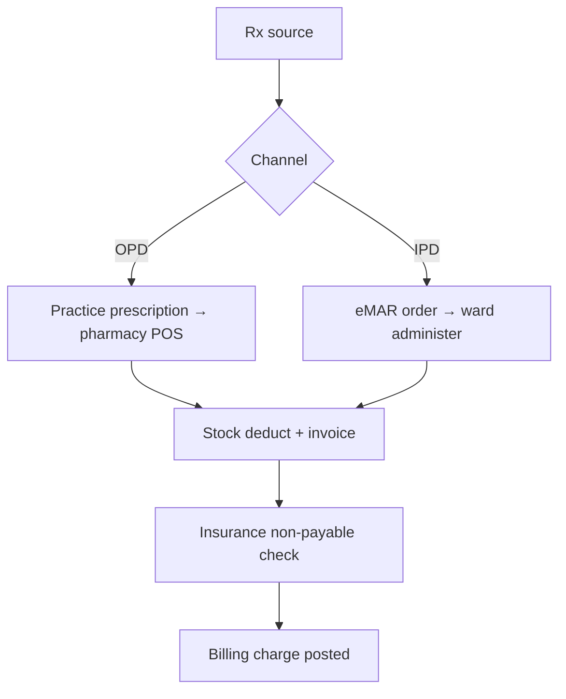

**Gap:** eMAR → pharmacy dispense auto-loop (GAP-IPD-004) 🟡

---

### 3.12 Billing · Finance · Accounts 🟡/🔴

| UI | API | Status |
|----|-----|--------|
| `/api/v1/billing/estimate/*` | HMIS IP estimates | 🟢 |
| `/api/billing/*`, `/billing/checkout` | Patient commerce billing | 🟢 |
| `/hospital/billing` | — | 🔴 localStorage scaffold |
| `/finance/*`, `/accounts/*` | `/api/finance/login` only | 🔴 scaffold UI |

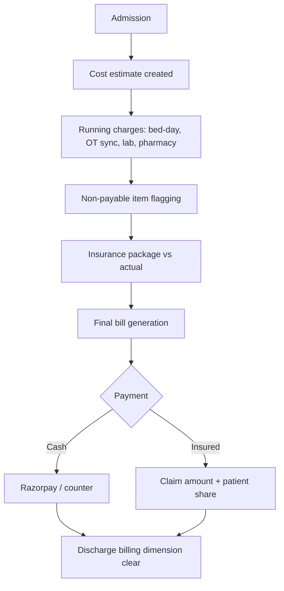

---

### 3.13 MRD — Medical Records 🟡

| UI | API |
|----|-----|
| `/hospital/mrd`, `/hospital/ehr`, `/hospital/discharge-summary`, `/hospital/ip-sheets` | `/api/hospital/practice/medical-records`, `/mrd/digitization-queue`, `/discharge-summaries`, `/ehr/:patientId` |
| `/mrd/*` standalone portal | Demo data 🔴 |

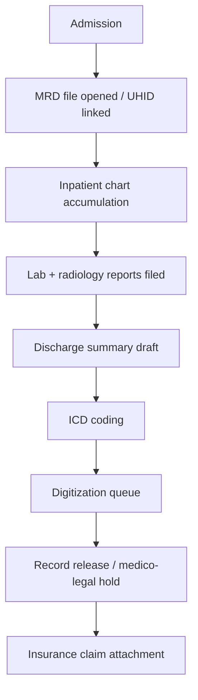

---

### 3.14 Discharge 🟢

| UI | API |
|----|-----|
| `/hmis/admission/:id/discharge`, `/hmis/discharge-board`, `/hospital/discharge-summary` | `/api/v1/adt/discharge/readiness/*`, `/api/v1/discharge/draft|sign|packet` |
| `/display/discharge-status` | `/api/display/discharge-status` |

**Readiness dimensions:** clinical · nursing_education · medication_reconciliation · billing · tpa (optional) · discharge_summary

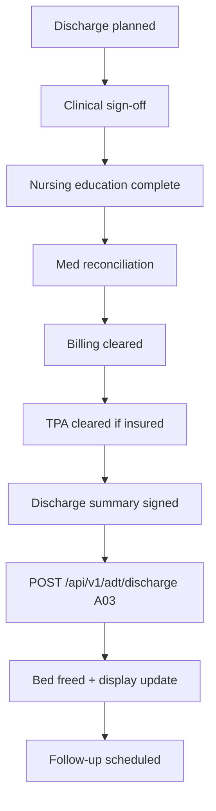

---

### 3.15 Blood Bank 🟡

| UI | API |
|----|-----|
| `/blood-bank/*`, `/display/blood-bank` | `/api/blood-bank/*` (donors, inventory, requisitions, cross-match) |

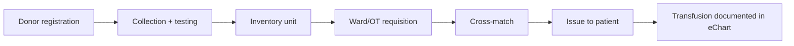

---

### 3.16 Dietary 🟡

| UI | API |
|----|-----|
| `/dietary/*` | `/api/dietary/*` (orders from admission, allergy check, kitchen release) |

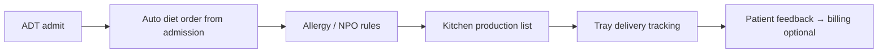

---

### 3.17 CSSD 🟡

| UI | API |
|----|-----|
| `/cssd/*` | `/api/cssd/*` (sets, sterilization cycles, release) |

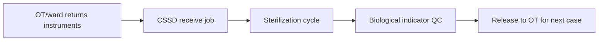

---

### 3.18 Procurement · Stores 🟡

| UI | API |
|----|-----|
| `/procurement/*` | `/api/procurement/*` (vendors, PO, approvals, GRN, ledger) |

Feeds pharmacy, lab, CSSD, biomedical stock replenishment.

---

### 3.19 Support departments 🔴 scaffold UI

| Module | UI | Backend |
|--------|-----|---------|
| Mortuary | `/mortuary/*` | Login only |
| Infection control | `/infection-control/*` | Login only |
| Finance dept | `/finance/*` | Login only |
| Asset | `/asset/*` | Login only |
| HR | `/hr/*` | Payroll separate |

---

### 3.20 HMIS Command · Analytics 🟢

| UI | API |
|----|-----|
| `/hmis/command-center`, `/hmis/discharge-board`, `/display/command` | `/api/v1/analytics/*`, `/api/v1/ai-ops/*`, `/api/v1/ai-revenue/*` |

Cross-module dashboards: census, bed pressure, OT utilisation, revenue leakage, HL7 monitor, follow-up compliance.

---

## 4. Cross-module integration matrix

| From → To | Trigger | API / mechanism |
|-----------|---------|----------------|
| Queue → Doctor | Token called | `/api/v1/queue/:id/call` + SSE |
| Doctor → Lab | Lab order | `POST /api/hospital/practice/lab-orders` |
| Doctor → RIS | Imaging order | `POST /api/hospital/practice/imaging-orders` |
| Doctor → Pharmacy | Rx | `POST /api/hospital/practice/prescriptions` |
| Doctor → OT | Schedule procedure | `POST /api/hospital/practice/procedures/schedule` |
| Doctor → ADT | Admit decision | `POST /api/v1/adt/convert-op-to-ip` |
| ER → ADT | Admit from ER | `POST /api/v1/adt/er-to-ip` |
| ADT → Insurance | Admission | `POST /api/v1/insurance/preauth` |
| ADT → Dietary | Admit event | `POST /api/dietary/orders/from-admission` |
| Ward → ICU | Clinical deterioration | `POST /api/v1/icu/admit` |
| OT → Billing | Case complete | `POST /api/v1/billing/estimate/:id/sync-ot` |
| eMAR → Pharmacy | Dispense | GAP — manual today |
| All clinical → MRD | Documents | Practice EHR + discharge APIs |
| Billing + MRD → Discharge | Clearance | Readiness dimensions |
| Discharge → Insurance | Claim | `/api/hospital/insurance/claims` |
| HMIS → Displays | Real-time | `/api/display/*` + SSE |

---

## 5. Role-based swimlane (operations view)

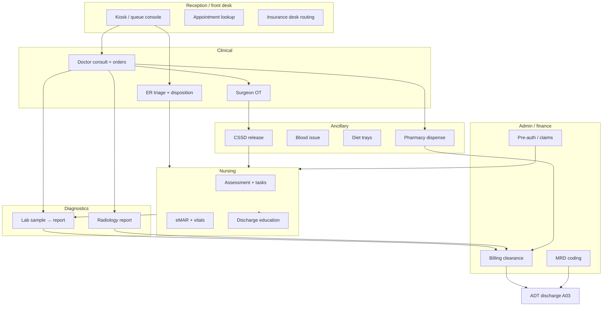

---

## 6. Route quick reference (all modules)

### Frontend prefixes

| Prefix | Module |
|--------|--------|
| `/hospital/*` | Hospital portal (practice, insurance, ADT entry, ward) |
| `/hmis/*` | Inpatient clinical hub |
| `/doctor/*` | Doctor OPD |
| `/icu/*` | ICU department |
| `/ot/*` | OT department |
| `/lab/*` | Lab + RIS |
| `/pharmacy/*` | Pharmacy |
| `/mrd/*` | MRD portal |
| `/blood-bank/*` | Blood bank |
| `/dietary/*` | Dietary |
| `/cssd/*` | CSSD |
| `/procurement/*` | Procurement |
| `/insurance-desk/*`, `/hospital/:slug/insurance/*` | Insurance |
| `/tpa/*` | TPA |
| `/display/*`, `/kiosk/*` | Displays |
| `/nurse/*` | Nurse mobile |

### Backend HMIS core (`/api/v1/`)

`adt` · `beds` · `nursing` · `emar` · `vitals` · `echart` · `er` · `icu` · `ot` · `anesthesia` · `discharge` · `billing` · `insurance` · `follow-up` · `recovery` · `analytics` · `ai-ops` · `ai-revenue` · `navigation` · `clinical-workspace` · `queue`

---

## 7. Implementation priority for go-live

| Priority | Modules | Why |
|----------|---------|-----|
| P0 | Queue, ADT, Beds, Ward, eMAR, Nursing, Discharge, Doctor orders | Admit→discharge spine |
| P0 | Insurance pre-auth + claims | Revenue cycle |
| P1 | ER, Lab RIS, Pharmacy POS, OT scheduling | Acute + diagnostic loop |
| P1 | MRD discharge summary, Billing estimates | Discharge gate |
| P2 | ICU live portal, Blood bank UI, Dietary UI, CSSD UI | Ancillary completeness |
| P2 | Displays all zones, Command centre | Hospital OS visibility |
| P3 | Finance, Mortuary, Infection control UIs | Scaffold → live APIs |

---

## 8. Document history

| Version | Date | Changes |
|---------|------|---------|
| 1.0 | 2026-06-17 | Complete multi-module workflows: doctor, lab, pharmacy, admission, insurance, billing, ER, MRD, OT, ICU, ward, ancillary, command |
