# MediQzy Greenfield — Paperless & AI-Augmented Hospital Flows

**Version:** 1.0  
**Date:** 2026-06-17  
**Audience:** Greenfield hospital CEOs, clinical directors, IT, implementation teams  
**Scope:** End-to-end **paperless** patient journeys and **AI-driven / copilot-augmented** workflows for every department in a new MediQzy deployment.

**Companion docs:**
- [GREENFIELD_HOSPITAL_GAPS_IMPLEMENTATION.md](./GREENFIELD_HOSPITAL_GAPS_IMPLEMENTATION.md) — gap IDs & phases
- [MEDIQZY_COMPLETE_HOSPITAL_WORKFLOWS.md](./MEDIQZY_COMPLETE_HOSPITAL_WORKFLOWS.md) — all module clinical flows
- [SMART_HOSPITAL_OS_VISION.md](./SMART_HOSPITAL_OS_VISION.md) — north-star architecture

**Legend:** 🟢 Live · 🟡 Partial · 🔴 Scaffold / planned  
**SaMD:** Class III = direct clinical decision support · Class IIb = risk stratification · NOT SaMD = admin / documentation with physician review

---

## 1. Greenfield north star

A **greenfield MediQzy hospital** targets two properties on day one:

| Property | What patients & staff experience |
|----------|----------------------------------|
| **Paperless from arrival** | No paper forms at lobby — QR, camera, OTP, e-receipt, digital consent |
| **AI-augmented everywhere** | Copilots assist (not replace) clinicians, nurses, insurance desk, and command centre |

**Human-in-the-loop rule (mandatory):** All SaMD-class outputs (triage ESI, drug interactions, risk scores) pass **quality gates** (`ai-quality-gates.service.js`) and require **licensed staff review** before clinical action. Scribe and discharge drafts require **physician signature**.

---

## 2. Platform stack — paperless + intelligence

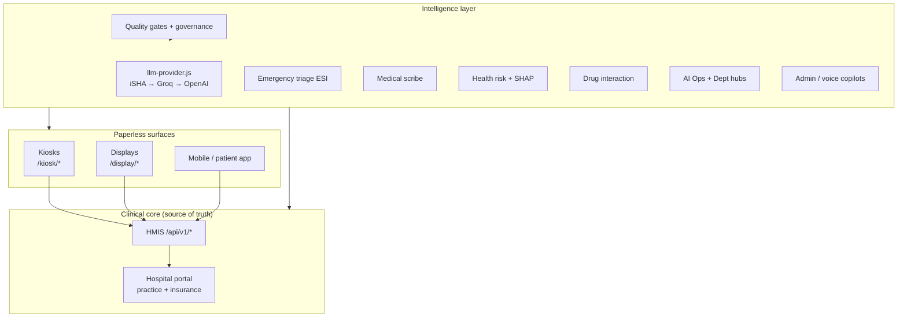

| Layer | Key files / routes |
|-------|-------------------|
| Paperless kiosks | `SelfCheckinKiosk.tsx`, `ERTriageKiosk.tsx`, `/api/display/kiosk/*`, `/api/abdm/kiosk/*` |
| AI brain | `/api/v3/ai-brain/*`, `server/services/ai-brain/llm-provider.js` |
| Clinical AI | `ai-emergency-triage.service.js`, `ai-drug-interaction.service.js`, `ai-health-risk-cron.service.js` |
| Copilots | `/admin/copilot`, `/doctor/assistant`, `/hmis/ai-ops`, `/hmis/ai-dept` |
| Governance | `/api/ai-governance/*`, `ai-quality-gates.service.js`, `ai-interpretability.service.js` |

---

## 3. Master paperless journey (arrival → discharge)

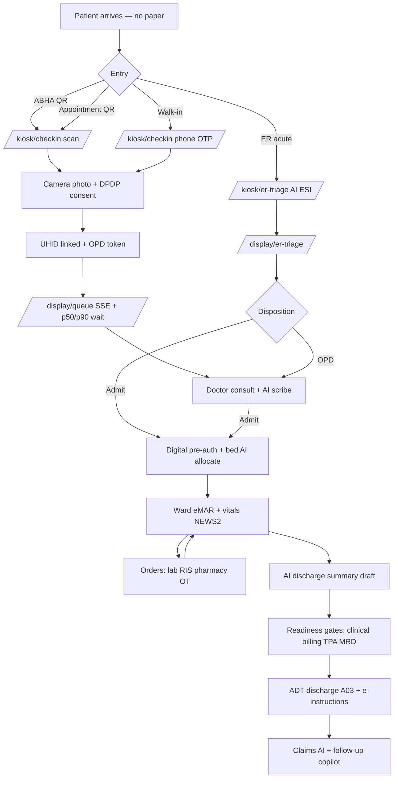

**No paper at:** registration · queue token · consent · clinical notes (scribe) · orders · discharge summary · claim packet · follow-up reminders.

---

## 4. Paperless lobby flow (Phase 1b — greenfield recommended)

Target state after GAP-KIOSK-001–007 (mostly 🟢 in PR #19):

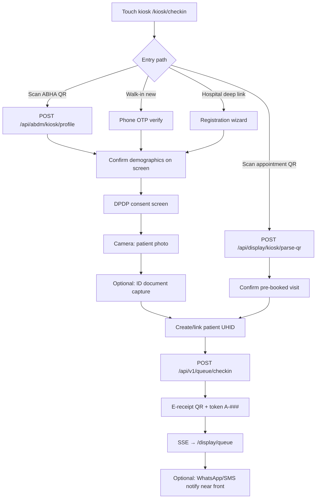

| Step | API | UI | Status |
|------|-----|-----|--------|
| QR parse | `POST /api/display/kiosk/parse-qr` | `KioskQrScanner.tsx` | 🟢 |
| ABHA kiosk | `POST /api/abdm/kiosk/*` | SelfCheckinKiosk ABHA tab | 🟢 |
| Photo capture | `POST /api/display/kiosk/photo` | `KioskPhotoCapture.tsx` | 🟢 |
| Walk-in register | `POST /api/display/kiosk/register` | SelfCheckinKiosk | 🟢 |
| Predictive wait | `hospital-queue.service.js` | E-receipt + displays | 🟢 |
| Video liveness anti-spoof | — | — | 🔴 GAP-KIOSK-007 |
| AI voice wayfinding | — | — | 🔴 GAP-HOS-003 |

---

## 5. Department flows — paperless + AI augmented

### 5.1 Reception · Queue · Displays

| Paperless | AI augmentation | Copilot / hub |
|-----------|-----------------|----------------|
| Digital token, e-receipt, no counter form | p50/p90 wait prediction, queue analytics | `/hospital/queue-console` |
| QR check-in, photo registration | Proactive WhatsApp/SMS notify | `queue-notify.service.js` |
| Lobby signage loop | Command centre KPI aggregation | `/display/command` |

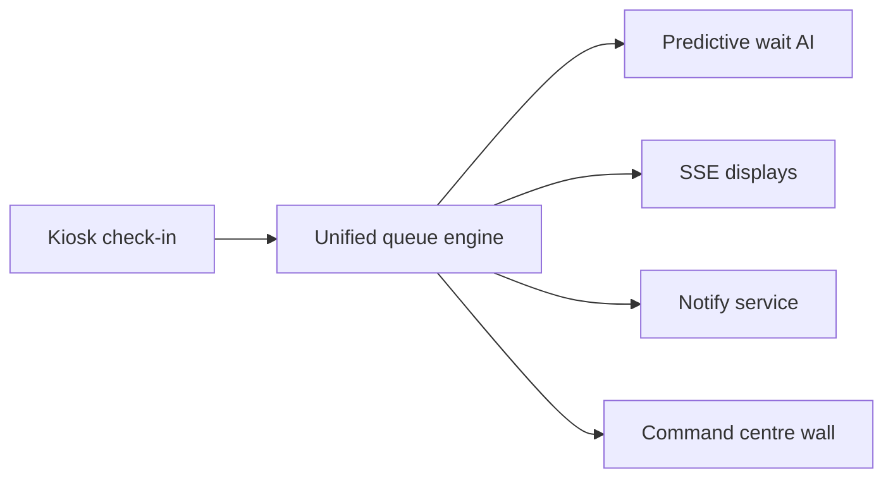

**Routes:** `/kiosk/checkin`, `/display/queue`, `/hospital/queue-console`, `/display/command`  
**APIs:** `/api/v1/queue/*`, `/api/display/*`  
**SaMD:** NOT SaMD (scheduling / ops)

---

### 5.2 Doctor · OPD · Clinical workspace

| Paperless | AI augmentation | Copilot |
|-----------|-----------------|---------|
| Voice scribe → structured SOAP (no handwritten notes) | Dr. iSHA agent: drug info, interactions, navigation | `/doctor/assistant` — `DoctorVoiceAssistant.tsx` |
| Digital prescriptions & e-orders | Rx draft from scribe notes | `/doctor/voice-scribe` |
| EMR risk panel | SHAP explainability on risk scores | `RiskScoreExplanation.tsx` |
| Video consult | AI vision frame assist (review required) | `/doctor/video-consultation` |

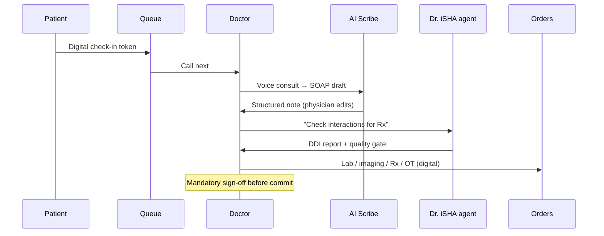

**APIs:** `/api/scribe/*`, `/api/voice-assistant/*`, `/api/v3/ai-brain/*`, `/api/v3/ai-intelligence/drug-interactions/*`, `/api/ai-governance/patient/:id/explanation`  
**SaMD:** DDI = **Class III** · Risk SHAP = **Class IIb** · Scribe = **NOT SaMD** (with physician review)

---

### 5.3 ER — Emergency

| Paperless | AI augmentation | Copilot |
|-----------|-----------------|---------|
| Kiosk symptom intake (touch, no triage form) | **AI ESI 5-level triage** + LIME explanation | `/kiosk/er-triage` |
| ER token on public board (privacy-safe) | Quality gate: ESI-1 immediate alert | `/display/er-triage` |
| Tele-triage video booth | LiveKit + triage context to doctor | `/kiosk/er-triage` video step |
| Digital disposition | ER→IP convert API | `/hospital/er/queue` |

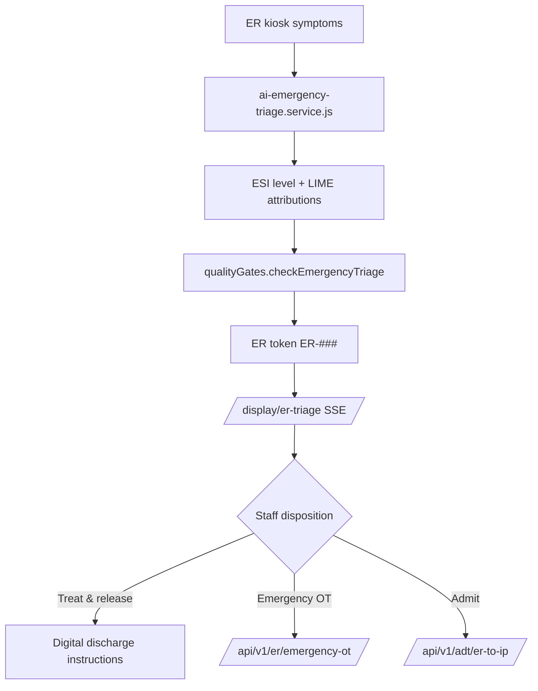

**APIs:** `POST /api/display/kiosk/er-triage`, `/api/v1/er/*`, `/api/medical-ai/instant-triage-call`  
**SaMD:** **Class III** (`emergency-triage-esi-v1`) — external validation GAP-CMP-004 open

---

### 5.4 Admission · ADT · Beds

| Paperless | AI augmentation | Copilot |
|-----------|-----------------|---------|
| Digital admit orders (no paper file) | Smart bed allocation by acuity/isolation | `POST /api/v1/ai-ops/bed-allocation` |
| e-Consent capture | LOS estimate + pathway suggestion on admit event | `workflow-ai-orchestrator.service.js` |
| Bed map digital | Capacity forecast 24h | `/hmis/ai-ops` Forecast tab |

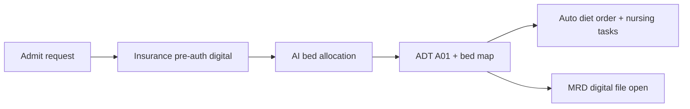

**Routes:** `/hospital/adt/admit`, `/hmis/beds/map`, `/hmis/ai-ops`  
**APIs:** `/api/v1/adt/*`, `/api/v1/beds/*`, `/api/v1/ai-ops/capacity-forecast`  
**SaMD:** Bed allocation = NOT SaMD (ops); readmission hints = **Class IIb**

---

### 5.5 Insurance · TPA

| Paperless | AI augmentation | Copilot |
|-----------|-----------------|---------|
| Digital eligibility 270/271 | Insurance AI bot Q&A | `/api/v3/ai-intelligence/insurance/*` |
| e-Document upload (no fax) | Autonomous pre-auth engine + fraud score | `ai-preauth-engine.service.js` |
| Portal task workflow | Denial pattern analytics | `/hmis/ai-dept` Insurance tab |
| Admin desk assist | Admin Copilot **insurance persona** | `/admin/copilot` |

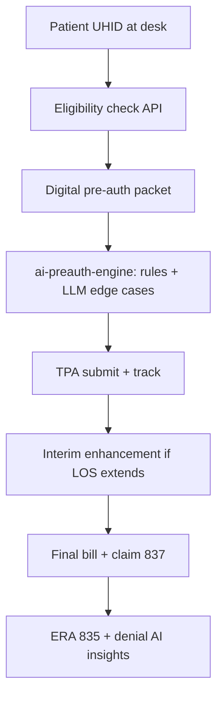

**Routes:** `/hospital/:slug/insurance/*`, `/hospital-insurance/*`, `/insurance-desk/*`  
**SaMD:** NOT SaMD (administrative revenue cycle)

---

### 5.6 Ward · Nursing · eMAR

| Paperless | AI augmentation | Copilot |
|-----------|-----------------|---------|
| Tablet vitals entry (no paper chart) | NEWS2 early warning on vitals | `/api/v1/vitals/*` |
| Barcode eMAR administration | Ward deterioration watchlist | `/hmis/ai-dept` Ward tab |
| Digital handoff notes | Nurse workload balance AI | `/hmis/ai-ops` Workload tab |
| Bedside display + nurse call | Ambient deterioration on wall | 🔴 GAP-IOT-002 |

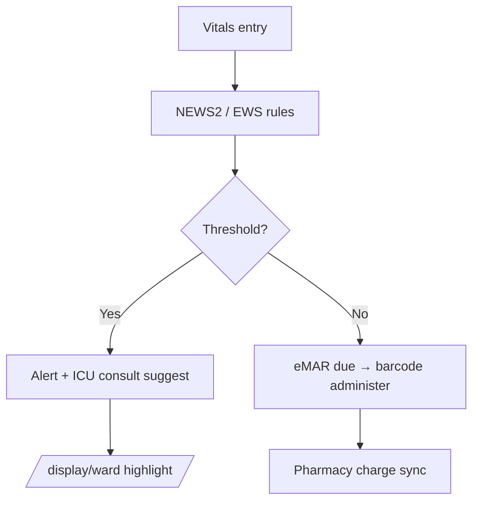

**Routes:** `/hospital/ward`, `/hmis/emar`, `/display/ward`, `/display/bedside`, `/nurse/*`  
**SaMD:** NEWS2 alerts = **Class IIb** risk stratification

---

### 5.7 ICU

| Paperless | AI augmentation | Copilot |
|-----------|-----------------|---------|
| Digital ventilator + drip charts | ICU dept intelligence: SOFA, weaning candidates | `/hmis/ai-dept` ICU tab |
| Live vitals wall (no paper flowsheet) | MQTT → SSE vitals bridge | `/display/icu-board` |
| Tele-ICU video overlay | Remote intensivist on clinical wall | 🟡 GAP-VIDEO-004 |

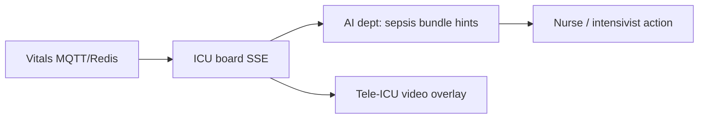

**Routes:** `/icu/*`, `/display/icu-board`, `/hmis/patient/:id/workspace`  
**APIs:** `/api/v1/icu/*`, `display-mqtt-bridge.service.js`

---

### 5.8 OT — Operation Theatre

| Paperless | AI augmentation | Copilot |
|-----------|-----------------|---------|
| Digital WHO checklist + consent | OT utilisation + delay analytics | `/hmis/ai-dept` OT tab |
| Barcode consumables / implants | Post-op note scribe draft | Scribe on `patient.ot.completed` |
| Corridor status display | Remote expert proctoring video | 🔴 GAP-VIDEO-005 |

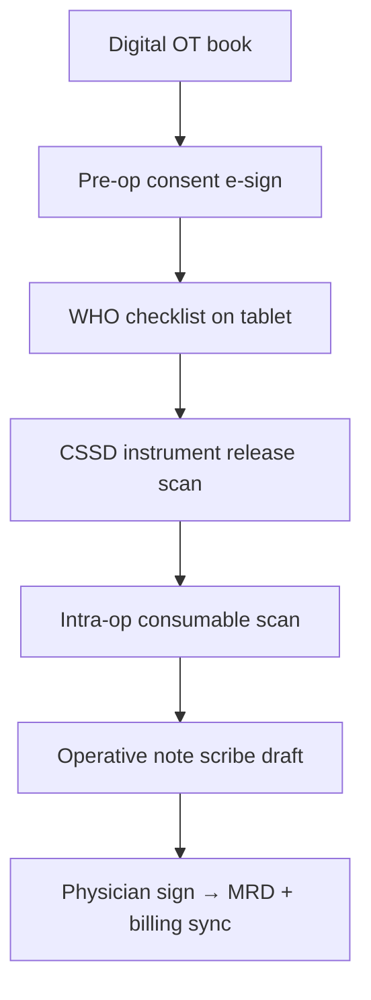

**Routes:** `/hmis/ot/command-center`, `/display/ot-status`, `/ot/*`

---

### 5.9 Lab · Pathology

| Paperless | AI augmentation | Copilot |
|-----------|-----------------|---------|
| Digital lab orders from doctor | Critical unacked value alerts | `/hmis/ai-dept` Lab tab |
| PDF report + FHIR DiagnosticReport | AI report scanner (upload interpret) | `/report-scanner` |
| No paper requisition slip | TAT + workload analytics | Lab portal |

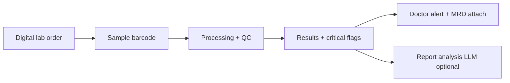

**Routes:** `/lab/*`, `/hospital/lab-order`, `/report-scanner`  
**SaMD:** Report scanner = **Class IIb** (patient-facing interpretive — physician review)

---

### 5.10 Radiology · RIS · PACS

| Paperless | AI augmentation | Copilot |
|-----------|-----------------|---------|
| Digital imaging orders | Critical finding alert routing | RIS workflow |
| DICOM upload (no film) | PACS + HyperGrid integration | `/lab/ris` |
| e-Report distribution | — | `/api/hypergrid/dicom/*` |

---

### 5.11 Pharmacy

| Paperless | AI augmentation | Copilot |
|-----------|-----------------|---------|
| Digital Rx from OPD | **Drug interaction checker** at prescribe | `ai-drug-interaction.service.js` |
| POS barcode dispense | Polypharmacy watch (dept hub) | `/hmis/ai-dept` Pharmacy tab |
| eMAR IPD administration | eMAR → pharmacy auto-loop | 🟡 GAP-IPD-004 |

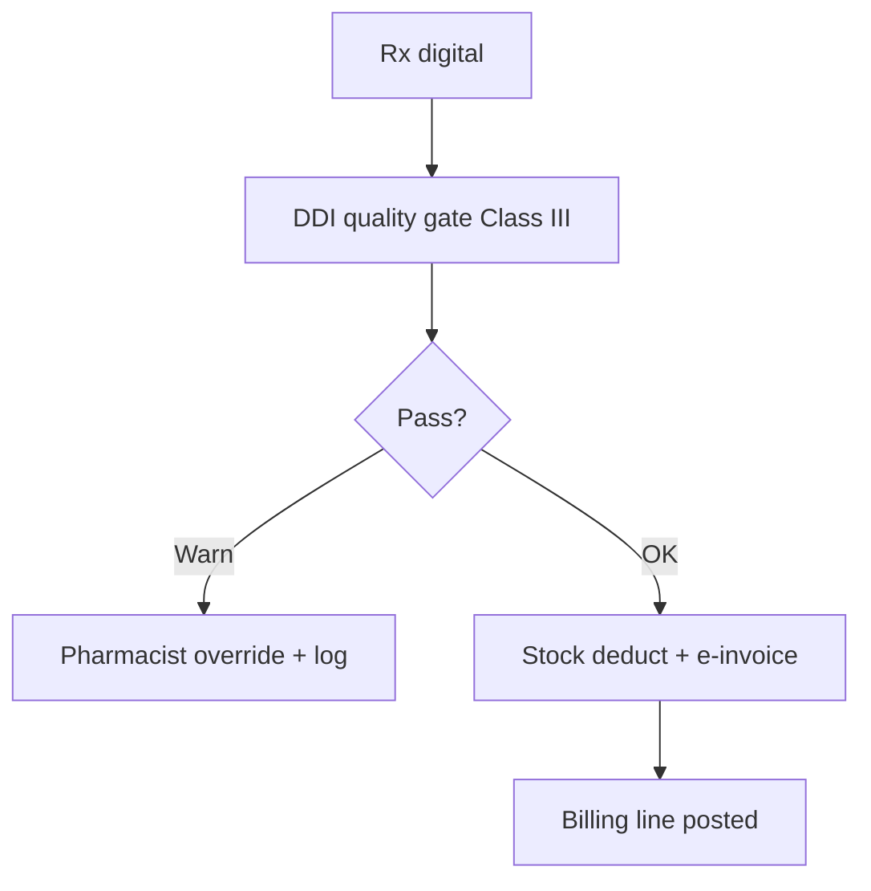

---

### 5.12 Billing · Revenue

| Paperless | AI augmentation | Copilot |
|-----------|-----------------|---------|
| Digital estimates at admit | Revenue leakage detection | `/hmis/ai-revenue` |
| Running charge ledger | Denial risk scoring | `ai-revenue-intelligence.service.js` |
| Razorpay / counter e-payment | Smart order sets by diagnosis | AI Revenue hub |
| No paper final bill | Accounts dept analytics | `/hmis/ai-dept` Accounts tab |

**Routes:** `/hmis/ai-revenue`, `/api/v1/billing/estimate/*`, `/billing/checkout`  
**Note:** `/hospital/billing` is 🔴 localStorage scaffold — use HMIS billing APIs.

---

### 5.13 MRD — Medical Records

| Paperless | AI augmentation | Copilot |
|-----------|-----------------|---------|
| Digital chart accumulation | Documentation completeness audit | `/hmis/ai-ops` Docs tab |
| Discharge summary e-sign | Scribe-assisted summary | `/hospital/discharge-summary` |
| QR staff check-in at MRD desk | Clinical NLP entity extraction | `/api/v3/ai-deeptech/entities/*` |
| Digitization queue | ICD coding assistant | 🔴 scaffold at `/mrd/icd-coding` |

---

### 5.14 Discharge

| Paperless | AI augmentation | Copilot |
|-----------|-----------------|---------|
| Digital readiness checklist (6 dimensions) | AI discharge summary data synthesis | `GET /api/v1/ai-ops/discharge-summary/:id` |
| e-Instructions + follow-up | Workflow AI packet draft on `patient.discharged` | `workflow-ai-orchestrator.service.js` |
| Family discharge status board | PREMS kiosk (planned) | 🔴 GAP-DISPLAY-002 |
| No paper take-home packet | Recovery / follow-up copilot | `/api/v1/follow-up/*` |

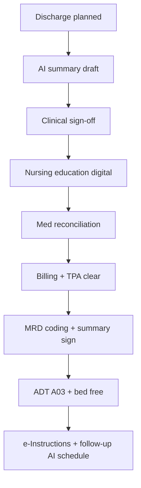

---

### 5.15 Command · Admin · Hospital OS

| Paperless | AI augmentation | Copilot |
|-----------|-----------------|---------|
| Device-enrolled displays (no printed signs) | Command centre KPI wall | `/display/command` |
| Digital twin floor map | Census + queue + wait analytics | `/display/floor-map` |
| Emergency broadcast SSE | Capacity forecast + workload | `/hmis/ai-ops` |
| SaMD governance dashboard | Model cards, drift, quality gate log | `/admin/ai-governance` |
| Multi-persona admin copilot | Ops / analytics / revenue / quality | `/admin/copilot` |

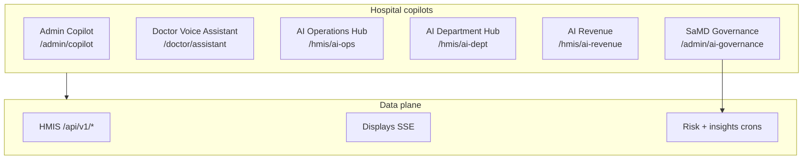

---

## 6. Copilot catalog by department

| Department | Copilot / AI surface | Route | Agent / service | Maturity |
|------------|---------------------|-------|-----------------|----------|
| **Reception** | Predictive wait + notify | Kiosk e-receipt | `hospital-queue.service.js` | 🟢 |
| **Reception** | Voice wayfinding (planned) | — | GAP-HOS-003 | 🔴 |
| **Doctor OPD** | Voice assistant (iSHA) | `/doctor/assistant` | `/api/voice-assistant/agent` | 🟢 |
| **Doctor OPD** | Medical scribe | `/doctor/voice-scribe` | `/api/scribe/*` | 🟢 |
| **Doctor OPD** | AI Doctor chat | `/ai-doctor` | `/api/v3/ai-brain/think` | 🟢 |
| **Doctor OPD** | Drug interaction | Prescribing UI | `ai-drug-interaction.service.js` | 🟢 |
| **Doctor OPD** | Risk SHAP panel | Patient EMR | `/api/ai-governance/patient/:id/explanation` | 🟢 |
| **ER** | AI ESI triage kiosk | `/kiosk/er-triage` | `ai-emergency-triage.service.js` | 🟢 |
| **ER** | ER dept intelligence | `/hmis/ai-dept` | `/api/v1/ai-dept/er` | 🟡 |
| **ADT** | Smart bed allocation | `/hmis/ai-ops` | `/api/v1/ai-ops/bed-allocation` | 🟢 |
| **Insurance** | Insurance AI bot | API | `ai-insurance-bot.service.js` | 🟢 |
| **Insurance** | Pre-auth engine | Backend | `ai-preauth-engine.service.js` | 🟢 |
| **Insurance** | Admin copilot insurance persona | `/admin/copilot` | `admin` agent | 🟢 |
| **Ward** | NEWS2 + workload | Ward + ai-ops | `vitals-ews.service.js` | 🟢 |
| **Ward** | Ward dept hub | `/hmis/ai-dept` | `/api/v1/ai-dept/ward` | 🟡 |
| **ICU** | ICU dept hub + vitals wall | `/display/icu-board` | `/api/v1/ai-dept/icu` | 🟡 |
| **OT** | OT dept hub | `/hmis/ai-dept` | `/api/v1/ai-dept/ot` | 🟡 |
| **Lab** | Critical value alerts | `/hmis/ai-dept` | `/api/v1/ai-dept/lab` | 🟡 |
| **Lab** | Report scanner | `/report-scanner` | `report-analysis.service.js` | 🟢 |
| **Pharmacy** | DDI at prescribe | Rx flows | `ai-drug-interaction.service.js` | 🟢 |
| **Pharmacy** | Pharmacy dept hub | `/hmis/ai-dept` | `/api/v1/ai-dept/pharmacy` | 🟡 |
| **Billing** | Revenue intelligence | `/hmis/ai-revenue` | `ai-revenue-intelligence.service.js` | 🟢 |
| **MRD** | Documentation audit | `/hmis/ai-ops` | `/api/v1/ai-ops/documentation-audit` | 🟢 |
| **Discharge** | Summary synthesis | HMIS API | `/api/v1/ai-ops/discharge-summary/:id` | 🟢 |
| **Command** | Admin copilot (4 personas) | `/admin/copilot` | `/api/v3/ai-brain/agents/process` | 🟢 |
| **Command** | AI Operations Hub | `/hmis/ai-ops` | `/api/v1/ai-ops/*` | 🟢 |
| **Command** | SaMD governance | `/admin/ai-governance` | `/api/ai-governance/*` | 🟢 |
| **Patient public** | Symptom checker | `/symptom-checker` | `/api/v3/ai-intelligence/triage/assess` | 🟢 |
| **Patient public** | WhatsApp AI | Channel | `whatsapp-ai-conversation.service.js` | 🟢 |

---

## 7. SaMD & governance overlay (every AI clinical output)

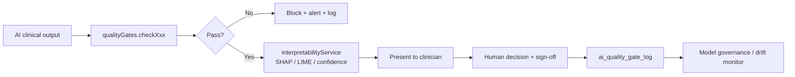

| Component | SaMD class | Quality gate | Explainability |
|-----------|------------|--------------|----------------|
| Emergency triage ESI | Class III | `checkEmergencyTriage` | LIME |
| Drug interaction | Class III | `checkDrugInteraction` | Rule + LLM |
| Health risk score | Class IIb | `checkHealthRiskScore` | SHAP |
| Medical scribe | NOT SaMD | Physician review enforced | — |
| Admin copilot | NOT SaMD | Approval modal for actions | — |
| Dept SQL hubs | NOT SaMD | — | — |

**Governance rule:** Model changes flow `proposeChange()` → medical director review → `approveChange()` only. Never autonomous weight/threshold updates.

---

## 8. Greenfield phase map — paperless + AI

| Phase | Paperless deliverables | AI deliverables | Exit gate |
|-------|------------------------|-----------------|-----------|
| **1b Paperless lobby** | QR + photo + ABHA + walk-in kiosk | Predictive queue wait, ER triage kiosk | Walk-in gets token without staff |
| **2a Smart displays** | SSE queue boards, command centre | Queue analytics, KPI wall | Board updates < 1 s |
| **2b Clinical walls** | ER/ICU/OT/ward displays | MQTT vitals, ESI board, dept hubs | ICU vitals live on wall |
| **2c Interactive care** | Bedside terminal, nurse call, family video | Bedside video consult | Nurse call → response logged |
| **3 Full IPD** | Digital ADT, eMAR, discharge | AI ops forecast, doc audit, bed AI | Admit→discharge E2E |
| **3b Telepresence** | ER booth, family lounge video | Tele-ICU overlay | Video E2E on staging |
| **4 Command OS** | Device CMS, floor map | Admin copilot, revenue AI, governance | All screens enrolled |

**Gap reference:** KIOSK-* · QUEUE-* · DISPLAY-* · VIDEO-* · IOT-* · HOS-* · CMP-004/005

---

## 9. AI + paperless gaps still open (greenfield)

| Gap ID | Area | Target |
|--------|------|--------|
| GAP-HOS-003 | AI voice wayfinding at lobby kiosk | NL directions to department |
| GAP-KIOSK-007 | Video liveness / ID anti-spoof | Trust at self-registration |
| GAP-IOT-002 | Ambient deterioration on ward/ICU displays | MQTT NEWS2 → wall highlight |
| GAP-VIDEO-004 | ICU tele-intensivist workflow | Full tele-ICU ops path |
| GAP-VIDEO-005 | OT remote expert proctoring | Expert video on OT display |
| GAP-IPD-004 | eMAR → pharmacy auto-dispense loop | Closed medication loop |
| GAP-CMP-004 | External SaMD validation (triage, risk) | Clinical study + sign-off |
| GAP-CMP-002 | PHI sanitization before all LLM calls | DPDP compliance |
| GAP-BIL-001–004 | IP billing automation | Revenue loop completion |
| GAP-DISPLAY-002 | Discharge PREMS kiosk | Patient feedback at exit |

---

## 10. Route quick reference — paperless + AI

### Paperless surfaces
`/kiosk/checkin` · `/kiosk/er-triage` · `/kiosk/family-video` · `/display/*` · `/hospital/queue-console`

### AI copilot surfaces
`/admin/copilot` · `/doctor/assistant` · `/doctor/voice-scribe` · `/hmis/ai-ops` · `/hmis/ai-dept` · `/hmis/ai-revenue` · `/admin/ai-governance` · `/ai-doctor` · `/symptom-checker` · `/report-scanner`

### AI API prefixes
`/api/v3/ai-brain/*` · `/api/v3/ai-intelligence/*` · `/api/v1/ai-ops/*` · `/api/v1/ai-dept/*` · `/api/v1/ai-revenue/*` · `/api/ai-governance/*` · `/api/scribe/*` · `/api/voice-assistant/*` · `/api/display/kiosk/*`

---

## 11. Document history

| Version | Date | Changes |
|---------|------|---------|
| 1.0 | 2026-06-17 | Greenfield paperless + AI-augmented flows for all departments; copilot catalog; SaMD overlay; phase map |
