# MediQzy Hospital OS — Master Gap Implementation Package

| Field | Value |
|-------|-------|
| **Document ID** | MED-HOSP-MASTER-001 |
| **Version** | 1.0 |
| **Date** | 2026-06-17 |
| **Audience** | CEO, CTO, PM, BA, Engineering, QA, Security, Delivery, Hospital IT |
| **Purpose** | Single consolidated package: gap backlog, phases, sign-off, workflows, paperless + AI flows |

This document merges four source specifications into **one printable / shareable Word package**:

1. **Greenfield Gaps Implementation** — full gap register, phases, acceptance criteria, sign-off
2. **Complete Hospital Module Workflows** — doctor, lab, pharmacy, ADT, insurance, billing, ER, MRD, OT, ICU, ward
3. **Greenfield Paperless & AI-Augmented Flows** — paperless journeys + department copilots
4. **Hospital OS Workflow Charts** — patient journeys, queue, displays, ADT timelines

**How to use:** Part I for engineering backlog and go-live gates; Parts II–IV for operations training and clinical flow design.

---


\newpage

# Part I — Greenfield Gaps Implementation (Master Backlog)

*Source: `GREENFIELD_HOSPITAL_GAPS_IMPLEMENTATION.md`*

---


| Field | Value |
|-------|-------|
| **Document ID** | MED-HOSP-GAP-001 |
| **Version** | 1.5 |
| **Date** | 2026-06-17 |
| **Owner** | AI CTO |
| **Audience** | PM, BA, Engineering, QA, Security, Delivery |
| **Status** | ACTIVE — implementation backlog |
| **Related audits** | `HOSPITAL_ROLLOUT_READINESS_ASSESSMENT.md`, `TENANT_SETUP_AUDIT.md`, `SAMD_READINESS_SCORECARD.md`, `MEDIQZY_COMPLETE_HOSPITAL_WORKFLOWS.md`, `MEDIQZY_GREENFIELD_PAPERLESS_AI_FLOWS.md` |

---

## 1. Purpose

This document is the **single implementation backlog** for making Mediqzy production-ready for a **greenfield hospital deployment** (new tenant, new facility, real PHI).

It consolidates findings from:

- Hospital HMIS / portal codebase review (June 2026)
- Multi-tenant security audit (`docs/deployment/TENANT_SETUP_AUDIT.md`)
- Mobile / frontend / QA landscape review
- SaMD & DPDP compliance scorecards

Each gap has: **ID, priority, owner role, current state, target state, files, implementation steps, acceptance criteria, dependencies.**

---

## 2. Executive summary

### 2.1 Overall readiness (greenfield hospital)

| Dimension | Score | Go-live without fix? |
|-----------|-------|----------------------|
| OPD + doctor + patient flows | 75% | Yes (with deploy) |
| Insurance / TPA desk | 85% | Yes |
| Pharmacy + lab portals | 80% | Yes |
| Full IPD (admit → discharge) | 45% | **No** |
| Hospital portal sidebar (beds, OPD/IPD, billing) | 30% | **No** |
| Multi-tenant PHI isolation | 50% | **No** |
| Native mobile apps | 35% | Build separately |
| Hospital E2E QA | 40% | **No** |
| Paperless kiosk (QR + camera self-registration) | 15% | **No** |
| Smart displays (info boards, clinical walls) | 25% | **No** |
| Video-ready displays (bedside, ER, ICU, OT) | 10% | **No** |
| Hospital OS control plane (devices, CMS, command) | 20% | **No** |
| Smart queue management (unified, real-time, predictive) | 20% | **No** |

**Weighted overall:** ~54/100 (clinical core strong; campus display + queue OS immature)

### 2.2 Verdict

| Deployment type | Ready? |
|-----------------|--------|
| Phased greenfield: OPD + insurance + pharmacy + lab | **Yes** (Phase 1) |
| Paperless lobby: QR check-in + walk-in self-registration | **After KIOSK-001–005** (Phase 1b) |
| Smart hospital info displays (queue, signage, dept boards) | **After DISPLAY-001 + QUEUE-002** (Phase 2a) |
| Smart queue (unified engine, SSE, predictive wait) | **After QUEUE-001–002** (Phase 1b/2a) |
| Clinical display walls (ER, ICU, OT, ward) + MQTT vitals | **After DISPLAY-003 + IOT-001** (Phase 2b) |
| Video-call ready surfaces (bedside, ER booth, family) | **After VIDEO-001–003** (Phase 3) |
| IPD pilot (10–30 beds) using HMIS routes | **After Phase 0 + Phase 2** |
| Full hospital ERP replacement on day one | **No** |
| Multi-hospital SaaS with shared-row tenancy | **No** |

### 2.3 Implementation phases (summary)

| Phase | Focus | Exit criteria |
|-------|-------|---------------|
| **0 — Foundation** | Migrations, tenant isolation, encryption | Pen-test pass; migrations green on clean DB |
| **1 — Day-1 go-live** | OPD, insurance, pharmacy, lab | Staff trained; no placeholder routes in use |
| **2 — IPD pilot** | HMIS UI + ADT/eMAR/discharge | Admit→discharge E2E passes in CI |
| **3 — Productization** | Unified portal, IP billing, mobile | Sidebar = real APIs; no `localStorage` clinical data |
| **4 — Scale & compliance** | ECS, NABH evidence, SaMD filing | Per-tenant accreditation pack exportable |
| **Display OS** | Parallel track — see `SMART_HOSPITAL_OS_VISION.md` | Phase 1b → 2a → 2b → 2c → 3 (telepresence) → 4 (command) |

---

## 3. Architecture context (why gaps exist)

Mediqzy runs **two parallel hospital stacks**:

```
┌─────────────────────────────────────────────────────────────────┐
│  HOSPITAL PORTAL STACK (partial / risky for IPD)                │
│  UI: /hospital/*                                                │
│  API: /api/hospital/practice/*                                  │
│  Persistence: file store + localStorage + legacy beds.ward       │
│  Sidebar: beds, OPD/IPD, pharmacy, billing → PLACEHOLDERS        │
└─────────────────────────────────────────────────────────────────┘

┌─────────────────────────────────────────────────────────────────┐
│  HMIS STACK (clinical backend + UI — use for IPD pilot)         │
│  UI: /hmis/*, /ward/*, /icu/*, /ot/*                            │
│  API: /api/v1/adt, beds, emar, nursing, ot, discharge, vitals  │
│  Persistence: PostgreSQL (wards, ip_admissions, adt_events…)    │
│  Tests: adt-beds, emar, nursing-ipd, ot-scheduling, icu, etc.   │
└─────────────────────────────────────────────────────────────────┘
```

**Rule until GAP-ARCH-001 is closed:** Staff must **not** use `/hospital/beds`, `/hospital/opd-ipd`, `/hospital/billing` for real operations. Use `/hmis/*` and `/ward/*`.

### 3.1 Paperless kiosk / self-registration (current vs target)

Zone **1a** in `MEDIQZY_DISPLAY_KIOSK_PLAN.md` calls for appointment lookup by phone/ABHA, token issuance, and wayfinding. The **built** experience is narrower: phone-only check-in for **existing** appointments — no QR scan, no camera capture, no walk-in new-patient registration.

```
┌──────────────────────────────────────────────────────────────────────────┐
│  CURRENT (partial — demo-capable, not production paperless)              │
│  UI:  /kiosk/checkin → SelfCheckinKiosk.tsx (phone keypad only)           │
│  API: POST /api/display/checkin/appointments | issue-token               │
│  QR:  @zxing/browser in HospitalMRD.tsx (staff MRD scan — not kiosk)     │
│  Cam: getUserMedia in MRD / triage / video — not registration kiosk      │
│  ABHA: POST /api/abdm/abha/register/* (authUser required — not kiosk)    │
└──────────────────────────────────────────────────────────────────────────┘
                                    ↓
┌──────────────────────────────────────────────────────────────────────────┐
│  TARGET — paperless QR + camera self-registration (GAP-KIOSK-001–007)    │
│  Entry: ABHA QR | appointment QR | hospital deep-link QR | walk-in       │
│  Capture: live patient photo (+ optional ID doc image) with DPDP consent   │
│  Output: UHID/MRN + OPD queue token + e-receipt QR (no paper form)       │
│  Privacy: public queue boards show token/initials only                     │
└──────────────────────────────────────────────────────────────────────────┘
```

**Target flow (lobby kiosk):**

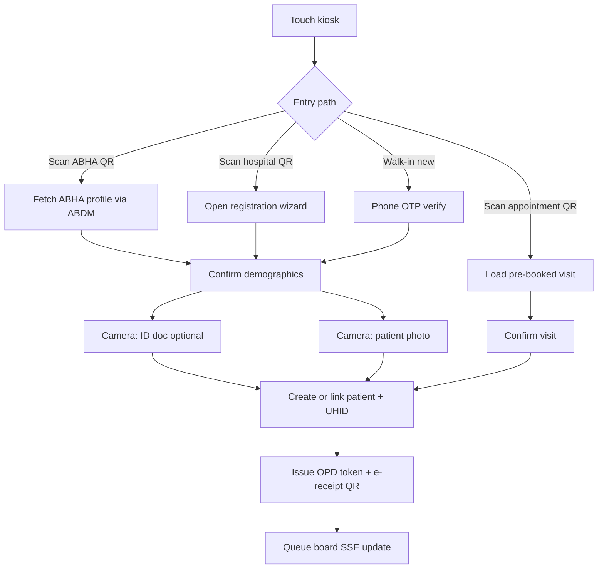

**Reuse (do not rebuild):** `DisplayShell.tsx`, `SelfCheckinKiosk.tsx` idle/timeout UX, `HospitalMRD.tsx` ZXing pattern, patient profile upload + MinIO + ClamAV, `hospital-display.route.js` token issuance + SSE, `abdm.route.js` OTP primitives.

**Full paperless + AI copilot flows (all departments):** see **`MEDIQZY_GREENFIELD_PAPERLESS_AI_FLOWS.md`** — master journey, per-department AI augmentation, copilot catalog, SaMD overlay.

### 3.1b AI-augmented & copilot flows (greenfield target)

Every department gets **AI augmentation** (not autonomous clinical action) plus named **copilot surfaces**:

| Zone | Paperless | AI / copilot | Route |
|------|-----------|--------------|-------|
| Lobby | QR + camera registration | Predictive wait, queue notify | `/kiosk/checkin`, `/display/queue` |
| OPD | Digital scribe notes | Dr. iSHA voice assistant, DDI checker | `/doctor/assistant`, `/doctor/voice-scribe` |
| ER | Kiosk symptom intake | **AI ESI triage** (Class III SaMD) + tele-triage video | `/kiosk/er-triage` |
| ADT | Digital admit | Smart bed allocation, capacity forecast | `/hmis/ai-ops` |
| Insurance | e-Docs, no fax | Pre-auth engine, insurance AI bot, admin copilot | `/hospital-insurance/*`, `/admin/copilot` |
| Ward | Tablet vitals + eMAR | NEWS2 alerts, workload balance | `/hmis/ai-dept`, `/hmis/ai-ops` |
| ICU | Digital charts + vitals wall | Dept hub, tele-ICU overlay (partial) | `/display/icu-board` |
| OT | Digital checklist + implants | OT analytics, post-op scribe draft | `/hmis/ot/*` |
| Lab | Digital orders + reports | Critical value alerts, report scanner | `/report-scanner` |
| Pharmacy | Digital Rx + barcode | Drug interaction (Class III SaMD) | prescribing flows |
| Billing | e-Estimates + payment | Revenue intelligence, denial risk | `/hmis/ai-revenue` |
| MRD | Digital chart | Documentation audit, NLP entities | `/hmis/ai-ops` |
| Discharge | e-Summary + instructions | AI summary synthesis, follow-up | `/hmis/discharge` |
| Command | Device-enrolled displays | Admin copilot, SaMD governance | `/admin/copilot`, `/admin/ai-governance` |

**Mandatory:** All SaMD outputs pass `ai-quality-gates.service.js` + licensed staff review. Full flows: **`MEDIQZY_GREENFIELD_PAPERLESS_AI_FLOWS.md`**.

### 3.2 Smart Hospital OS — displays, interactive care & telepresence

**North star:** MediQzy as a **Hospital Operating System** — every screen in the building (info board, kiosk, bedside, ICU wall, OT door, command centre) runs on the same platform as HMIS, with **video-call ready** surfaces in ER, ICU, OT, and IPD rooms.

Full vision: **`docs/hospital/SMART_HOSPITAL_OS_VISION.md`**

```
┌─────────────────────────────────────────────────────────────────────────────┐
│  MEDIQZY HOSPITAL OS                                                         │
│  Clinical Core (HMIS) ──┬── Display & Kiosk Layer (18 zones, 40+ screens)   │
│                         ├── Telepresence (LiveKit on bedside / ER / family)  │
│                         ├── Real-Time (SSE + MQTT vitals bridge)             │
│                         └── Control Plane (devices, CMS, emergency, KPIs)    │
└─────────────────────────────────────────────────────────────────────────────┘
```

**Built today (Hospital OS Phase 1b–2 — PR #19):**

| Surface | Route | Maturity |
|---------|-------|----------|
| OPD queue board | `/display/queue` | Live SSE + unified queue |
| ICU board | `/display/icu-board` | Live poll + MQTT/SSE vitals |
| OT status | `/display/ot-status` | Scaffold + HMIS when tables exist |
| Ward nursing | `/display/ward` | Scaffold |
| Bedside terminal | `/display/bedside` | Nurse call API + video consult |
| Blood bank / discharge | `/display/blood-bank`, `/display/discharge-status` | Scaffold |
| Self check-in | `/kiosk/checkin` | QR + photo + ABHA + walk-in + notify |
| ER tele-triage kiosk | `/kiosk/er-triage` | AI ESI + ER queue + LiveKit |
| ER triage board | `/display/er-triage` | Unified ER queue SSE |
| Family video kiosk | `/kiosk/family-video` | LiveKit session trigger |
| Command centre | `/display/command` | Live KPI wall |
| Digital twin map | `/display/floor-map` | Occupancy overlay |
| Queue console | `/hospital/queue-console` | Staff console + analytics |
| Display admin | `/display/admin` | Device registry + broadcasts |
| SSE + emergency | `DisplayShell` + `/api/display/events` | Production |
| LiveKit video | All `DisplayShell` surfaces | `DisplayVideoOverlay` |

**Gap status (honest — 2026-06-17):**

| Area | Status |
|------|--------|
| QUEUE-001, 002 | **Done** — unified `hospital_queue_entries`, SSE |
| KIOSK walk-in + hardened check-in | **Done** |
| DISPLAY live queue + nurse call | **Done** |
| QUEUE-003–008 | **Done** — p50/p90 wait, WhatsApp/SMS notify, analytics API + console |
| KIOSK QR scan + camera + ABHA | **Done** — scanner UI, photo upload, `/api/abdm/kiosk` |
| VIDEO telepresence | **Done** — LiveKit overlay on displays; ER/bedside/family flows |
| ICU MQTT vitals bridge | **Done** — Redis `hg:events` + optional `MQTT_BROKER_URL` |
| Command centre / digital twin | **Done** — `/display/command`, `/display/floor-map` |
| ER tele-triage booth (VIDEO-002) | **Done** — `/kiosk/er-triage` |
| Wayfinding / voice kiosk (HOS-003) | Not built |
| CMS signage content editor (HOS-001 partial) | Schedules API only; no admin CMS UI |
| ICU tele-intensivist overlay (VIDEO-004) | Partial — video overlay works; no intensivist workflow |
| OT proctoring video (VIDEO-005) | Not built |

**Still not built:** wayfinding kiosk, full lobby CMS editor, OT proctoring, video liveness (KIOSK-007).

**Display taxonomy (extended):** Types A–D per kiosk plan + **E (video booth)** + **F (command centre)**. Rule: Type D (bedside) and E must ship with camera + LiveKit join.

### 3.3 Smart queue management (fragmented today)

Patient queue is the **connective tissue** between kiosk check-in, doctor EMR, and wall displays. Today it is **split across three implementations** that do not talk to each other:

| System | Path | Problem |
|--------|------|---------|
| `QueueEntry` | `/api/doctor/queue/*`, `QueueManagementPanel.tsx` | Doctor-only; not linked to kiosk or displays |
| `checkin_tokens` | `hospital-display.route.js` | Kiosk tokens isolated from doctor queue |
| `queue_tokens` | `GET /api/display/queue` | Referenced but no migration; demo fallback; `avgWaitMins: 12` hardcoded |

`OPDQueueDisplay` polls every **15 s**; doctor panel polls every **30 s**. No SSE `token_called` event ties them together.

**Target:** One `hospital_queue_entries` service (GAP-QUEUE-001) with priority rules, predictive wait (GAP-QUEUE-003), SSE push (GAP-QUEUE-002), and proactive patient notify (GAP-QUEUE-006). Full spec: **`SMART_HOSPITAL_OS_VISION.md` §5**.

**Dependency rule:** GAP-KIOSK-005 and GAP-DISPLAY-001 require GAP-QUEUE-001 for production.

---

## 4. Master gap register

| ID | Priority | Gap title | Owner | Phase | Status |
|----|----------|-----------|-------|-------|--------|
| GAP-MIG-001 | P0 | Unified migration orchestrator | DevOps | 0 | **Done** |
| GAP-MIG-002 | P0 | HMIS migration chain applied & verified | DevOps | 0 | **Done** |
| GAP-MIG-003 | P0 | `er_visits` table migration | Backend | 0 | **Done** |
| GAP-MIG-004 | P0 | RLS + tenant security SQL applied | Security | 0 | **Done** |
| GAP-MIG-005 | P0 | PHI encryption migration + backfill | Security | 0 | **Done** |
| GAP-TEN-001 | P0 | Tenant scope on all hospital/HMIS routes | Security + Backend | 0 | **Done** |
| GAP-TEN-002 | P0 | RLS session vars unified & enforced | Security + Backend | 0 | **Done** |
| GAP-TEN-003 | P0 | Greenfield tenant provisioning playbook | Delivery + DevOps | 0 | **Done** |
| GAP-TEN-004 | P0 | Dedicated DB/schema per hospital (no shared-row) | DevOps | 0 | **Done** |
| GAP-ARCH-001 | P0 | Unify hospital portal ↔ HMIS navigation | Frontend + PM | 2 | **Done** |
| GAP-ARCH-002 | P0 | Remove file-store practice persistence | Backend | 0 | **Done** |
| GAP-ARCH-003 | P0 | Unify bed models (legacy vs HMIS `ward_id`) | Backend | 0 | **Done** |
| GAP-ARCH-004 | P0 | Eliminate `hospitalStorage` for clinical data | Frontend | 2 | **Done** |
| GAP-IPD-001 | P1 | Ward master data CRUD API | Backend | 2 | **Done** |
| GAP-IPD-002 | P1 | OT room setup admin API | Backend | 2 | **Done** |
| GAP-IPD-003 | P1 | 10-bed hospital seed script | DevOps | 0 | **Done** |
| GAP-IPD-004 | P1 | eMAR → pharmacy dispense loop | Backend | 3 | **Done** |
| GAP-IPD-005 | P1 | ER workflow schema + migration | Backend | 2 | **Done** |
| GAP-BIL-001 | P1 | IP charge master | Backend + BA | 3 | **Done** |
| GAP-BIL-002 | P1 | Bed-day automated charging | Backend | 3 | **Done** |
| GAP-BIL-003 | P1 | Discharge billing clearance automation | Backend | 3 | **Done** |
| GAP-BIL-004 | P1 | Hospital billing UI (replace placeholder) | Frontend | 3 | **Done** |
| GAP-MOB-001 | P1 | Patient native app (Expo scaffold → MVP) | Mobile | 1 | **Done** |
| GAP-MOB-002 | P1 | Consolidate mobile API paths | Backend + Mobile | 1 | **Done** |
| GAP-MOB-003 | P2 | Unified hospital staff mobile app | Mobile | 3 | **Done** |
| GAP-API-001 | P1 | Hospital HMIS OpenAPI contract | Backend + BA | 2 | **Done** |
| GAP-API-002 | P2 | Public swagger for hospital integrators | Backend | 4 | **Done** |
| GAP-QA-001 | P0 | Hospital admit→discharge Playwright E2E | QA | 2 | **Done** |
| GAP-QA-002 | P0 | Tenant isolation pen-test | Security + QA | 0 | **Done** |
| GAP-QA-003 | P1 | Hospital portal smoke script in CI | QA + DevOps | 2 | **Done** |
| GAP-QA-004 | P1 | Default `npm test` runs full Jest suite | QA | 1 | **Done** |
| GAP-OPS-001 | P1 | PostgreSQL backup/restore runbook | DevOps | 0 | **Done** |
| GAP-OPS-002 | P1 | Sentry/PagerDuty alerting | DevOps | 1 | **Done** |
| GAP-OPS-003 | P2 | ECS task definition for main Express app | DevOps | 4 | **Done** |
| GAP-CMP-001 | P0 | DPDP DPO + LLM provider DPAs | Security | 0 | **Done** |
| GAP-CMP-002 | P1 | PHI sanitization before LLM calls | AI + Security | 1 | **Done** |
| GAP-CMP-003 | P1 | NABH evidence population per tenant | BA + Delivery | 3 | **Done** |
| GAP-CMP-004 | P2 | SaMD clinical validation (triage, risk) | AI + Medical Director | 4 | **Done** |
| GAP-CMP-005 | P2 | CDSCO SaMD external filing | Regulatory | 4 | **Done** |
| GAP-UX-001 | P1 | Single staff SSO across portals | Frontend + Backend | 3 | **Done** |
| GAP-UX-002 | P2 | Bedside nurse mobile UX | UX + Mobile | 3 | **Done** |
| GAP-DEPT-001 | P2 | Dept modules (blood bank, CSSD…) on patient timeline | Backend + Frontend | 4 | **Done** |
| GAP-KIOSK-001 | P0 | QR-based kiosk entry (ABHA / appointment / walk-in deep link) | Frontend + Backend | 1 | **Done**|
| GAP-KIOSK-002 | P0 | Camera ID + patient photo capture at kiosk | Frontend + Backend | 1 | **Done**|
| GAP-KIOSK-003 | P0 | Walk-in new patient registration API (User + UHID + token) | Backend | 1 | **Done**|
| GAP-KIOSK-004 | P0 | Kiosk ABHA flow without staff JWT (device token + OTP limits) | Backend + Security | 1 | **Done**|
| GAP-KIOSK-005 | P0 | Harden check-in APIs (remove demo fallbacks, real schema) | Backend | 1 | **Done**|
| GAP-KIOSK-006 | P1 | DPDP consent for kiosk photo/ID storage + retention | Security + BA | 1 | **Done**|
| GAP-KIOSK-007 | P2 | Optional video liveness / ID verification at kiosk | AI + Frontend | 4 | **Done** |
| GAP-HOS-001 | P1 | Hospital OS control plane (device registry, CMS, branding) | Frontend + Backend | 2 | **Done** |
| GAP-HOS-002 | P2 | Digital twin / live floor map (occupancy overlay) | Frontend + Backend | 4 | **Done**|
| GAP-HOS-003 | P2 | AI voice wayfinding on lobby kiosk | AI + Frontend | 4 | **Done** |
| GAP-DISPLAY-001 | P1 | Passive info displays on production data (queue, signage, dept) | Frontend + Backend | 2 | **Done**|
| GAP-DISPLAY-002 | P1 | Interactive care surfaces (bedside API, discharge, wayfinding kiosks) | Frontend + Backend | 2 | **Done** |
| GAP-DISPLAY-003 | P1 | Clinical staff displays (ER, ICU, OT, ward) wired to HMIS | Frontend + Backend | 2 | **Done** |
| GAP-DISPLAY-004 | P1 | Family waiting + corridor signage CMS | Frontend + Backend | 2 | **Done** |
| GAP-DISPLAY-005 | P2 | Command centre executive KPI wall | Frontend + Backend | 4 | **Done**|
| GAP-VIDEO-001 | P1 | Video-ready display SDK (LiveKit embed in DisplayShell) | Frontend + Backend | 3 | **Done**|
| GAP-VIDEO-002 | P1 | ER tele-triage video booth kiosk | Frontend + Backend | 3 | **Done**|
| GAP-VIDEO-003 | P1 | Bedside + family lounge video consult | Frontend + Backend | 3 | **Done**|
| GAP-VIDEO-004 | P2 | ICU tele-intensivist overlay on clinical displays | Frontend + Backend | 4 | **Done** |
| GAP-VIDEO-005 | P2 | OT remote expert / proctoring video channel | Frontend + Backend | 4 | **Done** |
| GAP-IOT-001 | P1 | MQTT vitals → SSE bridge for ICU/ER displays | Backend + DevOps | 2 | **Done**|
| GAP-IOT-002 | P2 | Ambient deterioration alerts on ward/ICU displays | AI + Backend | 4 | **Done** |
| GAP-QUEUE-001 | P0 | Unified hospital queue service (merge 3 queue implementations) | Backend | 1 | **Done**|
| GAP-QUEUE-002 | P0 | Real-time queue SSE events (displays + doctor panel) | Backend + Frontend | 2 | **Done**|
| GAP-QUEUE-003 | P1 | Predictive wait-time engine (per-doctor ML / historical) | Backend + AI | 3 | **Done**|
| GAP-QUEUE-004 | P1 | Priority rules engine (ESI, appointment, walk-in, VIP) | Backend + BA | 2 | **Done**|
| GAP-QUEUE-005 | P1 | Multi-counter load balancing | Backend | 2 | **Done**|
| GAP-QUEUE-006 | P1 | Proactive patient queue notifications (WhatsApp/SMS/push) | Backend | 3 | **Done**|
| GAP-QUEUE-007 | P1 | Front-desk queue console (call, reorder, transfer, no-show) | Frontend + Backend | 2 | **Done**|
| GAP-QUEUE-008 | P2 | Queue analytics dashboard (P50/P90 wait, utilisation, SLA) | Backend + Frontend | 4 | **Done**|

---

## 5. P0 gaps — detailed implementation

### GAP-MIG-001 — Unified migration orchestrator

| | |
|---|---|
| **Owner** | DevOps Engineer |
| **Current** | Fragmented runners: `run-hmis-migrations.js`, per-file `node migration.js`, manual SQL |
| **Target** | Single `scripts/migrate-all.sh` (or `server/run-all-migrations.js`) with ordered steps + exit codes |
| **Files** | `server/run-hmis-migrations.js`, `server/migrations/*`, `server/db/migrations/*`, new `server/scripts/migrate-all.mjs` |

**Implementation steps**

1. Define ordered migration manifest:

   ```text
   1. Base PostgreSQL / Sequelize sync (if applicable)
   2. server/migrations/saas-platform-tables.migration.js
   3. server/migrations/add-multitenancy-admin-hierarchy.js
   4. server/migrations/hospital-portal-tables.sql (or -simple variant)
   5. server/migrations/pharmacy-module-tables.sql
   6. node server/run-hmis-migrations.js up
   7. server/migrations/samd-interpretability-governance.migration.js
   8. server/db/migrations/020-row-level-security-phi.sql
   9. server/db/migrations/027-phi-encryption.sql
   10. server/migrations/add-tenant-security.sql
   11. GAP-MIG-003 er_visits migration
   ```

2. Add `migrate-all status` — prints applied vs pending per manifest entry.
3. Wire into deploy runbook (`docs/deployment/PRODUCTION_DEPLOYMENT_RUNBOOK.md`).
4. Fail deploy if any step fails (non-zero exit).

**Acceptance criteria**

- [ ] Fresh PostgreSQL → `npm run migrate:all` → all HMIS tables exist
- [ ] Re-run is idempotent (no errors on second run)
- [ ] Documented in deploy checklist

**Dependencies** | None  
**Blocks** | GAP-MIG-002, GAP-TEN-002, all IPD work

---

### GAP-MIG-002 — HMIS migration chain verified

| | |
|---|---|
| **Owner** | DevOps + Backend |
| **Current** | 8 migrations defined in `server/run-hmis-migrations.js`; may not be applied on prod |
| **Target** | `node server/run-hmis-migrations.js status` shows all 8 applied on every environment |

**Tables created (minimum)**

| Migration file | Tables / changes |
|----------------|----------------|
| `20260525000001-create-wards-table.js` | `wards` |
| `20260525000002-update-beds-table.js` | `beds.ward_id`, `current_admission_id`, … |
| `20260525000003-create-ip-admissions.js` | `ip_admissions` |
| `20260525000004-create-adt-events.js` | `adt_events` |
| `20260525000005-create-ot-tables.js` | `ot_rooms`, `ot_bookings`, `ot_checklists` |
| `20260525000006-create-emar-tables.js` | `medication_orders`, `medication_administrations` |
| `20260525000007-create-vitals-and-alerts.js` | `vital_records`, `early_warning_alerts` |
| `20260526000001-create-hmis-phase3-5-tables.js` | 30+ tables (ICU, nursing, discharge, billing estimates, …) |

**Acceptance criteria**

- [ ] `status` = 8/8 on staging and production
- [ ] `server/__tests__/adt-beds.test.js` passes against migrated DB

---

### GAP-MIG-003 — `er_visits` migration

| | |
|---|---|
| **Owner** | Backend Engineer |
| **Current** | `server/routes/er-workflow.route.js` references `er_visits`; not in migration manifest |
| **Target** | Formal migration + model; no runtime `CREATE TABLE` hacks |

**Implementation steps**

1. Add `server/migrations/20260617000001-create-er-visits.js` with columns matching route expectations.
2. Register in `run-hmis-migrations.js` or manifest position after `adt_events`.
3. Add `server/__tests__/er-workflow.test.js` (minimal admit + triage).

**Acceptance criteria**

- [ ] ER route works on clean DB without fallback DDL
- [ ] Test in CI

---

### GAP-MIG-004 — RLS + tenant security SQL

| | |
|---|---|
| **Owner** | Security & Compliance Engineer |
| **Current** | `server/db/migrations/020-row-level-security-phi.sql`, `server/migrations/add-tenant-security.sql` — design exists, adoption partial |
| **Target** | Policies active on PHI tables; verified with cross-tenant negative tests |

**Implementation steps**

1. Pick **one** session variable convention (recommend `app.current_org_id` INTEGER).
2. Update all SQL files to use the same variable name.
3. Apply migrations on staging.
4. Implement GAP-TEN-002 so every PHI query sets the variable.

**Acceptance criteria**

- [ ] User A (org 1) cannot `SELECT` org 2 appointments when RLS enabled
- [ ] Documented in `docs/security/TENANT_SECURITY_QUICK_REF.md`

---

### GAP-MIG-005 — PHI encryption at rest

| | |
|---|---|
| **Owner** | Security Engineer |
| **Current** | `server/db/migrations/027-phi-encryption.sql`, `server/utils/encryption.js`; opt-in |
| **Target** | `ENCRYPTION_KEY` set in prod; backfill complete for designated PHI columns |

**Implementation steps**

1. Generate 64-char hex `ENCRYPTION_KEY`; store in SSM/Secrets Manager.
2. Run `027-phi-encryption.sql`.
3. Run `server/scripts/qa/backfill-phi-encryption.mjs`.
4. Verify decrypt round-trip in staging.

**Acceptance criteria**

- [ ] New PHI rows encrypted at insert
- [ ] Backfill job completes with audit log
- [ ] App reads decrypted values transparently

---

### GAP-TEN-001 — Tenant scope on hospital/HMIS routes

| | |
|---|---|
| **Owner** | Security + Backend (Principal Engineer review) |
| **Current** | `attachTenantScope` in ~3 route files; `TENANT_SETUP_AUDIT.md` = HIGH RISK |
| **Target** | All `/api/v1/*`, `/api/hospital/*`, `/api/nurse/*`, `/api/hospital/staff/*` enforce `organization_id` / `tenant_id` filter |

**Route audit matrix (implement `scopeFilter` on each)**

| Route prefix | File(s) | Tenant field |
|--------------|---------|--------------|
| `/api/v1/adt` | `server/routes/adt.route.js` | `organization_id` |
| `/api/v1/beds` | `server/routes/beds-management.route.js` | `organization_id` |
| `/api/v1/emar` | `server/routes/emar.route.js` | `organization_id` |
| `/api/v1/nursing` | `server/routes/nursing-ipd.route.js` | `organization_id` |
| `/api/v1/ot` | `server/routes/ot-scheduling.route.js` | `organization_id` |
| `/api/v1/icu` | `server/routes/icu.route.js` | `organization_id` |
| `/api/v1/discharge` | `server/routes/discharge-workflow.route.js` | `organization_id` |
| `/api/hospital/practice` | `server/routes/hospital/practice.route.js` | `tenant_id` |
| `/api/hospital-insurance` | `server/routes/hospital-insurance.route.js` | `organization_id` |
| `/api/nurse` | `server/routes/nurse.route.js` | `organization_id` |
| `/api/fhir` | `server/routes/fhir.route.js` | tenant-scoped bulk export |

**Implementation pattern**

```javascript
import { attachTenantScope, scopeFilter } from '../middleware/tenantScope.middleware.js';

router.use(authUser, attachTenantScope);

router.get('/patients', async (req, res) => {
  const where = { ...scopeFilter(req), status: 'active' };
  // ...
});
```

**Acceptance criteria**

- [ ] GAP-QA-002 pen-test: 0 cross-tenant reads on audited routes
- [ ] `tenantScope` never fails open (remove open fallback or alert on error)

**Dependencies** | GAP-MIG-004  
**Blocks** | Any multi-hospital production PHI

---

### GAP-TEN-002 — RLS session enforcement

| | |
|---|---|
| **Owner** | Backend + Security |
| **Current** | `rls-context.middleware.js` exposes helpers; only prescription + appointment controller use `setSequelizeRlsContext` |
| **Target** | All PHI writes use `req.withRlsTransaction()` or equivalent |

**Implementation steps**

1. Extend `appointment.controller.js` pattern to HMIS services.
2. Middleware: on authenticated request, if `req.user.organization_id`, call `SET LOCAL app.current_org_id = $id` at transaction start.
3. Add regression test `server/scripts/qa/verify-rls-coverage.mjs` — fail CI if new PHI routes lack RLS wrapper.

**Acceptance criteria**

- [ ] `verify-rls-coverage.mjs` passes
- [ ] DB-level deny confirmed with integration test

---

### GAP-TEN-003 — Greenfield provisioning playbook

| | |
|---|---|
| **Owner** | Delivery Manager + DevOps |
| **Current** | Manual scripts (`add-new-tenant.cjs`, `create-hospital-account.js`); no ward/bed seed |
| **Target** | Documented + scripted: tenant → admin → capabilities → wards/beds/OT → smoke verify |

**Deliverable script:** `server/scripts/greenfield/provision-hospital.mjs`

```bash
node server/scripts/greenfield/provision-hospital.mjs \
  --name "Acme Hospital" \
  --subdomain acme \
  --beds 10 \
  --wards 2 \
  --ot-rooms 1 \
  --admin-email admin@acme.com
```

**Steps inside script**

1. `tenant.service.onboardTenant()` or `super-admin-tenant` API
2. Create hospital auth account (`hospital-auth.route.js`)
3. Run GAP-IPD-003 seed (wards, beds, OT rooms) for `organization_id`
4. Set capabilities: `bed_management`, `opd_ipd`, `emar`, `insurance`, …
5. Call health check: `GET /api/hospital/capabilities`, `GET /api/v1/beds/census`

**Acceptance criteria**

- [ ] New hospital usable in &lt; 30 minutes (automated)
- [ ] Runbook in `docs/hospital/GREENFIELD_PROVISIONING_RUNBOOK.md` (linked from this doc)

---

### GAP-TEN-004 — Dedicated DB or schema per hospital

| | |
|---|---|
| **Owner** | DevOps + Principal Engineer |
| **Current** | Default shared PostgreSQL + inconsistent `organization_id` |
| **Target** | Greenfield hospitals use `shared_schema` (minimum) or `dedicated_db` via `tenant-provisioner.service.js` |

**Acceptance criteria**

- [ ] Provisioning uses `dbStrategy: 'SCHEMA'` or `'DEDICATED'`
- [ ] `shared_row` not used for hospital PHI until GAP-TEN-001 + GAP-TEN-002 closed

---

### GAP-ARCH-002 — Remove file-store practice persistence

| | |
|---|---|
| **Owner** | Backend Engineer |
| **Current** | `server/routes/hospital/practice.route.js` → `HOSPITAL_PRACTICE_STORE` default `/tmp/mediczy/hospital-practice/state.json` |
| **Target** | All practice entities in PostgreSQL with `organization_id` |

**Entities to migrate**

| Entity | Target table / pattern |
|--------|------------------------|
| Appointments | `appointments` (existing) |
| Patients | `users` / hospital patient registry table |
| Staff roster | `user_associations` or hospital staff table |
| Resources / rooms | `wards`, `beds`, config JSONB on tenant |
| Prescriptions / lab orders | existing clinical tables |

**Implementation steps**

1. Create `hospital_practice_*` tables or map to existing models.
2. One-time migration: import `state.json` if present.
3. Replace file read/write with Sequelize/pg queries scoped by tenant.
4. Remove `STORE_DIR` env var after cutover.

**Acceptance criteria**

- [ ] PM2 restart does not lose hospital practice data
- [ ] Horizontal scaling (2+ API instances) shows consistent data
- [ ] `HOSPITAL_PRACTICE_STORE` deprecated

**Reference** | `docs/hospital/HOSPITAL_PORTAL_DATA_PERSISTENCE_FIX.md` (frontend fixes done; backend file store remains)

---

### GAP-ARCH-003 — Unify bed models

| | |
|---|---|
| **Owner** | Backend Engineer |
| **Current** | Legacy `beds.ward` (string) vs HMIS `wards` + `beds.ward_id` |
| **Target** | Single canonical model; hospital portal reads HMIS bed APIs |

**Implementation steps**

1. Data migration: map `beds.ward` strings → `ward_id` FK where possible.
2. Deprecate string `ward` column (keep read-only alias during transition).
3. Point `hospital/practice` bed endpoints to `bed-allocation.service.js`.
4. Update `client/src/pages/hospital/*` bed views to call `/api/v1/beds/*`.

**Acceptance criteria**

- [ ] One bed record per physical bed per org
- [ ] `adt-beds.test.js` + manual bed map UI agree on occupancy

---

### GAP-ARCH-004 — Eliminate `hospitalStorage` for clinical data

| | |
|---|---|
| **Owner** | Frontend Engineer |
| **Current** | `client/src/utils/hospitalStorage.ts` used by `HospitalModulePages.tsx` and others |
| **Target** | All clinical/admin data via API; `localStorage` only for UI prefs |

**Files to refactor**

| File | Action |
|------|--------|
| `client/src/pages/hospital/HospitalModulePages.tsx` | Replace `ManagedSection` with real API pages or redirect to `/hmis/*` |
| `client/src/pages/hospital/HospitalPracticeManagement.tsx` | Remove `hospitalStorage` fallbacks |
| `client/src/utils/hospitalStorage.ts` | Deprecate; keep only `ui_prefs` keys |

**Acceptance criteria**

- [ ] Refresh browser → clinical data unchanged (from server)
- [ ] Grep `saveHospitalStore` in `client/src/pages/hospital/` = 0 for clinical keys

---

### GAP-ARCH-001 — Unify hospital portal ↔ HMIS navigation

| | |
|---|---|
| **Owner** | Frontend + PM |
| **Current** | `HospitalSidebar.tsx` links to placeholders |
| **Target** | Sidebar items route to real modules |

**Redirect map**

| Sidebar label | Current href | Target href |
|---------------|--------------|-------------|
| Bed Management | `/hospital/beds` | `/hmis/beds/map` |
| OPD/IPD | `/hospital/opd-ipd` | `/ward` or `/hmis/inpatient` |
| Pharmacy | `/hospital/pharmacy` | `/pharmacy/dashboard` (if licensed) or in-hospital pharmacy module |
| Billing | `/hospital/billing` | `/hospital-insurance/*` or `/accounts` (post GAP-BIL-004) |
| EMR / Records | `/hospital/ehr` | Keep + ensure API-backed |

**Acceptance criteria**

- [ ] No sidebar link lands on `HospitalModulePages` placeholder
- [ ] PM sign-off on IA document

---

### GAP-QA-001 — Admit → discharge Playwright E2E

| | |
|---|---|
| **Owner** | QA Engineer |
| **Current** | Playwright covers admin/doctor login only (`tests/e2e/`) |
| **Target** | `tests/e2e/hospital-admit-discharge.spec.ts` |

**Scenario**

1. Hospital admin login
2. Navigate `/ward` → admit patient (or API seed + UI verify)
3. Record vitals `/hmis/*`
4. Administer eMAR dose (mock or test patient)
5. Discharge readiness checklist → discharge
6. Assert ADT event log + bed available

**Acceptance criteria**

- [ ] Runs in CI against staging
- [ ] Blocks merge on failure (Phase 2+)

---

### GAP-QA-002 — Tenant isolation pen-test

| | |
|---|---|
| **Owner** | Security + QA |
| **Current** | Audit documented; not closed |
| **Target** | Written report + all Critical/High remediated |

**Test cases**

1. Hospital A token → Hospital B patient ID → expect 403/404
2. Hospital A token → Hospital B bed allocation → expect deny
3. FHIR bulk export scoped to tenant
4. RLS enabled: direct SQL without session var → deny

**Acceptance criteria**

- [ ] Report stored in `docs/security/pen-test-YYYY-MM.md`
- [ ] 0 open Critical findings

---

### GAP-CMP-001 — DPDP organizational closure

| | |
|---|---|
| **Owner** | Security & Compliance |
| **Current** | `dpdp-privacy.service.js` — DPO "to be appointed"; LLM cross-border noted |
| **Target** | DPO named; DPAs with Groq/OpenAI/Anthropic; privacy policy updated |

**Acceptance criteria**

- [ ] DPO contact in app + `docs/compliance/DPDP_REGISTER.md`
- [ ] Signed DPAs on file
- [ ] LLM calls documented in data inventory

---

### GAP-KIOSK-001 — QR-based kiosk entry

| | |
|---|---|
| **Owner** | Frontend + Backend |
| **Phase** | 1 (Phase 1b — paperless lobby) |
| **Current** | `/kiosk/checkin` accepts phone only; QR scanning exists in `HospitalMRD.tsx` (staff); no patient-facing QR |
| **Target** | Kiosk home offers: **Scan QR** or **Enter phone** or **Walk-in registration** |

**QR entry paths**

| QR type | Payload | Action |
|---------|---------|--------|
| ABHA QR | NDHM health ID | Resolve profile via ABDM (see GAP-KIOSK-004) |
| Appointment QR | `appointmentId` + HMAC or signed JWT | Skip phone lookup; go to confirm step |
| Hospital registration QR | `hospitalId`, `dept`, `visitType` | Start walk-in wizard (GAP-KIOSK-003) |

**Files**

| Layer | Path |
|-------|------|
| UI | `client/src/pages/display/SelfCheckinKiosk.tsx` (extend) or new `SelfRegistrationKiosk.tsx` |
| QR lib | Reuse `@zxing/browser` from `client/src/pages/hospital/HospitalMRD.tsx` |
| Routes | `client/src/routes/index.tsx` — add `/kiosk/register` if separate from check-in |
| API | `server/routes/hospital-display.route.js` — `POST /api/display/kiosk/parse-qr` |
| Plan | `docs/hospital/MEDIQZY_DISPLAY_KIOSK_PLAN.md` Zone 1a |

**Implementation steps**

1. Add kiosk step machine: `idle → choose-entry → scan-qr | enter-phone | walk-in → …`
2. Port ZXing `decodeFromVideoDevice` pattern from MRD into kiosk component (HTTPS + one-time camera permission).
3. Implement `parse-qr` endpoint: classify payload type; validate signature/tenant; return next-step hint.
4. Wire appointment QR to existing `checkin/issue-token` path after confirm.
5. Register kiosk device via `display_devices` + optional `x-device-token` header.

**Acceptance criteria**

- [ ] ABHA, appointment, and hospital deep-link QRs each route to the correct wizard step
- [ ] Invalid/expired QR shows user-friendly error; idle timeout resets session
- [ ] QR scan works on Chrome kiosk mode over HTTPS
- [ ] No staff login required on public kiosk routes

**Dependencies** | GAP-KIOSK-004 (ABHA QR), GAP-KIOSK-005 (appointment schema), GAP-TEN-001 (tenant scope on kiosk APIs)

---

### GAP-KIOSK-002 — Camera ID + patient photo capture at kiosk

| | |
|---|---|
| **Owner** | Frontend + Backend |
| **Phase** | 1 |
| **Current** | Profile photo upload fixed for patient/doctor web; no kiosk capture flow |
| **Target** | Kiosk captures **live patient photo** (required for new registration); **ID document photo** (optional Phase 1b, required before go-live if hospital policy mandates) |

**Files**

| Layer | Path |
|-------|------|
| UI | Kiosk wizard step `capture-photo` / `capture-id` |
| Upload | Reuse `server/routes/user.route.js` presign or direct upload; ClamAV via `registrationHelpers.js` |
| Storage | MinIO bucket `patient-media` (or tenant-scoped prefix) |
| Link | Patient record `profilePicture` + new `id_document_key` column or `patient_documents` table |

**Implementation steps**

1. Add `<video>` preview + capture frame to blob (canvas) in kiosk UI.
2. POST multipart to kiosk-scoped upload endpoint (device token auth, rate limited).
3. Store object key on patient; never expose raw bucket URL without signed URL.
4. Show consent screen before capture (GAP-KIOSK-006).
5. Compress image client-side (max 2 MB) before upload.

**Acceptance criteria**

- [ ] Patient photo attached to newly registered or linked patient record
- [ ] Upload rejected if ClamAV flags file
- [ ] Camera permission denial shows fallback: "Visit registration counter"
- [ ] Captured images not retained in browser memory after session reset

**Dependencies** | GAP-KIOSK-003, GAP-KIOSK-006, GAP-TEN-001

---

### GAP-KIOSK-003 — Walk-in new patient registration API

| | |
|---|---|
| **Owner** | Backend |
| **Phase** | 1 |
| **Current** | Kiosk errors with "visit registration counter" when no appointment; doctor can create patient on behalf (`doctor.route.js`); no public kiosk registration |
| **Target** | Unauthenticated (device-token) endpoint creates or links patient, assigns hospital UHID/MRN, issues OPD queue token |

**Endpoint spec (proposed)**

```
POST /api/display/kiosk/register
Headers: x-device-token (required), x-tenant-id or derived from device
Body: {
  phone, otpVerified: true,
  firstName, lastName, dateOfBirth, gender,
  abhaId?: string,
  departmentId?: string,
  visitType: 'walk-in' | 'follow-up',
  photoKey?: string,
  idDocumentKey?: string,
  consentVersion: string
}
Response: { patientId, uhid, token_number, eReceiptQrPayload }
```

**Implementation steps**

1. Phone OTP verify (reuse SMS/WhatsApp OTP service with kiosk rate limits).
2. If `abhaId` present, merge demographics from ABDM response; de-duplicate by ABHA or phone.
3. Create `User` (role patient) + hospital-scoped MRN/UHID (sequence per `organization_id`).
4. Optionally create same-day walk-in `appointment` or `opd_visit` row for queue routing.
5. Call token issuance (extend `checkin_tokens` or integrate HMIS queue module).
6. Emit HL7 `A04` / internal `patient.registered` event if Kafka consumer enabled.
7. Return e-receipt QR encoding `{ uhid, token, date }` for patient phone scan.

**Acceptance criteria**

- [ ] Walk-in patient receives queue token without front-desk staff action
- [ ] Duplicate phone + same day returns existing visit link option (no duplicate UHID)
- [ ] All writes scoped to kiosk device's `organization_id`
- [ ] Audit log: device ID, timestamp, consent version, no password set on kiosk-created accounts

**Dependencies** | GAP-TEN-001, GAP-KIOSK-005, GAP-KIOSK-006

---

### GAP-KIOSK-004 — Kiosk ABHA flow (no staff JWT)

| | |
|---|---|
| **Owner** | Backend + Security |
| **Phase** | 1 |
| **Current** | `POST /api/abdm/abha/register/init` and `/verify` behind `authUser` |
| **Target** | Kiosk-safe ABHA: scan QR → fetch/link profile OR mobile OTP create/link; rate limited; device token auth |

**Files**

| Path | Change |
|------|--------|
| `server/routes/abdm.route.js` | Add `/api/abdm/kiosk/abha/*` routes with `deviceAuth` + IP/device rate limits |
| `server/routes/hospital-display.route.js` | Reuse `deviceAuth` middleware pattern |
| Env | `ABDM_CLIENT_ID`, `ABDM_CLIENT_SECRET`, HIP credentials per tenant |

**Implementation steps**

1. Extract ABHA OTP logic from existing routes into shared service.
2. New router mounted at `/api/abdm/kiosk` with `deviceAuth` + `abhaOtpRateLimit`.
3. Support ABHA QR parse (healthId / PHR address) → ABDM profile fetch.
4. Map ABHA demographics to kiosk registration payload (GAP-KIOSK-003).
5. Security review: no PHI in QR logs; kiosk cannot export bulk ABHA data.

**Acceptance criteria**

- [ ] Valid ABHA QR pre-fills registration form; user confirms before submit
- [ ] OTP brute-force blocked (existing rate limiter + device throttle)
- [ ] ABHA link stored on patient record; audit trail in `abdm_audit` or equivalent
- [ ] Works only when ABDM credentials configured for tenant (graceful degrade otherwise)

**Dependencies** | GAP-CMP-001 (DPDP), GAP-TEN-001, ABDM sandbox/prod credentials

---

### GAP-KIOSK-005 — Harden check-in APIs (remove demo fallbacks)

| | |
|---|---|
| **Owner** | Backend |
| **Phase** | 1 |
| **Current** | `POST /api/display/checkin/appointments` returns demo appointment when DB empty; `issue-token` returns demo token on DB error; SQL joins `doctors`/`patients` tables may not match Sequelize schema |
| **Target** | Production-only responses; correct appointment/patient joins; appointment status updated on check-in |

**Files**

| Path |
|------|
| `server/routes/hospital-display.route.js` |
| `server/models/appointment*.js` (verify canonical schema) |
| `server/utils/appointmentSlotTime.js` (slot canonicalization) |

**Implementation steps**

1. Remove demo fallback blocks (lines returning `DEMO-001` / `A-001`).
2. Rewrite appointment lookup using Sequelize models or verified SQL against `appointments` + `users` + `doctors`.
3. Filter by `organization_id` from device token config.
4. On successful check-in: set appointment status `checked_in`; record `checked_in_at`.
5. Integrate `checkin_tokens` with HMIS OPD queue if separate queue table exists.
6. Add smoke test: `server/scripts/qa/kiosk-checkin.smoke.mjs`.

**Acceptance criteria**

- [ ] No demo data returned when `NODE_ENV=production`
- [ ] Phone lookup returns only today's confirmed appointments for tenant
- [ ] Token sequence unique per day per counter prefix
- [ ] SSE `new-token` event received on OPD queue display

**Dependencies** | GAP-TEN-001

---

### GAP-HOS-001 — Hospital OS control plane

| | |
|---|---|
| **Owner** | Frontend + Backend |
| **Phase** | 2a |
| **Current** | `DisplayAdminPage` + `display_devices` table; emergency broadcast works; no CMS, no tenant branding, no command KPIs |
| **Target** | Production control plane: enroll devices, assign zones, schedule CMS playlists, per-tenant branding, device health dashboard |

**Deliverables**

1. `display_content_schedules` table + CRUD API for lobby/corridor signage playlists.
2. Device provisioning wizard: generate token, QR sticker for field tech, zone picker.
3. Admin UI: live device grid (online/offline, last_seen, firmware/Chrome version).
4. Per-tenant logo, colour, hospital name pushed to all `DisplayShell` instances via device config JSON.
5. Integration with emergency broadcast (already exists) + audit log.

**Files:** `DisplayAdminPage.tsx`, `hospital-display.route.js`, new `display-cms.route.js`

**Acceptance criteria**

- [ ] Field tech can register a screen in < 2 min without developer help
- [ ] CMS playlist rotates on `/display/signage?zone=lobby` without redeploy
- [ ] Revoked device token returns 401 within 60 s
- [ ] All display API calls scoped to device's `organization_id`

**Dependencies** | GAP-TEN-001

---

### GAP-DISPLAY-001 — Passive info displays on production data

| | |
|---|---|
| **Owner** | Frontend + Backend |
| **Phase** | 2a |
| **Current** | `OPDQueueDisplay`, `BloodBankDisplay`, etc. poll APIs with demo/fallback data |
| **Target** | Queue, pharmacy, lab, blood bank, lobby signage show **live tenant data** via SSE where applicable |

**Scope**

| Display | Route | Data source |
|---------|-------|-------------|
| OPD queue | `/display/queue` | OPD queue module + SSE `new-token` |
| Pharmacy queue | `/display/pharmacy-queue` (new) | Pharmacy POS |
| Lab collection | `/display/lab-queue` (new) | LIS |
| Blood bank | `/display/blood-bank` | Blood bank module |
| Lobby signage | `/display/signage` (new) | CMS + doctor roster |

**Acceptance criteria**

- [ ] Token board updates within 1 s of check-in (SSE, not 30 s poll)
- [ ] Public displays never show full patient names (token/initials only)
- [ ] Predictive wait time field (optional ML) documented for Phase 4

**Dependencies** | GAP-HOS-001, GAP-KIOSK-005, GAP-TEN-001

---

### GAP-DISPLAY-002 — Interactive care surfaces

| | |
|---|---|
| **Owner** | Frontend + Backend |
| **Phase** | 2c |
| **Current** | `BedsideDisplay` has nurse call **stub**; no wayfinding or discharge kiosks |
| **Target** | Bedside, discharge, and wayfinding kiosks wired to HMIS + real nurse call API |

**New routes**

| Route | Features |
|-------|----------|
| `/display/bedside?bed=` | Care team, meds, diet, vitals, meal rating, **nurse call API**, patient app QR |
| `/kiosk/wayfinding` | Floor map, find doctor, dept hours |
| `/kiosk/discharge` | PREMS, discharge instructions QR, transport request, bill QR |

**Nurse call API (proposed):** `POST /api/display/bedside/nurse-call` → SSE to ward station display + nurse mobile push.

**Acceptance criteria**

- [ ] Nurse call from bedside reaches ward station display < 2 s
- [ ] Bedside shows only patient assigned to that bed (device config `bed_id`)
- [ ] Discharge kiosk completes PREMS and stores score linked to admission

**Dependencies** | GAP-IPD-001, GAP-TEN-001, GAP-HOS-001

---

### GAP-DISPLAY-003 — Clinical staff displays (ER, ICU, OT, ward)

| | |
|---|---|
| **Owner** | Frontend + Backend |
| **Phase** | 2b |
| **Current** | `ICUBoardDisplay`, `OTStatusDisplay`, `WardNursingDisplay` — scaffold data |
| **Target** | Staff-only displays in restricted areas show **live HMIS + vitals** |

**Scope**

| Zone | Route | Data |
|------|-------|------|
| ER triage (staff) | `/display/er-triage` (new) | `er_visits`, ESI, triage AI |
| ER public wait | `/display/er-waiting` (new) | Aggregate wait by acuity — no names |
| ICU central | `/display/icu-board` | Beds, NEWS2, vent flags |
| OT complex | `/display/ot-status` | OT schedule, WHO checklist status |
| Ward station | `/display/ward` | Beds, meds due, fall risk, discharge status |

**Acceptance criteria**

- [ ] ICU board refreshes vitals within 15 s (via GAP-IOT-001)
- [ ] ER board colour-codes ESI 1–5; resus room display on Code Blue SSE
- [ ] OT corridor board shows initials only; staff board shows full data

**Dependencies** | GAP-IPD-005, GAP-IOT-001, GAP-TEN-001

---

### GAP-DISPLAY-004 — Family waiting & corridor signage

| | |
|---|---|
| **Owner** | Frontend + Backend |
| **Phase** | 2c |
| **Current** | Not built |
| **Target** | Privacy-safe family status for ICU/OT; corridor digital signage on CMS |

**Deliverables**

1. `/display/family-waiting` — token-based status: "Patient T3: OT — In progress"
2. `/display/signage?zone=corridor` — wayfinding arrows, advisories, health tips
3. SSE push when ICU/OT status changes for linked family token

**Acceptance criteria**

- [ ] Family display never shows patient name — token or initials only
- [ ] Status updates within 5 s of OT/ICU workflow event

---

### GAP-IOT-001 — MQTT vitals → SSE bridge

| | |
|---|---|
| **Owner** | Backend + DevOps |
| **Phase** | 2b |
| **Current** | MQTT vitals consumed by ICU module; not pushed to display SSE broker |
| **Target** | Bridge service: MQTT topic `vitals/{ward}/{bed}` → `pushToZone('icu-a', 'vitals', payload)` |

**Implementation steps**

1. Add `server/services/display-mqtt-bridge.service.js` subscribing to vitals topics.
2. Normalize payload: HR, BP, SpO2, RR, Temp, NEWS2, timestamp.
3. Rate-limit push to 15 s per bed to avoid SSE flood.
4. On disconnect: display shows "Vitals feed reconnecting" (DisplayShell pattern).

**Acceptance criteria**

- [ ] ICU board updates without full page reload
- [ ] Bridge survives MQTT reconnect; no memory leak over 24 h soak test

**Dependencies** | GAP-DISPLAY-003

---

### GAP-VIDEO-001 — Video-ready display SDK

| | |
|---|---|
| **Owner** | Frontend + Backend |
| **Phase** | 3 |
| **Current** | LiveKit in `DoctorVideoConsultation.tsx`; displays have no video component |
| **Target** | Reusable `DisplayVideoRoom` component; device-scoped LiveKit tokens; SSE session start/end |

**Deliverables**

1. Extract `VideoRoom` from doctor consult into `client/src/components/display/DisplayVideoRoom.tsx`.
2. `POST /api/display/video/sessions` — create room, return tokens for display + remote party.
3. SSE events: `video_session_start`, `video_session_end`.
4. `DisplayShell` renders video overlay full-screen when session active; dismiss returns to idle content.

**Acceptance criteria**

- [ ] Bedside display joins LiveKit room with token expiring ≤ 4 h
- [ ] Video overlay does not leak after session end (tracks stopped, DOM cleared)
- [ ] Works on Chrome kiosk over HTTPS with front camera

**Dependencies** | `videoProvider.js`, GAP-TEN-001, GAP-DISPLAY-002

---

### GAP-VIDEO-002 — ER tele-triage video booth

| | |
|---|---|
| **Owner** | Frontend + Backend |
| **Phase** | 3 |
| **Current** | Emergency triage AI exists; no kiosk video booth |
| **Target** | `/kiosk/er-triage` — symptom intake → queue → auto-connect video to ER physician |

**Flow:** Touch → chief complaint (voice/text) → triage AI ESI suggestion → issue ER token → LiveKit room with on-call ER doctor.

**Acceptance criteria**

- [ ] Walk-in can complete triage + video without staff login on kiosk
- [ ] SaMD quality gates on triage output if ESI influences routing (see SaMD scorecard)
- [ ] Session recorded per hospital policy with consent banner

**Dependencies** | GAP-VIDEO-001, GAP-IPD-005, GAP-KIOSK-006

---

### GAP-VIDEO-003 — Bedside + family lounge video consult

| | |
|---|---|
| **Owner** | Frontend + Backend |
| **Phase** | 3 |
| **Current** | Patient/doctor web video only |
| **Target** | Patient initiates nurse/doctor video from bedside; approved visitor joins from family kiosk |

**Routes:** `/display/bedside` (nurse/doctor call buttons), `/kiosk/family-video` (visitation token + schedule).

**Acceptance criteria**

- [ ] Nurse can answer from ward web or mobile without leaving EMR context
- [ ] Family visit blocked outside approved window
- [ ] Visitation audit log: who, when, duration

**Dependencies** | GAP-VIDEO-001, GAP-DISPLAY-002, GAP-DISPLAY-004

---

### GAP-QUEUE-001 — Unified hospital queue service

| | |
|---|---|
| **Owner** | Backend |
| **Phase** | 1b (minimal) → 2a (full) |
| **Current** | Three disconnected implementations: `QueueEntry` (Sequelize), `checkin_tokens`, `queue_tokens` (no migration) |
| **Target** | Single `hospital_queue_entries` table + `server/services/hospital-queue.service.js` as source of truth for all departments |

**Schema (proposed)**

```sql
CREATE TABLE hospital_queue_entries (
  id SERIAL PRIMARY KEY,
  organization_id UUID NOT NULL,
  department VARCHAR(40) NOT NULL,  -- opd, er, pharmacy, lab, radiology
  token_number VARCHAR(20) NOT NULL,
  queue_zone VARCHAR(80),           -- OPD-MAIN, OPD-DR1, PHARMACY-1
  patient_id INTEGER REFERENCES users(id),
  appointment_id INTEGER,
  doctor_id INTEGER,
  counter_id VARCHAR(40),
  queue_type VARCHAR(30),           -- scheduled, walk_in, urgent, emergency
  triage_level VARCHAR(20),         -- ESI-1..5
  priority_score INTEGER DEFAULT 50,
  status VARCHAR(30) DEFAULT 'waiting',
  estimated_wait_minutes INTEGER,
  check_in_at TIMESTAMPTZ DEFAULT NOW(),
  called_at TIMESTAMPTZ,
  serving_at TIMESTAMPTZ,
  completed_at TIMESTAMPTZ,
  no_show_at TIMESTAMPTZ,
  metadata JSONB DEFAULT '{}'
);
CREATE INDEX idx_hqe_org_dept_status ON hospital_queue_entries(organization_id, department, status);
CREATE UNIQUE INDEX idx_hqe_token_day ON hospital_queue_entries(organization_id, department, token_number, (check_in_at::date));
```

**API (proposed)**

```
POST   /api/v1/queue/check-in          -- kiosk, front desk, appointment arrival
PATCH  /api/v1/queue/:id/call          -- staff/doctor call next
PATCH  /api/v1/queue/:id/start         -- consultation / service started
PATCH  /api/v1/queue/:id/complete
PATCH  /api/v1/queue/:id/no-show
GET    /api/v1/queue/board?zone=       -- display board aggregate
GET    /api/v1/queue/my?doctorId=      -- doctor panel (replaces /api/doctor/queue)
```

**Migration steps**

1. Create migration + `hospital-queue.service.js`.
2. Port logic from `queue-management.route.js` into service; mount at `/api/v1/queue`.
3. Redirect kiosk `issue-token` to create `hospital_queue_entries` row (deprecate `checkin_tokens`).
4. Rewrite `GET /api/display/queue` to read from service (deprecate `queue_tokens`).
5. Data migration script: copy existing `QueueEntry` rows if table populated.
6. Deprecation headers on `/api/doctor/queue/*` for 90 days.

**Acceptance criteria**

- [ ] Kiosk token appears on doctor queue panel within 1 s
- [ ] Single token sequence per department per day per tenant
- [ ] `organization_id` enforced on all queue operations
- [ ] No demo fallback in production

**Blocks** | GAP-KIOSK-005, GAP-DISPLAY-001, GAP-QUEUE-002

---

### GAP-QUEUE-002 — Real-time queue SSE events

| | |
|---|---|
| **Owner** | Backend + Frontend |
| **Phase** | 2a |
| **Current** | `OPDQueueDisplay` polls every 15 s; `QueueManagementPanel` polls every 30 s; kiosk push uses `new-token` only |
| **Target** | SSE events on every queue state change; displays and doctor panel subscribe |

**SSE events**

| Event | Payload | Subscribers |
|-------|---------|-------------|
| `queue_token_issued` | token, zone, eta | OPD board, counter display |
| `queue_token_called` | token, counter, doctor | OPD board + TTS, door panel, patient push |
| `queue_token_serving` | token, room | Doctor desk display |
| `queue_token_completed` | token | Analytics |
| `queue_updated` | zone snapshot | Board refresh |

**Implementation steps**

1. Extend `hospital-display.route.js` SSE broker with queue events from `hospital-queue.service.js`.
2. `OPDQueueDisplay`: subscribe via `useDisplaySSE`; remove 15 s poll (keep 60 s health poll).
3. `QueueManagementPanel`: subscribe to doctor-filtered SSE or WebSocket.
4. TTS trigger on `queue_token_called` only (not on poll diff).

**Acceptance criteria**

- [ ] Token called on doctor panel → wall board updates in < 1 s
- [ ] Audio TTS fires once per call (no duplicate on poll)
- [ ] SSE reconnect restores current queue snapshot

**Dependencies** | GAP-QUEUE-001, GAP-HOS-001

---

### GAP-QUEUE-003 — Predictive wait-time engine

| | |
|---|---|
| **Owner** | Backend + AI |
| **Phase** | 3 |
| **Current** | `estimatedWaitMinutes = queueLength × 20` in `queue-management.route.js` |
| **Target** | Per-doctor rolling consult duration + queue depth + time-of-day factor |

**Formula (v1):** `eta = f(doctor_id, queue_depth, triage_priority, historical_p50_consult_minutes)`

**Acceptance criteria**

- [ ] ETA shown on kiosk e-receipt and OPD board within ±5 min P50 on staging backtest
- [ ] ETA recalculates on every `queue_updated` event

---

### GAP-QUEUE-004 — Priority rules engine

| | |
|---|---|
| **Owner** | Backend + BA |
| **Phase** | 2b |
| **Target** | Configurable rules per hospital: ESI-1 always first; scheduled appointments within 15 min of slot bump priority; elderly/VIP flags |

**Acceptance criteria**

- [ ] Rules stored per `organization_id`; changes audit-logged
- [ ] ER queue sorted by ESI then arrival time

---

### GAP-QUEUE-005 — Multi-counter load balancing

| | |
|---|---|
| **Owner** | Backend |
| **Phase** | 2a |
| **Target** | Walk-in check-in auto-assigns to shortest open counter in zone |

---

### GAP-QUEUE-006 — Proactive patient notifications

| | |
|---|---|
| **Owner** | Backend |
| **Phase** | 3 |
| **Target** | WhatsApp/SMS/push when patient is N positions away and when called |

**Acceptance criteria**

- [ ] Patient opts in at kiosk check-in; DPDP consent logged
- [ ] "You are being called" notification < 3 s after doctor calls

---

### GAP-QUEUE-007 — Front-desk queue console

| | |
|---|---|
| **Owner** | Frontend + Backend |
| **Phase** | 2a |
| **Target** | Staff UI at `/hospital/queue-console`: view all counters, call next, drag reorder, transfer, no-show |

---

## 6. P1 gaps — detailed implementation

### GAP-IPD-001 — Ward master data CRUD API

**Endpoint spec**

```
POST   /api/v1/wards
GET    /api/v1/wards
GET    /api/v1/wards/:id
PUT    /api/v1/wards/:id
DELETE /api/v1/wards/:id  (soft delete)
```

**Fields:** `organization_id`, `name`, `code`, `floor`, `capacity`, `ward_type` (general/icu/ot_recovery), `is_active`

**Files:** new `server/routes/wards.route.js`, `server/services/ward.service.js`  
**UI:** Admin tab in `/hospital/settings` or `/hmis/admin/wards`  
**Acceptance:** Provision script uses API instead of raw SQL

---

### GAP-IPD-002 — OT room setup admin API

Mirror GAP-IPD-001 for `ot_rooms` table (`20260525000005-create-ot-tables.js`).

---

### GAP-IPD-003 — 10-bed hospital seed script

**File:** `server/scripts/greenfield/seed-10bed-hospital.sql` (or `.mjs`)

**Creates per `organization_id`:**

- 2 wards (General 8 beds, Private 2 beds)
- 10 beds with codes `G-01`…`G-08`, `P-01`…`P-02`
- 1 OT room
- Default capabilities JSON

**Acceptance:** Bed map shows 10 beds, all available, after seed

---

### GAP-IPD-004 — eMAR → pharmacy dispense loop

**Flow:** `medication_orders` (eMAR) → pharmacy queue → `pharmacy` dispense → update order status

**Files:** bridge service `server/services/emar-pharmacy-bridge.service.js`, webhook or poll from `server/routes/pharmacy/*`

**Acceptance:** Nurse order appears in pharmacy portal; dispense marks eMAR order `dispensed`

---

### GAP-IPD-005 — ER workflow schema

See GAP-MIG-003; add UI link from `/er` queue to ADT admit.

---

### GAP-BIL-001 through GAP-BIL-004 — IP billing

| ID | Deliverable |
|----|-------------|
| GAP-BIL-001 | `charge_master` table + CRUD (procedure, bed/day, nursing, OT package) |
| GAP-BIL-002 | Nightly cron: bed-days × rate → `ip_charges` |
| GAP-BIL-003 | Discharge service checks `billing_cleared` before `A03` discharge |
| GAP-BIL-004 | Replace `HospitalModulePages` billing with real UI wired to estimates + insurance |

**Reference services:** `server/services/billing-estimate.service.js`, `hospital-insurance.route.js`

---

### GAP-MOB-001 — Patient native app MVP

**Current:** `mobile/App.tsx` placeholder  
**Target:** Auth, dashboard, appointments, profile (photo upload), video consult

**Stack:** Expo React Native (existing `mobile/` folder)  
**API:** `/api/mobile/*` per `docs/patient/PATIENT_MOBILE_APP_API_GUIDE.md`

**Milestones**

1. Navigation + auth + token storage
2. Appointments list/book
3. Profile + `profile-picture` upload (presign or direct)
4. LiveKit video screen (sample exists: `LiveKitVideoCallScreen.js`)

---

### GAP-MOB-002 — Consolidate mobile API paths

**Decision record needed:**

| App | Canonical base |
|-----|----------------|
| Patient | `/api/mobile` |
| Doctor | `/api` (per doctor integration guide) OR `/api/mobile` extension |

Document in `docs/mobile/API_GATEWAY_DECISION.md`; deprecate duplicate aliases in `server/app.js` legacy forwards.

---

### GAP-API-001 — Hospital HMIS OpenAPI

Generate OpenAPI 3.1 for:

- `/api/v1/adt`, `/beds`, `/emar`, `/nursing`, `/ot`, `/discharge`, `/vitals`
- `/api/hospital-insurance`

**Tooling:** extend `server/docs/swagger.config.js`; CI gate: new hospital routes require `@swagger` block.

---

### GAP-QA-003 — Hospital portal smoke

**File:** `server/scripts/qa/hospital-portal-smoke.mjs`

**Checks:** login, capabilities 200, beds census 200, insurance dashboard 200, no 404 on sidebar hrefs

---

### GAP-QA-004 — Full Jest in CI

Change default `server/package.json` `test` script from single file to `test:all` or hospital-focused subset.

---

### GAP-OPS-001 — PostgreSQL backup runbook

Replace `server/docs/DATABASE_BACKUP.md` MariaDB content with:

- `pg_dump` schedule
- PITR / RDS snapshot strategy
- Restore drill quarterly

---

### GAP-OPS-002 — Alerting

Close `server/app.js` TODO: integrate Sentry + PagerDuty/Slack for 5xx rate, DB connection failures, cron failures.

---

### GAP-CMP-002 — PHI sanitization before LLM

Audit all `llm-provider.js` call sites; enforce `phi-masker.js` on prompts; block raw PHI to US providers without DPA.

---

### GAP-CMP-003 — NABH evidence per tenant

Use `server/routes/nabh-jci.route.js` to upload checkpoint evidence per hospital `organization_id`; export PDF pack for survey.

---

### GAP-UX-001 — Single staff SSO

**Target:** One `staffToken` with role claims; route to nurse/ICU/OT sub-apps without re-login.

**Files:** `unified-hospital-staff.routes.js`, `client/src/auth/*`, portal layouts

---

### GAP-KIOSK-006 — DPDP consent for kiosk photo/ID storage

| | |
|---|---|
| **Owner** | Security + BA |
| **Phase** | 1 |
| **Current** | `dpdp-privacy.service.js` exists; no kiosk-specific consent capture |
| **Target** | Touch consent screen before camera; versioned consent text; retention policy enforced |

**Deliverables**

1. Consent copy (EN + HI): purpose (identity verification, MRD), retention period, right to erasure.
2. `consentVersion` + `consentedAt` stored on registration audit row.
3. ID document images: encrypt at rest (GAP-MIG-005); auto-purge after N days if policy allows.
4. Privacy notice URL on kiosk idle screen.

**Acceptance criteria**

- [ ] Registration blocked if consent not accepted
- [ ] Consent version bump forces re-display on next visit
- [ ] DPO register documents kiosk as processing activity

**Dependencies** | GAP-CMP-001, GAP-KIOSK-002, GAP-MIG-005

---

## 7. P2 gaps — backlog

| ID | Summary | Notes |
|----|---------|-------|
| GAP-MOB-003 | Unified staff mobile app | `/api/hospital/staff/*` consumer |
| GAP-OPS-003 | ECS for main Express app | `Dockerfile.mediczy-app` exists; task def needed |
| GAP-API-002 | Public swagger for integrators | Admin-gated today |
| GAP-CMP-004 | SaMD clinical validation | Triage + risk scoring external study |
| GAP-CMP-005 | CDSCO filing | Before commercial SaMD claims |
| GAP-UX-002 | Bedside nurse mobile | Barcode meds, glove-friendly vitals |
| GAP-DEPT-001 | Dept modules on timeline | blood bank, CSSD, dietary, mortuary |
| GAP-KIOSK-007 | Video liveness / ID verification at kiosk | Optional third-party or on-device; not required for Phase 1b |
| GAP-DISPLAY-005 | Command centre executive KPI wall | 86" census, OT utilisation, revenue, incidents — `/display/command` |
| GAP-VIDEO-004 | ICU tele-intensivist overlay | Remote intensivist joins ICU board LiveKit overlay |
| GAP-VIDEO-005 | OT remote expert / proctoring | Surgeon requests expert on OT room display |
| GAP-HOS-002 | Digital twin / live floor map | Bed/OT/ER occupancy on 2D map |
| GAP-HOS-003 | AI voice wayfinding | Lobby kiosk natural-language directions |
| GAP-IOT-002 | Ambient deterioration alerts on displays | NEWS2 threshold → highlight bed on ward/ICU wall |
| GAP-QUEUE-008 | Queue analytics dashboard | P50/P90 wait, no-show %, doctor utilisation, SLA breach |

---

## 8. Phase implementation plan

### Phase 0 — Foundation (block all PHI at scale)

| Week | Work items | Gap IDs |
|------|------------|---------|
| 1 | Migration orchestrator + HMIS chain on staging/prod | MIG-001, MIG-002 |
| 1 | `er_visits` migration | MIG-003 |
| 2 | RLS SQL + unify session vars | MIG-004, TEN-002 |
| 2 | PHI encryption + backfill | MIG-005 |
| 2 | Tenant scope on P0 routes | TEN-001 |
| 3 | Remove file-store practice persistence | ARCH-002 |
| 3 | Unify bed model migration | ARCH-003 |
| 3 | Provisioning script + 10-bed seed | TEN-003, IPD-003 |
| 3 | Dedicated schema per hospital | TEN-004 |
| 4 | Pen-test + remediate | QA-002 |
| 4 | DPDP DPO + DPAs | CMP-001 |
| 4 | PG backup runbook | OPS-001 |

**Phase 0 exit gate:** Pen-test 0 Critical; migrations green; provision script demo on clean DB.

---

### Phase 1 — Day-1 go-live (OPD + insurance + diagnostics)

| Work items | Gap IDs |
|------------|---------|
| Deploy backend + frontend to hospital subdomain | — |
| Train staff: use insurance portal, OPD, doctor workflow | — |
| Pharmacy + lab portals (if in-house) | — |
| Patient app MVP OR patient web | MOB-001 |
| Mobile API decision record | MOB-002 |
| Sentry alerting | OPS-002 |
| PHI LLM sanitization | CMP-002 |
| Full Jest in CI | QA-004 |

**Modules in scope:** `/hospital/dashboard`, `/hospital-insurance/*`, `/pharmacy/*`, `/lab/*`, doctor + patient flows

**Modules explicitly out of scope:** `/hospital/beds`, `/hospital/opd-ipd` placeholders

---

### Phase 1b — Paperless lobby (QR + camera self-registration)

| Work items | Gap IDs |
|------------|---------|
| Harden check-in APIs (no demo data) | KIOSK-005 |
| **Unified queue service (kiosk → doctor → display)** | **QUEUE-001** |
| QR entry on kiosk (ABHA + appointment + deep link) | KIOSK-001 |
| Walk-in registration API + UHID + token | KIOSK-003 |
| Kiosk ABHA (device token, OTP limits) | KIOSK-004 |
| Camera patient photo (+ optional ID) | KIOSK-002 |
| DPDP consent screen | KIOSK-006 |
| Kiosk smoke test in CI | QA-003 (extend) |
| Chrome kiosk HTTPS deploy + device token provisioning | TEN-003 |

**Routes in scope:** `/kiosk/checkin`, `/kiosk/register` (new), `/display/queue`

**Phase 1b exit gate:** Walk-in patient completes registration + receives token without staff; ABHA QR check-in works on staging; no demo fallbacks in prod.

---

### Phase 2 — IPD pilot (10–30 beds)

| Work items | Gap IDs |
|------------|---------|
| Sidebar → HMIS redirects | ARCH-001 |
| Ward + OT admin APIs | IPD-001, IPD-002 |
| ER schema + UI link | IPD-005, MIG-003 |
| Admit→discharge Playwright E2E | QA-001 |
| Hospital portal smoke CI | QA-003 |
| Staff training on `/hmis/*`, `/ward/*` | — |
| OpenAPI for HMIS | API-001 |

**Phase 2 exit gate:** E2E green; bed map reflects real admissions; eMAR dose logged.

---

### Phase 2a — Smart info displays (Display OS)

| Work items | Gap IDs |
|------------|---------|
| Hospital OS control plane (device enroll, CMS) | HOS-001 |
| OPD queue board on live data + SSE | DISPLAY-001, **QUEUE-002** |
| **Front-desk queue console** | **QUEUE-007** |
| **Multi-counter load balancing** | **QUEUE-005** |
| Lobby / corridor signage | DISPLAY-001, HOS-001 |
| Pharmacy / lab / blood bank boards | DISPLAY-001 |
| Display device provisioning in greenfield playbook | TEN-003, HOS-001 |

**Phase 2a exit gate:** All lobby/OPD screens enrolled; queue board SSE < 1 s; emergency broadcast tested on every device.

---

### Phase 2b — Clinical display walls

| Work items | Gap IDs |
|------------|---------|
| ER triage + public waiting displays | DISPLAY-003, IPD-005, **QUEUE-004** |
| ICU / OT / ward staff boards on HMIS data | DISPLAY-003 |
| MQTT vitals → SSE bridge | IOT-001 |

**Phase 2b exit gate:** ICU board shows live vitals; ER board shows ESI-coded patients; OT status matches HMIS schedule.

---

### Phase 2c — Interactive patient care

| Work items | Gap IDs |
|------------|---------|
| Bedside terminal + nurse call API | DISPLAY-002 |
| Wayfinding + discharge kiosks | DISPLAY-002 |
| Family waiting display (ICU/OT) | DISPLAY-004 |

**Phase 2c exit gate:** Nurse call from bedside reaches ward station; discharge kiosk captures PREMS.

---

### Phase 3 — Productization

| Work items | Gap IDs |
|------------|---------|
| Remove `hospitalStorage` clinical usage | ARCH-004 |
| IP billing engine | BIL-001–004 |
| eMAR → pharmacy loop | IPD-004 |
| Staff SSO | UX-001 |
| NABH evidence uploads | CMP-003 |
| Staff mobile app (optional) | MOB-003 |

---

### Phase 3b — Telepresence (video-call ready hospital)

| Work items | Gap IDs |
|------------|---------|
| Video SDK embedded in DisplayShell | VIDEO-001 |
| **Predictive wait + patient queue notifications** | **QUEUE-003, QUEUE-006** |
| Bedside + family lounge video consult | VIDEO-003 |
| ER tele-triage video booth | VIDEO-002 |
| ICU tele-intensivist overlay (optional) | VIDEO-004 |
| OT remote proctoring (optional) | VIDEO-005 |

**Phase 3b exit gate:** Bedside video to nurse works E2E; ER booth connects to physician; family visit enforces policy.

---

### Phase 4 — Scale & compliance

| Work items | Gap IDs |
|------------|---------|
| ECS migration | OPS-003 |
| SaMD clinical validation | CMP-004 |
| CDSCO filing | CMP-005 |
| Command centre KPI wall | DISPLAY-005 |
| Digital twin floor map | HOS-002 |
| AI wayfinding + ambient alerts | HOS-003, IOT-002 |
| Dept module integration | DEPT-001 |
| Public API docs | API-002 |

---

## 9. Migration runbook (quick reference)

```bash
# On target server (after backup)
cd /home/ubuntu/Mediczy/server

# 1. HMIS chain
node run-hmis-migrations.js up
node run-hmis-migrations.js status   # expect 8/8

# 2. SaMD governance (if AI enabled)
node migrations/samd-interpretability-governance.migration.js

# 3. SQL (via psql)
psql $DATABASE_URL -f db/migrations/020-row-level-security-phi.sql
psql $DATABASE_URL -f db/migrations/027-phi-encryption.sql
psql $DATABASE_URL -f migrations/add-tenant-security.sql
psql $DATABASE_URL -f migrations/hospital-portal-tables.sql

# 4. PHI backfill (after ENCRYPTION_KEY set)
node scripts/qa/backfill-phi-encryption.mjs

# 5. Greenfield provision
node scripts/greenfield/provision-hospital.mjs --name "..." --beds 10

# 6. Verify
npm run test:all
node scripts/qa/hospital-portal-smoke.mjs   # after GAP-QA-003
```

---

## 10. QA acceptance gates

| Gate | When | Criteria |
|------|------|----------|
| **G0** | Before any prod PHI | MIG-001–005, TEN-004, QA-002, CMP-001 |
| **G1** | Phase 1 go-live | Insurance E2E manual script; OPD booking works; no placeholder routes used |
| **G1b** | Paperless lobby (Phase 1b) | KIOSK-005 smoke green; **QUEUE-001** kiosk→doctor link; walk-in E2E; consent logged |
| **G2** | IPD pilot start | QA-001 pass; ARCH-001 redirects live; ward seed exists |
| **G2a** | Smart info displays | HOS-001 devices enrolled; **QUEUE-002** SSE < 1 s; DISPLAY-001 live |
| **G2b** | Clinical display walls | DISPLAY-003 + IOT-001; ICU vitals on board |
| **G2c** | Interactive care | DISPLAY-002 nurse call E2E; DISPLAY-004 family board |
| **G3** | IPD production | ARCH-004 complete; BIL-003 discharge billing; IPD-004 optional |
| **G3b** | Telepresence | VIDEO-001 SDK; VIDEO-003 bedside video; VIDEO-002 ER booth |
| **G4** | Multi-site SaaS | TEN-001 100% route coverage; OPS-003 if on ECS |

---

## 11. Role RACI (implementation)

| Role | Responsible for |
|------|-----------------|
| **PM** | Phase scope, sidebar IA, go-live comms, sign-off G1/G2 |
| **BA** | Workflow specs, charge master rules, NABH checkpoint mapping |
| **Principal Engineer** | ARCH-003, TEN-004, API gateway decisions |
| **Tech Lead** | Code review all P0; tenant middleware patterns |
| **Backend** | MIG-003, ARCH-002, IPD APIs, BIL, EMAR-pharmacy bridge, KIOSK-003–005, DISPLAY APIs, IOT-001, VIDEO sessions |
| **Frontend** | ARCH-001, ARCH-004, BIL-004, KIOSK-001–002, DISPLAY-001–004, VIDEO-001–003 |
| **Mobile** | MOB-001–003 |
| **AI Engineer** | CMP-002, CMP-004 (with Medical Director); KIOSK-007 (liveness) |
| **DevOps** | MIG-001–002, TEN-003, OPS-*, deploy runbooks, kiosk device provisioning |
| **UX** | UX-001, UX-002, bedside flows, kiosk wizard UX, display zone IA |
| **UI** | Hospital admin screens, display/kiosk touch targets, command centre |
| **QA** | QA-001–004, test data fixtures |
| **Security** | TEN-001–002, MIG-004–005, QA-002, CMP-001, KIOSK-004, KIOSK-006 |
| **Delivery** | Phase gates, customer onboarding, training materials |

---

## 12. What is already done (do not re-implement)

| Area | Evidence |
|------|----------|
| Hospital insurance cockpit | `hospital-insurance.route.js`, 25+ UI pages |
| HMIS backend services | `adt`, `emar`, `nursing-ipd`, `ot-scheduling`, `icu`, `discharge` services + Jest tests |
| HMIS clinical UI | `/hmis/beds/map`, `/hmis/emar`, `/ward`, `/hmis/discharge` |
| Pharmacy module | `server/routes/pharmacy/*` (16 routers) |
| Lab module | `lab.route.enhanced.js` |
| Multi-role staff auth API | `unified-hospital-staff.routes.js` |
| Frontend hospital save fixes | `HOSPITAL_PORTAL_DATA_PERSISTENCE_FIX.md` (API wiring for many forms) |
| Doctor API + mobile web | `DOCTOR_APP_API_INTEGRATION_GUIDE.md`, `DoctorMobileHome.tsx` |
| Patient mobile API gateway | `server/api/mobile/index.js` |
| SaMD software governance | 22/27 scorecard items |
| Display/kiosk layer (plan + partial check-in) | `docs/hospital/MEDIQZY_DISPLAY_KIOSK_PLAN.md`, `/kiosk/checkin`, `SelfCheckinKiosk.tsx` |
| Smart Hospital OS vision | `docs/hospital/SMART_HOSPITAL_OS_VISION.md` |
| Doctor queue API (per-doctor only — merge into QUEUE-001) | `queue-management.route.js`, `QueueManagementPanel.tsx` |
| Display pages (scaffold) | `client/src/pages/display/*` — queue, ICU, OT, ward, bedside |
| SSE + emergency shell | `DisplayShell.tsx`, `hospital-display.route.js` |
| LiveKit video (web consult — not displays yet) | `videoProvider.js`, `DoctorVideoConsultation.tsx` |
| Kiosk QR scan pattern (staff only — reuse for kiosk) | `HospitalMRD.tsx` (`@zxing/browser`) |
| Profile photo upload pipeline (reuse for kiosk capture) | `user.route.js`, MinIO + ClamAV |

**Not done — do not assume available:**

| Area | Gap IDs |
|------|---------|
| Paperless QR + camera self-registration | KIOSK-001–007 |
| Walk-in patient at kiosk | KIOSK-003 |
| ABHA at kiosk without staff login | KIOSK-004 |
| Production-hardened check-in APIs | KIOSK-005 |
| Unified smart queue (kiosk + doctor + display) | QUEUE-001–008 |
| Video on hospital displays | VIDEO-001–005 |
| Clinical walls on live HMIS/MQTT data | DISPLAY-003, IOT-001 |
| Hospital OS control plane (CMS, command) | HOS-001, DISPLAY-005 |
| Interactive bedside nurse call | DISPLAY-002 |

---

## 13. Sign-off checklist (greenfield hospital go-live)

### Phase 0 — Required before PHI

- [ ] GAP-MIG-001 — Migration orchestrator deployed
- [ ] GAP-MIG-002 — HMIS 8/8 migrations applied
- [ ] GAP-TEN-001 — Tenant scope on audited routes
- [ ] GAP-TEN-002 — RLS enforcement verified
- [ ] GAP-TEN-004 — Dedicated schema/DB for hospital
- [ ] GAP-ARCH-002 — No file-store practice data
- [ ] GAP-QA-002 — Pen-test 0 Critical
- [ ] GAP-CMP-001 — DPDP DPO + DPAs
- [ ] GAP-OPS-001 — Backup restore drill completed

### Phase 1 — OPD + insurance go-live

- [ ] Staff trained; runbook distributed
- [ ] Sidebar audit: no placeholder routes in use
- [ ] GAP-OPS-002 — Alerting live
- [ ] Rollback plan documented

### Phase 1b — Paperless lobby (optional Day-1; recommended for greenfield)

- [x] GAP-KIOSK-005 — Check-in APIs hardened; demo fallbacks removed in prod
- [x] **GAP-QUEUE-001** — Kiosk token flows into unified queue (doctor panel sees it)
- [x] GAP-KIOSK-001 — QR entry live (appointment QR minimum)
- [x] GAP-KIOSK-003 — Walk-in registration issues UHID + queue token
- [x] GAP-KIOSK-002 — Patient photo capture on new registration
- [x] GAP-KIOSK-006 — Consent screen + audit trail
- [x] GAP-KIOSK-004 — ABHA QR (if ABDM credentials provisioned)
- [ ] Kiosk devices registered in `display_devices`; HTTPS Chrome kiosk tested

### Phase 2 — IPD pilot

- [ ] GAP-ARCH-001 — Sidebar redirects to HMIS
- [ ] GAP-IPD-003 — Beds seeded and visible on map
- [ ] GAP-QA-001 — Admit→discharge E2E green
- [ ] Medical director sign-off on eMAR workflow

### Phase 2a–2c — Smart Hospital displays (optional parallel track)

- [ ] GAP-HOS-001 — All prod screens enrolled; CMS signage live
- [x] **GAP-QUEUE-002** — Queue SSE: token called → wall board < 1 s
- [x] GAP-DISPLAY-001 — OPD queue board on SSE production data
- [x] **GAP-QUEUE-007** — Front-desk queue console operational
- [x] GAP-DISPLAY-003 + GAP-IOT-001 — ICU/ER/OT/ward boards on live data
- [x] GAP-DISPLAY-002 — Bedside nurse call API operational
- [ ] GAP-DISPLAY-004 — Family waiting board privacy-safe

### Phase 3 — Full IPD + billing

- [ ] GAP-ARCH-004 — No clinical localStorage
- [ ] GAP-BIL-001–003 — IP billing operational
- [ ] GAP-IPD-004 — Pharmacy loop (if in-house pharmacy)

### Phase 3b — Telepresence

- [x] GAP-VIDEO-001 — DisplayVideoRoom SDK in DisplayShell
- [x] GAP-VIDEO-003 — Bedside + family video consult E2E
- [x] GAP-VIDEO-002 — ER tele-triage booth on staging

### Phase 4 — Command & world-class OS

- [x] GAP-DISPLAY-005 — Command centre KPI wall
- [x] GAP-HOS-002 — Digital twin floor map (if in scope)

---

## 14. Related documents

| Document | Path |
|----------|------|
| Rollout readiness (Jan 2026) | `docs/hospital/HOSPITAL_ROLLOUT_READINESS_ASSESSMENT.md` |
| Tenant security audit | `docs/deployment/TENANT_SETUP_AUDIT.md` |
| Portal persistence fix | `docs/hospital/HOSPITAL_PORTAL_DATA_PERSISTENCE_FIX.md` |
| Backend API requirements | `docs/hospital/HOSPITAL_PORTAL_BACKEND_API_REQUIREMENTS.md` |
| Dashboard endpoint audit | `docs/hospital/HOSPITAL_DASHBOARD_ENDPOINT_AUDIT.md` |
| HMIS implementation plan | `HMIS_PATIENT_JOURNEY_IMPLEMENTATION_PLAN.md` (repo root) |
| SaMD scorecard | `docs/ai/SAMD_READINESS_SCORECARD.md` |
| Dhyan 10-bed reference | `docs/hospital/DHYAN_HOSPITAL_COMPLETE_SETUP.md` |
| Patient mobile API | `docs/patient/PATIENT_MOBILE_APP_API_GUIDE.md` |
| Doctor mobile API | `docs/doctor/DOCTOR_APP_API_INTEGRATION_GUIDE.md` |
| Production deploy | `docs/deployment/PRODUCTION_DEPLOYMENT_RUNBOOK.md` |
| Display & kiosk plan (Zone 1a) | `docs/hospital/MEDIQZY_DISPLAY_KIOSK_PLAN.md` |
| **Smart Hospital OS vision** | `docs/hospital/SMART_HOSPITAL_OS_VISION.md` |

---

## 15. Document maintenance

| Trigger | Action |
|---------|--------|
| Gap closed | Update §4 Status column + sign-off §13 |
| New hospital module shipped | Add row to §4 if new gap discovered |
| Pen-test / audit | Append findings; bump version |
| Phase complete | PM updates §8 status; Delivery archives evidence |

**Next review date:** 2026-07-01  
**Version history:**

| Version | Date | Changes |
|---------|------|---------|
| 1.0 | 2026-06-17 | Initial greenfield gaps document |
| 1.1 | 2026-06-17 | Added paperless QR + camera self-registration (GAP-KIOSK-001–007), §3.1 architecture, Phase 1b plan |
| 1.2 | 2026-06-17 | Smart Hospital OS vision — displays, interactive care, video telepresence (GAP-HOS/DISPLAY/VIDEO/IOT), Phase 2a–2c, 3b |
| 1.3 | 2026-06-17 | Smart Queue Management (GAP-QUEUE-001–008), §3.3 fragmentation analysis, unified queue service spec |
| 1.4 | 2026-06-17 | Hospital OS implementation complete (PR #19): queue/kiosk/display/video/MQTT/command centre; honest gap status table |
| 1.5 | 2026-06-17 | Master Word package: `MEDIQZY_HOSPITAL_OS_MASTER_GAP_IMPLEMENTATION.md` + `build-master-gap-doc.sh` |

---

*This document supersedes informal gap lists from the June 2026 CTO audit. For implementation PRs, reference gap IDs in commit messages (e.g. `fix(hospital): GAP-ARCH-002 migrate practice store to PostgreSQL`).*

\newpage

# Part II — Complete Hospital Module Workflows

*Source: `MEDIQZY_COMPLETE_HOSPITAL_WORKFLOWS.md`*

---


**Version:** 1.0  
**Date:** 2026-06-17  
**Audience:** Hospital operations, clinical directors, IT, implementation teams  
**Scope:** End-to-end flows across **all** MediQzy hospital modules — OPD, ER, admission, ward, ICU, OT, lab, radiology, pharmacy, insurance, billing, MRD, blood bank, dietary, CSSD, procurement, finance, displays, and command centre.

**Companion docs:** [MEDIQZY_HOSPITAL_OS_WORKFLOW_CHARTS.md](./MEDIQZY_HOSPITAL_OS_WORKFLOW_CHARTS.md) (kiosk/display focus) · [GREENFIELD_HOSPITAL_GAPS_IMPLEMENTATION.md](./GREENFIELD_HOSPITAL_GAPS_IMPLEMENTATION.md) (gap IDs) · [MEDIQZY_GREENFIELD_PAPERLESS_AI_FLOWS.md](./MEDIQZY_GREENFIELD_PAPERLESS_AI_FLOWS.md) (paperless + AI copilots)

**Legend:** 🟢 Live API + wired UI · 🟡 Partial · 🔴 Scaffold / demo data

**Critical rule:** For **inpatient clinical truth**, use `/hmis/*`, `/ward/*`, `/api/v1/*`. Do **not** use `/hospital/beds`, `/hospital/billing`, `/hospital/opd-ipd` for production IPD — those pages use localStorage placeholders.

---

## 1. Hospital module map (all departments)

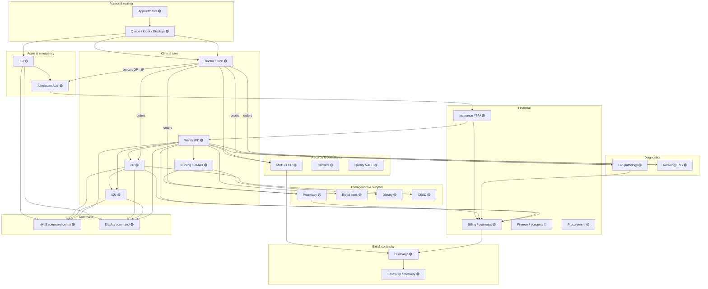

---

## 2. Master timeline — one patient, all modules

| Phase | Modules involved | Primary routes | Key APIs |
|-------|------------------|----------------|----------|
| **0. Arrival** | Queue, Kiosk, Displays | `/kiosk/checkin`, `/display/queue` | `/api/v1/queue`, `/api/display/kiosk/*` |
| **1. Registration** | Hospital practice, ABDM, MRD | `/hospital/practice-management` | `/api/hospital/practice/patients`, `/api/abdm/kiosk` |
| **2. OPD consult** | Doctor, Scribe, Orders | `/doctor/*`, `/hospital/prescription-creator` | `/api/doctor/clinical-workflow`, `/api/hospital/practice/*` |
| **3. ER (if acute)** | ER, AI triage, Displays | `/hospital/er/queue`, `/kiosk/er-triage` | `/api/v1/er/*`, `/api/display/kiosk/er-triage` |
| **4. Insurance pre-auth** | Insurance portal, HMIS preauth | `/hospital/:slug/insurance/pre-auth` | `/api/hospital/insurance/*`, `/api/v1/insurance/preauth` |
| **5. Admission** | ADT, Beds | `/hospital/adt/admit`, `/hmis/beds/map` | `/api/v1/adt/admit`, `/api/v1/beds/allocate` |
| **6. Inpatient care** | Ward, Nursing, eMAR, Vitals | `/hospital/ward`, `/hmis/emar` | `/api/v1/nursing/*`, `/api/v1/emar/*`, `/api/v1/vitals/*` |
| **7. ICU (if critical)** | ICU portal, vitals bridge | `/icu/*`, `/display/icu-board` | `/api/v1/icu/*`, MQTT→SSE |
| **8. OT (if surgical)** | OT command, CSSD | `/hmis/ot/command-center`, `/ot/*` | `/api/v1/ot/*`, `/api/cssd/*` |
| **9. Diagnostics** | Lab, RIS | `/lab/*`, `/hospital/lab-order` | `/api/lab/ris/*`, `/api/hospital/practice/lab-orders` |
| **10. Pharmacy** | Pharmacy, eMAR dispense | `/pharmacy/*`, `/hmis/emar` | `/api/pharmacy/*`, `/api/v1/emar/administer` |
| **11. Blood / diet** | Blood bank, Dietary | `/blood-bank/*`, `/dietary/*` | `/api/blood-bank/*`, `/api/dietary/*` |
| **12. Billing** | HMIS estimates, insurance | `/billing/*` | `/api/v1/billing/estimate`, `/api/billing/*` |
| **13. MRD** | Records, discharge summary | `/hospital/mrd`, `/hospital/discharge-summary` | `/api/hospital/practice/mrd/*`, `/api/v1/discharge/*` |
| **14. Discharge** | Readiness, ADT A03 | `/hmis/discharge-board` | `/api/v1/adt/discharge`, readiness APIs |
| **15. Claims & follow-up** | Insurance, recovery | `/hospital/insurance-claims` | `/api/hospital/insurance/claims`, `/api/v1/follow-up/*` |

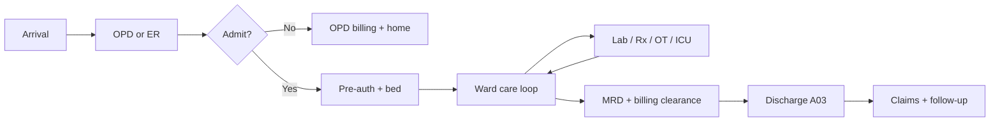

---

## 3. Module workflows (detailed)

### 3.1 Queue · Kiosk · Displays 🟢

| UI | API |
|----|-----|
| `/kiosk/checkin`, `/kiosk/er-triage`, `/hospital/queue-console` | `/api/v1/queue/*`, `/api/display/*` |
| `/display/queue`, `/display/er-triage`, `/display/ward`, `/display/icu-board`, `/display/ot-status`, `/display/bedside`, `/display/command` | SSE `/api/display/events` |

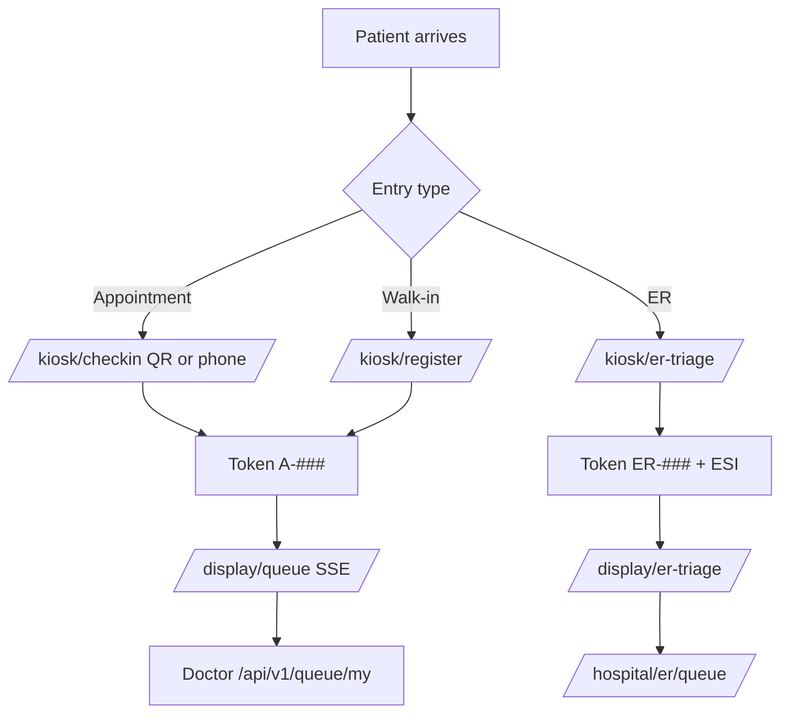

**Hands off to:** Doctor OPD, ER staff, billing (OPD counter).

---

### 3.2 Doctor · OPD · Clinical orders 🟢

| UI | API |
|----|-----|
| `/doctor/*`, `/smart-opd`, `/hospital/practice-management` | `/api/doctors/*`, `/api/doctor/clinical-workflow/*` |
| `/hospital/prescription-creator`, `/hospital/lab-order`, `/hospital/imaging-order`, `/hospital/procedure-adder` | `/api/hospital/practice/prescriptions`, `lab-orders`, `imaging-orders`, `procedures/schedule` |

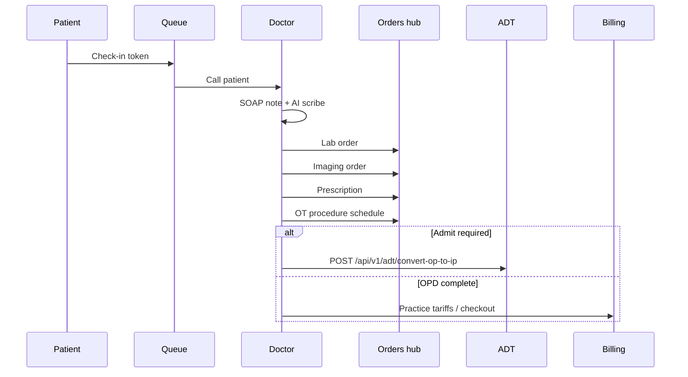

**Hands off to:** Lab, RIS, Pharmacy, OT, ADT, Insurance.

---

### 3.3 ER — Emergency 🟡

| UI | API |
|----|-----|
| `/hospital/er/queue`, `/kiosk/er-triage`, `/display/er-triage` | `/api/v1/er/register`, `/queue`, `/triage/:id`, `/emergency-ot`, `/convert-to-ip` |

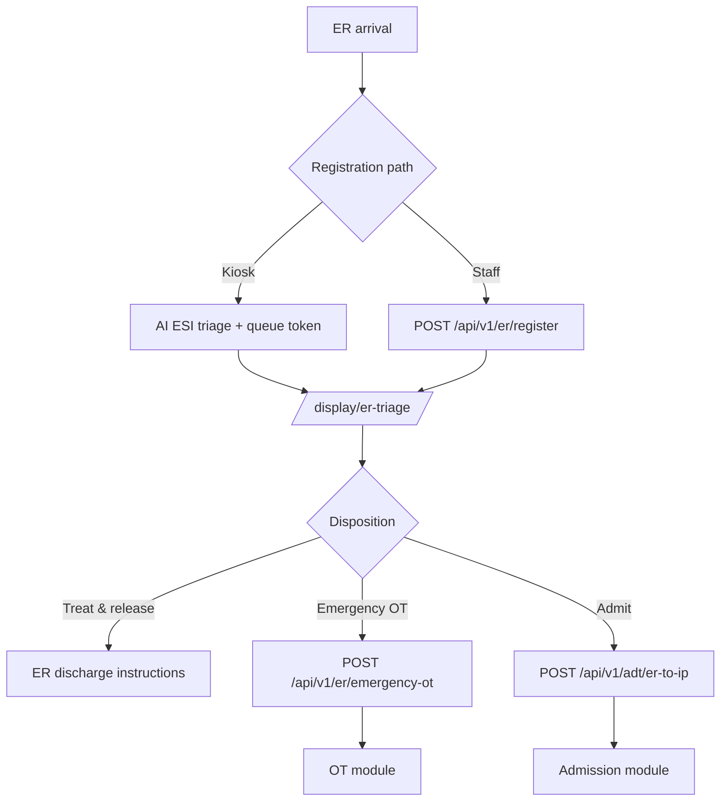

**Hands off to:** ADT, OT, ICU, Billing, MRD (MLC docs).

---

### 3.4 Admission · ADT · Beds 🟢

| UI | API |
|----|-----|
| `/hospital/adt/admit`, `/hospital/adt/er-to-ip`, `/hmis/beds/map`, `/hospital/ward` | `/api/v1/adt/admit`, `/transfer`, `/discharge`, `/convert-op-to-ip`, `/er-to-ip` |
| | `/api/v1/beds/allocate`, `/reserve`, `/map`, `/census` |

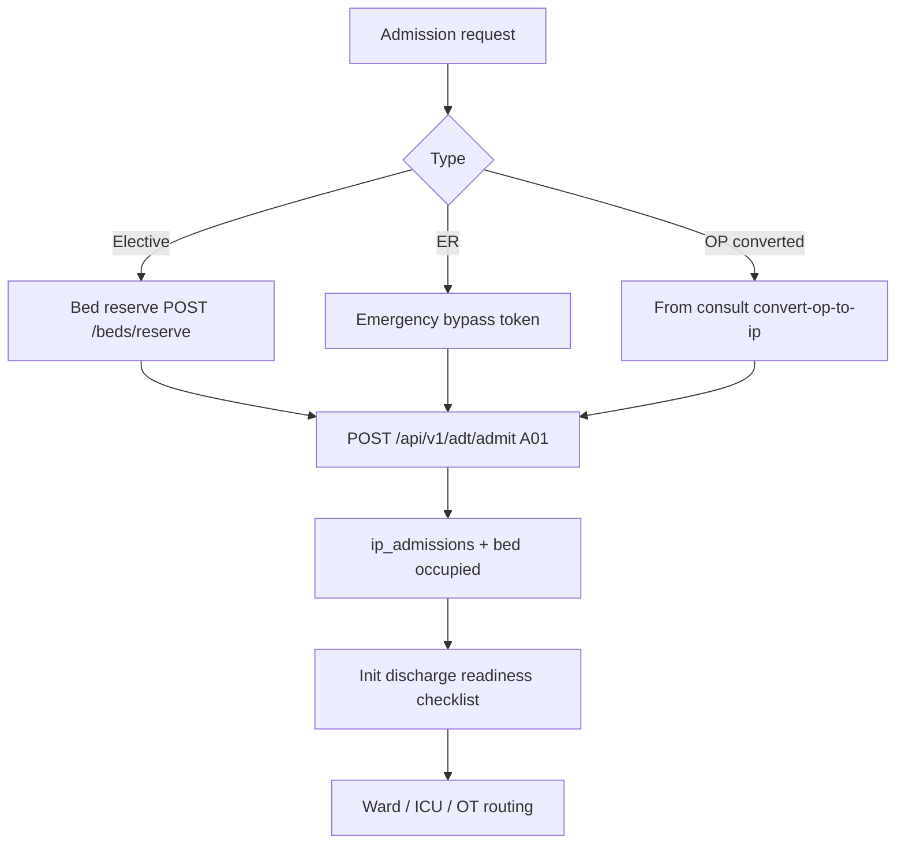

**Hands off to:** Insurance pre-auth, Ward, ICU, OT, Dietary auto-order, MRD file opening.

---

### 3.5 Insurance · TPA · Pre-auth 🟢

| UI | API |
|----|-----|
| `/hospital/:slug/insurance/*` (25+ screens) | `/api/hospital/insurance/*` |
| `/hospital/insurance-claims`, `/insurance-desk/*`, `/tpa/*` | `/api/v1/insurance/preauth`, `/api/tpa/*`, `/api/edi/*` |

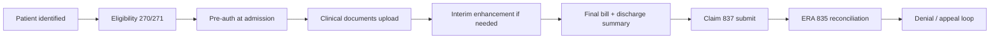

**Discharge gate:** Readiness dimension `tpa` + `billing` must clear before `POST /api/v1/adt/discharge` (unless override role).

**Hands off to:** Billing, MRD, Finance.

---

### 3.6 Ward · Nursing · eMAR · Vitals 🟢

| UI | API |
|----|-----|
| `/hospital/ward`, `/hmis/emar`, `/hmis/admission/:id/nursing-tasks`, `/hmis/admission/:id/echart` | `/api/v1/nursing/*`, `/api/v1/emar/*`, `/api/v1/vitals/*`, `/api/v1/echart/*` |
| `/nurse/*`, `/display/ward`, `/display/bedside` | `/api/display/bedside/nurse-call`, `/api/display/ward` |

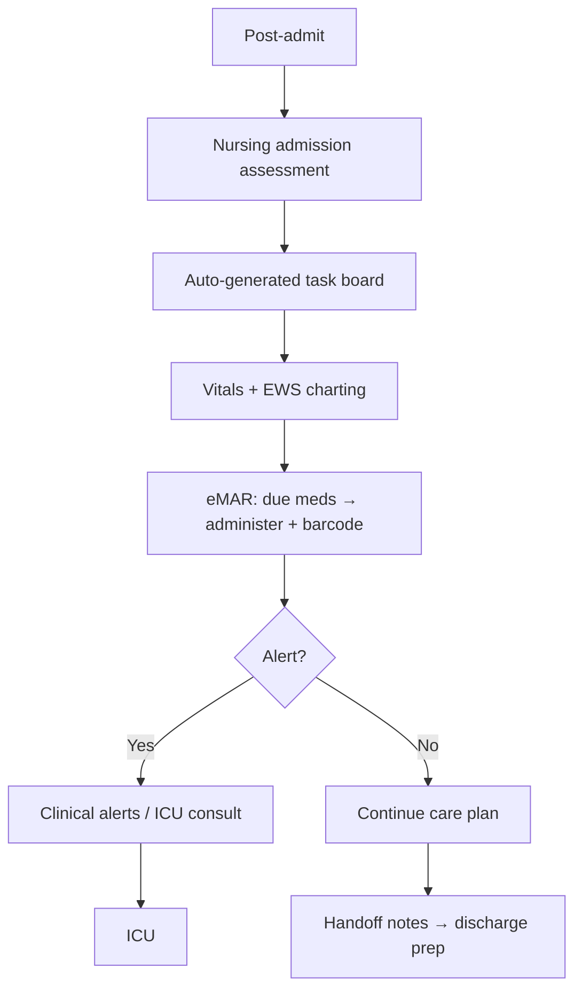

**Hands off to:** Pharmacy (eMAR), Lab (nursing collects), ICU transfer, Discharge readiness.

---

### 3.7 ICU 🟡

| UI | API |
|----|-----|
| `/icu/*`, `/hmis/patient/:id/workspace`, `/display/icu-board` | `/api/v1/icu/admit`, `/census`, `/:id/ventilator`, `/drips`, `/scores` |
| | `/api/display/icu-board` + MQTT `vitals_update` SSE |

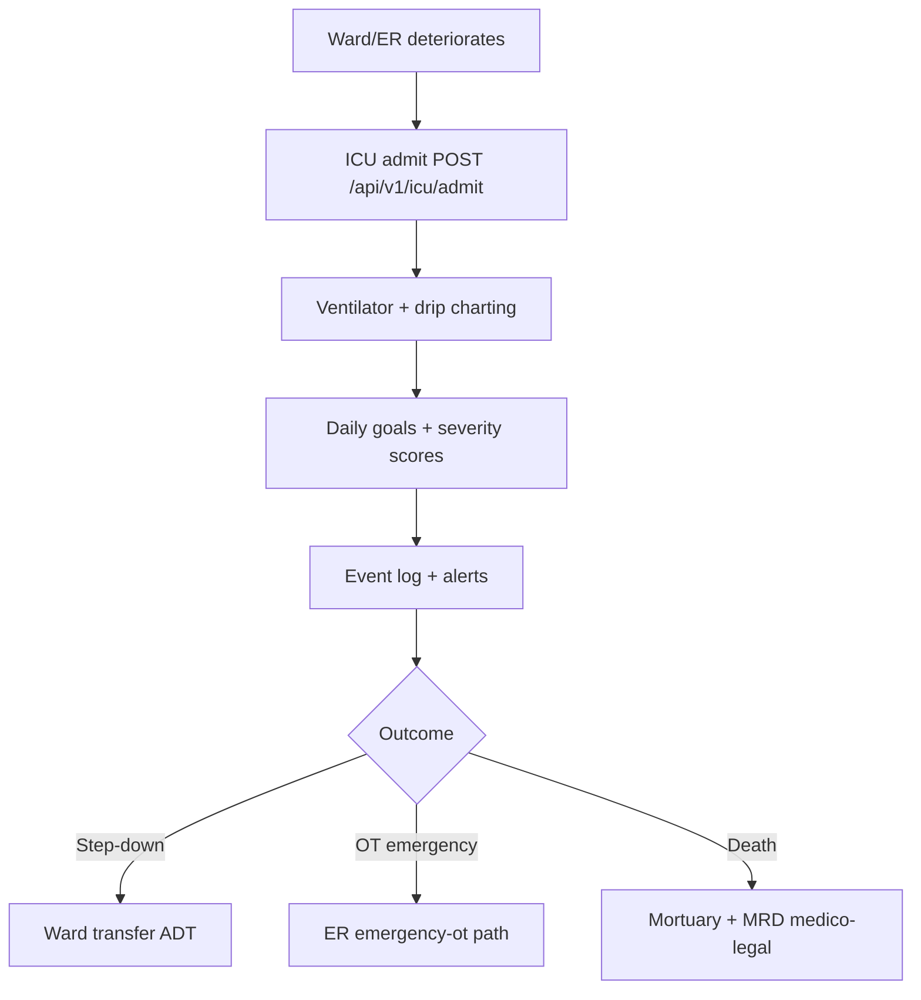

---

### 3.8 OT — Operation Theatre 🟡

| UI | API |
|----|-----|
| `/hmis/ot/command-center`, `/hmis/ot/:id/anesthesia`, `/ot/*`, `/display/ot-status` | `/api/v1/ot/book`, `/cases/today`, `/:id/checklist`, `/consumables`, `/implants`, `/operative-note` |
| | `/api/v1/anesthesia/assessment`, `/api/v1/er/emergency-ot` |

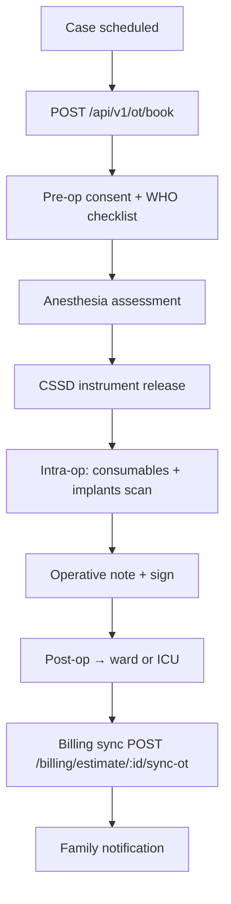

**Hands off to:** CSSD, ICU, Ward, Billing, MRD operative record.

---

### 3.9 Lab — Pathology 🟡

| UI | API |
|----|-----|
| `/lab/*`, `/hospital/lab-order`, `/hospital/lab-reports` | `/api/labs/*`, `/api/lab-tests/*`, `/api/hospital/practice/lab-orders` |
| | `/api/v1/lab-rules/*` (critical value rules) |

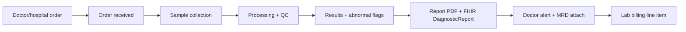

**OPD path:** `/hospital/lab-order` → practice API 🟢  
**Lab portal sub-pages:** many 🟡 scaffold

---

### 3.10 Radiology · RIS · PACS 🟢

| UI | API |
|----|-----|
| `/lab/ris`, `/lab/imaging`, `/hospital/imaging-order`, `/doctor/imaging` | `/api/lab/ris/*`, `/api/hypergrid/dicom/*`, `/api/hospital/practice/imaging-orders` |

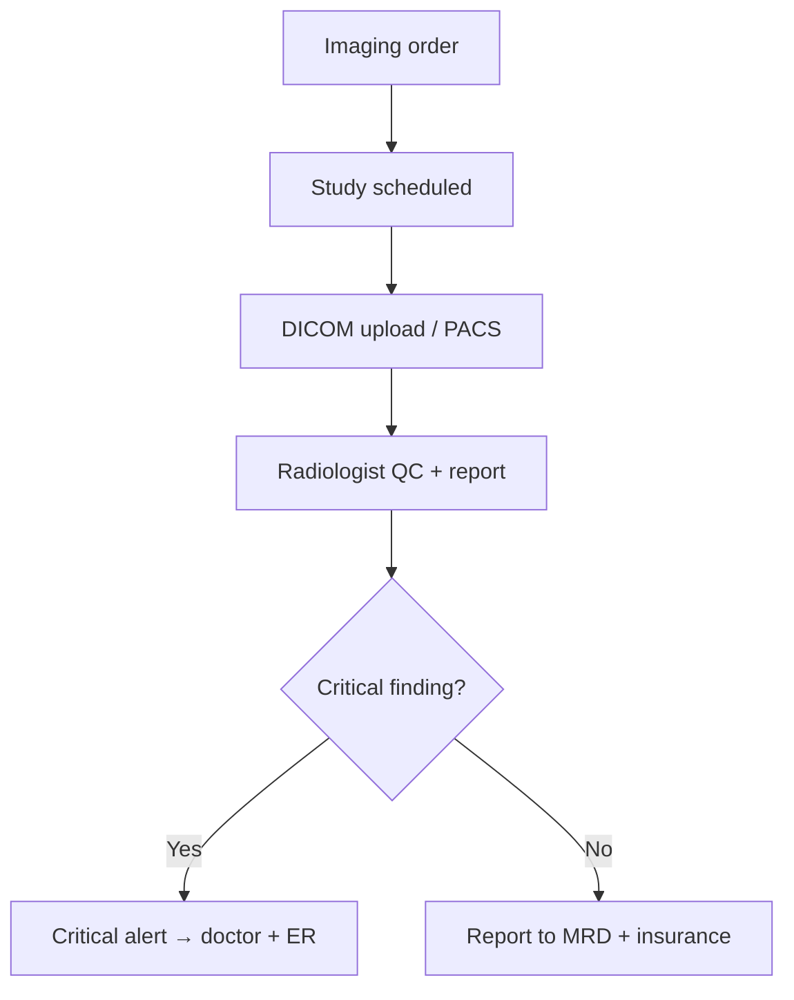

---

### 3.11 Pharmacy 🟡

| UI | API |
|----|-----|
| `/pharmacy/*`, `/hospital/pharmacy` | `/api/pharmacy/*` (inventory, POS, prescriptions, batches) |
| `/hmis/emar` (IPD admin) | `/api/v1/emar/administer`, `/api/hospital/practice/pharmacy/*` |

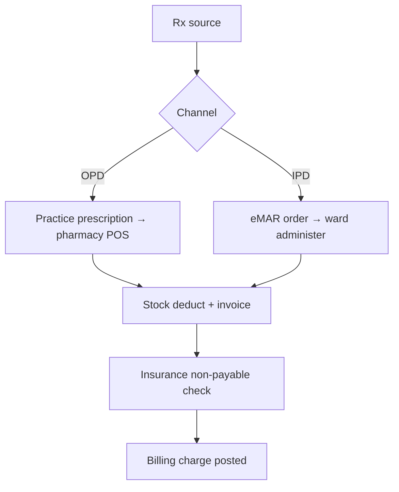

**Gap:** eMAR → pharmacy dispense auto-loop (GAP-IPD-004) 🟡

---

### 3.12 Billing · Finance · Accounts 🟡/🔴

| UI | API | Status |
|----|-----|--------|
| `/api/v1/billing/estimate/*` | HMIS IP estimates | 🟢 |
| `/api/billing/*`, `/billing/checkout` | Patient commerce billing | 🟢 |
| `/hospital/billing` | — | 🔴 localStorage scaffold |
| `/finance/*`, `/accounts/*` | `/api/finance/login` only | 🔴 scaffold UI |

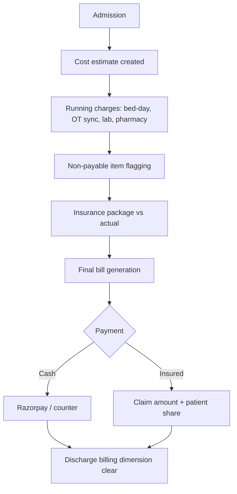

---

### 3.13 MRD — Medical Records 🟡

| UI | API |
|----|-----|
| `/hospital/mrd`, `/hospital/ehr`, `/hospital/discharge-summary`, `/hospital/ip-sheets` | `/api/hospital/practice/medical-records`, `/mrd/digitization-queue`, `/discharge-summaries`, `/ehr/:patientId` |
| `/mrd/*` standalone portal | Demo data 🔴 |

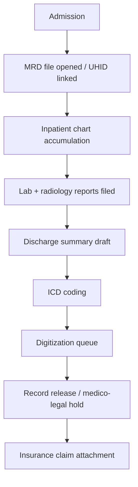

---

### 3.14 Discharge 🟢

| UI | API |
|----|-----|
| `/hmis/admission/:id/discharge`, `/hmis/discharge-board`, `/hospital/discharge-summary` | `/api/v1/adt/discharge/readiness/*`, `/api/v1/discharge/draft|sign|packet` |
| `/display/discharge-status` | `/api/display/discharge-status` |

**Readiness dimensions:** clinical · nursing_education · medication_reconciliation · billing · tpa (optional) · discharge_summary

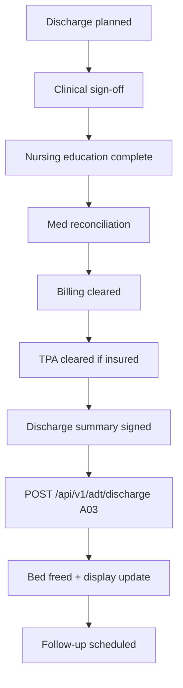

---

### 3.15 Blood Bank 🟡

| UI | API |
|----|-----|
| `/blood-bank/*`, `/display/blood-bank` | `/api/blood-bank/*` (donors, inventory, requisitions, cross-match) |

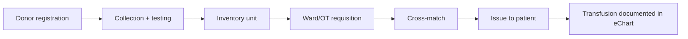

---

### 3.16 Dietary 🟡

| UI | API |
|----|-----|
| `/dietary/*` | `/api/dietary/*` (orders from admission, allergy check, kitchen release) |

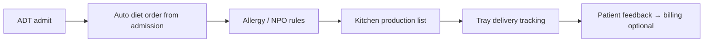

---

### 3.17 CSSD 🟡

| UI | API |
|----|-----|
| `/cssd/*` | `/api/cssd/*` (sets, sterilization cycles, release) |

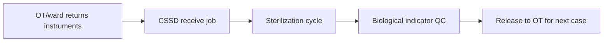

---

### 3.18 Procurement · Stores 🟡

| UI | API |
|----|-----|
| `/procurement/*` | `/api/procurement/*` (vendors, PO, approvals, GRN, ledger) |

Feeds pharmacy, lab, CSSD, biomedical stock replenishment.

---

### 3.19 Support departments 🔴 scaffold UI

| Module | UI | Backend |
|--------|-----|---------|
| Mortuary | `/mortuary/*` | Login only |
| Infection control | `/infection-control/*` | Login only |
| Finance dept | `/finance/*` | Login only |
| Asset | `/asset/*` | Login only |
| HR | `/hr/*` | Payroll separate |

---

### 3.20 HMIS Command · Analytics 🟢

| UI | API |
|----|-----|
| `/hmis/command-center`, `/hmis/discharge-board`, `/display/command` | `/api/v1/analytics/*`, `/api/v1/ai-ops/*`, `/api/v1/ai-revenue/*` |

Cross-module dashboards: census, bed pressure, OT utilisation, revenue leakage, HL7 monitor, follow-up compliance.

---

## 4. Cross-module integration matrix

| From → To | Trigger | API / mechanism |
|-----------|---------|----------------|
| Queue → Doctor | Token called | `/api/v1/queue/:id/call` + SSE |
| Doctor → Lab | Lab order | `POST /api/hospital/practice/lab-orders` |
| Doctor → RIS | Imaging order | `POST /api/hospital/practice/imaging-orders` |
| Doctor → Pharmacy | Rx | `POST /api/hospital/practice/prescriptions` |
| Doctor → OT | Schedule procedure | `POST /api/hospital/practice/procedures/schedule` |
| Doctor → ADT | Admit decision | `POST /api/v1/adt/convert-op-to-ip` |
| ER → ADT | Admit from ER | `POST /api/v1/adt/er-to-ip` |
| ADT → Insurance | Admission | `POST /api/v1/insurance/preauth` |
| ADT → Dietary | Admit event | `POST /api/dietary/orders/from-admission` |
| Ward → ICU | Clinical deterioration | `POST /api/v1/icu/admit` |
| OT → Billing | Case complete | `POST /api/v1/billing/estimate/:id/sync-ot` |
| eMAR → Pharmacy | Dispense | GAP — manual today |
| All clinical → MRD | Documents | Practice EHR + discharge APIs |
| Billing + MRD → Discharge | Clearance | Readiness dimensions |
| Discharge → Insurance | Claim | `/api/hospital/insurance/claims` |
| HMIS → Displays | Real-time | `/api/display/*` + SSE |

---

## 5. Role-based swimlane (operations view)

```mermaid
flowchart TB
  subgraph Reception["Reception / front desk"]
    R1[Kiosk / queue console]
    R2[Appointment lookup]
    R3[Insurance desk routing]
  end

  subgraph Clinical["Clinical"]
    C1[Doctor consult + orders]
    C2[ER triage + disposition]
    C3[Surgeon OT]
  end

  subgraph Nursing["Nursing"]
    N1[Assessment + tasks]
    N2[eMAR + vitals]
    N3[Discharge education]
  end

  subgraph Diagnostic["Diagnostics"]
    D1[Lab sample → report]
    D2[Radiology report]
  end

  subgraph Ancillary["Ancillary"]
    A1[Pharmacy dispense]
    A2[Blood issue]
    A3[Diet trays]
    A4[CSSD release]
  end

  subgraph Admin["Admin / finance"]
    F1[Pre-auth / claims]
    F2[Billing clearance]
    F3[MRD coding]
  end

  R1 --> C1 & C2
  C1 --> D1 & D2 & A1 & C3
  C2 --> Nursing
  C3 --> A4 --> Nursing
  Nursing --> D1
  Nursing --> N3
  D1 & D2 & A1 --> F2
  F1 --> Nursing
  F2 & F3 --> Discharge[ADT discharge A03]
```

---

## 6. Route quick reference (all modules)

### Frontend prefixes

| Prefix | Module |
|--------|--------|
| `/hospital/*` | Hospital portal (practice, insurance, ADT entry, ward) |
| `/hmis/*` | Inpatient clinical hub |
| `/doctor/*` | Doctor OPD |
| `/icu/*` | ICU department |
| `/ot/*` | OT department |
| `/lab/*` | Lab + RIS |
| `/pharmacy/*` | Pharmacy |
| `/mrd/*` | MRD portal |
| `/blood-bank/*` | Blood bank |
| `/dietary/*` | Dietary |
| `/cssd/*` | CSSD |
| `/procurement/*` | Procurement |
| `/insurance-desk/*`, `/hospital/:slug/insurance/*` | Insurance |
| `/tpa/*` | TPA |
| `/display/*`, `/kiosk/*` | Displays |
| `/nurse/*` | Nurse mobile |

### Backend HMIS core (`/api/v1/`)

`adt` · `beds` · `nursing` · `emar` · `vitals` · `echart` · `er` · `icu` · `ot` · `anesthesia` · `discharge` · `billing` · `insurance` · `follow-up` · `recovery` · `analytics` · `ai-ops` · `ai-revenue` · `navigation` · `clinical-workspace` · `queue`

---

## 7. Implementation priority for go-live

| Priority | Modules | Why |
|----------|---------|-----|
| P0 | Queue, ADT, Beds, Ward, eMAR, Nursing, Discharge, Doctor orders | Admit→discharge spine |
| P0 | Insurance pre-auth + claims | Revenue cycle |
| P1 | ER, Lab RIS, Pharmacy POS, OT scheduling | Acute + diagnostic loop |
| P1 | MRD discharge summary, Billing estimates | Discharge gate |
| P2 | ICU live portal, Blood bank UI, Dietary UI, CSSD UI | Ancillary completeness |
| P2 | Displays all zones, Command centre | Hospital OS visibility |
| P3 | Finance, Mortuary, Infection control UIs | Scaffold → live APIs |

---

## 8. Document history

| Version | Date | Changes |
|---------|------|---------|
| 1.0 | 2026-06-17 | Complete multi-module workflows: doctor, lab, pharmacy, admission, insurance, billing, ER, MRD, OT, ICU, ward, ancillary, command |

\newpage

# Part III — Paperless & AI-Augmented Flows

*Source: `MEDIQZY_GREENFIELD_PAPERLESS_AI_FLOWS.md`*

---


**Version:** 1.0  
**Date:** 2026-06-17  
**Audience:** Greenfield hospital CEOs, clinical directors, IT, implementation teams  
**Scope:** End-to-end **paperless** patient journeys and **AI-driven / copilot-augmented** workflows for every department in a new MediQzy deployment.

**Companion docs:**
- [GREENFIELD_HOSPITAL_GAPS_IMPLEMENTATION.md](./GREENFIELD_HOSPITAL_GAPS_IMPLEMENTATION.md) — gap IDs & phases
- [MEDIQZY_COMPLETE_HOSPITAL_WORKFLOWS.md](./MEDIQZY_COMPLETE_HOSPITAL_WORKFLOWS.md) — all module clinical flows
- [SMART_HOSPITAL_OS_VISION.md](./SMART_HOSPITAL_OS_VISION.md) — north-star architecture

**Legend:** 🟢 Live · 🟡 Partial · 🔴 Scaffold / planned  
**SaMD:** Class III = direct clinical decision support · Class IIb = risk stratification · NOT SaMD = admin / documentation with physician review

---

## 1. Greenfield north star

A **greenfield MediQzy hospital** targets two properties on day one:

| Property | What patients & staff experience |
|----------|----------------------------------|
| **Paperless from arrival** | No paper forms at lobby — QR, camera, OTP, e-receipt, digital consent |
| **AI-augmented everywhere** | Copilots assist (not replace) clinicians, nurses, insurance desk, and command centre |

**Human-in-the-loop rule (mandatory):** All SaMD-class outputs (triage ESI, drug interactions, risk scores) pass **quality gates** (`ai-quality-gates.service.js`) and require **licensed staff review** before clinical action. Scribe and discharge drafts require **physician signature**.

---

## 2. Platform stack — paperless + intelligence

```mermaid
flowchart TB
  subgraph Paperless["Paperless surfaces"]
    K["Kiosks\n/kiosk/*"]
    D["Displays\n/display/*"]
    M["Mobile / patient app"]
  end

  subgraph Clinical["Clinical core (source of truth)"]
    HMIS["HMIS /api/v1/*"]
    HOSP["Hospital portal\npractice + insurance"]
  end

  subgraph AI["Intelligence layer"]
    LLM["llm-provider.js\niSHA → Groq → OpenAI"]
    TRIAGE["Emergency triage ESI"]
    SCRIBE["Medical scribe"]
    RISK["Health risk + SHAP"]
    DDI["Drug interaction"]
    OPS["AI Ops + Dept hubs"]
    COPILOT["Admin / voice copilots"]
    GOV["Quality gates + governance"]
  end

  K --> HMIS
  D --> HMIS
  M --> HMIS
  HMIS --> HOSP
  AI --> Clinical
  AI --> Paperless
  GOV --> AI
```

| Layer | Key files / routes |
|-------|-------------------|
| Paperless kiosks | `SelfCheckinKiosk.tsx`, `ERTriageKiosk.tsx`, `/api/display/kiosk/*`, `/api/abdm/kiosk/*` |
| AI brain | `/api/v3/ai-brain/*`, `server/services/ai-brain/llm-provider.js` |
| Clinical AI | `ai-emergency-triage.service.js`, `ai-drug-interaction.service.js`, `ai-health-risk-cron.service.js` |
| Copilots | `/admin/copilot`, `/doctor/assistant`, `/hmis/ai-ops`, `/hmis/ai-dept` |
| Governance | `/api/ai-governance/*`, `ai-quality-gates.service.js`, `ai-interpretability.service.js` |

---

## 3. Master paperless journey (arrival → discharge)

```mermaid
flowchart TD
  A[Patient arrives — no paper] --> B{Entry}
  B -->|ABHA QR| C[/kiosk/checkin scan/]
  B -->|Appointment QR| C
  B -->|Walk-in| D[/kiosk/checkin phone OTP/]
  B -->|ER acute| E[/kiosk/er-triage AI ESI/]

  C --> F[Camera photo + DPDP consent]
  D --> F
  F --> G[UHID linked + OPD token]
  G --> H[/display/queue SSE + p50/p90 wait/]
  H --> I[Doctor consult + AI scribe]

  E --> J[/display/er-triage/]
  J --> K{Disposition}
  K -->|OPD| I
  K -->|Admit| L[Digital pre-auth + bed AI allocate]
  I -->|Admit| L

  L --> M[Ward eMAR + vitals NEWS2]
  M --> N[Orders: lab RIS pharmacy OT]
  N --> M
  M --> O[AI discharge summary draft]
  O --> P[Readiness gates: clinical billing TPA MRD]
  P --> Q[ADT discharge A03 + e-instructions]
  Q --> R[Claims AI + follow-up copilot]
```

**No paper at:** registration · queue token · consent · clinical notes (scribe) · orders · discharge summary · claim packet · follow-up reminders.

---

## 4. Paperless lobby flow (Phase 1b — greenfield recommended)

Target state after GAP-KIOSK-001–007 (mostly 🟢 in PR #19):

```mermaid
flowchart TD
  A[Touch kiosk /kiosk/checkin] --> B{Entry path}
  B -->|Scan ABHA QR| C[POST /api/abdm/kiosk/profile]
  B -->|Scan appointment QR| D[POST /api/display/kiosk/parse-qr]
  B -->|Walk-in new| E[Phone OTP verify]
  B -->|Hospital deep link| F[Registration wizard]

  C --> G[Confirm demographics on screen]
  D --> H[Confirm pre-booked visit]
  E --> G
  F --> G

  G --> I[DPDP consent screen]
  I --> J[Camera: patient photo]
  J --> K[Optional: ID document capture]
  K --> L[Create/link patient UHID]
  H --> L

  L --> M[POST /api/v1/queue/checkin]
  M --> N[E-receipt QR + token A-###]
  N --> O[SSE → /display/queue]
  O --> P[Optional: WhatsApp/SMS notify near front]
```

| Step | API | UI | Status |
|------|-----|-----|--------|
| QR parse | `POST /api/display/kiosk/parse-qr` | `KioskQrScanner.tsx` | 🟢 |
| ABHA kiosk | `POST /api/abdm/kiosk/*` | SelfCheckinKiosk ABHA tab | 🟢 |
| Photo capture | `POST /api/display/kiosk/photo` | `KioskPhotoCapture.tsx` | 🟢 |
| Walk-in register | `POST /api/display/kiosk/register` | SelfCheckinKiosk | 🟢 |
| Predictive wait | `hospital-queue.service.js` | E-receipt + displays | 🟢 |
| Video liveness anti-spoof | — | — | 🔴 GAP-KIOSK-007 |
| AI voice wayfinding | — | — | 🔴 GAP-HOS-003 |

---

## 5. Department flows — paperless + AI augmented

### 5.1 Reception · Queue · Displays

| Paperless | AI augmentation | Copilot / hub |
|-----------|-----------------|----------------|
| Digital token, e-receipt, no counter form | p50/p90 wait prediction, queue analytics | `/hospital/queue-console` |
| QR check-in, photo registration | Proactive WhatsApp/SMS notify | `queue-notify.service.js` |
| Lobby signage loop | Command centre KPI aggregation | `/display/command` |

```mermaid
flowchart LR
  K[Kiosk check-in] --> Q[Unified queue engine]
  Q --> W[Predictive wait AI]
  Q --> S[SSE displays]
  Q --> N[Notify service]
  Q --> C[Command centre wall]
```

**Routes:** `/kiosk/checkin`, `/display/queue`, `/hospital/queue-console`, `/display/command`  
**APIs:** `/api/v1/queue/*`, `/api/display/*`  
**SaMD:** NOT SaMD (scheduling / ops)

---

### 5.2 Doctor · OPD · Clinical workspace

| Paperless | AI augmentation | Copilot |
|-----------|-----------------|---------|
| Voice scribe → structured SOAP (no handwritten notes) | Dr. iSHA agent: drug info, interactions, navigation | `/doctor/assistant` — `DoctorVoiceAssistant.tsx` |
| Digital prescriptions & e-orders | Rx draft from scribe notes | `/doctor/voice-scribe` |
| EMR risk panel | SHAP explainability on risk scores | `RiskScoreExplanation.tsx` |
| Video consult | AI vision frame assist (review required) | `/doctor/video-consultation` |

```mermaid
sequenceDiagram
  participant P as Patient
  participant Q as Queue
  participant D as Doctor
  participant S as AI Scribe
  participant A as Dr. iSHA agent
  participant O as Orders

  P->>Q: Digital check-in token
  Q->>D: Call next
  D->>S: Voice consult → SOAP draft
  S->>D: Structured note (physician edits)
  D->>A: "Check interactions for Rx"
  A->>D: DDI report + quality gate
  D->>O: Lab / imaging / Rx / OT (digital)
  Note over D: Mandatory sign-off before commit
```

**APIs:** `/api/scribe/*`, `/api/voice-assistant/*`, `/api/v3/ai-brain/*`, `/api/v3/ai-intelligence/drug-interactions/*`, `/api/ai-governance/patient/:id/explanation`  
**SaMD:** DDI = **Class III** · Risk SHAP = **Class IIb** · Scribe = **NOT SaMD** (with physician review)

---

### 5.3 ER — Emergency

| Paperless | AI augmentation | Copilot |
|-----------|-----------------|---------|
| Kiosk symptom intake (touch, no triage form) | **AI ESI 5-level triage** + LIME explanation | `/kiosk/er-triage` |
| ER token on public board (privacy-safe) | Quality gate: ESI-1 immediate alert | `/display/er-triage` |
| Tele-triage video booth | LiveKit + triage context to doctor | `/kiosk/er-triage` video step |
| Digital disposition | ER→IP convert API | `/hospital/er/queue` |

```mermaid
flowchart TD
  A[ER kiosk symptoms] --> B[ai-emergency-triage.service.js]
  B --> C[ESI level + LIME attributions]
  C --> D[qualityGates.checkEmergencyTriage]
  D --> E[ER token ER-###]
  E --> F[/display/er-triage SSE/]
  F --> G{Staff disposition}
  G -->|Treat & release| H[Digital discharge instructions]
  G -->|Emergency OT| I[/api/v1/er/emergency-ot/]
  G -->|Admit| J[/api/v1/adt/er-to-ip/]
```

**APIs:** `POST /api/display/kiosk/er-triage`, `/api/v1/er/*`, `/api/medical-ai/instant-triage-call`  
**SaMD:** **Class III** (`emergency-triage-esi-v1`) — external validation GAP-CMP-004 open

---

### 5.4 Admission · ADT · Beds

| Paperless | AI augmentation | Copilot |
|-----------|-----------------|---------|
| Digital admit orders (no paper file) | Smart bed allocation by acuity/isolation | `POST /api/v1/ai-ops/bed-allocation` |
| e-Consent capture | LOS estimate + pathway suggestion on admit event | `workflow-ai-orchestrator.service.js` |
| Bed map digital | Capacity forecast 24h | `/hmis/ai-ops` Forecast tab |

```mermaid
flowchart LR
  A[Admit request] --> B[Insurance pre-auth digital]
  B --> C[AI bed allocation]
  C --> D[ADT A01 + bed map]
  D --> E[Auto diet order + nursing tasks]
  D --> F[MRD digital file open]
```

**Routes:** `/hospital/adt/admit`, `/hmis/beds/map`, `/hmis/ai-ops`  
**APIs:** `/api/v1/adt/*`, `/api/v1/beds/*`, `/api/v1/ai-ops/capacity-forecast`  
**SaMD:** Bed allocation = NOT SaMD (ops); readmission hints = **Class IIb**

---

### 5.5 Insurance · TPA

| Paperless | AI augmentation | Copilot |
|-----------|-----------------|---------|
| Digital eligibility 270/271 | Insurance AI bot Q&A | `/api/v3/ai-intelligence/insurance/*` |
| e-Document upload (no fax) | Autonomous pre-auth engine + fraud score | `ai-preauth-engine.service.js` |
| Portal task workflow | Denial pattern analytics | `/hmis/ai-dept` Insurance tab |
| Admin desk assist | Admin Copilot **insurance persona** | `/admin/copilot` |

```mermaid
flowchart TD
  A[Patient UHID at desk] --> B[Eligibility check API]
  B --> C[Digital pre-auth packet]
  C --> D[ai-preauth-engine: rules + LLM edge cases]
  D --> E[TPA submit + track]
  E --> F[Interim enhancement if LOS extends]
  F --> G[Final bill + claim 837]
  G --> H[ERA 835 + denial AI insights]
```

**Routes:** `/hospital/:slug/insurance/*`, `/hospital-insurance/*`, `/insurance-desk/*`  
**SaMD:** NOT SaMD (administrative revenue cycle)

---

### 5.6 Ward · Nursing · eMAR

| Paperless | AI augmentation | Copilot |
|-----------|-----------------|---------|
| Tablet vitals entry (no paper chart) | NEWS2 early warning on vitals | `/api/v1/vitals/*` |
| Barcode eMAR administration | Ward deterioration watchlist | `/hmis/ai-dept` Ward tab |
| Digital handoff notes | Nurse workload balance AI | `/hmis/ai-ops` Workload tab |
| Bedside display + nurse call | Ambient deterioration on wall | 🔴 GAP-IOT-002 |

```mermaid
flowchart TD
  A[Vitals entry] --> B[NEWS2 / EWS rules]
  B --> C{Threshold?}
  C -->|Yes| D[Alert + ICU consult suggest]
  C -->|No| E[eMAR due → barcode administer]
  E --> F[Pharmacy charge sync]
  D --> G[/display/ward highlight/]
```

**Routes:** `/hospital/ward`, `/hmis/emar`, `/display/ward`, `/display/bedside`, `/nurse/*`  
**SaMD:** NEWS2 alerts = **Class IIb** risk stratification

---

### 5.7 ICU

| Paperless | AI augmentation | Copilot |
|-----------|-----------------|---------|
| Digital ventilator + drip charts | ICU dept intelligence: SOFA, weaning candidates | `/hmis/ai-dept` ICU tab |
| Live vitals wall (no paper flowsheet) | MQTT → SSE vitals bridge | `/display/icu-board` |
| Tele-ICU video overlay | Remote intensivist on clinical wall | 🟡 GAP-VIDEO-004 |

```mermaid
flowchart LR
  V[Vitals MQTT/Redis] --> B[ICU board SSE]
  B --> A[AI dept: sepsis bundle hints]
  B --> T[Tele-ICU video overlay]
  A --> N[Nurse / intensivist action]
```

**Routes:** `/icu/*`, `/display/icu-board`, `/hmis/patient/:id/workspace`  
**APIs:** `/api/v1/icu/*`, `display-mqtt-bridge.service.js`

---

### 5.8 OT — Operation Theatre

| Paperless | AI augmentation | Copilot |
|-----------|-----------------|---------|
| Digital WHO checklist + consent | OT utilisation + delay analytics | `/hmis/ai-dept` OT tab |
| Barcode consumables / implants | Post-op note scribe draft | Scribe on `patient.ot.completed` |
| Corridor status display | Remote expert proctoring video | 🔴 GAP-VIDEO-005 |

```mermaid
flowchart TD
  A[Digital OT book] --> B[Pre-op consent e-sign]
  B --> C[WHO checklist on tablet]
  C --> D[CSSD instrument release scan]
  D --> E[Intra-op consumable scan]
  E --> F[Operative note scribe draft]
  F --> G[Physician sign → MRD + billing sync]
```

**Routes:** `/hmis/ot/command-center`, `/display/ot-status`, `/ot/*`

---

### 5.9 Lab · Pathology

| Paperless | AI augmentation | Copilot |
|-----------|-----------------|---------|
| Digital lab orders from doctor | Critical unacked value alerts | `/hmis/ai-dept` Lab tab |
| PDF report + FHIR DiagnosticReport | AI report scanner (upload interpret) | `/report-scanner` |
| No paper requisition slip | TAT + workload analytics | Lab portal |

```mermaid
flowchart LR
  O[Digital lab order] --> S[Sample barcode]
  S --> P[Processing + QC]
  P --> R[Results + critical flags]
  R --> A[Doctor alert + MRD attach]
  R --> AI[Report analysis LLM optional]
```

**Routes:** `/lab/*`, `/hospital/lab-order`, `/report-scanner`  
**SaMD:** Report scanner = **Class IIb** (patient-facing interpretive — physician review)

---

### 5.10 Radiology · RIS · PACS

| Paperless | AI augmentation | Copilot |
|-----------|-----------------|---------|
| Digital imaging orders | Critical finding alert routing | RIS workflow |
| DICOM upload (no film) | PACS + HyperGrid integration | `/lab/ris` |
| e-Report distribution | — | `/api/hypergrid/dicom/*` |

---

### 5.11 Pharmacy

| Paperless | AI augmentation | Copilot |
|-----------|-----------------|---------|
| Digital Rx from OPD | **Drug interaction checker** at prescribe | `ai-drug-interaction.service.js` |
| POS barcode dispense | Polypharmacy watch (dept hub) | `/hmis/ai-dept` Pharmacy tab |
| eMAR IPD administration | eMAR → pharmacy auto-loop | 🟡 GAP-IPD-004 |

```mermaid
flowchart TD
  R[Rx digital] --> D[DDI quality gate Class III]
  D --> P{Pass?}
  P -->|Warn| H[Pharmacist override + log]
  P -->|OK| S[Stock deduct + e-invoice]
  S --> B[Billing line posted]
```

---

### 5.12 Billing · Revenue

| Paperless | AI augmentation | Copilot |
|-----------|-----------------|---------|
| Digital estimates at admit | Revenue leakage detection | `/hmis/ai-revenue` |
| Running charge ledger | Denial risk scoring | `ai-revenue-intelligence.service.js` |
| Razorpay / counter e-payment | Smart order sets by diagnosis | AI Revenue hub |
| No paper final bill | Accounts dept analytics | `/hmis/ai-dept` Accounts tab |

**Routes:** `/hmis/ai-revenue`, `/api/v1/billing/estimate/*`, `/billing/checkout`  
**Note:** `/hospital/billing` is 🔴 localStorage scaffold — use HMIS billing APIs.

---

### 5.13 MRD — Medical Records

| Paperless | AI augmentation | Copilot |
|-----------|-----------------|---------|
| Digital chart accumulation | Documentation completeness audit | `/hmis/ai-ops` Docs tab |
| Discharge summary e-sign | Scribe-assisted summary | `/hospital/discharge-summary` |
| QR staff check-in at MRD desk | Clinical NLP entity extraction | `/api/v3/ai-deeptech/entities/*` |
| Digitization queue | ICD coding assistant | 🔴 scaffold at `/mrd/icd-coding` |

---

### 5.14 Discharge

| Paperless | AI augmentation | Copilot |
|-----------|-----------------|---------|
| Digital readiness checklist (6 dimensions) | AI discharge summary data synthesis | `GET /api/v1/ai-ops/discharge-summary/:id` |
| e-Instructions + follow-up | Workflow AI packet draft on `patient.discharged` | `workflow-ai-orchestrator.service.js` |
| Family discharge status board | PREMS kiosk (planned) | 🔴 GAP-DISPLAY-002 |
| No paper take-home packet | Recovery / follow-up copilot | `/api/v1/follow-up/*` |

```mermaid
flowchart TD
  A[Discharge planned] --> B[AI summary draft]
  B --> C[Clinical sign-off]
  C --> D[Nursing education digital]
  D --> E[Med reconciliation]
  E --> F[Billing + TPA clear]
  F --> G[MRD coding + summary sign]
  G --> H[ADT A03 + bed free]
  H --> I[e-Instructions + follow-up AI schedule]
```

---

### 5.15 Command · Admin · Hospital OS

| Paperless | AI augmentation | Copilot |
|-----------|-----------------|---------|
| Device-enrolled displays (no printed signs) | Command centre KPI wall | `/display/command` |
| Digital twin floor map | Census + queue + wait analytics | `/display/floor-map` |
| Emergency broadcast SSE | Capacity forecast + workload | `/hmis/ai-ops` |
| SaMD governance dashboard | Model cards, drift, quality gate log | `/admin/ai-governance` |
| Multi-persona admin copilot | Ops / analytics / revenue / quality | `/admin/copilot` |

```mermaid
flowchart TB
  subgraph Copilots["Hospital copilots"]
    AC[Admin Copilot\n/admin/copilot]
    DV[Doctor Voice Assistant\n/doctor/assistant]
    AO[AI Operations Hub\n/hmis/ai-ops]
    AD[AI Department Hub\n/hmis/ai-dept]
    AR[AI Revenue\n/hmis/ai-revenue]
    AG[SaMD Governance\n/admin/ai-governance]
  end

  subgraph Data["Data plane"]
    HMIS[HMIS /api/v1/*]
    DISP[Displays SSE]
    CRON[Risk + insights crons]
  end

  Copilots --> Data
  AG --> CRON
```

---

## 6. Copilot catalog by department

| Department | Copilot / AI surface | Route | Agent / service | Maturity |
|------------|---------------------|-------|-----------------|----------|
| **Reception** | Predictive wait + notify | Kiosk e-receipt | `hospital-queue.service.js` | 🟢 |
| **Reception** | Voice wayfinding (planned) | — | GAP-HOS-003 | 🔴 |
| **Doctor OPD** | Voice assistant (iSHA) | `/doctor/assistant` | `/api/voice-assistant/agent` | 🟢 |
| **Doctor OPD** | Medical scribe | `/doctor/voice-scribe` | `/api/scribe/*` | 🟢 |
| **Doctor OPD** | AI Doctor chat | `/ai-doctor` | `/api/v3/ai-brain/think` | 🟢 |
| **Doctor OPD** | Drug interaction | Prescribing UI | `ai-drug-interaction.service.js` | 🟢 |
| **Doctor OPD** | Risk SHAP panel | Patient EMR | `/api/ai-governance/patient/:id/explanation` | 🟢 |
| **ER** | AI ESI triage kiosk | `/kiosk/er-triage` | `ai-emergency-triage.service.js` | 🟢 |
| **ER** | ER dept intelligence | `/hmis/ai-dept` | `/api/v1/ai-dept/er` | 🟡 |
| **ADT** | Smart bed allocation | `/hmis/ai-ops` | `/api/v1/ai-ops/bed-allocation` | 🟢 |
| **Insurance** | Insurance AI bot | API | `ai-insurance-bot.service.js` | 🟢 |
| **Insurance** | Pre-auth engine | Backend | `ai-preauth-engine.service.js` | 🟢 |
| **Insurance** | Admin copilot insurance persona | `/admin/copilot` | `admin` agent | 🟢 |
| **Ward** | NEWS2 + workload | Ward + ai-ops | `vitals-ews.service.js` | 🟢 |
| **Ward** | Ward dept hub | `/hmis/ai-dept` | `/api/v1/ai-dept/ward` | 🟡 |
| **ICU** | ICU dept hub + vitals wall | `/display/icu-board` | `/api/v1/ai-dept/icu` | 🟡 |
| **OT** | OT dept hub | `/hmis/ai-dept` | `/api/v1/ai-dept/ot` | 🟡 |
| **Lab** | Critical value alerts | `/hmis/ai-dept` | `/api/v1/ai-dept/lab` | 🟡 |
| **Lab** | Report scanner | `/report-scanner` | `report-analysis.service.js` | 🟢 |
| **Pharmacy** | DDI at prescribe | Rx flows | `ai-drug-interaction.service.js` | 🟢 |
| **Pharmacy** | Pharmacy dept hub | `/hmis/ai-dept` | `/api/v1/ai-dept/pharmacy` | 🟡 |
| **Billing** | Revenue intelligence | `/hmis/ai-revenue` | `ai-revenue-intelligence.service.js` | 🟢 |
| **MRD** | Documentation audit | `/hmis/ai-ops` | `/api/v1/ai-ops/documentation-audit` | 🟢 |
| **Discharge** | Summary synthesis | HMIS API | `/api/v1/ai-ops/discharge-summary/:id` | 🟢 |
| **Command** | Admin copilot (4 personas) | `/admin/copilot` | `/api/v3/ai-brain/agents/process` | 🟢 |
| **Command** | AI Operations Hub | `/hmis/ai-ops` | `/api/v1/ai-ops/*` | 🟢 |
| **Command** | SaMD governance | `/admin/ai-governance` | `/api/ai-governance/*` | 🟢 |
| **Patient public** | Symptom checker | `/symptom-checker` | `/api/v3/ai-intelligence/triage/assess` | 🟢 |
| **Patient public** | WhatsApp AI | Channel | `whatsapp-ai-conversation.service.js` | 🟢 |

---

## 7. SaMD & governance overlay (every AI clinical output)

```mermaid
flowchart LR
  A[AI clinical output] --> B[qualityGates.checkXxx]
  B --> C{Pass?}
  C -->|No| D[Block + alert + log]
  C -->|Yes| E[interpretabilityService\nSHAP / LIME / confidence]
  E --> F[Present to clinician]
  F --> G[Human decision + sign-off]
  G --> H[ai_quality_gate_log]
  H --> I[Model governance / drift monitor]
```

| Component | SaMD class | Quality gate | Explainability |
|-----------|------------|--------------|----------------|
| Emergency triage ESI | Class III | `checkEmergencyTriage` | LIME |
| Drug interaction | Class III | `checkDrugInteraction` | Rule + LLM |
| Health risk score | Class IIb | `checkHealthRiskScore` | SHAP |
| Medical scribe | NOT SaMD | Physician review enforced | — |
| Admin copilot | NOT SaMD | Approval modal for actions | — |
| Dept SQL hubs | NOT SaMD | — | — |

**Governance rule:** Model changes flow `proposeChange()` → medical director review → `approveChange()` only. Never autonomous weight/threshold updates.

---

## 8. Greenfield phase map — paperless + AI

| Phase | Paperless deliverables | AI deliverables | Exit gate |
|-------|------------------------|-----------------|-----------|
| **1b Paperless lobby** | QR + photo + ABHA + walk-in kiosk | Predictive queue wait, ER triage kiosk | Walk-in gets token without staff |
| **2a Smart displays** | SSE queue boards, command centre | Queue analytics, KPI wall | Board updates < 1 s |
| **2b Clinical walls** | ER/ICU/OT/ward displays | MQTT vitals, ESI board, dept hubs | ICU vitals live on wall |
| **2c Interactive care** | Bedside terminal, nurse call, family video | Bedside video consult | Nurse call → response logged |
| **3 Full IPD** | Digital ADT, eMAR, discharge | AI ops forecast, doc audit, bed AI | Admit→discharge E2E |
| **3b Telepresence** | ER booth, family lounge video | Tele-ICU overlay | Video E2E on staging |
| **4 Command OS** | Device CMS, floor map | Admin copilot, revenue AI, governance | All screens enrolled |

**Gap reference:** KIOSK-* · QUEUE-* · DISPLAY-* · VIDEO-* · IOT-* · HOS-* · CMP-004/005

---

## 9. AI + paperless gaps still open (greenfield)

| Gap ID | Area | Target |
|--------|------|--------|
| GAP-HOS-003 | AI voice wayfinding at lobby kiosk | NL directions to department |
| GAP-KIOSK-007 | Video liveness / ID anti-spoof | Trust at self-registration |
| GAP-IOT-002 | Ambient deterioration on ward/ICU displays | MQTT NEWS2 → wall highlight |
| GAP-VIDEO-004 | ICU tele-intensivist workflow | Full tele-ICU ops path |
| GAP-VIDEO-005 | OT remote expert proctoring | Expert video on OT display |
| GAP-IPD-004 | eMAR → pharmacy auto-dispense loop | Closed medication loop |
| GAP-CMP-004 | External SaMD validation (triage, risk) | Clinical study + sign-off |
| GAP-CMP-002 | PHI sanitization before all LLM calls | DPDP compliance |
| GAP-BIL-001–004 | IP billing automation | Revenue loop completion |
| GAP-DISPLAY-002 | Discharge PREMS kiosk | Patient feedback at exit |

---

## 10. Route quick reference — paperless + AI

### Paperless surfaces
`/kiosk/checkin` · `/kiosk/er-triage` · `/kiosk/family-video` · `/display/*` · `/hospital/queue-console`

### AI copilot surfaces
`/admin/copilot` · `/doctor/assistant` · `/doctor/voice-scribe` · `/hmis/ai-ops` · `/hmis/ai-dept` · `/hmis/ai-revenue` · `/admin/ai-governance` · `/ai-doctor` · `/symptom-checker` · `/report-scanner`

### AI API prefixes
`/api/v3/ai-brain/*` · `/api/v3/ai-intelligence/*` · `/api/v1/ai-ops/*` · `/api/v1/ai-dept/*` · `/api/v1/ai-revenue/*` · `/api/ai-governance/*` · `/api/scribe/*` · `/api/voice-assistant/*` · `/api/display/kiosk/*`

---

## 11. Document history

| Version | Date | Changes |
|---------|------|---------|
| 1.0 | 2026-06-17 | Greenfield paperless + AI-augmented flows for all departments; copilot catalog; SaMD overlay; phase map |

\newpage

# Part IV — Patient & Operations Workflow Charts

*Source: `MEDIQZY_HOSPITAL_OS_WORKFLOW_CHARTS.md`*

---


**Version:** 1.0  
**Date:** 2026-06-17  
**Audience:** Hospital operations, clinical leads, nursing, front desk, IT, delivery  
**Scope:** End-to-end journeys from first touch (arrival / booking) through admission, inpatient care, and discharge — mapped to MediQzy routes, APIs, and display surfaces.

**Related docs:**
- [SMART_HOSPITAL_OS_VISION.md](./SMART_HOSPITAL_OS_VISION.md) — north-star architecture
- [GREENFIELD_HOSPITAL_GAPS_IMPLEMENTATION.md](./GREENFIELD_HOSPITAL_GAPS_IMPLEMENTATION.md) — gap IDs & maturity
- [MEDIQZY_DISPLAY_KIOSK_PLAN.md](./MEDIQZY_DISPLAY_KIOSK_PLAN.md) — zone hardware specs

---

## 1. How to read these charts

| Symbol | Meaning |
|--------|---------|
| 🟢 | **Live** — wired to production APIs / unified queue / HMIS |
| 🟡 | **Partial** — UI exists; demo fallback or missing migration |
| 🔴 | **Scaffold** — placeholder UI (e.g. hospital portal localStorage modules) |
| `[Screen]` | Frontend route |
| `(API)` | Backend endpoint |
| `{Display}` | Wall / kiosk surface |

**Stack rule (critical for IPD):**

| Use for real clinical work | Do **not** use for IPD |
|----------------------------|-------------------------|
| `/hmis/*`, `/ward/*`, `/icu/*`, `/ot/*` | `/hospital/beds`, `/hospital/opd-ipd`, `/hospital/billing` (placeholders) |
| `/api/v1/adt`, `/beds`, `/emar`, `/nursing`, `/ot`, `/discharge` | Hospital portal sidebar modules without API wiring |

---

## 2. Platform layers (operations view)

```mermaid
flowchart TB
  subgraph Touch["Touch layer — Hospital OS"]
    K["Kiosks<br/>/kiosk/*"]
    D["Displays<br/>/display/*"]
    M["Staff mobile / web"]
  end

  subgraph Control["Control plane"]
    Q["Unified queue<br/>/api/v1/queue"]
    SSE["SSE events<br/>/api/display/events"]
    ADM["Display admin<br/>/display/admin"]
  end

  subgraph Clinical["Clinical plane — HMIS"]
    ADT["ADT<br/>/api/v1/adt"]
    BED["Beds<br/>/api/v1/beds"]
    EMAR["eMAR<br/>/api/v1/emar"]
    NUR["Nursing<br/>/api/v1/nursing"]
    OT["OT<br/>/api/v1/ot"]
    DC["Discharge<br/>/api/v1/discharge"]
  end

  subgraph OPD["Outpatient plane"]
    APT["Appointments<br/>/api/enhanced-appointments"]
    HPR["Hospital practice<br/>/api/hospital/practice"]
    INS["Insurance<br/>/api/hospital/insurance"]
  end

  subgraph Intel["Intelligence & IoT"]
    AI["AI triage / scribe / copilot"]
    MQTT["MQTT vitals → SSE bridge"]
  end

  K --> Q
  D --> SSE
  Q --> SSE
  M --> ADT
  M --> EMAR
  ADT --> BED
  ADT --> DC
  EMAR --> NUR
  OT --> DC
  K --> AI
  MQTT --> D
  APT --> K
  HPR --> INS
```

---

## 3. Patient entry paths (four front doors)

Every patient enters through one of four paths. All OPD/ER waiting uses the **unified queue** (`hospital_queue_entries`).

```mermaid
flowchart LR
  subgraph Entry["Patient entry"]
    A["📅 Scheduled OPD"]
    B["🆕 Walk-in OPD"]
    C["🚨 Emergency"]
    D["🏥 Planned IPD"]
  end

  subgraph Queue["Unified queue OS 🟢"]
    QOPD["OPD zone<br/>OPD-MAIN"]
    QER["ER zone<br/>er-triage"]
  end

  subgraph HMIS["HMIS IPD 🟢"]
    ADM["ADT Admit"]
  end

  A -->|book online| APT["/appointments"]
  APT -->|arrive| K1["/kiosk/checkin"]
  K1 --> QOPD

  B -->|register| K1
  K1 --> QOPD

  C -->|self triage| K2["/kiosk/er-triage"]
  C -->|staff register| ER["/hospital/er/queue"]
  K2 --> QER
  ER --> QER

  D -->|pre-auth + bed| WARD["/hospital/adt/admit"]
  WARD --> ADM
```

| Path | Primary UI | Key APIs | Queue? | Converts to IPD? |
|------|------------|----------|--------|------------------|
| Scheduled OPD | `/kiosk/checkin`, `/appointments` | `POST /api/enhanced-appointments/book`, `POST /api/display/checkin/issue-token` | 🟢 Yes (`scheduled`) | `POST /api/v1/adt/convert-op-to-ip` |
| Walk-in OPD | `/kiosk/checkin` | `POST /api/display/kiosk/register` | 🟢 Yes (`walk_in`) | Same |
| Emergency | `/kiosk/er-triage`, `/hospital/er/queue` | `POST /api/display/kiosk/er-triage`, `POST /api/v1/er/register` | 🟢 ER queue | `POST /api/v1/adt/er-to-ip` |
| Elective IPD | `/hospital/adt/admit` | `POST /api/v1/beds/reserve`, `POST /api/v1/adt/admit` | No | — |

---

## 4. Master patient journey — admission to discharge

High-level swimlane for **all** paths converging on IPD discharge (OPD-only patients exit after consult).

```mermaid
flowchart TB
  START((Patient arrives))

  subgraph Phase0["Phase 0 — Access & identity"]
    ID["Identity<br/>phone · QR · ABHA · UHID"]
    REG["Registration / check-in"]
  end

  subgraph Phase1["Phase 1 — Triage & routing"]
    TRI["Triage / priority<br/>ESI · appointment · walk-in"]
    ROUTE{"Route?"}
  end

  subgraph Phase2["Phase 2 — Outpatient care"]
    WAIT["Queue wait<br/>{Display} /display/queue"]
    CONSULT["Consultation<br/>doctor EMR / scribe"]
    ORDERS["Orders<br/>lab · imaging · Rx"]
  end

  subgraph Phase3["Phase 3 — Inpatient admission"]
    BED["Bed reserve / allocate<br/>(API) /api/v1/beds"]
    ADMIT["ADT Admit A01<br/>(API) /api/v1/adt/admit"]
  end

  subgraph Phase4["Phase 4 — Inpatient stay"]
    NURS["Nursing assessment & tasks"]
    EMAR["eMAR administration"]
    VITALS["Vitals / EWS / ICU monitoring"]
    OT_FLOW["OT procedure if needed"]
    BILL["Billing estimate & insurance"]
  end

  subgraph Phase5["Phase 5 — Discharge"]
    READY["Discharge readiness<br/>6 dimensions"]
    PACKET["Discharge summary & packet"]
    ADT_OUT["ADT Discharge A03<br/>bed freed"]
    EXIT["Exit & follow-up<br/>{Display} discharge lounge"]
  end

  OPD_EXIT((OPD discharge home))

  START --> ID --> REG --> TRI --> ROUTE
  ROUTE -->|OPD| WAIT --> CONSULT --> ORDERS
  ORDERS -->|go home| OPD_EXIT
  ORDERS -->|admit| BED
  ROUTE -->|ER/IPD direct| BED
  BED --> ADMIT --> NURS --> EMAR
  NURS --> VITALS
  ADMIT --> OT_FLOW
  EMAR --> BILL
  OT_FLOW --> BILL
  BILL --> READY --> PACKET --> ADT_OUT --> EXIT
```

---

## 5. Detailed patient workflows

### 5.1 Scheduled OPD (appointment → consult → home or admit)

```mermaid
sequenceDiagram
  autonumber
  actor P as Patient
  participant App as Patient app
  participant K as Kiosk /kiosk/checkin
  participant Q as Queue /api/v1/queue
  participant Disp as OPD board /display/queue
  participant Doc as Doctor panel
  participant HMIS as HMIS ADT

  P->>App: Book appointment
  App->>App: POST /api/enhanced-appointments/book
  P->>K: Arrive · scan QR or enter phone
  K->>K: POST /api/display/checkin/appointments
  K->>K: POST /api/display/checkin/issue-token
  K->>Q: checkIn (queueType: scheduled)
  Q-->>Disp: SSE queue_token_issued
  Q-->>P: Token + est. wait (WhatsApp optional)
  Doc->>Q: GET /api/v1/queue/my
  Doc->>Q: PATCH call → start → complete
  Q-->>Disp: SSE queue_token_called
  alt Discharge home
    P->>P: Orders fulfilled · billing at counter
  else Convert to IPD
    Doc->>HMIS: POST /api/v1/adt/convert-op-to-ip
  end
```

| Step | Actor | Screen / API | Output |
|------|-------|--------------|--------|
| 1 | Patient | `/appointments` → book | Appointment record |
| 2 | Patient | `/kiosk/checkin` → phone / QR | Appointment matched |
| 3 | System | `(API) POST /api/display/checkin/issue-token` | Queue token `A-###` |
| 4 | Patient | `{Display}` `/display/queue` | Token called on wall + TTS |
| 5 | Doctor | `QueueManagementPanel` → `/api/v1/queue` | Consultation |
| 6 | Doctor | `/hospital/ehr`, prescriptions, lab orders | Clinical documentation |
| 7a | Patient | Pharmacy / billing counter | OPD exit |
| 7b | Doctor | `/hospital/adt/admit` → convert OP→IP | IPD path (§5.4) |

---

### 5.2 Walk-in OPD (kiosk registration → queue → consult)

```mermaid
flowchart TD
  A[Touch /kiosk/checkin] --> B{Path?}
  B -->|Walk-in| C[Demographics + consent DPDP kiosk-v1]
  C --> D[Optional: photo · ABHA · WhatsApp notify]
  D --> E["(API) POST /api/display/kiosk/register"]
  E --> F[Create/link user · allocate UHID]
  F --> G["checkIn → hospital_queue_entries"]
  G --> H["Token e.g. A-042"]
  H --> I["{Display} /display/queue + SSE"]
  I --> J[Doctor consult via /api/v1/queue]
  J --> K{Outcome?}
  K -->|Home| L[OPD billing · pharmacy]
  K -->|Admit| M["/hospital/adt/admit convert-op-to-ip"]
```

**Kiosk APIs (🟢):**

| Action | Endpoint |
|--------|----------|
| QR parse | `POST /api/display/kiosk/parse-qr` |
| Walk-in register | `POST /api/display/kiosk/register` |
| Photo | `POST /api/display/kiosk/photo` |
| ABHA OTP | `POST /api/abdm/kiosk/abha/init`, `/verify` |

---

### 5.3 Emergency (ER triage → treat → admit or discharge)

```mermaid
flowchart TD
  subgraph KioskPath["Self-service 🟢"]
    K1[/kiosk/er-triage/] --> K2[Symptoms + pain + consent]
    K2 --> K3["AI ESI triage + quality gates"]
    K3 --> K4["ER token ER-### + optional LiveKit"]
  end

  subgraph StaffPath["Staff-led 🟡"]
    S1[/hospital/er/queue/] --> S2["(API) POST /api/v1/er/register"]
    S2 --> S3["Retriage PUT /api/v1/er/triage/:id"]
  end

  subgraph Board["Clinical visibility 🟢"]
    D1["{Display} /display/er-triage"]
    D2["SSE zone er-triage"]
  end

  K4 --> D1
  S3 --> D1
  D1 --> D2

  subgraph Disposition["ER disposition"]
    X{Acuity / decision}
    X -->|Treat & release| R1[ER discharge instructions]
    X -->|Emergency OT| R2["POST /api/v1/er/emergency-ot"]
    X -->|Admit IPD| R3["POST /api/v1/adt/er-to-ip"]
  end

  K4 --> X
  S3 --> X
```

| ESI level | Queue priority | Typical routing |
|-----------|----------------|-----------------|
| ESI-1 | 100 (resuscitation) | Code teams · immediate bed/OT |
| ESI-2 | 85 (emergent) | Emergency OT or ICU eval |
| ESI-3 | 70 (urgent) | ER bay → ward when bed ready |
| ESI-4/5 | 55 / 40 | Fast track · observe · discharge |

---

### 5.4 Inpatient admission (elective / converted / ER)

```mermaid
flowchart LR
  subgraph PreAdmit["Pre-admission"]
    PA1[Insurance pre-auth<br/>/hmis or /insurance-desk]
    PA2["(API) POST /api/v1/insurance/preauth"]
    PA3["(API) POST /api/v1/beds/reserve"]
  end

  subgraph Admit["Admission event"]
    A1["/hospital/adt/admit"]
    A2["(API) POST /api/v1/adt/admit"]
    A3["ip_admissions + adt_events A01"]
    A4["Init discharge readiness checklist"]
  end

  subgraph Assign["Bed & ward"]
    B1["(API) POST /api/v1/beds/allocate"]
    B2["/hmis/beds/map"]
    B3["{Display} /display/ward"]
    B4["{Display} /display/bedside?bed="]
  end

  PA1 --> PA2 --> PA3 --> A1 --> A2 --> A3 --> A4
  A2 --> B1 --> B2
  B2 --> B3
  B2 --> B4
```

**Admission types (`adt.service.js`):**

| Type | Source | API |
|------|--------|-----|
| `elective` | Planned surgery / admission | `POST /api/v1/adt/admit` |
| `op_converted` | After OPD consult | `POST /api/v1/adt/convert-op-to-ip` |
| `er` | From ER | `POST /api/v1/adt/er-to-ip` |
| `emergency` | Bypass reservation token | `admit` with emergency flag |

---

### 5.5 Inpatient stay (nursing · eMAR · OT · monitoring)

```mermaid
flowchart TB
  subgraph Daily["Daily inpatient operations"]
    direction TB
  N1["Nursing assessment<br/>(API) /api/v1/nursing/assessment"]
  N2["Care tasks<br/>/hmis/admission/:id/nursing-tasks"]
  N3["Vitals + EWS<br/>(API) /api/v1/nursing/vitals"]
  E1["eMAR orders<br/>(API) /api/v1/emar/orders"]
  E2["Due meds<br/>/hmis/emar · /hospital/ward"]
  E3["Administer + barcode<br/>(API) /api/v1/emar/administer"]
  end

  subgraph Critical["Critical care overlays"]
  I1["ICU census<br/>/icu/*"]
  I2["{Display} /display/icu-board"]
  I3["MQTT vitals → SSE"]
  O1["OT book<br/>(API) /api/v1/ot/book"]
  O2["WHO checklist<br/>/hmis/ot/command-center"]
  O3["{Display} /display/ot-status"]
  end

  subgraph PatientExp["Patient experience"]
  P1["{Display} /display/bedside"]
  P2["Nurse call<br/>(API) /api/display/bedside/nurse-call"]
  P3["Video consult<br/>(API) /api/display/video/sessions"]
  P4["Family video<br/>/kiosk/family-video"]
  end

  N1 --> N2 --> N3
  E1 --> E2 --> E3
  I1 --> I2
  I3 --> I2
  O1 --> O2 --> O3
  P1 --> P2
  P1 --> P3
  P4 --> P3
```

---

### 5.6 Discharge (readiness → summary → bed release)

```mermaid
flowchart TD
  subgraph Readiness["Discharge readiness dimensions 🟢"]
    R1["clinical — doctor discharge order"]
    R2["nursing_education — patient teaching"]
    R3["medication_reconciliation"]
    R4["billing — charges cleared"]
    R5["tpa — insurance clearance optional"]
    R6["discharge_summary — signed summary"]
  end

  subgraph Workflow["Discharge workflow UI 🟢"]
    W1["/hmis/admission/:id/discharge"]
    W2["/hmis/discharge-board"]
    W3["DischargeWorkflow.tsx"]
  end

  subgraph APIs["APIs"]
    A1["GET/PUT /api/v1/adt/discharge/readiness/:id"]
    A2["POST /api/v1/discharge/draft"]
    A3["POST /api/v1/discharge/sign"]
    A4["POST /api/v1/adt/discharge → A03"]
  end

  subgraph Exit["Patient exit"]
    E1["{Display} /display/discharge-status"]
    E2["Insurance claims /discharge"]
    E3["/patient/care-journey follow-up"]
  end

  R1 & R2 & R3 & R4 & R5 & R6 --> W1
  W1 --> W3 --> A1 --> A2 --> A3 --> A4
  A4 --> E1 --> E2 --> E3
```

**Discharge gate:** `POST /api/v1/adt/discharge` blocks until mandatory readiness dimensions are complete (override roles: `medical_director`, `discharge_officer`).

---

## 6. Operations charts

### 6.1 Department operations map

Who does what, when, on which screen.

```mermaid
flowchart TB
  subgraph Front["Front office & access"]
    FO1["Reception / queue console<br/>/hospital/queue-console"]
    FO2["Insurance desk<br/>/insurance-desk/*"]
    FO3["Kiosk zone<br/>/kiosk/checkin"]
  end

  subgraph Clinical["Clinical departments"]
    C1["OPD doctors<br/>/doctor/* + queue panel"]
    C2["ER team<br/>/hospital/er/queue"]
    C3["Ward nurses<br/>/hmis/* · /ward/*"]
    C4["ICU team<br/>/icu/*"]
    C5["OT team<br/>/hmis/ot/* · /ot/*"]
  end

  subgraph Support["Support services"]
    S1["Lab / radiology<br/>orders from practice API"]
    S2["Pharmacy<br/>eMAR → dispense 🟡"]
    S3["Billing / finance<br/>HMIS estimates 🟢 · portal UI 🔴"]
  end

  subgraph Command["Command & visibility"]
    X1["Command centre<br/>/display/command"]
    X2["Floor map<br/>/display/floor-map"]
    X3["Display admin<br/>/display/admin"]
  end

  FO3 --> FO1
  FO1 --> C1
  FO3 --> C2
  C1 -->|admit| C3
  C2 -->|admit| C3
  C3 --> C4
  C3 --> C5
  C3 --> S1
  C3 --> S2
  C3 --> S3
  C1 & C2 & C3 & C4 & C5 --> X1
  X3 --> FO3
```

---

### 6.2 Queue operations (Smart Queue OS)

```mermaid
stateDiagram-v2
  [*] --> waiting: checkIn (kiosk / API)
  waiting --> called: doctor/staff callNext
  called --> serving: startServing
  serving --> completed: completeEntry
  called --> no_show: markNoShow
  waiting --> waiting: reorderEntry (priority)
  completed --> [*]
  no_show --> [*]

  note right of waiting
    SSE: queue_token_issued
    Notify: WhatsApp/SMS
    Display: /display/queue
  end note

  note right of called
    SSE: queue_token_called
    TTS on OPD board
  end note
```

| Operation | Role | API |
|-----------|------|-----|
| Issue token | Kiosk / reception | `POST /api/display/kiosk/register` or `check-in` |
| View board | Public display | `GET /api/v1/queue/board` |
| Call patient | Doctor | `PATCH /api/v1/queue/:id/call` |
| Start consult | Doctor | `PATCH /api/v1/queue/:id/start` |
| Complete | Doctor | `PATCH /api/v1/queue/:id/complete` |
| Console override | Reception | `GET /api/v1/queue/console`, `PATCH .../call-staff` |
| Analytics | Admin | `GET /api/v1/queue/analytics/hospital` |

---

### 6.3 ADT event timeline (inpatient operations)

```mermaid
gantt
  title Inpatient ADT event timeline (typical 3-day stay)
  dateFormat  YYYY-MM-DD
  axisFormat  %d %b

  section Access
  OPD consult or ER arrival     :a1, 2026-01-01, 1d
  Bed reserve + pre-auth         :a2, 2026-01-01, 1d

  section ADT
  A01 Admit                      :milestone, m1, 2026-01-01, 0d
  Nursing admission assessment   :b1, 2026-01-01, 1d
  eMAR active                    :b2, 2026-01-01, 3d

  section Procedures
  OT procedure optional          :c1, 2026-01-02, 1d

  section Discharge
  Readiness dimensions           :d1, 2026-01-03, 1d
  Discharge summary signed       :milestone, m2, 2026-01-03, 0d
  A03 Discharge + bed free       :milestone, m3, 2026-01-03, 0d
```

| HL7 ADT | MediQzy event | API | Bed state |
|---------|---------------|-----|-----------|
| A01 | Admit | `POST /api/v1/adt/admit` | Occupied |
| A02 | Transfer | `POST /api/v1/adt/transfer` | Reassigned |
| A03 | Discharge | `POST /api/v1/adt/discharge` | Available |
| A11 | Cancel admit | `POST /api/v1/adt/cancel` | Released |

---

### 6.4 Display & kiosk touchpoints by journey stage

| Journey stage | Patient sees | Staff sees | APIs / events |
|---------------|--------------|------------|---------------|
| Arrival | `{Display}` signage `/display/signage` | Floor map `/display/floor-map` | CMS schedules |
| Registration | `/kiosk/checkin` | Queue console `/hospital/queue-console` | kiosk register APIs |
| OPD wait | `/display/queue` | Doctor queue panel | SSE `queue_token_*` |
| ER wait | `/display/er-triage` | `/hospital/er/queue` | ER queue + vitals |
| Ward stay | `/display/bedside` | `/display/ward` | nurse call, vitals |
| ICU | — | `/display/icu-board` | MQTT → `vitals_update` |
| OT | Family waiting area | `/display/ot-status` | OT status API |
| Family visit | `/kiosk/family-video` | Bedside video overlay | LiveKit sessions |
| Discharge | `/display/discharge-status` | `/hmis/discharge-board` | readiness APIs |
| Command | — | `/display/command` | census + KPIs |

```mermaid
flowchart LR
  subgraph Building["Hospital floor — display zones"]
    direction TB
    L[Lobby<br/>signage · floor-map · kiosk]
    O[OPD<br/>queue board · check-in kiosk]
    E[ER<br/>triage kiosk · ER board]
    W[Wards<br/>bedside · nursing station]
    I[ICU<br/>vitals board]
    T[OT<br/>status door display]
    C[Command centre<br/>KPI wall]
  end

  L --> O
  L --> E
  O --> W
  E --> W
  E --> I
  W --> T
  W & I & T --> C
```

---

### 6.5 Role responsibility matrix (RACI summary)

| Activity | Reception | Nurse | Doctor | OT | Billing | Insurance | Patient |
|----------|:---------:|:-----:|:------:|:--:|:-------:|:---------:|:-------:|
| Kiosk check-in | I | — | — | — | — | — | **R** |
| Queue call | **R** | C | **A** | — | — | — | I |
| OPD consult | I | — | **R** | — | — | — | **R** |
| Bed reservation | C | I | C | — | — | C | I |
| ADT admit | C | **R** | **A** | — | I | C | I |
| eMAR administer | — | **R** | **A** | — | — | — | I |
| OT procedure | — | C | **A** | **R** | — | — | I |
| Discharge readiness | I | **R** | **A** | — | **R** | C | **R** |
| ADT discharge | C | C | **A** | — | **R** | C | I |

**R** = Responsible · **A** = Accountable · **C** = Consulted · **I** = Informed

---

### 6.6 Insurance & billing operations overlay

```mermaid
flowchart TD
  subgraph Cash["Cash / self-pay"]
    CS1[Consult charges] --> CS2[HMIS billing estimate]
    CS2 --> CS3[Payment at counter]
  end

  subgraph Insured["Insured patient"]
    IN1[Pre-auth at admission<br/>/api/v1/insurance/preauth]
    IN2[During stay — package tracking]
    IN3[Discharge clearance<br/>readiness dimension: tpa]
    IN4[Claim submission<br/>/api/hospital/insurance/*]
  end

  subgraph DischargeGate["Discharge gate"]
    DG1{billing dimension clear?}
    DG2{TPA clear if insured?}
    DG3["POST /api/v1/adt/discharge"]
  end

  IN1 --> IN2 --> IN3 --> IN4
  CS2 --> DG1
  IN3 --> DG2
  DG1 --> DG3
  DG2 --> DG3
```

---

## 7. End-to-end swimlane — elective surgery patient (7-day path)

Example: planned cholecystectomy with insurance.

| Day | Patient action | Operations / clinical | System touchpoints |
|-----|----------------|----------------------|-------------------|
| D-7 | Books pre-op OPD | Surgeon consult | `/appointments`, `/doctor/*` |
| D-3 | Insurance desk visit | Pre-auth submitted | `/insurance-desk`, `POST /api/v1/insurance/preauth` |
| D-1 | Arrives for pre-admission | Bed reserved, labs | `/hospital/adt/admit`, `POST /api/v1/beds/reserve` |
| D0 AM | Admission | Nursing intake, consent | `POST /api/v1/adt/admit`, `/hmis/admission/:id/nursing-tasks` |
| D0 PM | OT | WHO checklist, anesthesia | `/hmis/ot/command-center`, `{Display}` `/display/ot-status` |
| D0 post | Recovery ward | eMAR, vitals | `/hmis/emar`, `/display/ward` |
| D1 | Ward stay | Mobilisation, diet | Bedside `/display/bedside`, nurse call API |
| D2 | Discharge prep | Med rec, education | `/hmis/admission/:id/discharge`, readiness APIs |
| D2 PM | Exit | Summary + claim | `POST /api/v1/adt/discharge`, `{Display}` `/display/discharge-status` |

```mermaid
journey
  title Elective surgery patient journey
  section Pre-admission
    Book consult: 5: Patient
    Pre-auth approval: 4: Insurance desk
    Bed reservation: 5: Ward clerk
  section Admission day
    ADT admit: 5: Nurse, Doctor
    OT procedure: 3: Patient
    Recovery: 2: Patient
  section Discharge
    Readiness checklist: 4: Nurse, Billing
    Go home: 5: Patient
```

---

## 8. API quick reference (by workflow phase)

| Phase | Primary routes |
|-------|----------------|
| Identity / kiosk | `/api/display/kiosk/*`, `/api/abdm/kiosk/*`, `/api/display/checkin/*` |
| Queue | `/api/v1/queue/*`, `/api/display/queue`, `/api/display/events` |
| Appointments | `/api/enhanced-appointments/*` |
| ADT | `/api/v1/adt/*` |
| Beds | `/api/v1/beds/*` |
| Nursing | `/api/v1/nursing/*`, `/api/v1/echart/*` |
| eMAR | `/api/v1/emar/*` |
| ER | `/api/v1/er/*`, `/api/display/kiosk/er-triage` |
| OT | `/api/v1/ot/*`, `/api/v1/anesthesia/*` |
| ICU | `/api/v1/icu/*` |
| Discharge | `/api/v1/discharge/*`, `/api/v1/adt/discharge/readiness/*` |
| Billing | `/api/v1/billing/estimate/*` |
| Insurance | `/api/hospital/insurance/*`, `/api/v1/insurance/preauth` |
| Displays | `/api/display/*` (board, command, floor-map, video, nurse-call) |

---

## 9. Implementation maturity (June 2026)

| Workflow segment | Status | Notes |
|------------------|--------|-------|
| Scheduled OPD booking → kiosk → queue → consult | 🟢 Live | Unified queue + SSE |
| Walk-in kiosk registration + UHID | 🟢 Live | QR, photo, ABHA, notify |
| ER kiosk AI triage + video | 🟢 Live | SaMD quality gates on ESI |
| HMIS ADT / beds / eMAR / nursing | 🟢 Backend + key UIs | Jest tests exist |
| OT scheduling + command center | 🟢 Backend | Display board 🟡 |
| Discharge readiness + ADT A03 | 🟢 Live | 6-dimension checklist |
| Insurance / TPA | 🟢 ~85% | Claims + pre-auth |
| ER staff queue (`er_visits`) | 🟡 Partial | Migration GAP-IPD-005 |
| Ward / OT / discharge **displays** | 🟡 Partial | Demo fallback if DB empty |
| Hospital portal beds/billing sidebar | 🔴 Scaffold | Use HMIS routes |
| eMAR → pharmacy dispense loop | 🟡 Open | GAP-IPD-004 |
| Admit→discharge Playwright E2E | 🔴 Open | GAP-QA-001 |

---

## 10. Print-friendly checklist (operations lead)

Use this for go-live walkthroughs.

- [ ] Kiosk devices enrolled in `/display/admin` with `x-device-token`
- [ ] Migration applied: `node server/migrations/20260617-hospital-queue-os.migration.js`
- [ ] HMIS migrations: `node server/run-hmis-migrations.js`
- [ ] OPD board `/display/queue` shows live tokens on SSE
- [ ] Queue console `/hospital/queue-console` can call patients
- [ ] Doctor panel uses `/api/v1/queue` (not legacy `/api/doctor/queue`)
- [ ] Bed map `/hmis/beds/map` reflects real allocations
- [ ] eMAR due list populates on `/hmis/emar`
- [ ] Discharge board shows readiness dimensions
- [ ] Command centre `/display/command` shows census KPIs
- [ ] MQTT_BROKER_URL set if ICU live vitals required

---

## Document history

| Version | Date | Changes |
|---------|------|---------|
| 1.0 | 2026-06-17 | Initial patient + operations workflow charts for Hospital OS |

---

## Document assembly

| Part | Source file |
|------|-------------|
| I | `GREENFIELD_HOSPITAL_GAPS_IMPLEMENTATION.md` |
| II | `MEDIQZY_COMPLETE_HOSPITAL_WORKFLOWS.md` |
| III | `MEDIQZY_GREENFIELD_PAPERLESS_AI_FLOWS.md` |
| IV | `MEDIQZY_HOSPITAL_OS_WORKFLOW_CHARTS.md` |

Regenerate: `bash scripts/docs/build-master-gap-doc.sh`

