# MediQzy Hospital OS — Patient & Operations Workflow Charts

**Version:** 1.0  
**Date:** 2026-06-17  
**Audience:** Hospital operations, clinical leads, nursing, front desk, IT, delivery  
**Scope:** End-to-end journeys from first touch (arrival / booking) through admission, inpatient care, and discharge — mapped to MediQzy routes, APIs, and display surfaces.

**Related docs:**
- [SMART_HOSPITAL_OS_VISION.md](./SMART_HOSPITAL_OS_VISION.md) — north-star architecture
- [GREENFIELD_HOSPITAL_GAPS_IMPLEMENTATION.md](./GREENFIELD_HOSPITAL_GAPS_IMPLEMENTATION.md) — gap IDs & maturity
- [MEDIQZY_DISPLAY_KIOSK_PLAN.md](./MEDIQZY_DISPLAY_KIOSK_PLAN.md) — zone hardware specs

---

## 1. How to read these charts

| Symbol | Meaning |
|--------|---------|
| 🟢 | **Live** — wired to production APIs / unified queue / HMIS |
| 🟡 | **Partial** — UI exists; demo fallback or missing migration |
| 🔴 | **Scaffold** — placeholder UI (e.g. hospital portal localStorage modules) |
| `[Screen]` | Frontend route |
| `(API)` | Backend endpoint |
| `{Display}` | Wall / kiosk surface |

**Stack rule (critical for IPD):**

| Use for real clinical work | Do **not** use for IPD |
|----------------------------|-------------------------|
| `/hmis/*`, `/ward/*`, `/icu/*`, `/ot/*` | `/hospital/beds`, `/hospital/opd-ipd`, `/hospital/billing` (placeholders) |
| `/api/v1/adt`, `/beds`, `/emar`, `/nursing`, `/ot`, `/discharge` | Hospital portal sidebar modules without API wiring |

---

## 2. Platform layers (operations view)

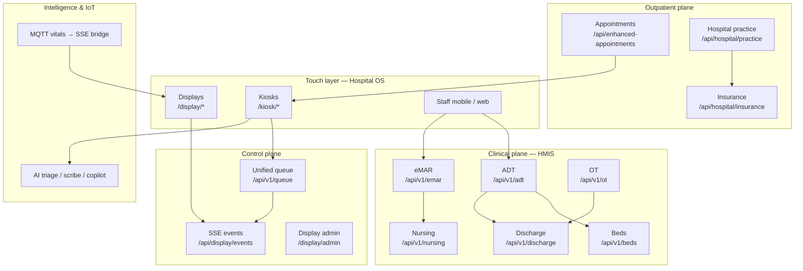

---

## 3. Patient entry paths (four front doors)

Every patient enters through one of four paths. All OPD/ER waiting uses the **unified queue** (`hospital_queue_entries`).

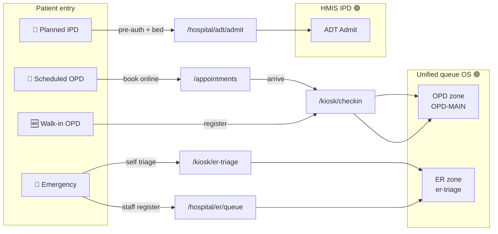

| Path | Primary UI | Key APIs | Queue? | Converts to IPD? |
|------|------------|----------|--------|------------------|
| Scheduled OPD | `/kiosk/checkin`, `/appointments` | `POST /api/enhanced-appointments/book`, `POST /api/display/checkin/issue-token` | 🟢 Yes (`scheduled`) | `POST /api/v1/adt/convert-op-to-ip` |
| Walk-in OPD | `/kiosk/checkin` | `POST /api/display/kiosk/register` | 🟢 Yes (`walk_in`) | Same |
| Emergency | `/kiosk/er-triage`, `/hospital/er/queue` | `POST /api/display/kiosk/er-triage`, `POST /api/v1/er/register` | 🟢 ER queue | `POST /api/v1/adt/er-to-ip` |
| Elective IPD | `/hospital/adt/admit` | `POST /api/v1/beds/reserve`, `POST /api/v1/adt/admit` | No | — |

---

## 4. Master patient journey — admission to discharge

High-level swimlane for **all** paths converging on IPD discharge (OPD-only patients exit after consult).

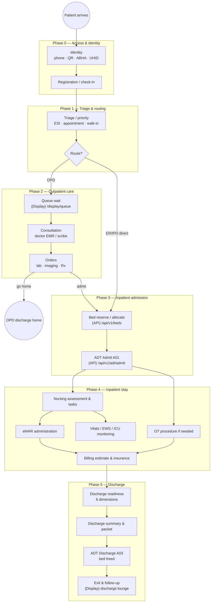

---

## 5. Detailed patient workflows

### 5.1 Scheduled OPD (appointment → consult → home or admit)

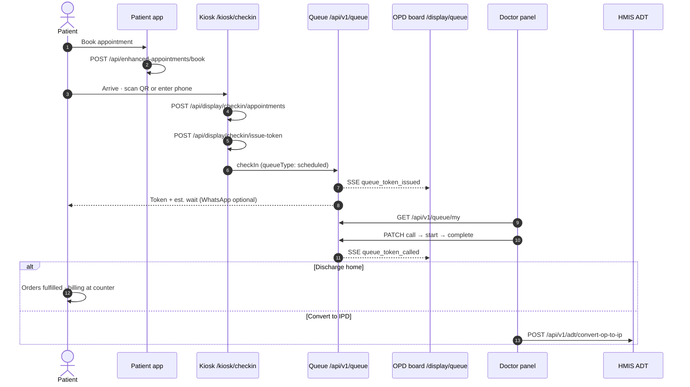

| Step | Actor | Screen / API | Output |
|------|-------|--------------|--------|
| 1 | Patient | `/appointments` → book | Appointment record |
| 2 | Patient | `/kiosk/checkin` → phone / QR | Appointment matched |
| 3 | System | `(API) POST /api/display/checkin/issue-token` | Queue token `A-###` |
| 4 | Patient | `{Display}` `/display/queue` | Token called on wall + TTS |
| 5 | Doctor | `QueueManagementPanel` → `/api/v1/queue` | Consultation |
| 6 | Doctor | `/hospital/ehr`, prescriptions, lab orders | Clinical documentation |
| 7a | Patient | Pharmacy / billing counter | OPD exit |
| 7b | Doctor | `/hospital/adt/admit` → convert OP→IP | IPD path (§5.4) |

---

### 5.2 Walk-in OPD (kiosk registration → queue → consult)

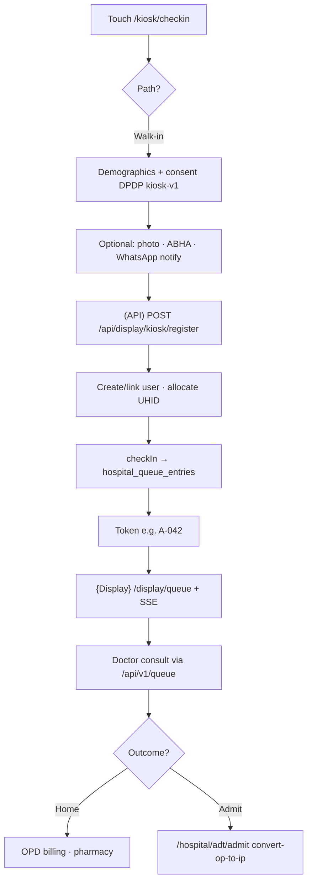

**Kiosk APIs (🟢):**

| Action | Endpoint |
|--------|----------|
| QR parse | `POST /api/display/kiosk/parse-qr` |
| Walk-in register | `POST /api/display/kiosk/register` |
| Photo | `POST /api/display/kiosk/photo` |
| ABHA OTP | `POST /api/abdm/kiosk/abha/init`, `/verify` |

---

### 5.3 Emergency (ER triage → treat → admit or discharge)

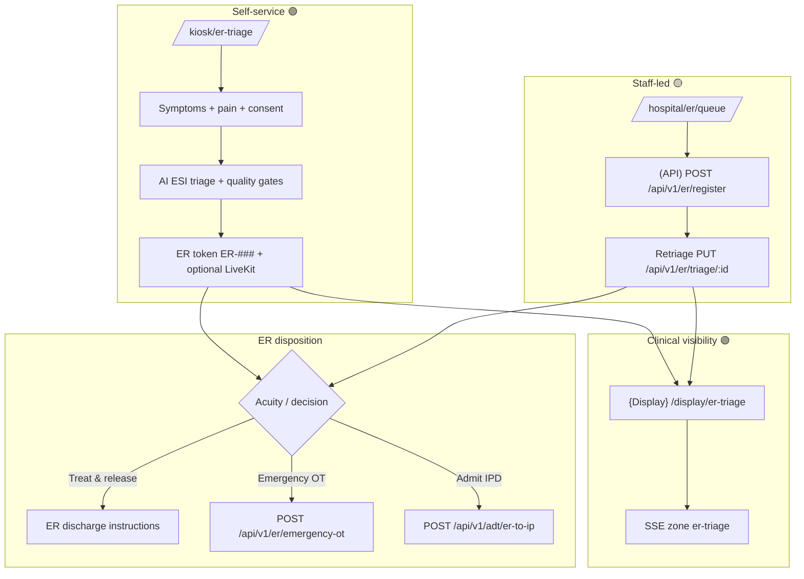

| ESI level | Queue priority | Typical routing |
|-----------|----------------|-----------------|
| ESI-1 | 100 (resuscitation) | Code teams · immediate bed/OT |
| ESI-2 | 85 (emergent) | Emergency OT or ICU eval |
| ESI-3 | 70 (urgent) | ER bay → ward when bed ready |
| ESI-4/5 | 55 / 40 | Fast track · observe · discharge |

---

### 5.4 Inpatient admission (elective / converted / ER)

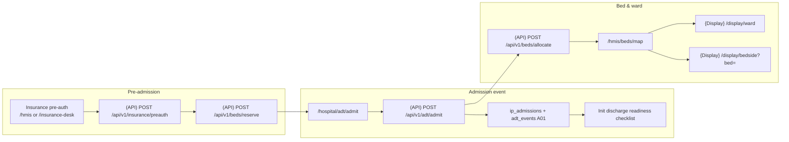

**Admission types (`adt.service.js`):**

| Type | Source | API |
|------|--------|-----|
| `elective` | Planned surgery / admission | `POST /api/v1/adt/admit` |
| `op_converted` | After OPD consult | `POST /api/v1/adt/convert-op-to-ip` |
| `er` | From ER | `POST /api/v1/adt/er-to-ip` |
| `emergency` | Bypass reservation token | `admit` with emergency flag |

---

### 5.5 Inpatient stay (nursing · eMAR · OT · monitoring)

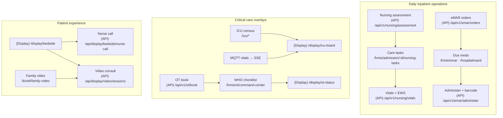

---

### 5.6 Discharge (readiness → summary → bed release)

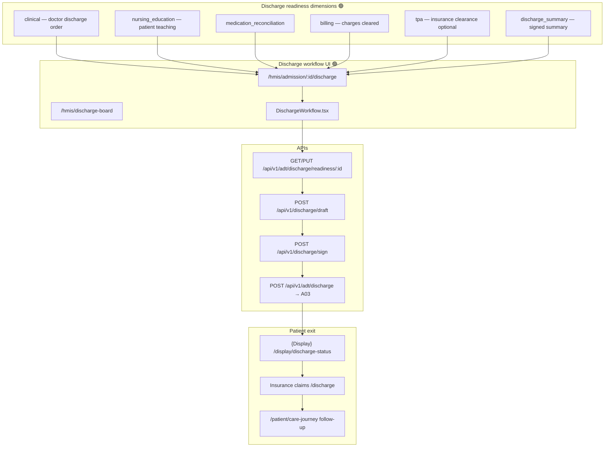

**Discharge gate:** `POST /api/v1/adt/discharge` blocks until mandatory readiness dimensions are complete (override roles: `medical_director`, `discharge_officer`).

---

## 6. Operations charts

### 6.1 Department operations map

Who does what, when, on which screen.

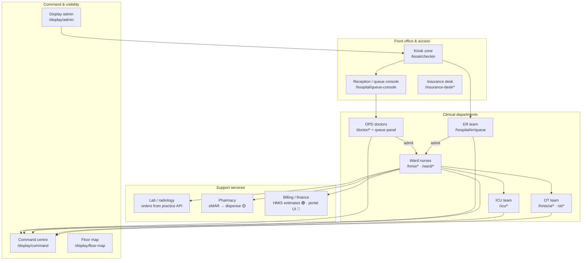

---

### 6.2 Queue operations (Smart Queue OS)

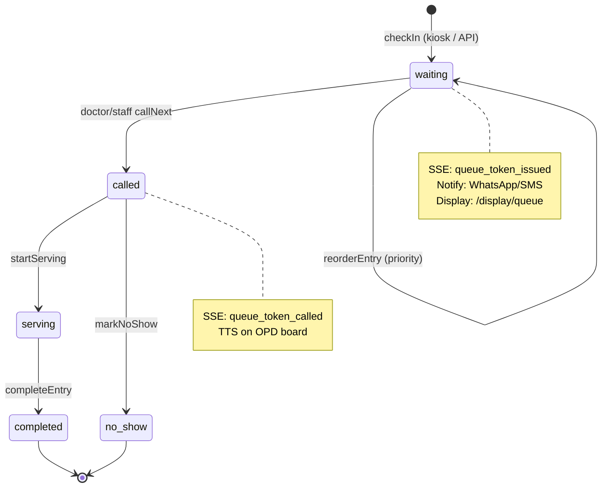

| Operation | Role | API |
|-----------|------|-----|
| Issue token | Kiosk / reception | `POST /api/display/kiosk/register` or `check-in` |
| View board | Public display | `GET /api/v1/queue/board` |
| Call patient | Doctor | `PATCH /api/v1/queue/:id/call` |
| Start consult | Doctor | `PATCH /api/v1/queue/:id/start` |
| Complete | Doctor | `PATCH /api/v1/queue/:id/complete` |
| Console override | Reception | `GET /api/v1/queue/console`, `PATCH .../call-staff` |
| Analytics | Admin | `GET /api/v1/queue/analytics/hospital` |

---

### 6.3 ADT event timeline (inpatient operations)

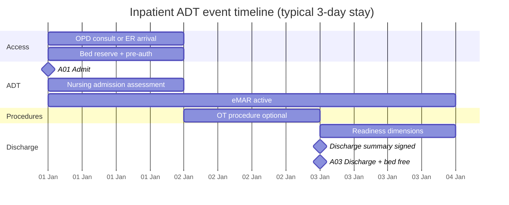

| HL7 ADT | MediQzy event | API | Bed state |
|---------|---------------|-----|-----------|
| A01 | Admit | `POST /api/v1/adt/admit` | Occupied |
| A02 | Transfer | `POST /api/v1/adt/transfer` | Reassigned |
| A03 | Discharge | `POST /api/v1/adt/discharge` | Available |
| A11 | Cancel admit | `POST /api/v1/adt/cancel` | Released |

---

### 6.4 Display & kiosk touchpoints by journey stage

| Journey stage | Patient sees | Staff sees | APIs / events |
|---------------|--------------|------------|---------------|
| Arrival | `{Display}` signage `/display/signage` | Floor map `/display/floor-map` | CMS schedules |
| Registration | `/kiosk/checkin` | Queue console `/hospital/queue-console` | kiosk register APIs |
| OPD wait | `/display/queue` | Doctor queue panel | SSE `queue_token_*` |
| ER wait | `/display/er-triage` | `/hospital/er/queue` | ER queue + vitals |
| Ward stay | `/display/bedside` | `/display/ward` | nurse call, vitals |
| ICU | — | `/display/icu-board` | MQTT → `vitals_update` |
| OT | Family waiting area | `/display/ot-status` | OT status API |
| Family visit | `/kiosk/family-video` | Bedside video overlay | LiveKit sessions |
| Discharge | `/display/discharge-status` | `/hmis/discharge-board` | readiness APIs |
| Command | — | `/display/command` | census + KPIs |

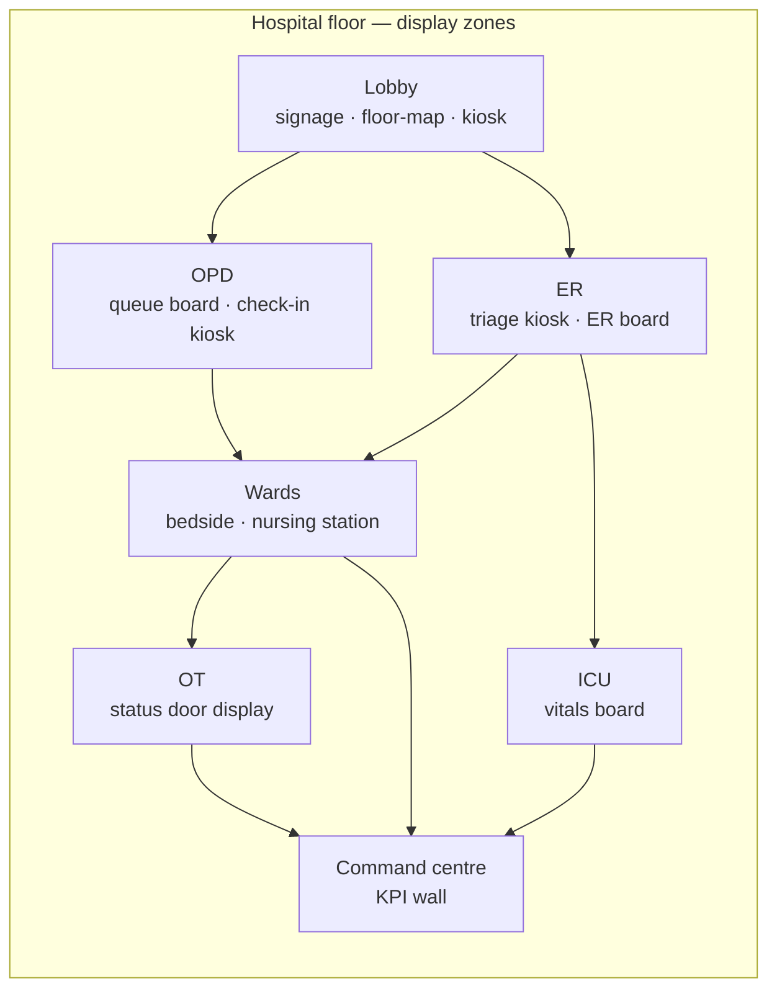

---

### 6.5 Role responsibility matrix (RACI summary)

| Activity | Reception | Nurse | Doctor | OT | Billing | Insurance | Patient |
|----------|:---------:|:-----:|:------:|:--:|:-------:|:---------:|:-------:|
| Kiosk check-in | I | — | — | — | — | — | **R** |
| Queue call | **R** | C | **A** | — | — | — | I |
| OPD consult | I | — | **R** | — | — | — | **R** |
| Bed reservation | C | I | C | — | — | C | I |
| ADT admit | C | **R** | **A** | — | I | C | I |
| eMAR administer | — | **R** | **A** | — | — | — | I |
| OT procedure | — | C | **A** | **R** | — | — | I |
| Discharge readiness | I | **R** | **A** | — | **R** | C | **R** |
| ADT discharge | C | C | **A** | — | **R** | C | I |

**R** = Responsible · **A** = Accountable · **C** = Consulted · **I** = Informed

---

### 6.6 Insurance & billing operations overlay

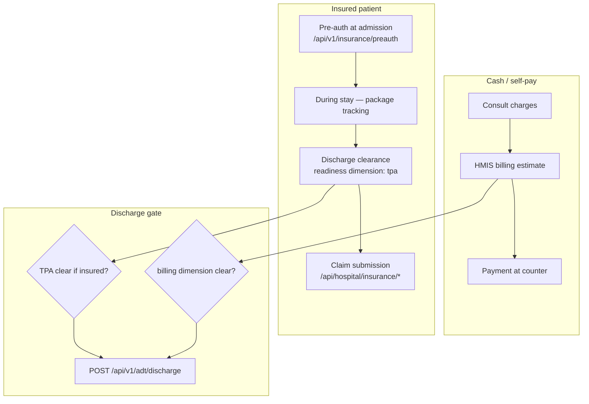

---

## 7. End-to-end swimlane — elective surgery patient (7-day path)

Example: planned cholecystectomy with insurance.

| Day | Patient action | Operations / clinical | System touchpoints |
|-----|----------------|----------------------|-------------------|
| D-7 | Books pre-op OPD | Surgeon consult | `/appointments`, `/doctor/*` |
| D-3 | Insurance desk visit | Pre-auth submitted | `/insurance-desk`, `POST /api/v1/insurance/preauth` |
| D-1 | Arrives for pre-admission | Bed reserved, labs | `/hospital/adt/admit`, `POST /api/v1/beds/reserve` |
| D0 AM | Admission | Nursing intake, consent | `POST /api/v1/adt/admit`, `/hmis/admission/:id/nursing-tasks` |
| D0 PM | OT | WHO checklist, anesthesia | `/hmis/ot/command-center`, `{Display}` `/display/ot-status` |
| D0 post | Recovery ward | eMAR, vitals | `/hmis/emar`, `/display/ward` |
| D1 | Ward stay | Mobilisation, diet | Bedside `/display/bedside`, nurse call API |
| D2 | Discharge prep | Med rec, education | `/hmis/admission/:id/discharge`, readiness APIs |
| D2 PM | Exit | Summary + claim | `POST /api/v1/adt/discharge`, `{Display}` `/display/discharge-status` |

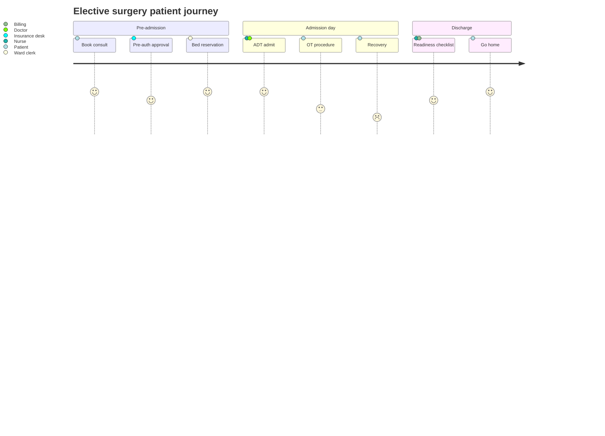

---

## 8. API quick reference (by workflow phase)

| Phase | Primary routes |
|-------|----------------|
| Identity / kiosk | `/api/display/kiosk/*`, `/api/abdm/kiosk/*`, `/api/display/checkin/*` |
| Queue | `/api/v1/queue/*`, `/api/display/queue`, `/api/display/events` |
| Appointments | `/api/enhanced-appointments/*` |
| ADT | `/api/v1/adt/*` |
| Beds | `/api/v1/beds/*` |
| Nursing | `/api/v1/nursing/*`, `/api/v1/echart/*` |
| eMAR | `/api/v1/emar/*` |
| ER | `/api/v1/er/*`, `/api/display/kiosk/er-triage` |
| OT | `/api/v1/ot/*`, `/api/v1/anesthesia/*` |
| ICU | `/api/v1/icu/*` |
| Discharge | `/api/v1/discharge/*`, `/api/v1/adt/discharge/readiness/*` |
| Billing | `/api/v1/billing/estimate/*` |
| Insurance | `/api/hospital/insurance/*`, `/api/v1/insurance/preauth` |
| Displays | `/api/display/*` (board, command, floor-map, video, nurse-call) |

---

## 9. Implementation maturity (June 2026)

| Workflow segment | Status | Notes |
|------------------|--------|-------|
| Scheduled OPD booking → kiosk → queue → consult | 🟢 Live | Unified queue + SSE |
| Walk-in kiosk registration + UHID | 🟢 Live | QR, photo, ABHA, notify |
| ER kiosk AI triage + video | 🟢 Live | SaMD quality gates on ESI |
| HMIS ADT / beds / eMAR / nursing | 🟢 Backend + key UIs | Jest tests exist |
| OT scheduling + command center | 🟢 Backend | Display board 🟡 |
| Discharge readiness + ADT A03 | 🟢 Live | 6-dimension checklist |
| Insurance / TPA | 🟢 ~85% | Claims + pre-auth |
| ER staff queue (`er_visits`) | 🟡 Partial | Migration GAP-IPD-005 |
| Ward / OT / discharge **displays** | 🟡 Partial | Demo fallback if DB empty |
| Hospital portal beds/billing sidebar | 🔴 Scaffold | Use HMIS routes |
| eMAR → pharmacy dispense loop | 🟡 Open | GAP-IPD-004 |
| Admit→discharge Playwright E2E | 🔴 Open | GAP-QA-001 |

---

## 10. Print-friendly checklist (operations lead)

Use this for go-live walkthroughs.

- [ ] Kiosk devices enrolled in `/display/admin` with `x-device-token`
- [ ] Migration applied: `node server/migrations/20260617-hospital-queue-os.migration.js`
- [ ] HMIS migrations: `node server/run-hmis-migrations.js`
- [ ] OPD board `/display/queue` shows live tokens on SSE
- [ ] Queue console `/hospital/queue-console` can call patients
- [ ] Doctor panel uses `/api/v1/queue` (not legacy `/api/doctor/queue`)
- [ ] Bed map `/hmis/beds/map` reflects real allocations
- [ ] eMAR due list populates on `/hmis/emar`
- [ ] Discharge board shows readiness dimensions
- [ ] Command centre `/display/command` shows census KPIs
- [ ] MQTT_BROKER_URL set if ICU live vitals required

---

## Document history

| Version | Date | Changes |
|---------|------|---------|
| 1.0 | 2026-06-17 | Initial patient + operations workflow charts for Hospital OS |
