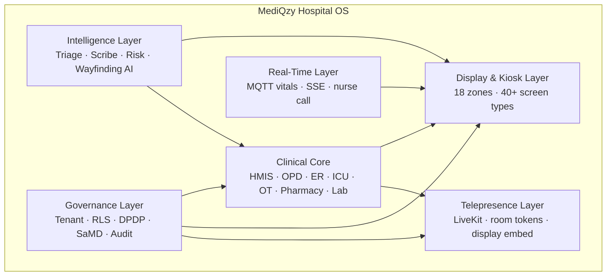
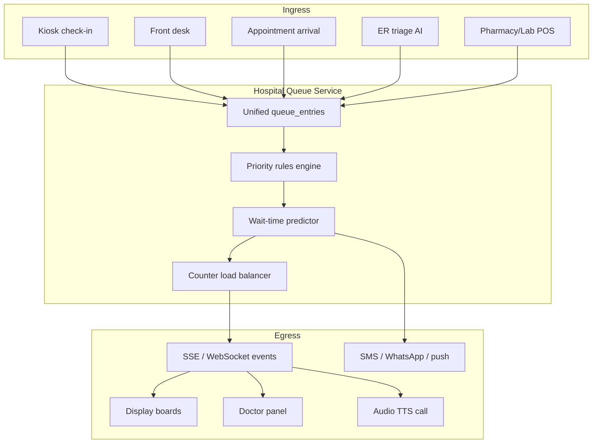
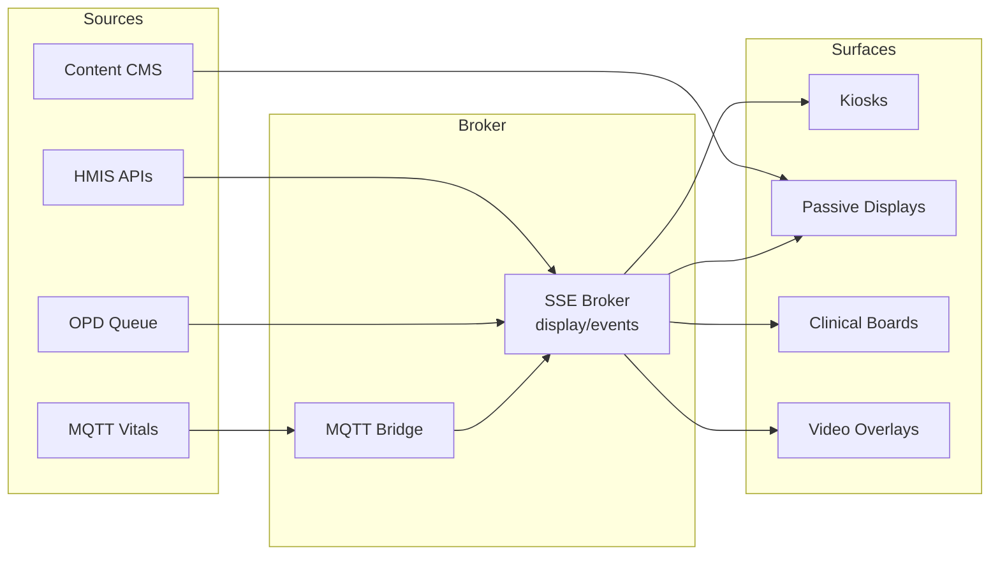

# MediQzy Smart Hospital OS — Vision & Platform Blueprint

| Field | Value |
|-------|-------|
| **Document ID** | MED-HOSP-OS-001 |
| **Version** | 1.1 |
| **Date** | 2026-06-17 |
| **Owner** | AI CTO |
| **Audience** | CEO, PM, BA, Engineering, UX, Delivery, Hospital IT |
| **Status** | ACTIVE — north-star architecture |
| **Related** | `MEDIQZY_DISPLAY_KIOSK_PLAN.md`, `GREENFIELD_HOSPITAL_GAPS_IMPLEMENTATION.md` |

---

## 1. North star

**MediQzy is not a collection of hospital modules. It is a Hospital Operating System.**

Every screen in the building — lobby kiosk, OPD queue board, ICU vitals wall, bedside terminal, OT door panel, family waiting display, command centre — runs on the **same platform** as clinical workflows, billing, and AI. One tenant. One data plane. One control plane. One emergency broadcast. One video layer.

**World-class smart hospital properties we target:**

| Property | What it means |
|----------|---------------|
| **Paperless from arrival** | QR + camera self-registration; no paper forms at lobby |
| **Every surface is smart** | Any browser screen = live clinical or patient experience |
| **Telepresence everywhere** | Video consult ready at bedside, ER, ICU, OT, family lounge |
| **Real-time by default** | SSE + MQTT; no whiteboards, no crackling PA for queue |
| **Privacy by zone** | Public = tokens; clinical = full PHI behind device token + location |
| **AI-native** | Triage, scribe, risk, wayfinding assistant on kiosks and displays |
| **Zero proprietary hardware** | Chrome kiosk mode on commercial panels; optional e-ink door tags |
| **Command & control** | One admin plane: devices, CMS, emergencies, KPIs |

---

## 2. Platform pillars



| Pillar | Role | Key tech |
|--------|------|----------|
| **Clinical Core** | Source of truth for patients, beds, orders, queue | PostgreSQL HMIS, `/api/v1/*` |
| **Display & Kiosk** | Patient info, interactive care, staff boards | React displays, `DisplayShell`, device tokens |
| **Telepresence** | Doctor/nurse/family video on any capable screen | LiveKit, `videoProvider.js` |
| **Real-Time** | Vitals, queue, emergencies, nurse call | SSE broker, MQTT bridge |
| **Intelligence** | AI triage, voice scribe, risk, chat assistant | `llm-provider.js`, quality gates |
| **Governance** | Multi-tenant PHI, consent, model change control | RLS, DPDP, SaMD scorecard |

---

## 3. Display taxonomy (extended)

Building on `MEDIQZY_DISPLAY_KIOSK_PLAN.md` types A–D, we add **video-capable** variants:

| Type | Interaction | Video | Examples |
|------|-------------|-------|----------|
| **A — Self-service kiosk** | Full touch | Optional (tele-triage booth) | Check-in, wayfinding, discharge, family video visit request |
| **B — Public passive display** | None | Loop only (health education) | Queue board, lobby signage, ER public wait |
| **C — Staff clinical display** | Read-only / minimal | **Tele-ICU / OT proctor overlay** | ICU board, ER triage, OT status, ward station |
| **D — Bedside / room terminal** | Patient interactive | **Primary video surface** | Care team, meds, nurse call, **video consult with doctor** |
| **E — Video booth** | Touch + camera + mic | **Primary** | ER tele-triage, remote specialist consult room |
| **F — Command centre** | Staff dashboard | Incident war-room | 86" KPI wall, census, OT utilisation, Code Blue map |

**Design rule:** Any Type **D** or **E** screen must ship with `getUserMedia` + LiveKit room join capability. Type **C** screens support **incoming** video overlay (tele-intensivist joins ICU wall).

---

## 4. Zone catalog — smart hospital coverage

Full zone specs live in `MEDIQZY_DISPLAY_KIOSK_PLAN.md` (Zones 1–18). Summary with **implementation maturity**:

| Zone | Primary displays | Video-ready target | Built today | Gap IDs |
|------|------------------|-------------------|-------------|---------|
| **1 Lobby** | Check-in kiosk, wayfinding, signage | Tele-triage redirect | Check-in partial | KIOSK-001–007, DISPLAY-002, DISPLAY-003 |
| **2 OPD wait** | Queue board, doctor sub-display, education | Health video loop | Queue display scaffold | DISPLAY-001, VIDEO-001 |
| **3 Registration** | Counter confirm, token display | — | Token via check-in | KIOSK-005 |
| **4 Consult** | Door status, doctor desk | Remote consult on desk | — | DISPLAY-003, VIDEO-001 |
| **5 IPD room** | Bedside terminal, door panel, ward board | **Bedside video consult** | Bedside UI scaffold | DISPLAY-002, DISPLAY-008, VIDEO-003 |
| **6 ICU** | Central board, per-bed, bay door | **Tele-ICU overlay** | ICU board scaffold | DISPLAY-003, VIDEO-004, IOT-001 |
| **7 ER** | Triage board, public wait, ambulance, resus | **ER video booth** | — | DISPLAY-003, VIDEO-002, IOT-001 |
| **8 OT** | Schedule corridor, complex status, room | **Remote proctor / expert** | OT status scaffold | DISPLAY-003, VIDEO-005 |
| **9 Family wait** | Token-based ICU/OT status | **Family video visit kiosk** | — | DISPLAY-004, VIDEO-003 |
| **10–13** | Pharmacy, lab, blood bank, CSSD | — | Blood bank partial | DISPLAY-001 |
| **14–17** | Insurance, dietary, discharge, corridors | Discharge kiosk | Discharge display partial | DISPLAY-002, DISPLAY-004 |
| **18 Admin** | Command centre KPI wall | War-room video | — | DISPLAY-005, HOS-001 |

**Maturity today:** ~10 display React pages exist; most use REST poll + demo data. SSE emergency shell works. LiveKit exists for doctor/patient web consult but **not embedded on hospital displays**. **Queue management is fragmented across three implementations** — see §5.

---

## 5. Smart Queue Management

The queue is the **heartbeat of OPD, ER, pharmacy, and lab**. A world-class hospital OS needs one intelligent queue engine — not three disconnected tables and 15-second polling.

### 5.1 Current state (fragmented)

| Implementation | Location | Scope | Issues |
|----------------|----------|-------|--------|
| **`QueueEntry` (Sequelize)** | `queue-management.model.js`, `/api/doctor/queue/*` | Per-doctor OPD waitlist | Not linked to kiosk or display board; doctor auth only |
| **`checkin_tokens`** | `hospital-display.route.js` | Kiosk check-in tokens | Separate from doctor queue; demo fallbacks |
| **`queue_tokens`** | `GET /api/display/queue` | Display board | **Table may not exist**; hardcoded `avgWaitMins: 12`; demo fallback |
| **BullMQ `/api/queues`** | `queue.route.js` | Background jobs (email) | **Not patient queue** — naming collision |

**Symptoms today:**
- `OPDQueueDisplay` **polls every 15 s** instead of SSE push
- Kiosk issues token → display board may not update (different tables)
- Doctor `QueueManagementPanel` polls every 30 s — no shared event bus
- Wait time = `queueLength × 20 min` (naive); no ML, no doctor-specific consult duration
- No pharmacy/lab/ER unified queue; no patient "you are 3 away" notification

### 5.2 Target — unified smart queue engine



**One table (conceptual):** `hospital_queue_entries`

| Field | Purpose |
|-------|---------|
| `organization_id` | Tenant scope |
| `department` | `opd`, `er`, `pharmacy`, `lab`, `radiology` |
| `token_number` | Public token (A-014, P-032, ER-07) |
| `queue_zone` | Waiting lounge zone for display filter |
| `counter_id` / `doctor_id` | Routing target |
| `patient_id` | Link to user/UHID |
| `priority_score` | Computed from rules engine |
| `triage_level` | ESI 1–5 for ER |
| `status` | `waiting` → `called` → `serving` → `completed` / `no_show` |
| `estimated_wait_minutes` | ML + historical |
| `check_in_at`, `called_at`, `completed_at` | SLA metrics |

### 5.3 "Smart" capabilities

| Capability | Description | Gap |
|------------|-------------|-----|
| **Unified ingress** | Kiosk, walk-in, appointment, ER triage → same queue service | QUEUE-001 |
| **Real-time push** | SSE `queue_updated` / `token_called` < 1 s to all surfaces | QUEUE-002 |
| **Predictive wait** | Per-doctor consult duration history + queue depth + time of day | QUEUE-003 |
| **Priority rules** | ESI > urgent walk-in > scheduled slot > routine; configurable per hospital | QUEUE-004 |
| **Multi-counter balancing** | Auto-assign to shortest queue counter | QUEUE-005 |
| **Proactive patient notify** | "You are 3 patients away" via WhatsApp/SMS/push | QUEUE-006 |
| **Front-desk console** | Drag reorder, call next, transfer counter, mark no-show | QUEUE-007 |
| **Queue analytics** | P50/P90 wait, no-show %, doctor utilisation, SLA breach alerts | QUEUE-008 |

### 5.4 Queue surfaces (who consumes the engine)

| Consumer | Route / UI | Update mode |
|----------|------------|-------------|
| OPD wall board | `/display/queue?zone=OPD-MAIN` | SSE + TTS on `token_called` |
| Doctor sub-display | `/display/queue?zone=OPD-DR1` | SSE filtered by `doctor_id` |
| Doctor EMR panel | `QueueManagementPanel.tsx` | SSE (replace 30 s poll) |
| Door status panel | `/display/doctor-door?doctor=` | SSE on status change |
| Kiosk e-receipt | Token + **live ETA** QR | REST on issue; push on change |
| Pharmacy / lab board | `/display/pharmacy-queue` | SSE |
| ER triage board | `/display/er-triage` | SSE + ESI colour |
| Patient mobile app | `/api/mobile/queue/status` | Push notification |
| Command centre | KPI: avg wait by dept | Analytics API |

### 5.5 Integration with kiosk & displays

```
Kiosk check-in (KIOSK-005)
        ↓
POST /api/v1/queue/check-in  →  hospital_queue_entries
        ↓
SSE pushToZone('opd-waiting', 'token_called', payload)
        ↓
OPDQueueDisplay updates + TTS "Token A-014 Counter 2"
        ↓
Doctor panel receives same event → highlights called patient
```

**Rule:** GAP-KIOSK-005 and GAP-DISPLAY-001 **depend on GAP-QUEUE-001** for production go-live.

### 5.6 Phase placement

| Phase | Queue deliverables |
|-------|-------------------|
| **1b** | Kiosk check-in writes to unified queue (QUEUE-001 minimal) |
| **2a** | SSE push to display boards (QUEUE-002); remove demo data |
| **2b** | ER queue + ESI priority (QUEUE-004); pharmacy/lab queues |
| **3** | Predictive wait + patient notifications (QUEUE-003, QUEUE-006) |
| **4** | Analytics dashboard + ML refinement (QUEUE-008) |

---

## 6. Telepresence architecture (video-call ready displays)

### 5.1 Unified video model

```
Clinical event (admit, consult request, Code Blue, family visit approved)
        ↓
POST /api/display/video/sessions  OR  existing appointment/emergency flow
        ↓
buildLiveKitJoinData() — device-scoped token (patient display, nurse station, doctor)
        ↓
Display receives SSE: video_session_start { roomId, token, role, expiresAt }
        ↓
DisplayShell → VideoOverlay component joins LiveKit room
        ↓
Session end → SSE video_session_end → return to idle content
```

**Reuse:** `server/utils/videoProvider.js`, `livekit-client` (already in doctor voice assistant), `DoctorVideoConsultation.tsx` patterns.

### 5.2 Video scenarios by zone

| Scenario | Initiator | Display endpoint | Priority |
|----------|-----------|------------------|----------|
| Bedside → nurse video | Patient taps on bedside terminal | `/display/bedside?bed=` | P1 |
| Bedside → doctor consult | Doctor schedules / nurse bridges | Bedside + doctor web | P1 |
| ER tele-triage booth | Walk-in at kiosk | `/kiosk/er-triage` (new) | P1 |
| ICU tele-intensivist | Remote intensivist | `/display/icu-board` overlay | P2 |
| OT remote expert | Surgeon requests proctor | `/display/ot-status?room=` | P2 |
| Family video visit | Approved visitor at lounge kiosk | `/kiosk/family-video` | P1 |
| Command war-room | Incident commander | `/display/command` | P2 |

### 5.3 Hardware requirements (video displays)

| Surface | Min spec | Notes |
|---------|----------|-------|
| Bedside terminal | 15" touch, front camera, speaker, mic | Wall mount, PoE preferred |
| ER video booth | 21" touch, HD cam, noise-cancelling mic | Privacy booth or curtained alcove |
| ICU/OT staff wall | 55"+, optional cam for tele-ICU | Restricted area; cam optional |
| Family kiosk | 21" touch, cam | Consent + visit window enforcement |

All require **HTTPS** and Chrome kiosk mode with persistent `deviceToken` in URL or local storage.

---

## 7. Interactive patient care kiosks (beyond check-in)

| Kiosk route | Purpose | Data sources |
|-------------|---------|--------------|
| `/kiosk/checkin` | Appointment check-in + QR registration | Appointments, queue |
| `/kiosk/register` | Walk-in new patient (paperless) | Patient, ABHA, UHID |
| `/kiosk/wayfinding` | Floor map, find doctor, departments | CMS, doctor schedule |
| `/kiosk/discharge` | PREMS feedback, bill QR, transport | Discharge, billing |
| `/kiosk/family-video` | Request / join approved video visit | Visitation rules, LiveKit |
| `/kiosk/er-triage` | Symptom intake + video to ER physician | ER queue, triage AI, LiveKit |
| `/kiosk/health-info` | Condition education, post-discharge instructions | CMS, patient record (scoped) |

**Bedside terminal** (`/display/bedside`) is the **in-room interactive care surface**: care team, today's meds, diet, vitals summary, nurse call (real API), meal rating, **one-tap video to nurse**, patient app QR.

---

## 8. Hospital OS control plane

Single admin experience: `/display/admin` (extend) + future `/hospital/command`.

| Capability | API / UI | Status |
|------------|----------|--------|
| Device registry | `display_devices`, `POST /api/display/devices` | Partial |
| Zone assignment | Device `config.zone_id` | Partial |
| SSE emergency broadcast | `POST /api/display/emergency/broadcast` | Works |
| CMS playlist scheduling | — | **Not built** |
| Device health heartbeat | `last_seen` on device | Partial |
| Live KPI command centre | — | **Not built** |
| Per-tenant display branding | — | **Not built** |
| MQTT vitals → display bridge | — | **Not built** |

**GAP-HOS-001** closes the control plane for production greenfield.

---

## 9. Real-time data flows



| Event type | Transport | Latency target |
|------------|-----------|----------------|
| Queue token change | SSE | < 1 s |
| Code Blue / emergency | SSE all zones | < 500 ms |
| ICU vitals update | MQTT → SSE | < 15 s |
| Nurse call from bedside | REST → SSE to ward station | < 2 s |
| Video session invite | SSE to target device | < 3 s |
| CMS slide change | Poll 60 s or SSE | < 60 s |

---

## 10. Futuristic / world-class differentiators (Phase 4+)

| Feature | Description | Gap |
|---------|-------------|-----|
| **Digital twin floor map** | Live bed/OT/ER occupancy on 3D or 2D map | HOS-002 |
| **AI wayfinding voice** | "Take me to Radiology" on lobby kiosk | HOS-003 |
| **Ambient clinical intelligence** | Display highlights NEWS2 deterioration before nurse pages | IOT-002 |
| **Unified patient journey timeline** | Family display shows privacy-safe milestone progress | DISPLAY-004 |
| **Smart room** | Bedside auto-identifies admitted patient via bed assignment | DISPLAY-002 |
| **Predictive queue** | OPD display shows ML-estimated wait, not static | QUEUE-003 |
| **Cross-campus display mesh** | Multi-building SSE fan-out | HOS-001 |

---

## 11. Implementation roadmap (Display OS)

Aligned with `GREENFIELD_HOSPITAL_GAPS_IMPLEMENTATION.md` clinical phases:

| Phase | Display OS deliverables | Gap IDs |
|-------|-------------------------|---------|
| **1b — Paperless lobby** | QR registration, check-in hardening | KIOSK-001–007, **QUEUE-001** |
| **2a — Info displays live** | Queue, signage, pharmacy/lab boards on real data | DISPLAY-001, HOS-001, **QUEUE-002** |
| **2b — Clinical boards** | ER, ICU, OT, ward displays + MQTT bridge | DISPLAY-003, IOT-001, **QUEUE-004** |
| **2c — Interactive care** | Bedside nurse call API, discharge kiosk, wayfinding | DISPLAY-002, DISPLAY-004 |
| **3 — Telepresence** | Video SDK on bedside + ER booth + family kiosk | VIDEO-001–003, **QUEUE-003, QUEUE-006** |
| **4 — Command & AI** | Executive wall, tele-ICU, digital twin | DISPLAY-005, VIDEO-004–005, HOS-002–003 |

### Phase 2a exit gate (info displays)

- [ ] OPD queue board shows live tokens from production queue (no mock)
- [ ] ≥ 1 lobby signage screen on CMS schedule
- [ ] Device registry: all prod screens enrolled with heartbeat
- [ ] Emergency broadcast tested on every enrolled device

### Phase 3 exit gate (telepresence)

- [ ] Bedside patient can start nurse video call; nurse answers on ward station or web
- [ ] ER tele-triage booth connects to ER physician LiveKit room
- [ ] Family video visit enforces visitation policy + consent

---

## 12. Existing code to extend (do not fork)

| Asset | Path | Extend for |
|-------|------|------------|
| Display shell + SSE | `client/src/pages/display/DisplayShell.tsx` | Video overlay, device token |
| Display pages | `client/src/pages/display/*.tsx` | Wire to HMIS APIs |
| Display API | `server/routes/hospital-display.route.js` | Video sessions, nurse call, CMS |
| LiveKit tokens | `server/utils/videoProvider.js` | Device-scoped join tokens |
| Video consult UI | `DoctorVideoConsultation.tsx`, `VideoConsultation.tsx` | Extract `VideoRoom` component |
| Doctor queue API | `queue-management.route.js`, `QueueManagementPanel.tsx` | Merge into unified queue service |
| Display queue poll | `OPDQueueDisplay.tsx` | Replace 15 s poll with SSE |
| Kiosk tokens | `hospital-display.route.js` `checkin_tokens` | Merge into `hospital_queue_entries` |
| Kiosk plan zones | `docs/hospital/MEDIQZY_DISPLAY_KIOSK_PLAN.md` | Zone-by-zone acceptance |
| ZXing QR | `HospitalMRD.tsx` | All registration kiosks |
| IoT vitals | MQTT consumers (ICU module) | Bridge to SSE |

---

## 13. Security & compliance (displays)

| Risk | Mitigation |
|------|------------|
| PHI on public screen | Zone policy engine; public routes never return full name |
| Stolen device token | Revoke in admin; token bound to `organization_id` + zone |
| Video eavesdropping | Short-lived LiveKit tokens; room name unguessable |
| Kiosk session bleed | Idle timeout; clear camera buffers on reset |
| Family video abuse | Visitation approval workflow; time-boxed rooms |
| DPDP | Consent on camera use (KIOSK-006); signage privacy notice |

---

## 14. Related documents

| Document | Purpose |
|----------|---------|
| `GREENFIELD_HOSPITAL_GAPS_IMPLEMENTATION.md` | Gap IDs, acceptance criteria, phase gates |
| `MEDIQZY_DISPLAY_KIOSK_PLAN.md` | Zone hardware + content specs |
| `HMIS_PATIENT_JOURNEY_IMPLEMENTATION_PLAN.md` | Clinical backend for display data |
| `docs/ai/SAMD_READINESS_SCORECARD.md` | AI on kiosk/triage displays |

---

## 15. Document maintenance

| Version | Date | Changes |
|---------|------|---------|
| 1.0 | 2026-06-17 | Initial Smart Hospital OS vision — displays, kiosks, video, control plane |
| 1.1 | 2026-06-17 | Smart Queue Management (§5) — unified engine, 8 capabilities, fragmentation analysis |

**Next review:** 2026-07-15

---

*MediQzy Hospital OS: one platform for clinical care, every screen, and telepresence at world-class standard.*
