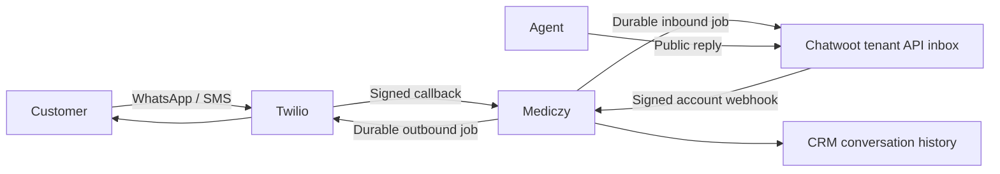

# Tenant Chatwoot Bridge

Mediczy receives customer messages and sends channel replies. Chatwoot at
https://chat.mediqzy.com is the human-agent workspace. Use a separate Chatwoot
account per Mediczy CRM tenant, and an API inbox per receiving channel/address.
Hospital directory record IDs are not automatically CRM tenant IDs.

## Message Flow



The CRM and hospital Communication Hubs display tenant connection status,
queued/failed deliveries, and an Open Chatwoot link. Chatwoot-managed CRM threads
open the corresponding Chatwoot conversation for replies. Chatwoot has its own
agent login; Mediczy does not expose service tokens to the browser or provide SSO.
Restrict each hospital's agents to its own Chatwoot account and inboxes.

## Deployment

1. Apply `server/migrations/20261003000000-chatwoot-bridge.migration.js` after
   the CRM migrations. Both CRM and full migration runners include this step.
2. Set `CHATWOOT_URL=https://chat.mediqzy.com` and `CHATWOOT_ENABLED=true` in
   the server environment. The default is disabled. Restart the server after
   changing the global switch so the queue worker starts.
3. Store each tenant's Chatwoot API token, account webhook secret, and existing
   Twilio credentials in the deployment secret store/server environment. The
   database stores environment variable names, not their values.
4. In the tenant's Chatwoot account, create an **API inbox**. Add an account
   webhook at `https://<mediczy-api-host>/api/chatwoot/webhook` subscribed to
   `message_created` and `conversation_status_changed`. Save its signing secret
   in that tenant's webhook-secret environment variable. Confirm the installed
   Chatwoot version sends the timestamp and HMAC signature headers.
5. Validate the mapping with the setup command below; add `--apply` to persist
   it disabled. Add both `--apply --enable` to activate it after channel and
   webhook configuration is ready.
6. Point the tenant's Twilio receiving-number callback to the exact
   `--webhook-url` used below. Changing the URL or query string invalidates
   Twilio signature validation.
7. Use Check Chatwoot connection in the tenant's Communication Hub, then send
   one customer test message and one agent text reply. Verify both directions
   in CRM history and the provider's delivery logs.

```bash
node server/scripts/configure-chatwoot.mjs \
  --tenant-id <CRM_TENANT_ID> \
  --account-id <CHATWOOT_ACCOUNT_ID> \
  --inbox-id <CHATWOOT_API_INBOX_ID> \
  --channel whatsapp \
  --address <E164_RECEIVING_NUMBER> \
  --api-token-env CHATWOOT_MEDSTAR_API_TOKEN \
  --webhook-secret-env CHATWOOT_MEDSTAR_WEBHOOK_SECRET \
  --credentials-prefix CHATWOOT_MEDSTAR_WHATSAPP \
  --webhook-url https://<mediczy-api-host>/api/chatwoot/channels/twilio
```

The command checks CRM tenant existence, server credential availability, remote
API inbox membership, and conflicting tenant/account/number mappings. It defaults
to validation without writes. It refuses reassignment of existing mappings.
The existing `/api/whatsapp-production/webhook` is also supported; configured
tenant numbers enter Chatwoot before the legacy handler.

## Scope and Recovery

- WhatsApp and SMS have signed Twilio ingress and text reply delivery.
- Email has an SMTP text reply adapter and the common `enqueueInbound` service,
  but no email ingestion route is added here. In-app ingress/delivery and other
  providers require adapters. Do not enable these until those adapters exist.
- Media-only inbound messages show an attachment notice. Media transfer,
  agent attachments, rich messages, WhatsApp templates, and provider delivery
  status callbacks are not implemented in this bridge. Unsupported agent replies
  fail with a private Chatwoot note and a failed CRM event.
- Inbound jobs retry up to five times, recovering remote contacts/conversations
  and checking message history for the bridge job marker. Duplicate customer
  callbacks and agent webhooks enqueue only one job.
- Jobs process in conversation order. An interrupted or timed-out outbound send
  is `uncertain`; it is not automatically repeated, and subsequent outbound
  replies wait for reconciliation. Check the provider before marking it `sent`
  or returning it to `pending`. Private notes and bridge-generated messages never
  enter customer delivery.
- To pause a tenant, set its account/inbox `enabled=false`. To stop the bridge
  globally, set `CHATWOOT_ENABLED=false` and restart. The existing Rocket.Chat
  integration still handles unconfigured legacy traffic; full removal requires
  migrating its support-widget/ticket consumers separately.

## Medstar Activation

The earlier directory lookup found Medstar Hospital (`6680`) and Medstar
Speciality Hospital (`4618`) with `tenant_id=NULL`, without a matching CRM tenant.
Neither directory ID can safely identify the intended CRM tenant. Activation
requires the confirmed CRM tenant/organization ID, Chatwoot account ID, API inbox
ID, receiving number, and tenant credentials. No Medstar mapping or production
migration was applied during implementation.

## Verification

```bash
# Unit checks work without a database. Integration cases require an isolated
# loopback PostgreSQL database whose name begins with chatwoot_test.
CHATWOOT_TEST_DATABASE_URL=postgresql://<user>@127.0.0.1:<port>/chatwoot_test \
  node --test server/tests/chatwoot-bridge.test.mjs
npm --prefix client test -- src/components/communication/ChatwootWorkspace.test.tsx
```

References: [Chatwoot webhooks and signature verification](https://www.chatwoot.com/hc/user-guide/articles/1677693021-how-to-use-webhooks),
[Chatwoot application API](https://developers.chatwoot.com/api-reference/introduction).
