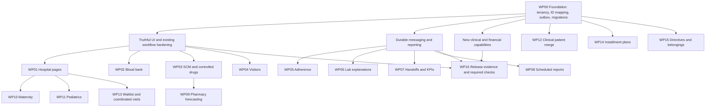

# Mediqzy Hospital Gap Implementation Plan

Created: 8 November 2026  
Planning base: Mediqzy main `4d20cb72`  
Audit evidence: [Hospital micro audit](../audits/MEDCORE_MEDIQZY_HOSPITAL_MICRO_AUDIT_2026-11-08.md)  
Structured backlog: [implementation-backlog.csv](medcore-hospital-implementation-2026-11-08/implementation-backlog.csv)  
Reference bundle: [Medcore hospital reference](../reference/medcore-hospital-2026-11-08/README.md)

## Outcome

This plan closes the 31 gaps from the hospital comparison without replacing
working Mediqzy hospital modules or importing a second hospital platform.
Existing Mediqzy patient, hospital, SCM, lab, billing, auth and notification
systems remain the systems of record. Medcore material is available only as a
quarantined reference for workflow design and tests.

The implementation has two tracks:

1. Make existing clinical and operational workflows truthful, atomic,
   tenant-scoped and observable.
2. Add the missing hospital capabilities only after their data model, clinical
   policy and acceptance scenarios are agreed.

No work package authorizes a production migration, automatic clinical decision,
external notification or third-party integration by itself. Each production
release needs the normal change review and the package's evidence checklist.

## Execution log

### 9 November 2026 — WP08 report scheduling slice in the working tree

- Replaced the mounted admin Reports placeholder with a real API-backed page:
  administrators can load approved templates, generate a report and create or
  inspect schedules without fabricated dashboard totals.
- Schedules are now persisted in `scheduled_reports`, restored after a process
  restart and guarded per schedule with the shared cron lease so multiple app
  instances do not generate the same report concurrently.
- Added `20261109000200-report-schedule-durability.migration.js` to create the
  required schedule/archive storage on environments where the legacy Phase 2/3
  migration was not run. It is registered but not applied from this tree.
- CSV/XLSX download links now point at the mounted admin reports route.

The delivery part of F21 remains intentionally disabled: arbitrary recipient
email needs a configured, approved outbound-report policy and delivery receipt
contract. Schedules archive generated output; they do not claim an email was
delivered when no provider receipt exists.

Validated locally with:

```bash
npm test -- --runInBand server/__tests__/report-schedule-durability.test.js
npx eslint src/pages/admin/AdminPlaceholders.tsx --quiet
npm run build:dev
```

### 9 November 2026 — WP03 SCM receipt and controlled-substance integrity slice in the working tree

- GRN creation now validates every submitted PO line under a row lock. The
  server derives the item from the PO, rejects duplicate, foreign, non-positive
  or over-received lines, then creates the GRN, line records, PO status,
  approval request and audit event in one tenant-bound transaction.
- GRN inventory posting now requires an independently approved authorization.
  Posting is atomic and idempotent per GRN line; a retry after a completed
  posting returns success without a duplicate receipt, while historical partial
  postings are stopped for reconciliation rather than silently extended.
- `20261109000100-scm-receipt-integrity.migration.js` adds the immutable
  `grn_line_id` ledger link and a partial unique index. It is registered with
  the migration runner but has not been applied from this working tree.
- Controlled-drug movements accept only positive quantities and explicit
  directions (`receipt`, `return`, `dispense`, `wastage`). They require a
  witness and source reference; dispense additionally requires a patient. The
  route verifies the item classification, serializes same-item movements,
  prevents negative stock and writes the controlled log, ledger mutation and
  audit event atomically. The UI no longer supplies invented witness/patient or
  source data.
- A distinct SCM approval endpoint and UI control now let an approver decide a
  pending GRN posting; receiving and posting use their existing separate role
  permissions.

These are conservative operational defaults chosen under the 9 November build
approval. They still need pharmacy/controlled-substance policy owner review
(accepted directions, emergency exception, witness identity and reconciliation
SOP) before a production release.

Validated locally with:

```bash
npm test -- --runInBand \
  server/__tests__/scm-receipt-integrity.test.js \
  server/__tests__/medcore-adherence-integrity.test.js \
  server/__tests__/blood-bank-issue-state.test.js \
  server/__tests__/display-wayfinding-ot-routes.test.js
npx eslint src/pages/dept/SCMModulePages.tsx --quiet
node --check server/routes/scm.route.js
git diff --check
```

### 9 November 2026 — WP04 visitor-pass slice in the working tree

- Added `security_visitor_passes`, a canonical organization-scoped pass record
  with immutable pass ID, identity, destination, pass type, check-in/out,
  actor attribution and optimistic version.
- Visitor reads and writes no longer reconstruct an entity from the latest audit
  event or substitute sample people. Empty is represented as an empty register.
- The mounted security page can issue a pass and check it out. Updates require
  `expectedVersion`, so a stale terminal action receives a conflict instead of
  overwriting another operator's changes.
- Audit events remain evidence of each action, not the mutable source of truth.

This is the persistence and UI portion of WP04. Admission binding, blacklist,
occupancy and visiting-window policy remain configuration/governance work and
are intentionally not inferred from placeholder text.

### 8 November 2026 — WP05 and adjacent adoption-integrity slice in the working tree

- Added a feature-gated application startup registration for the adoption
  adherence cron. It continues to use the shared cron lease/health registry.
- A reminder plan now requires timezone, local start/end dates and daily local
  times. The service materializes uniquely keyed occurrences before returning
  success, rather than accepting a plan with no reminder event.
- Due events are claimed with `FOR UPDATE SKIP LOCKED` before notification. An
  occurrence carries a stable notification event ID, so a retry after a provider
  handoff uses the notification service's existing event deduplication.
- Quiet-hours events become `deferred` with a timezone-correct next attempt;
  they are not marked skipped or silently discarded.
- Lab-explanation delivery is atomically claimed before send and uses the same
  stable notification-event deduplication boundary. A failed provider call
  releases the claim with its error; a successful call is acknowledged against
  that claim token.
- Handoff creation retains the UI's `handoffReason`; transitions now permit
  only `pending → claimed` and owner-only `claimed → completed/cancelled`.
  Doctor approval is restricted to doctor/admin/medical-director roles, matching
  the existing doctor-approval API wording.

The additive migration
`20261108000100-adherence-occurrence-integrity.migration.js` is required before
these paths are enabled in an environment. It has not been applied from this
working tree.

Validated locally with:

```bash
npm test -- --runInBand \
  server/__tests__/medcore-adherence-integrity.test.js \
  server/__tests__/blood-bank-issue-state.test.js \
  server/__tests__/display-wayfinding-ot-routes.test.js
npx eslint src/pages/MedCoreWorkbench.tsx \
  src/pages/hospital/HospitalPracticeManagement.tsx src/routes/index.tsx --quiet
```

### 8 November 2026 — WP01 complete in the working tree

The five mounted hospital landing-page aliases no longer render `ManagedSection`
or save generic browser-local updates under operational action labels:

- `/hospital/appointments`, `/hospital/patients` and `/hospital/staff` now
  redirect to the corresponding tab in practice management.
- `/hospital/pharmacy` redirects to the authenticated dispensing queue.
- `/hospital/claims` redirects to the authenticated insurance claims dashboard.
- Practice management no longer writes appointment, patient, staff or resource
  records to `localStorage`, and it shows success only after the server confirms
  the business command. Response adapters retain the fields needed to render a
  newly created appointment without inventing an ID or result.

Validated locally with:

```bash
npx eslint src/pages/hospital/HospitalPracticeManagement.tsx src/routes/index.tsx --quiet
npx tsc --noEmit --pretty false --skipLibCheck
```

The remaining release evidence for this package is the planned authenticated
two-session browser test against a disposable hospital tenant; it was not run
from this working tree because it requires test credentials and a running
backend/database fixture.

### 8 November 2026 — WP02, slice 1 complete in the working tree

The first P0 implementation slice closes the immediately misleading blood-bank
display behavior and the repeated-issue allocation defect:

- `GET /api/display/blood-bank` now aggregates tenant-scoped canonical
  `blood_bank_units` and active requisitions. It returns `503
  blood_inventory_unavailable` if the canonical source cannot be read; it never
  creates demo stock, expiry alerts or requisitions.
- The public display resolves its organization through the existing display
  device/default-organization middleware before querying forced-RLS blood-bank
  tables. It renders an explicit unavailable state rather than stale or
  invented numeric cells.
- Blood requisition issue now permits only the locked `pending → issued`
  transition. A repeated request returns `409 REQUISITION_NOT_ISSUABLE` before
  selecting another unit.
- Regression coverage exercises the canonical display source, unavailable
  response, organization-scoped handle and repeated issue path.

Validated locally with:

```bash
npm test -- --runInBand \
  server/__tests__/blood-bank-issue-state.test.js \
  server/__tests__/display-wayfinding-ot-routes.test.js
npx eslint src/pages/display/BloodBankDisplay.tsx --quiet
```

The next WP02 slice is F03: connect persisted crossmatch and transfusion records
to patient/sample/unit identity, clinical review and issue/return workflow. It
requires the blood-bank clinical owner to approve the compatibility, emergency
exception and bedside verification policy before the state machine is built.

## Delivery model



`M`, `L` and `XL` in the backlog are relative delivery sizes, not calendar
estimates. WP12 is deliberately isolated because patient merge is a cross-domain
data migration with a larger blast radius. WP10, WP11 and WP15 require named
clinical governance approval before build work starts.

## Sequence

### Phase 0 — Foundation and release controls

Complete WP00 and begin WP16 before changing a clinical or financial workflow.
The deliverables are a canonical ID/schema map, transaction-scoped tenant access,
idempotent command/outbox conventions, a migration/recovery playbook, synthetic
two-hospital fixtures and a release evidence template. This phase also records a
provenance/licensing decision for the copied Medcore reference. It does not add
Medcore code to the application.

Exit criteria:

- The disposable test database uses the same privilege and RLS posture as the
  application.
- Every new command has tenant, actor, request ID and expected-version rules.
- A worker crash/retry and connection-pool reuse fixture exists.
- The reference bundle's legal/provenance boundary is documented and approved
  before any literal reuse is considered.

### Phase 1 — Correct existing operational workflows

Deliver WP01 through WP04 first. They remove misleading user interfaces and
protect inventory, controlled-drug, receipt and visitor records already relied
on by hospital operations.

| Package | Findings | Result |
|---|---|---|
| WP01 | F01 | The five mounted landing pages use real APIs/screens and never present local notes as hospital actions. |
| WP02 | F02–F04 | Blood display shows canonical data or clear unavailability; issue/allocation, crossmatch and transfusion state are durable and retry-safe. |
| WP03 | F14–F16 | Controlled-substance and GRN workflows validate business rules and commit atomically. |
| WP04 | F17–F19 | Visitor passes are canonical, usable in the UI and verified under two-tenant RLS conditions. |

Release WP02 only after blood-bank clinical ownership has approved compatibility,
emergency exception and bedside verification policy. Release WP03 only when the
ledger reconciliation fixture passes; an HTTP success response alone is not
evidence of inventory correctness.

### Phase 2 — Patient communication and data-backed intelligence

Deliver WP05 through WP09 using the foundation's outbox and worker conventions.
This completes the adoption workbench workflows before expanding their use.

| Package | Findings | Result |
|---|---|---|
| WP05 | F05–F08 | Timezone-aware recurring adherence occurrences, atomic claims and exactly-once logical delivery. |
| WP06 | F09–F11 | Patient/report-linked lab explanations with versioned clinician review and durable delivery. |
| WP07 | F12–F13 | Handoff ownership state machine and scoped, reproducible KPI computation. |
| WP08 | F20–F21 | Real PDF/XLSX bytes plus durable, restart-safe report schedules and recipient delivery receipts. |
| WP09 | F30 | Pharmacy forecasts built from normalized, scoped consumption data with backtesting. |

Do not use forecast or KPI output to make an automatic procurement or clinical
decision in this phase. The output remains advisory and visibly identifies its
data window, source and availability.

### Phase 3 — New hospital capabilities

Commission these packages by service-line priority after the clinical/data design
review. They can run in parallel after WP00, except where dependencies are shown
in the diagram.

| Package | Findings | Decision needed before build |
|---|---|---|
| WP10 | F22 | Antenatal, labor/partograph, delivery and postnatal scope; approved references and sign-off policy. |
| WP11 | F23 | Pediatric measurement/reference sources, corrected age and immunization relationship. |
| WP12 | F24 | FK inventory, merge authority, conflict policy and external reconciliation method. |
| WP13 | F25–F26 | Waitlist prioritization, offer expiry, multi-clinician travel/resource rules. |
| WP14 | F27 | Financial policy for plans, payment allocation, amendments, credit/refund and reminders. |
| WP15 | F28–F29 | Directive/legal policy, signatories, belongings handover and dispute process. |

WP12 must have a backup/rehearsal and a reversible reconciliation strategy before
the first real merge. A general “undo merge” control is not safe after new
clinical or financial activity and is not an acceptance condition.

## Common implementation rules

All work packages follow these non-negotiable rules:

- Resolve organization, role and actor from authenticated server context. Never
  accept tenant ownership from the client.
- Validate patient, admission, appointment, item and invoice references inside
  the same tenant-scoped transaction.
- Use a durable state transition and idempotency key for any action that can be
  retried, delivered externally or change stock/money/clinical status.
- Write an immutable audit event with the command and outcome. Audit events do
  not replace the canonical mutable record.
- Model unavailable, empty, failed and stale data separately. Never substitute
  demo values or a plausible default in a hospital operational screen.
- Make provider sending asynchronous through the outbox. Mark it delivered only
  after a durable provider receipt or documented reconciliation rule.
- Preserve source values, units, data/reference versions and correction history
  for clinical calculations and AI-generated drafts.
- Ship schema migration, backfill decision, rollback/recovery plan, tests and
  monitoring with the feature.

## Acceptance evidence

Each work package is complete only when its acceptance scenarios in the structured
backlog are automated and reviewed. The minimum release evidence is:

1. Migration rehearsal from a representative pre-change database with an
   integrity report and recovery test.
2. API tests for authorization, tenant isolation, invalid state, retry and
   concurrent commands.
3. Browser test for the mounted action users actually take, including reload,
   empty and failure states.
4. Outbox/worker test for timeout, retry, restart and duplicate worker behavior
   when the package sends a notification or report.
5. Ledger/inventory/clinical invariant test where a package affects stock,
   money, signed data or patient identity.
6. Clinical owner sign-off for WP02, WP06, WP10, WP11 and WP15; finance owner
   sign-off for WP03 and WP14.

WP16 makes these checks required for changed hospital modules and tracks any
existing baseline failures with an owner and expiry. The historical audit
harness remains proof of the prior defects; corrected behavior belongs in the
normal Mediqzy test suites.

## Reference-code use

The [reference bundle](../reference/medcore-hospital-2026-11-08/README.md)
contains 287 exact upstream files and a SHA-256 manifest, arranged outside the
runtime source tree. Use it to locate workflow examples and test cases. It is
not a drop-in package: Medcore depends on its own Prisma schema, shared package,
authentication, tenancy, scheduler and web framework.

The upstream repository has conflicting licensing statements: its `LICENSE`
contains AGPL-3.0 text and its README describes the software as proprietary.
Until the project owner resolves that conflict in writing, implementation must be
clean-room: use the plan and behavioral requirements, write Mediqzy-native code,
and retain the manifest/provenance record. Do not import from the reference
directory or distribute copied files.

## Implementation tracker

The machine-readable source of truth is
[`work-packages.json`](medcore-hospital-implementation-2026-11-08/work-packages.json).
The CSV is designed for ticket import. Each row includes design, data, API and
acceptance details. Update status, assignee, PR and release evidence in your
tracker rather than editing the audit conclusions retrospectively.

When a work package begins, create a short decision record that names the
current Mediqzy commit, the relevant audit findings, the owning canonical tables
and APIs, migration plan, clinical/finance owner where needed, and the test
evidence required for release.
