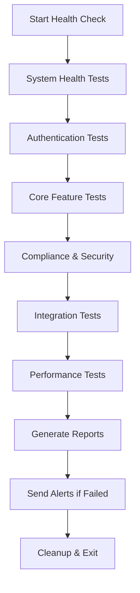

# 🔧 Mediczy Scripts Collection

> **Total Scripts**: 112 organized shell scripts for development, testing, deployment, and administration

## 📁 Script Categories

All scripts are organized into the following categories:

### 🧪 [Testing](./testing/) - 46 scripts
Comprehensive testing suite for all platform features.
- API endpoint testing
- Login & authentication tests
- Feature-specific tests (video, payment, prescription, etc.)
- Production smoke tests
- Integration tests

**Key Scripts:**
- `test-all-credentials.sh` - Test all user credentials
- `test-production-logins.sh` - Verify production login flows
- `comprehensive-test.sh` - Full platform test suite
- `smoke-test.sh` - Quick health check

### 🚀 [Development](./development/) - 18 scripts
Development server management and debugging tools.
- Server start/stop/restart scripts
- Development mode starters
- HMR and WebSocket fixes
- Debug utilities

**Key Scripts:**
- `start-all.sh` - Start all services
- `dev-start.sh` - Start in development mode
- `restart-server.sh` - Restart backend
- `fix-hmr.sh` - Fix hot module reload

### 📦 [Deployment](./deployment/) - 12 scripts
Production deployment and infrastructure setup.
- Production deployment automation
- SSL certificate installation
- Database migrations
- Pre-deployment checks

**Key Scripts:**
- `deploy-production.sh` - Deploy to production
- `install-ssl.sh` - Install SSL certificates
- `pre-deploy-sanity-check.sh` - Pre-deployment validation
- `migrate-all-entities.sh` - Run database migrations

### 🎭 [Demo](./demo/) - 12 scripts
Demo scripts and example workflows.
- Patient creation demos
- Prescription demos
- Doctor-patient workflows
- EMR demonstrations

**Key Scripts:**
- `demo-consultation-prescription.sh` - Full consultation flow
- `demo-auto-prescription.sh` - Auto prescription generation
- `demo-doctor-create-patient.sh` - Doctor creates patient
- `create-test-patient.sh` - Create test patient data

### ✅ [Verification](./verification/) - 9 scripts
System verification and diagnostic tools.
- Configuration verification
- Setup validation
- System diagnostics
- Integration checks

**Key Scripts:**
- `verify-auth-complete.sh` - Verify auth system
- `verify-prescription-system.sh` - Check prescription flow
- `verify-sib-setup.sh` - Validate SIB integration
- `diagnose-patient-issues.sh` - Debug patient issues

### ⚙️ [Setup](./setup/) - 6 scripts
Initial setup and configuration scripts.
- OAuth setup (Google, etc.)
- PostgreSQL migration setup
- Production environment setup
- Feature configuration

**Key Scripts:**
- `setup-google-oauth.sh` - Configure Google OAuth
- `setup-postgres-migration.sh` - Setup PostgreSQL
- `setup-dr-kumar.sh` - Setup test doctor
- `setup-patient-access.sh` - Configure patient access

### 🏭 [Production](./production/) - 5 scripts
Production utilities and diagnostics.
- Sanity checks
- Domain diagnostics
- Firewall troubleshooting
- Production debugging

**Key Scripts:**
- `quick-sanity-check.sh` - Fast production check
- `domain-diagnostic.sh` - Domain/DNS diagnostics
- `sophos-troubleshoot.sh` - Firewall debugging
- `how-to-use-token.sh` - Token usage guide

### 👨‍💼 [Admin](./admin/) - 2 scripts
Admin utilities and commands.
- Admin command shortcuts
- Hospital feature management

**Key Scripts:**
- `admin-commands.sh` - Admin CLI commands
- `advanced-hospital-features.sh` - Hospital admin tools

### 🗄️ [Database](./database/) - 2 scripts
Database management and backup.
- Database backups
- Test user creation

**Key Scripts:**
- `backup-database.sh` - Backup PostgreSQL database
- `create-db-test-users.sh` - Create test users in DB

---

## 🚀 Quick Start

### Run Tests
```bash
# Quick smoke test
./scripts/testing/smoke-test.sh

# Comprehensive test suite
./scripts/testing/comprehensive-test.sh

# Test specific feature
./scripts/testing/test-video-system.sh
```

### Development
```bash
# Start all services
./scripts/development/start-all.sh

# Development mode with nodemon
./scripts/development/dev-start.sh

# Restart server
./scripts/development/restart-server.sh
```

### Deployment
```bash
# Pre-deployment check
./scripts/deployment/pre-deploy-sanity-check.sh

# Deploy to production
./scripts/deployment/deploy-production.sh
```

### Demo & Examples
```bash
# Demo consultation flow
./scripts/demo/demo-consultation-prescription.sh

# Create test patient
./scripts/demo/create-test-patient.sh
```

---

## 📊 Script Statistics

| Category | Scripts | Purpose |
|----------|---------|---------|
| Testing | 46 | QA, validation, integration tests |
| Development | 18 | Server management, debugging |
| Deployment | 12 | Production deployment, SSL |
| Demo | 12 | Examples, workflows |
| Verification | 9 | System checks, diagnostics |
| Setup | 6 | Configuration, initialization |
| Production | 5 | Production utilities |
| Admin | 2 | Admin tools |
| Database | 2 | DB management |

**Total: 112 scripts**

---

## 🎯 Common Tasks

### Test All Logins
```bash
./scripts/testing/test-all-user-logins.sh
```

### Verify Production Readiness
```bash
./scripts/deployment/pre-deployment-verification.sh
./scripts/production/quick-sanity-check.sh
```

### Setup New Environment
```bash
./scripts/setup/setup-postgres-migration.sh
./scripts/setup/setup-google-oauth.sh
```

### Debug Issues
```bash
./scripts/verification/diagnose-patient-issues.sh
./scripts/production/domain-diagnostic.sh
```

---

## 💡 Best Practices

1. **Always run from project root**: `./scripts/category/script.sh`
2. **Check exit codes**: Most scripts return 0 on success, 1 on failure
3. **Review before production**: Test scripts in staging first
4. **Keep scripts updated**: Update when APIs or features change
5. **Use verification scripts**: Run after deployments

---

## 🔍 Finding Scripts

### By Task
- **Testing a feature**: Check `testing/` folder
- **Deploying**: Look in `deployment/`
- **Setting up**: Browse `setup/`
- **Debugging**: Try `verification/` or `production/`

### By Name Pattern
- `test-*` - Testing scripts
- `demo-*` - Demo/example scripts  
- `setup-*` - Setup/configuration scripts
- `verify-*` - Verification scripts
- `deploy-*` - Deployment scripts

---

## 📝 Adding New Scripts

When adding new scripts:
1. Place in appropriate category folder
2. Use descriptive, lowercase names with hyphens
3. Add execute permissions: `chmod +x script.sh`
4. Include header comment with description
5. Return proper exit codes (0 = success, 1 = failure)
6. Update this README if adding major scripts

---

## 🏥 Mediczy - Automated Health Check System

A comprehensive automation functional testing system for daily production monitoring of the Mediczy healthcare platform.

## 📋 Table of Contents

- [Overview](#overview)
- [Features](#features)
- [Quick Start](#quick-start)
- [Architecture](#architecture)
- [Configuration](#configuration)
- [Usage](#usage)
- [Monitoring & Alerts](#monitoring--alerts)
- [Troubleshooting](#troubleshooting)
- [Contributing](#contributing)

## 🎯 Overview

This health check system provides automated functional testing for all critical user functions in the Mediczy platform, ensuring production reliability through:

- **Daily Automated Testing**: Runs comprehensive tests on schedule
- **Multi-Environment Support**: Production, staging, and development environments
- **Comprehensive Coverage**: Tests authentication, core features, compliance, security, and integrations
- **Performance Monitoring**: Tracks response times and system performance
- **Detailed Reporting**: JSON and text reports with historical data
- **Alert System**: Configurable notifications for failures and performance issues

## ✨ Features

### 🔍 Test Coverage

- **System Health**: Server connectivity, database, Redis, frontend availability
- **Authentication**: User/doctor registration, login, protected endpoints
- **Core Features**: Appointments, membership plans, doctor listings, AI doctor
- **Compliance & Security**: GDPR features, audit logs, rate limiting, security headers
- **Integrations**: Firebase FCM, Google Fit OAuth, payment gateways
- **Performance**: Response time monitoring and benchmarking

### 📊 Reporting

- **JSON Reports**: Machine-readable detailed test results
- **Text Summaries**: Human-readable status reports
- **Performance Metrics**: Response time tracking and trends
- **Historical Data**: 30-day retention with log rotation
- **Alert Integration**: Email, Slack, PagerDuty notifications

### 🔧 Automation

- **Cron Integration**: Scheduled daily, hourly, or custom intervals
- **CI/CD Ready**: Jenkins, GitHub Actions, GitLab CI compatible
- **Environment Aware**: Automatic configuration per environment
- **Self-Cleaning**: Automatic log rotation and cleanup

## 🚀 Quick Start

### 1. Installation

```bash
# Clone or navigate to your Mediczy project
cd /path/to/Mediczy

# Run the installation script
./scripts/install-health-checks.sh

# This will:
# - Create necessary directories
# - Set up permissions
# - Offer to install cron jobs
# - Test the installation
```

### 2. First Run

```bash
# Test in development environment
./scripts/daily-health-check.sh development

# Test in staging
./scripts/daily-health-check.sh staging

# Production check (be careful!)
./scripts/daily-health-check.sh production
```

### 3. Check Status

```bash
# Quick status check
./scripts/health-status.sh

# View latest logs
tail -f logs/health-checks/*.log

# View latest report
cat reports/daily-checks/daily_summary_*.txt
```

## 🏗 Architecture

### Directory Structure

```
Mediczy/
├── scripts/
│   ├── daily-health-check.sh      # Main health check script
│   ├── run-daily-checks.sh        # Cron-friendly runner
│   ├── setup-test-data.sh         # Test data creation
│   ├── install-health-checks.sh   # Installation script
│   ├── health-status.sh           # Quick status checker
│   └── crontab-example.txt        # Cron configuration examples
├── config/
│   └── health-check-config.json   # Configuration file
├── logs/
│   └── health-checks/              # Execution logs (auto-rotated)
└── reports/
    └── daily-checks/               # Generated reports
```

### Test Flow



## ⚙️ Configuration

### Environment Configuration

Edit `config/health-check-config.json`:

```json
{
  "environments": {
    "production": {
      "base_url": "https://your-domain.com/api",
      "web_url": "https://your-domain.com",
      "timeout": 30,
      "expected_response_time_ms": 2000,
      "alerts": {
        "email": "ops-team@yourcompany.com",
        "slack_webhook": "YOUR_SLACK_WEBHOOK_URL"
      }
    }
  }
}
```

### Test Suite Configuration

Enable/disable test suites:

```json
{
  "test_suites": {
    "system_health": { "enabled": true },
    "authentication": { "enabled": true, "cleanup_test_users": true },
    "core_features": { "enabled": true },
    "compliance_security": { "enabled": true },
    "integrations": { "enabled": true, "allow_failures": true },
    "performance": { "enabled": true, "max_response_time_ms": 5000 }
  }
}
```

### Cron Schedule

Install automated checks:

```bash
# Daily production checks at 6 AM
0 6 * * * /path/to/Mediczy/scripts/run-daily-checks.sh production --silent

# Hourly staging checks during business hours
0 9-17 * * 1-5 /path/to/Mediczy/scripts/run-daily-checks.sh staging --silent
```

## 📖 Usage

### Manual Execution

```bash
# Run full health check
./scripts/daily-health-check.sh [environment]

# Quick silent check (for cron)
./scripts/run-daily-checks.sh [environment] --silent

# Set up test data
./scripts/setup-test-data.sh [environment]

# Check current status
./scripts/health-status.sh
```

### Environment Options

- `development` - Local development server (localhost:8000/4000)
- `staging` - Staging environment
- `production` - Production environment

### Report Types

1. **JSON Report** (`daily_report_*.json`)
   - Machine-readable detailed results
   - Performance metrics
   - Test execution metadata

2. **Text Summary** (`daily_summary_*.txt`)
   - Human-readable status overview
   - Failed test details
   - Performance summary

3. **Execution Log** (`health_check_*.log`)
   - Detailed execution trace
   - Error messages and debugging info
   - Timestamped entries

## 🔔 Monitoring & Alerts

### Setting Up Notifications

#### Email Alerts
```bash
# Configure sendmail or use external email service
# Update config/health-check-config.json with email settings
```

#### Slack Integration
```bash
# Get Slack webhook URL from your workspace
# Update config with webhook URL:
"slack_webhook": "https://hooks.slack.com/services/YOUR/WEBHOOK/URL"
```

#### PagerDuty Integration
```bash
# Configure PagerDuty integration key:
"pagerduty_key": "YOUR_PAGERDUTY_INTEGRATION_KEY"
```

### Monitoring Dashboards

View reports and metrics:

```bash
# Latest status
./scripts/health-status.sh

# View specific report
cat reports/daily-checks/daily_summary_production_YYYYMMDD_HHMMSS.txt

# Monitor real-time
tail -f logs/health-checks/health_check_*.log
```

## 🐛 Troubleshooting

### Common Issues

#### 1. Authentication Failures
```bash
# Check if test accounts exist and have correct credentials
./scripts/setup-test-data.sh development

# Verify API endpoints are accessible
curl -X POST http://localhost:8000/api/users/login \
  -H 'Content-Type: application/json' \
  -d '{"email":"automation.user@mediczy.test","password":"AutoUser123!"}'
```

#### 2. Server Not Responding
```bash
# Check if backend is running
curl -s http://localhost:8000/api/health

# Check if frontend is running
curl -s http://localhost:4000

# Restart services if needed
cd server && npm start &
cd client && npm run dev &
```

#### 3. Permission Errors
```bash
# Fix script permissions
chmod +x scripts/*.sh

# Fix directory permissions
chmod 755 logs/ reports/
```

#### 4. Missing Dependencies
```bash
# Install required tools
# Ubuntu/Debian:
apt-get install curl jq bc

# CentOS/RHEL:
yum install curl jq bc
```

### Debug Mode

Run with verbose output:

```bash
# Enable detailed logging
MEDICZY_DEBUG=true ./scripts/daily-health-check.sh development

# Check specific test
curl -v http://localhost:8000/api/health
```

### Log Analysis

```bash
# Find recent errors
grep -i error logs/health-checks/*.log | tail -10

# Check test results
grep -E "(PASS|FAIL)" logs/health-checks/*.log | tail -20

# Performance analysis
grep "response time" logs/health-checks/*.log
```

## 🤝 Contributing

### Adding New Tests

1. Edit `scripts/daily-health-check.sh`
2. Add test function following the pattern:
```bash
run_test "Test Name" \
    "curl command or test logic" \
    "expected_http_status"
```

### Adding New Test Suites

1. Create new test section in main script
2. Add configuration in `config/health-check-config.json`
3. Update this README with documentation

### Best Practices

- **Idempotent Tests**: Tests should not affect each other
- **Cleanup**: Always clean up test data
- **Error Handling**: Graceful handling of failures
- **Performance**: Keep test execution under 5 minutes
- **Documentation**: Update README for new features

## 📄 License

This health check system is part of the Mediczy project and follows the same license terms.

## 📞 Support

For issues and questions:

- **Logs**: Check `logs/health-checks/` for detailed error information
- **Status**: Run `./scripts/health-status.sh` for quick diagnostics
- **Configuration**: Review `config/health-check-config.json` for settings
- **Documentation**: This README and inline script comments

---

**Last Updated**: November 10, 2025
**Version**: 1.0
**Maintainer**: Mediczy DevOps Team